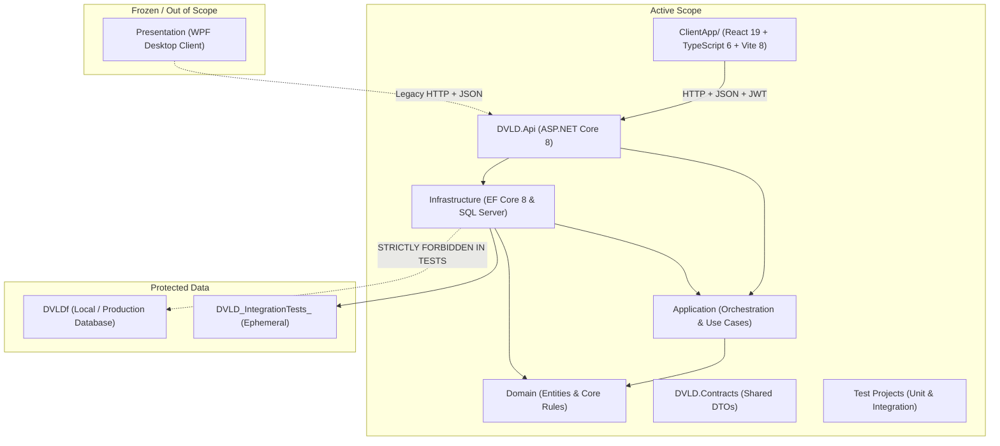

# AI Agent Engineering Governance — DVLD Repository

> **Authority Level:** Universal Mandatory Repository Governance  
> **Target Systems:** Google Antigravity, AI Coding Assistants, and Pair-Programming Agents  
> **Repository Root:** `D:\DVLD-WPF`  
> **Governance Status:** ACTIVE & ENFORCED  
> **Active Backend:** ASP.NET Core Web API (`DVLD.Api`)  
> **Active Frontend:** React SPA in `ClientApp/`  
> **WPF Scope:** Legacy / Frozen / Out of Scope  

---

## 1. Overview and Mission

This repository contains the **Driver & Vehicle Licensing Department (DVLD)** management system. The architecture comprises a .NET 8 Web API backend (`DVLD.Api`), enterprise persistence with SQL Server and Entity Framework Core 8 (`Infrastructure`), business use-case orchestration (`Application`), pure domain models (`Domain`), a shared contract boundary (`DVLD.Contracts`), automated test suites (`Test/`), a modern React 19 single-page application (`ClientApp/`), and a legacy WPF desktop client (`Presentation (WPF)/`).

All AI agents operating within this repository **must** strictly adhere to the operational constraints, protected boundaries, safety gates, and documentation standards defined across this governance suite.

---

## 2. Governance Document Suite

This document is the authoritative entry point. Detailed specifications are maintained in seven specialized governance documents:

| Document | Primary Focus & Authority |
|---|---|
| [`AI-ENGINEERING-INSTRUCTIONS.md`](./AI-ENGINEERING-INSTRUCTIONS.md) | Mandatory 10-step agent engineering workflow, approval gates, verification rules, and tool protocols. |
| [`TECHNOLOGY-STACK.md`](./TECHNOLOGY-STACK.md) | Verified inventory of languages, frameworks, libraries, versions, package manifests, and dependency gaps. |
| [`ENGINEERING-STANDARDS.md`](./ENGINEERING-STANDARDS.md) | Architectural layering, UnitOfWork, transaction management, SQL locking, Result pattern, and API design. |
| [`SECURITY-STANDARDS.md`](./SECURITY-STANDARDS.md) | JWT authentication, Segregation of Duties (SoD), role policies, rate limiting, and file upload protection. |
| [`TESTING-STANDARDS.md`](./TESTING-STANDARDS.md) | Test isolation, test database lifecycle (`DVLD_IntegrationTests_<GUID>`), parallel migration throttling, and CI publishing. |
| [`ENGINEERING-ROADMAP.md`](./ENGINEERING-ROADMAP.md) | Prioritized remediation backlog (P0, P1 provisional, P2, P3), evidence classifications, and action items. |
| [`ENGINEERING-DECISIONS.md`](./ENGINEERING-DECISIONS.md) | Architectural Decision Records (ADRs) covering accepted decisions, constraints, proposals, rejections, and open business items. |

---

## 3. Scope and Boundaries



### 3.1 Task Boundaries & Layered Dependency Rules
- **Layered Architecture Dependency Rules:**
  - `Domain` has no dependency on Application, Infrastructure, or API.
  - `Application` depends only on `Domain`.
  - `Infrastructure` depends on `Application` and `Domain` where required to implement application contracts and persistence behavior.
  - `DVLD.Api` depends on `Application` and `Infrastructure` as required by composition and dependency injection.
  - `Application` must **never** depend on `Infrastructure`.
- **Backend .NET Tasks:** Encompass `API/`, `Application/`, `Infrastructure/`, `Domain/`, `DVLD.Contracts/`, and `Test/`.
- **Frontend React Tasks:** Encompass `ClientApp/` only. Frontend-specific workflows are further governed by [`ClientApp/AGENTS.md`](./ClientApp/AGENTS.md).
- **Cross-Layer / Full-Stack Tasks:** Root governance overrides component rules in any conflict.
- **WPF Exclusion:** The WPF desktop client located in `Presentation (WPF)/` is **frozen** and explicitly **excluded** from this engineering modernization and remediation program. AI agents must not describe WPF as the primary active development target, nor refactor, audit, or modify WPF code unless explicitly instructed in writing by the user.

---

## 4. Mandatory Pre-Execution & Post-Execution Checks

Every AI agent invocation must execute the following non-negotiable Git safety checks:

1. **Initial Git Status Check:**
   Run `git status --short --untracked-files=all` immediately upon invocation. Record active branch, HEAD commit, and any pre-existing uncommitted changes.
2. **Protection of User Work:**
   Never revert, overwrite, stash, or destroy existing uncommitted changes in the working tree.
3. **Audit Document Preservation:**
   The Phase A discovery deliverables (`docs/audits/phase-a-repository-discovery.md` and `docs/audits/phase-a-supplementary-review.md`) remain untracked documentation assets. They must never be deleted, renamed, or modified during normal implementation tasks.
4. **Final Git Status Check:**
   Before completing a turn, run `git status --short --untracked-files=all` and inspect the git diff to verify that only authorized files were modified.

---

## 5. Absolute Prohibitions

1. **Zero Destructive Git Operations:**
   Never run `git reset`, `git checkout --`, `git restore`, `git clean`, `git stash drop`, `git branch -D`, or force-push commands.
2. **Zero Unapproved Commits:**
   Do not commit, stage, or push changes unless explicitly instructed in writing by the human engineer.
3. **No Database Modification on `DVLDf` & Strict Test DB Lifecycle:**
   The development/production database `DVLDf` is strictly protected:
   - **NEVER** drop, truncate, recreate, wipe, or overwrite `DVLDf`.
   - **NEVER** run integration tests against `DVLDf` or any developer-owned database.
   - **NEVER** apply schema migrations to `DVLDf` without separate explicit human approval and a verified backup.
   - **Test Database Lifecycle Safety:** Integration tests must strictly create dynamic test databases named `DVLD_IntegrationTests_<GUID>`. Before any automated deletion during teardown, the test runner must verify:
     1. The database name was generated by the current test execution.
     2. The database belongs to the isolated test connection (`DVLD_TEST_CONNECTION`).
     3. The target is not `DVLDf` or any developer-owned database.
     4. The deletion target is explicitly validated before execution.
     5. The test execution has sufficient evidence of ownership of the database it intends to delete.
     6. If ownership or target identity cannot be verified, teardown must fail safely without deleting the database.
   - **Administrative Connection vs. Test Database:** Clarify that connecting to `master` strictly as an administrative connection to create or drop an isolated test database is permitted where required; using `master` as the actual integration test database is strictly prohibited.
4. **No Speculative Architecture:**
   Do **not** introduce MediatR, CQRS, event sourcing, Redis, microservices, or external message buses without an approved ADR recorded in [`ENGINEERING-DECISIONS.md`](./ENGINEERING-DECISIONS.md).
5. **No Hallucinated Verification:**
   Never state or imply that a build, unit test, integration test, or migration succeeded unless the command was actually executed and the process exited with code 0.

---

## 6. Approval Gates for High-Impact Changes

Explicit human engineering approval is mandatory before executing any of the following:

- Modifying database schemas, table definitions, or creating EF Core migrations.
- Altering authorization policies (e.g., relaxing `StaffOnly` to `StaffOrAdmin`, changing Segregation of Duties).
- Deleting, removing, or breaking existing public API endpoints or changing public contract payloads (such as `POST /api/applications/{id}/complete`).
- Upgrading or adding new NuGet or npm dependencies.
- Modifying test database connection infrastructure or execution strategies.
- Transitioning between engineering roadmap phases.

---

## 7. Required High-Level Workflow

Agents must execute tasks using the structured 10-step protocol detailed in [`AI-ENGINEERING-INSTRUCTIONS.md`](./AI-ENGINEERING-INSTRUCTIONS.md):

```text
1. Understand User Request
2. Inspect Repository State & Context
3. Identify Root Cause with Static & Runtime Evidence
4. Define Smallest Safe Scope (Minimal-Change Principle)
5. Identify Cross-Layer Risks & Side Effects
6. Present Plan & Request Approval (if High-Impact)
7. Implement Only Authorized Changes
8. Execute Targeted Verification (Build & Test)
9. Verify Final Git Diff & Status
10. Deliver Evidence-Backed Summary & Remaining Unknowns
```

*For complete instructions on executing this workflow, consult [`AI-ENGINEERING-INSTRUCTIONS.md`](./AI-ENGINEERING-INSTRUCTIONS.md).*