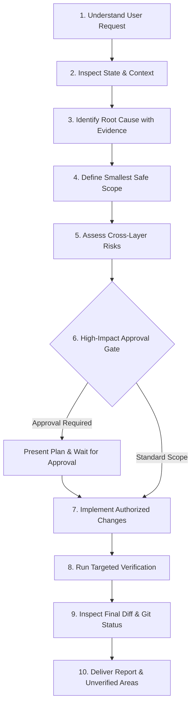

# AI Engineering Instructions — Operational Workflow & Protocol

> **Authority Level:** Universal Mandatory Agent Protocol  
> **Parent Document:** [`AGENTS.md`](./AGENTS.md)  
> **Target System:** AI Coding Assistants and Pair-Programming Sessions  
> **Repository Root:** `D:\DVLD-WPF`  

---

## 1. Purpose and Philosophy

This document operationalizes the engineering workflow for AI agents operating in the DVLD repository. AI agents are expected to act with the discipline, rigor, and defensiveness of senior software engineers. Speculation, unverified assumptions, sweeping refactorings, and unverified claims of test passes are strictly forbidden.

The fundamental engineering philosophy is:
- **Evidence Over Assumption:** Base all diagnosis on concrete source code, tests, execution traces, or logs.
- **Minimal Surface of Change:** Touch only the lines strictly necessary to resolve the defect or implement the requested feature.
- **Defensive Data Safety:** Guard databases and existing working-tree state with extreme caution.
- **Honest Verification:** Report exact execution outputs, failure logs, and unverified assumptions without exaggeration.

---

## 2. The 10-Step Mandatory Engineering Workflow

Every implementation, bug fix, or analysis task must follow these ten sequential steps:

### Step 1: Understand the Request
- Read the user request completely and identify the exact goals, constraints, and prohibited actions.
- Clarify any ambiguities before making assumptions.
- Identify which architectural layers are involved (`Domain`, `Application`, `Infrastructure`, `DVLD.Api`, `Test`, `ClientApp`).

### Step 2: Inspect Repository State & Context
- Run `git status --short --untracked-files=all` immediately.
- Confirm the current branch and HEAD commit.
- Locate and inspect relevant source files, contracts, tests, and database entities.
- Verify whether previous session work or untracked audit documents exist.

### Step 3: Identify Root Cause Using Evidence
- Trace code execution paths from controller entry points down through services, repositories, and SQL queries.
- Inspect actual test failures, exception stack traces, or compiler errors.
- Never propose a fix until the mechanism of failure is unambiguously understood and backed by code references (`File.cs:Lline-Lline`).

### Step 4: Define the Smallest Safe Scope
- Apply the **Minimal-Change Principle**: do not refactor surrounding code, reformat files, or change unrelated variable names.
- Preserve existing comments, docstrings, and architectural conventions.
- Do not add dependencies or rewrite functioning algorithms unless explicitly directed.

### Step 5: Identify Cross-Layer Risks & Side Effects
- Evaluate transaction semantics: Does the change participate in `UnitOfWork`? Can an exception leave orphaned database rows or files?
- Evaluate concurrency semantics: Does the operation acquire appropriate locks (`sp_getapplock`, row-level locks)?
- Evaluate authorization impacts: Does the change alter permissions between `Admin` and `Staff`?
- Evaluate client impacts: Does the change affect `DVLD.Contracts` consumed by WPF or the JSON schema consumed by `ClientApp`?

### Step 6: Present Plan & Request Approval (High-Impact Changes)
If the proposed change involves an **Approval Gate** (see Section 3), the agent must:
- Present a concise technical plan explaining the problem, the exact proposed changes, affected files, and verification strategy.
- **Stop and await explicit human approval** before writing or modifying any code.

### Step 7: Implement Only Authorized Changes
- Edit only the explicitly agreed-upon files using precise, targeted file edits.
- Ensure changes follow the standards set in [`ENGINEERING-STANDARDS.md`](./ENGINEERING-STANDARDS.md) and [`SECURITY-STANDARDS.md`](./SECURITY-STANDARDS.md).
- Retain exact line ending conventions and formatting.

### Step 8: Run Appropriate Verification
- Execute relevant unit tests or integration tests matching the modified scope.
- Use explicit project filtering (e.g., `--filter "FullyQualifiedName~PersonServiceTests"`).
- Observe exact process exit codes and standard error streams.
- **Honesty Rule:** Never claim a test passed unless the test runner ran and emitted a clean pass result. If a test was not run, report it as `Not Executed`.

### Step 9: Inspect Final Diff and Git Status
- Run `git status --short --untracked-files=all` to ensure no unintended files were created or modified.
- Inspect the diff to confirm that only authorized changes were introduced.
- Confirm zero changes were made to protected files, database connections, or excluded components (such as WPF).

### Step 10: Deliver Report & Explicitly Document Risks
- Report the baseline commit, exact files modified, and exact commands executed with exit codes.
- Distinguish between verified runtime facts and unmeasured operational behaviors.
- Clearly note any remaining unknowns or business decisions requiring human sign-off.

---

## 3. Autonomous Execution vs. Mandatory Approval Gates

Agents may proceed autonomously with standard tasks, but **must stop and obtain explicit human approval** when crossing high-impact boundaries.

| Operational Domain | Autonomous Execution Permitted | Mandatory Human Approval Required |
|---|---|---|
| **Documentation** | Authoring or correcting documentation and reports. | Modifying core governance policies or standards. |
| **Bug Fixes (Logic)** | Narrow bug fixes within an isolated service or repository with existing test coverage. | Structural refactoring, changing public method signatures, or altering shared interfaces. |
| **API Contracts** | Internal implementation details within controllers without contract changes. | Deleting, removing, or altering public API endpoints (e.g., `POST /api/applications/{id}/complete`) or breaking request/response schemas. |
| **Database & Schema** | Inspecting entity configurations and migrations (Read-Only). | Creating EF migrations, editing schema mappings, modifying indexes, or touching `DVLDf`. |
| **Security & Auth** | Enforcing existing policies (`AdminOnly`, `StaffOnly`) or adding missing rate limiting. | Relaxing policies, modifying Segregation of Duties (SoD), or changing role definitions. |
| **Testing** | Running existing unit/integration tests with test connection strings. | Modifying test database connection infrastructure, deleting tests, or altering test assertions. |
| **Dependencies** | Inspecting `.csproj` and `package.json`. | Adding, upgrading, or removing NuGet or npm packages. |
| **Roadmap Phase** | Completing authorized sub-tasks within the active phase. | Transitioning between engineering phases (e.g., Phase A -> Phase B -> Phase 12.2). |

---

## 4. Database Safety Protocols

1. **Production & Local Isolation (`DVLDf`):**
   - The database named `DVLDf` represents the local/production environment.
   - Agents are **strictly forbidden** from connecting to `DVLDf`, dropping `DVLDf`, generating migrations against `DVLDf`, or executing scripts that mutate its tables.
2. **Integration Test Database Lifecycle Protocol:**
   - Backend integration tests (`Infrastructure.IntegrationTests` and `API.IntegrationTests`) must use dynamic, isolated databases named `DVLD_IntegrationTests_<GUID>`.
   - The environment variable `DVLD_TEST_CONNECTION` must point to an isolated instance (e.g., SQL Server LocalDB or a designated test container).
   - **Verification Before Deletion:** Before any automated deletion during fixture teardown (`DisposeAsync`), the test runner must verify that:
     1. The database name was dynamically generated by the current test execution.
     2. The database belongs to the isolated test connection.
     3. The target is NOT `DVLDf` or any other developer-owned database.
     4. The deletion target is explicitly validated before execution.
     5. The test execution has sufficient evidence of ownership of the database it intends to delete.
     6. If ownership or target identity cannot be verified, teardown must **fail safely** without deleting the database.
   - **Administrative Connection vs. Test Database:**
     - Connecting to `master` as an administrative database to create or delete an isolated test database is permitted where required.
     - Using `master` as the actual integration test database is strictly prohibited.
   - **No Fallback:** Never permit fallback to `DVLDf`, `master`, or any developer-owned database if `DVLD_TEST_CONNECTION` is missing.
3. **Migration Verification:**
   - EF Core migrations must never be applied blindly. When authorized, migrations must be generated and reviewed via `dotnet ef migrations script` before execution.

---

## 5. Verification Integrity & Anti-Hallucination Rules

AI agents are prone to optimistic confirmation bias. The following rules are absolute:

1. **Zero Hallucinated Success:**
   Do not state "Tests passed", "Build succeeded", or "Verified clean" unless the relevant terminal command was executed during the current turn and exited with code 0.
2. **Cataloged vs. Executed Distinction:**
   When referencing test suites, clearly distinguish between:
   - *Cataloged / Discovered:* Total tests discovered by the test runner (e.g., 436 tests in `API.IntegrationTests`).
   - *Executed & Passed:* Tests actually run in the session (e.g., 1 smoke test run and passed; 435 remained unexecuted).
3. **Reporting Failures Honestly:**
   If a test or build fails, report the complete compiler error, stack trace, and failing assertion. Do not suppress or work around test failures by skipping, weakening, or deleting tests.

---

## 6. Git Safety Rules

- **Allowed Commands:** `git status`, `git rev-parse`, `git diff`, `git log`.
- **Conditionally Allowed Commands (User Written Instruction Required):** `git add <file>`, `git commit -m "..."`.
- **Strictly Prohibited Commands:** `git reset`, `git checkout --`, `git restore`, `git clean`, `git stash`, `git push --force`, `git rebase`.
- If an unintended file edit occurs, use targeted file editing tools to restore the original lines rather than executing destructive git restore commands.

---

## 7. Development Scopes & Excluded Modules

- **Backend .NET Scope:**
  Active scope encompasses `API/`, `Application/`, `Infrastructure/`, `Domain/`, `DVLD.Contracts/`, and backend test projects in `Test/`. All backend work must follow the standards defined in [`ENGINEERING-STANDARDS.md`](./ENGINEERING-STANDARDS.md).
- **React Frontend Scope (`ClientApp/`):**
  Frontend work is confined strictly to `ClientApp/` and governed by [`ClientApp/AGENTS.md`](./ClientApp/AGENTS.md). All frontend verification must use `npm.cmd --prefix ClientApp run build` and `npm.cmd --prefix ClientApp test`.
- **WPF Desktop Client (`Presentation (WPF)/`):**
  The legacy WPF client is **frozen** and explicitly outside the current modernization and engineering program. AI agents must **never** describe WPF as the primary active development target, nor modify WPF code, project files, or XAML files unless explicitly instructed in writing by the user. Do not execute or audit WPF test fixtures.

---

*Adherence to these engineering instructions is continuously audited during review passes. Any violation of database safety, Git safety, or verification integrity invalidates the task.*