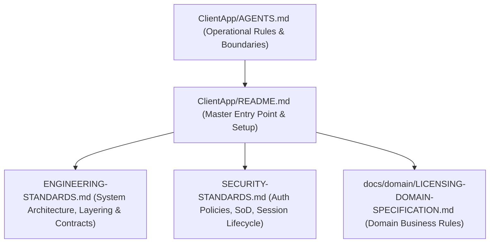

# AI Agent Engineering Instructions — DVLD ClientApp

> **Authority Level:** Mandatory Repository Instruction  
> **Target System:** Google Antigravity / AI Pair Programming Sessions  
> **Project Root:** `D:\DVLD-WPF\ClientApp`  
> **Governance Status:** ACTIVE & ENFORCED

---

## 1. Overview & Scope

This file governs all AI coding sessions operating within the `ClientApp` repository.

`ClientApp` is the browser-based single-page application for the Driver & Vehicle Licensing Department (DVLD) system. It connects to the `DVLD.Api` backend over HTTP + JSON + JWT at `http://localhost:5260/api`.

All AI agents operating in this codebase **must** adhere strictly to the protocols, documentation hierarchy, and protected boundaries defined in this document.

---

## 2. Authoritative Documentation Hierarchy

Before implementing changes or answering architectural questions, AI agents must consult documentation in the following order:



1. [`ClientApp/AGENTS.md`](./AGENTS.md) — Universal operational instructions, governance rules, and safety boundaries for frontend development (this document).
2. [`ClientApp/README.md`](./README.md) — Authoritative project entry point, technology stack, setup scripts, development workflows, and feature baseline summary.
3. [`ENGINEERING-STANDARDS.md`](../ENGINEERING-STANDARDS.md) — System architecture, Clean Architecture layers, API contracts, persistence, and concurrency rules.
4. [`SECURITY-STANDARDS.md`](../SECURITY-STANDARDS.md) — Authentication architecture, Segregation of Duties (SoD), role policies, and file upload validation.
5. [`docs/domain/LICENSING-DOMAIN-SPECIFICATION.md`](../docs/domain/LICENSING-DOMAIN-SPECIFICATION.md) — Authoritative domain business invariants and licensing workflow constraints.

---

## 3. Core Architecture & Standards

1. **Authentication Portal:**
   - Active production login is the **Simplified Light-Theme Portal** implemented in `src/components/Login.tsx` and `Login.css`.
   - The access token is held in memory by `authTokenStore.ts`; the refresh token is stored only in an HttpOnly cookie and is never readable from JavaScript. `localStorage` contains only the optional remembered username and the visual theme preference, never authentication tokens.
2. **Authenticated Application Shell:**
   - Root application coordinator in `src/App.tsx`.
   - Page routing and RBAC access guards in `src/components/AppRouter.tsx`.
   - Global keyboard command palette (Ctrl+K) in `src/components/common/CommandPalette.tsx`.
   - Navigation sidebar with role-filtered links in `src/components/Sidebar.tsx`.
   - Topbar with user profile dropdown and logout trigger in `src/components/Topbar.tsx`.
3. **Shared Design System (`src/components/common/` & `src/components/ui/`):**
   - Reusable enterprise UI components: `DataTable`, `TableToolbar`, `StatusBadge`, `StatCard`, `PageHero`, `ErrorAlert`, `EmptyState`, `ConfirmModal`, `ModalShell`.
   - Accessible primitives based on Radix UI (`@radix-ui/react-*`) and Tailwind CSS v4.
4. **TypeScript & Linter Standards:**
   - Target `ES2023`, `DOM`.
   - Strict module resolution with `verbatimModuleSyntax: true` — **always use `import type` for type-only imports**.
   - Path alias `@/*` maps to `./src/*`.
   - Strict compiler checks: `noUnusedLocals`, `noUnusedParameters`, `noFallthroughCasesInSwitch`.
5. **Data Fetching & Custom Hooks (`src/hooks/`):**
   - Centralize stateful data operations into dedicated hooks (`usePeople`, `useDashboardStatistics`, `useAsyncData`).
   - Abstract pagination and filtering via `usePagination`, `useTableFilters`, and `useDebounce`.
6. **HTTP Transport Client (`src/services/apiClient.ts`):**
   - Route all API calls through `apiRequest<T>()`. Never call `fetch()` directly inside UI components.
   - Automatically injects `Authorization: Bearer <token>` when authenticated.
   - Normalizes RFC 7807 `ProblemDetails` into strongly-typed `ApiError` instances for user-facing alert messages.
   - Automated 401 interception triggers session termination via `setUnauthorizedHandler()` and redirect to login with a friendly session-expired notice.

---

## 4. Mandatory Execution Rules

### 4.1 Scope Confinement
- Execute strictly within the scope requested by the user.
- Never perform unrequested redesigns, refactors, or dependency upgrades.
- Complete the requested deliverables, verify quality gates, and **STOP**.

### 4.2 Working Tree & Git Safety
- Always run `git status --short` before modifying any file.
- Preserve pre-existing uncommitted changes in the working tree.
- **Zero Destructive Git Commands:** Do **NOT** commit, push, create branches, stash, reset, or checkout away from the working branch unless explicitly instructed in writing by the user.

### 4.3 Technology & Dependency Discipline
- Inspect `package.json` directly. Never assume a package exists based on conversation history.
- Do not install, upgrade, or remove dependencies without explicit user authorization.
- Any dependency addition or removal must be evaluated and recorded in documentation.

### 4.4 Protected Application Boundaries
Unless explicitly authorized by the user, the following areas are **STRICTLY OFF-LIMITS**:
- Backend C# code (`API/`, `Core/`, `Infrastructure/`, `Application/`)
- Database schemas, migrations, and SQL procedures
- WPF desktop client (`Presentation (WPF)/`)
- Backend authorization policies and controller attributes
- Production authentication contracts (`POST /api/Auth/login`)

---

## 5. Technical Quality Gates

Every implementation or cleanup task must satisfy the following non-negotiable verification gates before concluding:

1. **TypeScript Build:**
   ```powershell
   npm.cmd --prefix ClientApp run build
   ```
   Must exit with code 0 (`tsc -b && vite build`).
2. **ESLint Verification:**
   ```powershell
   npm.cmd --prefix ClientApp run lint
   ```
   Must exit with code 0 (zero errors, zero warnings).
3. **Whitespace & Diff Verification:**
   ```powershell
   git diff --check
   ```
   Must report zero whitespace errors, trailing spaces, or conflict markers.
4. **Documentation Sync:**
   All documentation paths, commands, and feature descriptions must reflect the actual verified state of the codebase.
