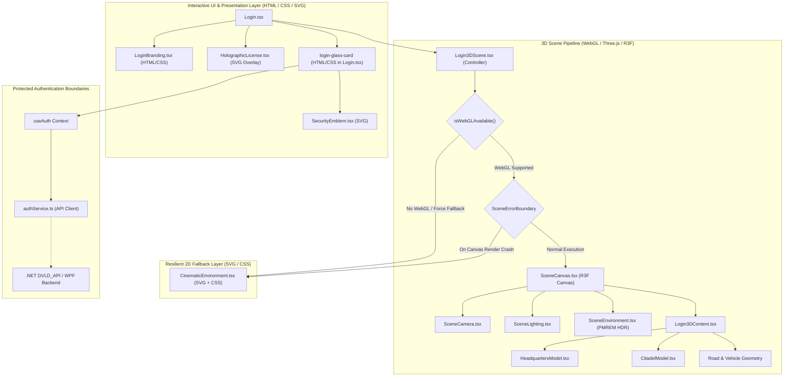

# DVLD Cinematic Login — System Architecture

> **Document ID:** `05-ARCHITECTURE`  
> **Status:** AUDITED & VERIFIED AGAINST SOURCE CODE  
> **Authoritative For:** Component Hierarchy, 3D Rendering Pipeline, Fallback Systems, and System Boundaries  
> **Audit Date:** 2026-10-31

---

## 1. High-Level Architecture Overview

The DVLD login experience is engineered as a decoupled, multi-tiered frontend presentation system with complete isolation between rendering visuals and authentication logic.

---

## 2. Component Responsibilities & Implementation Layers

### 2.1 UI Container & Auth Interface (`src/components/Login.tsx`)
- **Implementation Layer:** HTML / CSS (Styled with Tailwind CSS and CSS backdrop-filters).
- Owns the responsive login layout structure (`login-page`, `login-content-wrapper`, `login-left-column`, `login-card-container`).
- Renders the interactive glassmorphic login card with credentials inputs, "Remember me" persistence (`dvld_remembered_username`), submit handler, and error alert displays.
- The login card and form controls are standard DOM elements layered over the 3D canvas. They are **not** 3D WebGL meshes.
- Mounts `<Login3DScene />` at z-index 0 (`pointer-events-none`) to provide the animated cinematic backdrop.

### 2.2 3D Scene Controller (`src/components/login/scene/Login3DScene.tsx`)
- **Implementation Layer:** React component wrapping WebGL detection and error boundary.
- Executes synchronous capability check via `isWebGLAvailable()`.
- Provides a React `SceneErrorBoundary` wrapping `<SceneCanvas />`.
- If WebGL is unavailable or encounters a fatal crash during execution, catches the error and mounts `<CinematicEnvironment />` without disrupting user interaction or page execution.

### 2.3 R3F Canvas Container (`src/components/login/scene/SceneCanvas.tsx`)
- **Implementation Layer:** 3D WebGL Canvas (`@react-three/fiber`).
- Initializes `<Canvas>` with shadow maps enabled (`PCFSoftShadowMap`).
- Sets tone mapping to `ACESFilmicToneMapping` with balanced scene exposure (`0.95`).
- Clamps pixel ratio to `[1, 2]` to preserve GPU frame rate on high-density displays.

### 2.4 Lighting & Environment (`SceneLighting.tsx`, `SceneEnvironment.tsx`)
- **Implementation Layer:** Three.js / R3F scene lighting.
- **Radiosity:** Generates an algorithmic 6-face PMREM CubeTexture reproducing a midnight blue celestial dome with warm amber ground reflection.
- **Directional Sunlight:** Simulates high-angle cool blue moonlight (`#7dd3fc`, intensity 0.45).
- **Architectural Floodlights:** Three warm amber spotlights (`#f59e0b`, `#fbbf24`) targeting the entrance lobby and Roman Citadel columns.
- **Neon Accents:** Point lights simulating emissive cyan neon curb lighting.

### 2.5 3D Model Subsystem (`HeadquartersModel.tsx`, `CitadelModel.tsx`)
- **Implementation Layer:** Three.js binary GLTF 2.0 loader.
- Loads pre-compiled binary GLTF assets (`/models/headquarters/headquarters.glb` and `/models/citadel/citadel.glb`) via `@react-three/drei` `useGLTF`.
- Injects procedural PBR textures (normal maps, roughness variations) via Three.js material overrides.

### 2.6 Holographic Driver License (`HolographicLicense.tsx`)
- **Implementation Layer:** 2D SVG / CSS HUD component.
- Currently rendered as a 2D vector graphic with CSS glow filters positioned above the headquarters facade artwork in the HTML DOM.
- Migrating this component into an in-scene 3D WebGL mesh with dedicated shader materials is a `PROPOSED` enhancement for Phase 06/08.

---

## 3. Fallback Mechanism & Resilience

The application features a procedural SVG/CSS fallback environment (`CinematicEnvironment.tsx`):
- When WebGL context creation fails or an unhandled runtime error occurs inside the 3D canvas, `SceneErrorBoundary` intercepts the exception and mounts `CinematicEnvironment.tsx`.
- This ensures the login interface remains interactive and visually consistent with the nighttime theme, preventing unhandled runtime exceptions from crashing the authentication form.
- Acceptance criteria for fallback behavior are verified via simulated WebGL context loss tests.

---

## 4. Protected Boundaries

1. **Authentication Boundary:**
   - Communication between `Login.tsx` and the backend is mediated strictly by `authService.ts`.
   - The 3D scene has zero access to user credentials, passwords, or authentication state.
2. **Backend API Boundary:**
   - `DVLD_API` endpoints, database transactions, and JWT contracts are outside the scope of the frontend presentation layer.
3. **WPF Application Boundary:**
   - Desktop application files in `DVLD_Presentation` and shared C# business logic in `DVLD_Business` are completely decoupled from `ClientApp`.

---

## 5. Technical Debt & Planned Improvements

| Area | Verified Finding | Target Phase | Status |
|---|---|---|---|
| **Road & Vehicle 3D Mesh** | The foreground sedan and wet road currently use basic 3D procedural primitives in `Login3DContent.tsx`. | Phase 05 | `PLANNED` |
| **Signage Shaders** | Bilingual building signage requires dedicated emissive decal materials matching the reference Arabic and English typography. | Phase 04 / Phase 06 | `PLANNED` |
| **Holographic Driver License** | Currently rendered as a 2D SVG overlay (`HolographicLicense.tsx`). | Phase 06 / Phase 08 | `PROPOSED ENHANCEMENT` |
| **Asset Build Process** | GLB assets are generated via Node script `buildArchitecturalGLBs.js` rather than DCC export. | Phase 04 | `PLANNED` |
