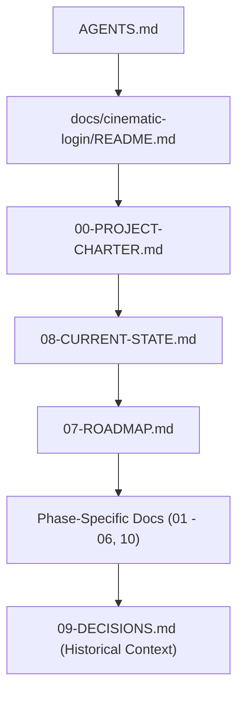

# DVLD Cinematic Login — Engineering Documentation Foundation

> **Documentation Root:** `ClientApp/docs/cinematic-login/`  
> **Status:** ACTIVE & FACTUALLY AUDITED  
> **Last Updated:** 2026-10-31 (Phase 00.1 Consistency Pass)

---

## 1. Purpose of This Documentation System

This documentation system serves as the single permanent source of engineering truth for the DVLD Cinematic Login experience.

Its objectives are:
- Maintain visual fidelity against the definitive cinematic login reference image.
- Preserve architectural continuity across multiple AI-assisted and human development sessions.
- Enforce strict engineering governance, technology discipline, and phase-gate validation.
- Protect application authentication, business logic, and backend boundaries from unintended modification.
- Record architectural decisions, asset provenance, and quality gates permanently in the codebase.

---

## 2. Rendering Architecture Overview

To maintain accurate technical descriptions across all documentation, the project distinguishes four distinct implementation layers:

1. **3D Scene Environment (WebGL / Three.js / React Three Fiber):**
   - Renders 3D architectural models (`HeadquartersModel.tsx`, `CitadelModel.tsx`), road ground plane, vehicle placeholder, and physical lighting.
2. **Interactive Authentication Interface (HTML / CSS):**
   - The glassmorphic login card, credentials inputs, Remember Me checkbox, and SSO buttons are HTML/CSS elements (`Login.tsx`, `Login.css`) styled with Tailwind and CSS backdrop filters, layered over the 3D canvas. They are **not** 3D WebGL meshes.
3. **Holographic Driving License Overlay (SVG / CSS):**
   - Currently implemented as a 2D vector HUD overlay (`HolographicLicense.tsx`) positioned above the headquarters facade. In-scene 3D projection is a proposed future enhancement (Phase 06/08).
4. **Resilient 2D Fallback Environment (SVG / CSS):**
   - Procedural SVG/CSS environment (`CinematicEnvironment.tsx`) mounted when WebGL context creation fails or when an unhandled 3D canvas error occurs.

---

## 3. Document Authority Matrix

Each subject area has a single authoritative document. In case of discrepancies, the authority hierarchy defined below governs:

| Subject Area | Authoritative Document | Description |
|---|---|---|
| **Agent Instructions & Rules** | [`../../AGENTS.md`](../../AGENTS.md) | Universal execution rules, Git safety, status categories, and conflict resolution |
| **Project Charter & Boundaries** | [`00-PROJECT-CHARTER.md`](./00-PROJECT-CHARTER.md) | Vision, mandatory non-negotiables, protected boundaries, Rules 1–5 |
| **Visual Requirements** | [`01-VISUAL-REFERENCE.md`](./01-VISUAL-REFERENCE.md) | 14 core visual elements, lighting, materials, and atmospheric targets |
| **Design Tokens & UI Specs** | [`02-DESIGN-SYSTEM.md`](./02-DESIGN-SYSTEM.md) | Color palettes, typography, spacing, glassmorphic tokens (Phase 01/02 analysis) |
| **Spatial Composition** | [`03-COMPOSITION-SPEC.md`](./03-COMPOSITION-SPEC.md) | Layer hierarchy, coordinates, bounding boxes, depth order, camera setup |
| **Tech Stack & Dependencies** | [`04-TECH-STACK.md`](./04-TECH-STACK.md) | Verified packages, versions, technology evaluation policy, ADR requirements |
| **System Architecture** | [`05-ARCHITECTURE.md`](./05-ARCHITECTURE.md) | Component hierarchy, 3D rendering pipeline, fallback mechanism, data flow |
| **Asset Registry & Provenance** | [`06-ASSET-REGISTER.md`](./06-ASSET-REGISTER.md) | GLB models, PBR textures, vector assets, file sizes, licenses, limitations |
| **Project Roadmap** | [`07-ROADMAP.md`](./07-ROADMAP.md) | 11-phase roadmap, lifecycle statuses, prerequisites, deliverables |
| **Living State & Continuity** | [`08-CURRENT-STATE.md`](./08-CURRENT-STATE.md) | Current phase status, modified files, technical facts, next authorized step |
| **Decision Records (ADR)** | [`09-DECISIONS.md`](./09-DECISIONS.md) | Architectural & design decisions, options evaluated, rationale |
| **Acceptance & Quality Gates** | [`10-QUALITY-GATES.md`](./10-QUALITY-GATES.md) | Visual, technical, functional, and phase-approval criteria |
| **Phase Prompt Template** | [`phases/PHASE-TEMPLATE.md`](./phases/PHASE-TEMPLATE.md) | Standardized template for authoring future AntiGravity phase prompts |

---

## 4. Standardized Status Terminology

All project documents adhere strictly to two separate status taxonomies:

### 4.1 Information & Decision Statuses
Used across specifications, asset registers, technical audits, and ADRs:
- `VERIFIED` — Confirmed by direct codebase or asset inspection.
- `APPROVED` — Explicitly approved in writing by the user.
- `PROPOSED` — Suggested design, architecture, or metric awaiting user review.
- `PENDING` — Awaiting a scheduled future phase or measurement.
- `UNKNOWN` — Information missing; requires verification without guessing.
- `BLOCKED` — Cannot proceed without a prerequisite decision or dependency.
- `DEFERRED` — Postponed intentionally to a later phase.

### 4.2 Phase Lifecycle Statuses
Used exclusively in roadmap tracking and phase execution:
- `PLANNED` — Defined in roadmap; not yet authorized for work.
- `IN PROGRESS` — Explicitly authorized by the user and actively underway.
- `TECHNICALLY VERIFIED` — Implemented, built, linted, and documented; awaiting user review.
- `VISUAL REVIEW` — Submitted with multi-resolution visual evidence for stakeholder inspection.
- `CHANGES REQUESTED` — User reviewed deliverables and requested targeted corrections.
- `APPROVED` — Explicitly approved in writing by the user; milestone sealed.

---

## 5. Mandatory Reading Order for AI Agents

Every AI session **must** read documents in this exact order before modifying any files:

1. [`../../AGENTS.md`](../../AGENTS.md)
2. [`README.md`](./README.md)
3. [`00-PROJECT-CHARTER.md`](./00-PROJECT-CHARTER.md)
4. [`08-CURRENT-STATE.md`](./08-CURRENT-STATE.md)
5. [`07-ROADMAP.md`](./07-ROADMAP.md)
6. Phase-specific specifications (`01` through `06`, and `10`)
7. [`09-DECISIONS.md`](./09-DECISIONS.md)

---

## 6. How to Determine Current Project Status

To know what is currently happening in the project:
1. Open [`08-CURRENT-STATE.md`](./08-CURRENT-STATE.md).
2. Check `Current phase`, `Phase status`, and `Last user-approved phase`.
3. Check `Next authorized action`. If the user prompt requests an action outside `Next authorized action`, trigger the Conflict Resolution protocol in `AGENTS.md`.

---

## 7. How to Execute a New Phase

1. **Verify Prerequisites:** Check [`07-ROADMAP.md`](./07-ROADMAP.md) to ensure all prerequisite phases are marked `APPROVED`.
2. **Review Scope & Constraints:** Read the authorized phase instructions and the corresponding entry in `07-ROADMAP.md`.
3. **Execute Strictly Within Scope:** Modify only files permitted by the phase scope. Never touch protected boundaries.
4. **Validate Baseline:** Run `npm.cmd --prefix ClientApp run build` and `npm.cmd --prefix ClientApp run lint`.
5. **Update Documentation:**
   - Update [`08-CURRENT-STATE.md`](./08-CURRENT-STATE.md) with work completed, modified files, and verified state.
   - Update [`07-ROADMAP.md`](./07-ROADMAP.md) updating the phase lifecycle state.
   - Update [`06-ASSET-REGISTER.md`](./06-ASSET-REGISTER.md) if assets were added or modified.
   - Update [`09-DECISIONS.md`](./09-DECISIONS.md) if architectural or design decisions were made.
6. **Deliver Report & Stop:** Provide the standardized phase report and wait for user approval.
