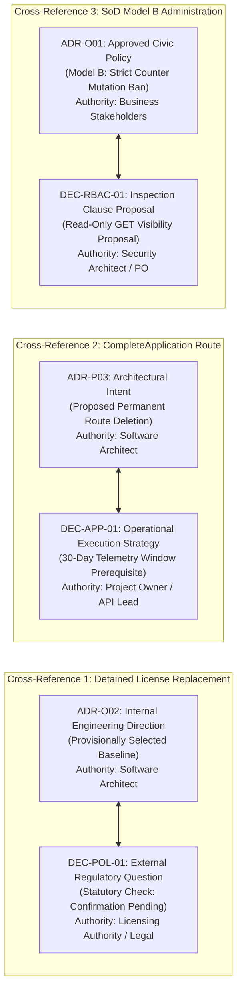

# Architecture Decision Records (ADR) & Policy Register

> **Authority Level:** Sole Authoritative Architectural, Technical & Security Decision Register  
> **Parent Document:** [`AGENTS.md`](./AGENTS.md)  
> **Repository Root:** `D:\DVLD-WPF`  
> **Baseline Commit:** `9b6d22f8728463f7b80c1341582016e1dda1972f`  
> **Governance Status:** CONSOLIDATED & ENFORCED (Phase 1)  

---

## 1. Decision Framework & Four Accounting Tiers

This register constitutes the sole authoritative catalog of all architectural, technical, operational, and security decisions governing the DVLD repository. All modifications to architecture, system boundaries, security controls, or domain invariants must be recorded herein.

To maintain strict historical and semantic integrity, the decision accounting is structured into four unambiguous tiers:

1. **Tier 1 — Historical Source Identifiers (Exactly 31 Identifiers):**
   - **15 Architecture Decision Records (ADR):** `ADR-001` through `ADR-005`, `ADR-C01`, `ADR-C02`, `ADR-P01` through `ADR-P03`, `ADR-R01` through `ADR-R03`, `ADR-O01`, and `ADR-O02`.
   - **16 Security Decisions (DEC):** `DEC-AUTH-01` through `DEC-AUTH-03`, `DEC-CRED-01`, `DEC-CRED-02`, `DEC-AUD-01`, `DEC-AUD-02`, `DEC-APP-01`, `DEC-RBAC-01`, `DEC-FILE-01`, `DEC-DEP-01`, `DEC-DEP-02`, `DEC-POL-01`, `DEC-POL-02`, `DEC-SEC05-01`, and `DEC-SEC05-02`.
   - *Sum:* $15 + 16 = \mathbf{31}$ original source identifiers.
2. **Tier 2 — Cross-Reference Relationships (3 Relationships):**
   - Three pairs of records address common domain problems across architectural and security/regulatory dimensions (`ADR-O02` $\leftrightarrow$ `DEC-POL-01`, `ADR-P03` $\leftrightarrow$ `DEC-APP-01`, `ADR-O01` $\leftrightarrow$ `DEC-RBAC-01`). They are linked by cross-references, not collapsed.
3. **Tier 3 — Canonical Decision Topics / Problem Groups (28 Topics):**
   - Grouping records by core platform problem space yields exactly **28 distinct decision topics** ($31 - 3 = 28$).
4. **Tier 4 — Independently Preserved Decision Records (Exactly 31 Records):**
   - All 31 historical records retain their independent identity, individual authority, specific lifecycle status, technical rationale, and implementation authorization boundary. **Zero records are deleted, collapsed, or discarded.**

### Explicit Lifecycle Statuses
- **ACCEPTED:** Actively implemented in code, validated by test suites, and enforced as active architecture.
- **CONSTRAINT:** Non-negotiable operational boundary, repository rule, or legacy freeze.
- **APPROVED POLICY:** Formally approved business or civic policy; does **not** grant implementation authorization.
- **PROPOSED:** Engineered technical recommendation submitted for evaluation; strictly **not authorized**.
- **REJECTED:** Demonstrably evaluated and rejected due to flawed premises or architectural anti-patterns.
- **PROVISIONALLY SELECTED:** Internal engineering baseline direction awaiting mandatory external legal/regulatory confirmation.
- **REGULATORY CONFIRMATION PENDING:** External statutory question awaiting formal sign-off from the Licensing Authority or Legal Counsel under Gate 3.
- **DEFERRED:** Formally excluded from initial release milestones and postponed to a future roadmap phase.
- **POLICY UNRESOLVED:** Multiple strategic alternatives submitted for Project Owner selection.

> [!NOTE]
> For comprehensive implementation stage mappings, open decision prerequisites, and subsystem maturity evaluations tied to these decision records, consult the standalone master plan [`docs/PROJECT-COMPLETION-MASTER-PLAN.md`](./docs/PROJECT-COMPLETION-MASTER-PLAN.md).

---

## 2. Master Decision Summary Matrix

| Record ID | Original Title & Scope | Governance Status | Designated Authority | Related Backlog / Package | Implementation Authorization |
|:---|:---|:---:|:---:|:---:|:---:|
| **`ADR-001`** | Layered Onion Architecture with UnitOfWork State Machine | **ACCEPTED** | System Architect | Core Architecture | Implemented / Active |
| **`ADR-002`** | Independent React SPA Client with Centralized Transport | **ACCEPTED** | System Architect | `ClientApp/` | Implemented / Active |
| **`ADR-003`** | JWT Bearer Token Authentication with Dynamic DB Revocation | **ACCEPTED** | Security Architect | `DVLD.Api`, `Program.cs` | Implemented / Active |
| **`ADR-004`** | Distributed Slot Mutual Exclusion via `sp_getapplock` | **ACCEPTED** | Database Architect | `Infrastructure` | Implemented / Active |
| **`ADR-005`** | Functional `Result<T>` Modeling over Domain Exceptions | **ACCEPTED** | Application Architect | `Application` Services | Implemented / Active |
| **`ADR-C01`** | Exclusion and Freeze of Legacy WPF Desktop Client | **CONSTRAINT** | Governance Authority | `Presentation (WPF)/` | Enforced / Frozen |
| **`ADR-C02`** | Isolation of Production Database (`DVLDf`) from Automated Testing | **CONSTRAINT** | Governance Authority | All Test Suites, CI | Enforced / Protected |
| **`ADR-P01`** | Separation of Non-Locking Reads from Update-Locking Queries (`PERF-02`) | **ACCEPTED** | Performance Architect | `PERF-02`, Phase 12.2 | Implemented / Active |
| **`ADR-P02`** | Standardized RFC 7807 ProblemDetails across All Endpoints (`REST-01`) | **ACCEPTED** | API Lead | `REST-01`, Phase 12.3 | Implemented / Active |
| **`ADR-P03`** | Deletion of Orphaned Direct Completion Endpoint (`INT-01`) | **ACCEPTED** | Software Architect | `INT-01`, Phase 12.2 | Implemented / Active |
| **`ADR-P04`** | Test-Host Database Isolation & Removal of the Startup Expiration Sweep (`TEST-03`) | **ACCEPTED** | System Architect | `TEST-03`, Test Infrastructure | Implemented / Active |
| **`ADR-006`** | Persisted Refresh-Token Sessions with Rotation, Reuse Detection & Security Stamps (`AUTH-01`) | **ACCEPTED** | Security Architect | `AUTH-01`, `DVLD.Api`, `ClientApp` | Implemented / Active |
| **`ADR-007`** | Cross-Process Serialization of Administrator Security-State Changes (`CONCURRENCY-01`) | **ACCEPTED** | Software Architect | `CONCURRENCY-01`, `UserService` | Implemented / Active |
| **`ADR-R01`** | Rejection of `Task.Run` for In-Process CPU Work (`PERF-03`) | **REJECTED** | Application Architect | `Application Services` | Rejected / Inactive |
| **`ADR-R02`** | Rejection of Multi-Tenant IDOR Claim on Citizen Photos (`SEC-02`) | **REJECTED** | Security Lead | `SEC-02`, `PeopleController` | Rejected / Inactive |
| **`ADR-R03`** | Rejection of Pagination on Tiny Static Reference Tables (`API-02`) | **REJECTED** | API Lead | `API-02`, Reference Data | Rejected / Inactive |
| **`ADR-O01`** | Retention vs. Relaxation of Segregation of Duties (`SEC-01`) | **APPROVED POLICY** | Business Stakeholders | `SEC-01`, Model B | **NOT AUTHORIZED** |
| **`ADR-O02`** | Detained License Replacement Policy (`INT-03`) | **PROVISIONALLY SELECTED** | Lead Architect | `INT-03`, Domestic Replace | **NOT AUTHORIZED** |
| **`DEC-AUTH-01`** | Target Stateless JWT Access Token Lifetime (15m vs 30m vs 60m) | **PROPOSAL (UNAPPROVED)** | Project Owner | `SEC-PKG-10`, `RSK-04` | **NOT AUTHORIZED** |
| **`DEC-AUTH-02`** | Server-Side Architecture for JWT Revocation (Stateless vs Cache vs DB) | **PROPOSAL (UNAPPROVED)** | Project Owner / Architect | `SEC-PKG-10`, Phase 12.2 | **NOT AUTHORIZED** |
| **`DEC-AUTH-03`** | Mandatory Multi-Factor Authentication (MFA / TOTP) for Admin Roles | **DEFERRED TO FUTURE PHASE** | Project Owner | `RSK-08`, Future Phase | **DEFERRED / UNAUTHORIZED** |
| **`DEC-CRED-01`** | Password Complexity Policy (NIST SP 800-63B vs Legacy Composition) | **PROPOSAL (UNAPPROVED)** | Project Owner | `SEC-PKG-09`, `RSK-07` | **NOT AUTHORIZED** |
| **`DEC-CRED-02`** | Account Lockout Strategy & Thresholds (Hard Lockout vs Exponential Delay) | **POLICY UNRESOLVED** | Project Owner | `SEC-PKG-11`, `RSK-05`, Gate 5 | **NOT AUTHORIZED** |
| **`DEC-AUD-01`** | Dedicated Security Audit Trail Storage Sink (Rolling JSON vs SQL Server) | **PROPOSAL (UNAPPROVED)** | Project Owner | `SEC-PKG-06`, `SEC-04` | **NOT AUTHORIZED** |
| **`DEC-AUD-02`** | Audit Sink Failure Handling & In-Memory Ring Buffer Architecture | **PROPOSAL (UNAPPROVED)** | Software Architect | `SEC-PKG-06`, `SEC-04` | **NOT AUTHORIZED** |
| **`DEC-APP-01`** | Deletion vs 30-Day Telemetry Window for `CompleteApplication` Endpoint | **ACCEPTED (OPTION 1)** | Project Owner / API Lead | `SEC-PKG-01`, `INT-01` | Implemented / Active |
| **`DEC-RBAC-01`** | Administrative Read-Only Inspection Access under SoD Model B | **PROPOSAL (UNAPPROVED)** | Project Owner | `SEC-PKG-05`, `SEC-01` | **NOT AUTHORIZED** |
| **`DEC-FILE-01`** | ImagePath Sanitization & Cross-User Deletion Defense Strategy | **PROPOSAL (UNAPPROVED)** | System Architect | `SEC-PKG-02`, `RSK-02` | **NOT AUTHORIZED** |
| **`DEC-DEP-01`** | Production Hosting Topology & Reverse Proxy CIDR Trust Configuration | **PROPOSAL (UNAPPROVED)** | DevOps / Infrastructure | `SEC-PKG-12`, `SEC-PKG-13` | **NOT AUTHORIZED** |
| **`DEC-DEP-02`** | Content-Security-Policy (CSP) Header Ownership (API vs SPA Host) | **PROPOSAL (UNAPPROVED)** | System Architect | `SEC-PKG-12`, `RSK-16` | **NOT AUTHORIZED** |
| **`DEC-POL-01`** | Statutory Ban on Detained License Replacement under Jordanian Traffic Law | **REGULATORY PENDING** | Licensing Authority / Legal | `SEC-PKG-15`, `INT-03`, Gate 3 | **BLOCKED ON LEGAL** |
| **`DEC-POL-02`** | Statutory Ban on International Permits for Detained Domestic Licenses | **REGULATORY PENDING** | Licensing Authority / Legal | `SEC-PKG-16`, `RSK-14`, Gate 3 | **BLOCKED ON LEGAL** |
| **`DEC-SEC05-01`**| Refresh Token Transport Mechanism (HttpOnly Cookie vs Hybrid Header) | **DEFERRED PROPOSAL** | Architect / Project Owner | `SEC-PKG-17`, `SEC-05` | **DEFERRED / UNAUTHORIZED** |
| **`DEC-SEC05-02`**| Token Invalidation Scope upon Reuse Detection (Subtree vs Family-wide) | **DEFERRED PROPOSAL** | Architect / Project Owner | `SEC-PKG-17`, `SEC-05` | **DEFERRED / UNAUTHORIZED** |

---

## 3. Detailed Cross-Reference Relationships

The three cross-reference relationships connect records that evaluate the same underlying domain or technical topic across architectural intent, operational execution, and statutory authority without collapsing their distinct governance properties:

### Relationship 1: `ADR-O02` $\longleftrightarrow$ `DEC-POL-01` (Detained License Replacement Policy)
- **Shared Subject:** Prevention of replacing actively detained driving licenses.
- **Preserved Distinction:**
  - `ADR-O02` records the **internal architectural consensus** selecting Option A (statutory ban on replacements) to guide domain model assumptions and service structure.
  - `DEC-POL-01` records the **external regulatory requirement** under Gate 3 confirming whether Jordanian Traffic Law permits administrative waivers or strictly bars replacements.
- **Enforcement Rule:** `ADR-O02` cannot be finalized and zero implementation code in `LicenseReplacementService.cs` may be authorized until `DEC-POL-01` receives formal written sign-off from the Licensing Authority and Legal Counsel.

### Relationship 2: `ADR-P03` $\longleftrightarrow$ `DEC-APP-01` (Direct Application Completion Route)
- **Shared Subject:** Elimination of the orphaned workflow bypass route `POST /api/applications/{id}/complete`.
- **Preserved Distinction:**
  - `ADR-P03` establishes the **architectural decision** to delete the route and remove the underlying `CompleteApplicationAsync` service method to prevent integrity corruption (`INT-01`).
  - `DEC-APP-01` establishes the **operational deployment strategy** requiring a 30-day telemetry observation window with deprecation headers before permanent route deletion to verify zero external consumers exist.
- **Enforcement Rule:** Hard route removal under `ADR-P03` is gated upon operational telemetry data verified under `DEC-APP-01`.

### Relationship 3: `ADR-O01` $\longleftrightarrow$ `DEC-RBAC-01` (Segregation of Duties Model B)
- **Shared Subject:** Administrative role boundaries relative to operational licensing counter actions.
- **Preserved Distinction:**
  - `ADR-O01` is the **binding civic policy record** approving Model B (retaining strict separation: `Staff` executes counter transactions, `Admin` manages users/system configuration, with no cross-role inheritance).
  - `DEC-RBAC-01` is an **unapproved operational proposal** evaluating whether administrators should receive read-only GET visibility on applications and licenses for audit purposes without mutation rights.
- **Enforcement Rule:** `ADR-O01` remains approved policy. `DEC-RBAC-01` remains an unapproved proposal. Counter mutation endpoints remain strictly `StaffOnly`.

---

## 4. Accepted Architecture Decisions

### ADR-001: Layered Onion Architecture with UnitOfWork State Machine
- **Status:** `ACCEPTED` (Implemented & Active)
- **Context:** DVLD coordinates legal licensing workflows involving citizens, appointments, examination results, fee collection, and driving credentials requiring coordinated persistence.
- **Decision:** Enforce Onion Architecture with explicit directional dependency rules:
  - `Domain` has zero external dependencies.
  - `Application` depends exclusively on `Domain`.
  - `Infrastructure` implements `Application` abstractions and maps persistence via EF Core 8.
  - `DVLD.Api` serves as composition root.
  - `Application` must **never** depend on `Infrastructure`.
  - Transactional persistence is encapsulated in repositories governed by a Scoped `UnitOfWork` with execution strategy retries and ambiguous commit detection.
- **Consequences:** Clear architectural layering. Persistence exceptions must be translated at repository boundaries into domain results.

### ADR-002: Independent React SPA Client with Centralized Transport
- **Status:** `ACCEPTED` (Implemented & Active)
- **Context:** Modern web access was required without coupling client presentation to the legacy desktop codebase.
- **Decision:** Construct an independent React 19 + TypeScript + Vite SPA (`ClientApp/`) communicating over HTTP + JSON + JWT. Route requests through centralized `apiClient.ts` with automatic 401 interception.
- **Consequences:** Clean separation of concerns. Backend API remains the sole validation authority.

### ADR-003: JWT Bearer Token Authentication with Dynamic DB Revocation
- **Status:** `ACCEPTED` (Implemented & Active)
- **Context:** Stateless JWT tokens cannot natively be revoked immediately upon user deactivation without distributed state.
- **Decision:** Implement `JwtBearerEvents.OnTokenValidated` in `Program.cs` to verify `IUserService.IsUserActiveAsync(userId)` in SQL Server on every authenticated request.
- **Consequences:** Provides immediate deactivation defense without requiring distributed cache infrastructure.

### ADR-004: Distributed Slot Mutual Exclusion via `sp_getapplock`
- **Status:** `ACCEPTED` (Implemented & Active)
- **Context:** Test appointment booking suffers concurrency race conditions on appointment slot capacities.
- **Decision:** Utilize SQL Server `sp_getapplock` with exclusive transaction locks on deterministic slot resource keys (`DVLD_Slot_{testTypeId}_{dateTime}`).
- **Required Invariants:** Consistent deterministic lock naming, `@LockOwner = 'Transaction'`, explicit acquisition return code checking (`>= 0`), and transaction lifetime alignment.

### ADR-005: Functional `Result<T>` Modeling over Domain Exceptions
- **Status:** `ACCEPTED` (Implemented & Active)
- **Context:** Using exceptions for business validation creates stack trace overhead and obscures contract outcomes.
- **Decision:** Use explicit `Result` and `Result<T>` return types for all application service workflows.
- **Consequences:** Predictable control flow. Controllers cleanly map failure results to standard HTTP error codes.

---

## 5. Architectural Constraints

### ADR-C01: Exclusion and Freeze of Legacy WPF Desktop Client
- **Status:** `CONSTRAINT` (Enforced & Frozen)
- **Context:** The repository contains a legacy desktop client in `Presentation (WPF)/`.
- **Constraint:** The WPF desktop application is **frozen** and explicitly excluded from active engineering, audits, refactoring, and test execution unless explicitly commissioned in writing by the Project Owner.

### ADR-C02: Isolation of Production Database (`DVLDf`) from Automated Testing
- **Status:** `CONSTRAINT` (Enforced & Protected)
- **Context:** The local/production development database is named `DVLDf`.
- **Constraint:** Automated test suites are **strictly prohibited** from connecting to, querying, migrating, dropping, or mutating `DVLDf`. All integration tests must target ephemeral databases named `DVLD_IntegrationTests_<GUID>` configured exclusively via `DVLD_TEST_CONNECTION`. Connecting to `master` strictly as an administrative connection to create/drop ephemeral test databases is permitted; using `master` as an integration test database is strictly prohibited.

---

## 6. Proposed Architecture Decisions (Pending Phase 12 Execution)

### ADR-P01: Separation of Non-Locking Reads from Update-Locking Queries (`PERF-02`)
- **Status:** `ACCEPTED` (Implemented & Verified in Phase 12.2)
- **Context:** `LicenseRepository.GetLicenseByIdAsync` hardcoded `WITH (UPDLOCK, HOLDLOCK)`, serializing read-only queries against concurrent readers.
- **Decision:** Refactor `GetLicenseByIdAsync` to execute ordinary shared reads. Introduce a dedicated `GetForUpdateAsync` method exclusively for state-modifying write workflows.
- **Consequences:** Eliminates reader-reader and reader-writer serialization. Update locks preserved exclusively in transactional write operations.

### ADR-P02: Standardized RFC 7807 ProblemDetails across All Endpoints (`REST-01`)
- **Status:** `ACCEPTED` (Implemented & Verified — 2026-11-09)
- **Context:** `AuthController` returned custom `{ error = "..." }` schemas and `GlobalExceptionHandler` returned standard `ProblemDetails`, so clients had to parse two incompatible failure shapes. Middleware-generated failures (401 challenge, 403 forbidden, unmatched-route 404, rate-limiter 429) had no body at all.
- **Decision:** Adopt RFC 7807 as the single failure envelope for every response path:
  - `ResultHttpMapper` is the only translator from `ErrorType` to HTTP status. Mapping is `Validation → 400` (`ValidationProblemDetails`), `Unauthorized → 401`, `Forbidden → 403`, `NotFound → 404`, `Conflict → 409`, `Failure/undefined → 500`.
  - `ErrorType.Unauthorized` is added for genuine authentication failures (login) and propagated by the existing `PropagateFailure` translators.
  - MVC model-binding failures use `ValidationProblemDetails` through `ApiBehaviorOptions.InvalidModelStateResponseFactory`.
  - Responses produced outside MVC are rendered by a `UseStatusCodePages` ProblemDetails writer.
  - `GlobalExceptionHandler` maps client cancellation to 499, malformed requests to 400, curated duplicate conflicts to 409, and everything else to a generic 500 that never echoes internals.
  - Every payload carries `status`, `title`, `detail`, `type`, `instance`, and a per-request `traceId`.
  - The React transport parses ProblemDetails into a typed `ApiError` (`status`, `title`, `detail`, `fieldErrors`, `traceId`).
- **Consequences:** One machine-readable error contract across controllers, middleware, and model binding. Internal exception text, SQL messages, and connection strings are never disclosed. Existing success contracts are unchanged.

### ADR-P03: Deletion of Orphaned Direct Completion Endpoint (`INT-01`)
- **Status:** `ACCEPTED` (Implemented & Verified in Phase 12.2)
- **Context:** `POST /api/applications/{id}/complete` allowed authenticated staff to complete applications directly, bypassing test and fee invariants.
- **Decision:** Permanently delete `POST /api/applications/{id}/complete` endpoint and underlying `CompleteApplicationAsync` service method per `DEC-APP-01` Option 1. Direct application completion is architecturally impossible; applications complete strictly via specialized domain issuance pipelines.
- **Consequences:** Eliminates critical integrity defect. Calling `POST /api/applications/{id}/complete` returns HTTP 404 Not Found.

### ADR-P04: Test-Host Database Isolation & Removal of the Startup Expiration Sweep (`TEST-03`)
- **Status:** `ACCEPTED` (Implemented & Verified — 2026-11-09)
- **Context:** `Program.cs` executed `ILicenseRepository.DeactivateExpiredLicensesAsync` before `app.Run()`. Because `WebApplicationFactory` executes the entry point up to `app.Run()`, every controller-test host performed that database write. `ApiWebApplicationFactory` replaced application services but never overrode `ConnectionStrings:DVLDConnection`, which resolves to `Server=.;Database=DVLDf` from `appsettings.json`. On a developer machine with that instance reachable, the test suite could mutate the protected application database.
- **Decision:**
  1. Remove the inline startup sweep. `LicenseExpirationBackgroundService` already performs its first sweep immediately at startup and then on its configured interval, so production processing is preserved without a write in the host-construction path.
  2. Add `Infrastructure.Configuration.SqlServerConnectionSafety`, a connection-free validator. When a host is a test host (environment `Testing` or `DVLD_TEST_HOST=1`), it rejects `DVLD`, `DVLDf`, and any catalog that is not `DVLD_IntegrationTests_(Api_)?<GUID>` before any `DbContext` is used.
  3. `ApiWebApplicationFactory` now pins an isolated, non-existent test catalog, injects a test-only JWT signing key, and installs a `DbConnectionInterceptor` that records connection attempts so "no database access" is asserted, not assumed.
- **Consequences:** Test hosts cannot reach the protected database. A misconfigured test host fails fast at startup with a diagnostic that names the rejected catalog but never echoes the connection string. Production and development hosts keep their legitimate configured target.

### ADR-006: Persisted Refresh-Token Sessions with Rotation, Reuse Detection & Security Stamps (`AUTH-01`)
- **Status:** `ACCEPTED` (Implemented & Verified — 2026-11-09)
- **Context:** The API issued a single 240-minute HS256 bearer token. There was no refresh token, no server-side revocation, and no invalidation on password change, role change, or deactivation beyond a per-request `IsActive` check. The SPA persisted the access token in `sessionStorage` (and read legacy `localStorage` keys). A stolen token remained valid for four hours and could not be revoked.
- **Decision:**
  1. The access token is a 15-minute HS256 JWT carrying `sub`, `name`, `role`, `FullName`, `PersonId`, `sst` (security stamp), and `jti`.
  2. Refresh tokens are 256-bit opaque values delivered only in an `HttpOnly`, `SameSite=Lax`, `Secure`-when-HTTPS cookie scoped to `/api/auth`. Only their SHA-256 hash is persisted.
  3. A `UserSessions` row represents one issued refresh generation. `TokenFamilyId` groups a login; `ReplacedBySessionId` records the rotation chain. Absolute expiry is 14 days and is never extended; idle expiry is 7 days.
  4. Every refresh consumes the current row through one conditional `UPDATE ... WHERE RevokedAtUtc IS NULL AND ExpiresAtUtc > now`; the database row lock guarantees exactly one winner across instances. A loser receives 409 and retries.
  5. Presenting a consumed token after a 30-second grace window revokes the entire family (theft response) and returns a generic 401. Inside the window, a still-active family returns 409 without revocation (legitimate multi-tab race).
  6. `User.SecurityStamp` is rotated on password change, role change, and activation change. `OnTokenValidated` compares the `sst` claim with the persisted stamp, so authorization changes take effect immediately.
  7. Logout revokes the current session; logout-all revokes every active session; password change revokes all sessions and issues a fresh session for the current device.
  8. CSRF is mitigated by `SameSite=Lax`, an explicit credential-enabled CORS origin, and a mandatory `X-CSRF-Protection: 1` header on cookie-authenticated endpoints.
- **Consequences:** Stolen access tokens expire in 15 minutes; refresh tokens are unusable if the database is leaked; sensitive user changes revoke access immediately; the SPA holds no tokens in web storage. Rotation/concurrency guarantees depend on SQL Server conditional-update semantics, which were not exercised against a database in this environment.

### ADR-007: Cross-Process Serialization of Administrator Security-State Changes (`CONCURRENCY-01`)
- **Status:** `ACCEPTED` (Implemented & Verified — 2026-11-09)
- **Context:** `UserService.UpdateUserAsync`/`DeleteUserAsync` counted active administrators and then saved outside any transaction or lock. Two concurrent demotions could both observe two active admins and both commit, leaving zero active administrators (system lockout).
- **Decision:** Serialize administrator security-state mutations with a SQL Server application lock (`sp_getapplock`, resource `DVLD_AdminMutation`, `Exclusive`, `Transaction` owner, 5 s timeout) acquired inside the mutation transaction. The authoritative `GetActiveAdminCountAsync` check runs after the lock is granted; the losing transaction returns a domain conflict (HTTP 409). The lock is database-scoped, so it holds across API processes.
- **Consequences:** The last-active-administrator invariant is enforced across processes without a schema change. Administrator demotions/deletions serialize on a single global lock, which is acceptable because these operations are rare. No other workflow is affected.

---

---

## 7. Rejected Architecture Recommendations

### ADR-R01: Rejection of `Task.Run` for In-Process CPU Work (`PERF-03`)
- **Status:** `REJECTED`
- **Proposal:** Wrap BCrypt hashing and SkiaSharp image resizing in `Task.Run()` to "offload work from request threads".
- **Rejection Rationale:** ASP.NET Core requests execute on ThreadPool threads. Calling `Task.Run()` queues another delegate to the same pool, incurring thread starvation and context switching overhead. CPU-bound work must run synchronously on the active request thread.

### ADR-R02: Rejection of Multi-Tenant IDOR Claim on Citizen Photos (`SEC-02`)
- **Status:** `REJECTED`
- **Proposal:** Treat photo retrieval without user-ownership checks as an Insecure Direct Object Reference (IDOR) vulnerability.
- **Rejection Rationale:** DVLD is an internal departmental portal where authenticated staff manage public citizen records. Citizens do not log in. Resource access is governed by staff role authorization and audit logging, not multi-tenant record ownership.

### ADR-R03: Rejection of Pagination on Tiny Static Reference Tables (`API-02`)
- **Status:** `REJECTED (INFORMATIONAL)`
- **Proposal:** Mandate pagination on static reference tables (`ApplicationTypes`, `TestTypes`, `Countries`).
- **Rejection Rationale:** Reference tables contain tiny, static datasets (7 application types, 3 test types, 195 countries). Paginating them introduces client overhead with zero performance benefit. Retain unpaged cached GET endpoints.

---

## 8. Business Decisions & Policy Records

### ADR-O01: Retention vs. Relaxation of Segregation of Duties (`SEC-01`)
- **Status:** `APPROVED POLICY` (Decision Date: 2026-11-08)
- **Context:** The API enforces `[Authorize(Policy = "StaffOnly")]` on operational counter endpoints (`Applications`, `Licenses`, `Detentions`). Administrators attempting counter transactions receive HTTP 403 Forbidden.
- **Policy Record:** Enforce **Model B — Explicit Permission Separation**:
  - `Admin` role does not inherit `Staff` operational permissions.
  - `Staff` role does not receive user management or system configuration permissions.
  - Operational counter transactions remain strictly restricted to `Staff`.
- **Implementation Authorization:** **NOT AUTHORIZED.** Modifying backend role policies or frontend navigation remains unauthorized until Phase 12.2 is approved.

### ADR-O02: Detained License Replacement Policy (`INT-03`)
- **Status:** `PROVISIONALLY SELECTED` (Provisional Baseline: 2026-11-08)
- **Context:** `LicenseReplacementService` currently issues replacements without checking whether a license is actively detained.
- **Provisional Business Rule (Option A):**
  1. A driving license with an active detention must not be replaced.
  2. The detention must first be resolved through the Release Detained License workflow.
  3. Once released, replacement may proceed if all other invariants are met.
  4. Historical detention and release records must remain preserved.
- **Implementation Authorization:** **NOT AUTHORIZED.** Cross-referenced to `DEC-POL-01`. Code changes remain strictly blocked pending written confirmation from the Licensing Authority.

---

## 9. Security Architecture & Policy Decisions

### DEC-AUTH-01: Target Stateless JWT Access Token Lifetime
- **Status:** `PROPOSAL (UNAPPROVED)` (**NOT AUTHORIZED**)
- **Domain:** Identity & Authentication (`RSK-04`, `SEC-PKG-10`)
- **Strategic Question:** What target access token lifetime should be configured for stateless JWTs prior to refresh token implementation?
- **Options Evaluated:** Option 1: 15 minutes; Option 2: 30 minutes; Option 3: 60 minutes.
- **Architectural Proposal:** Option 2 (30 minutes) is proposed for Project Owner evaluation to balance containment with usability during staff shifts. The 30-minute value is an **unapproved proposal**, NOT an approved setting.
- **Authority:** Project Owner (Gate 2).

### DEC-AUTH-02: Server-Side Architecture for JWT Token Revocation
- **Status:** `PROPOSAL (UNAPPROVED)` (**NOT AUTHORIZED**)
- **Domain:** Identity & Session Management (`SEC-PKG-10`, Phase 12.2)
- **Strategic Question:** What server-side architecture should be adopted for JWT token revocation?
- **Options Evaluated:** Option 1: Purely stateless (rely on short lifetime); Option 2: Distributed in-memory blocklist (Redis); Option 3: Dedicated database token tracking table.
- **Architectural Proposal:** Option 1 for initial milestone, transitioning to Option 2 or 3 under Phase 12.2.
- **Authority:** Project Owner / Architect.

### DEC-AUTH-03: Multi-Factor Authentication (MFA) for Administrative Roles
- **Status:** `DEFERRED TO FUTURE PHASE` (**NOT AUTHORIZED**)
- **Domain:** Identity & Access Governance (`RSK-08`)
- **Strategic Question:** Should Multi-Factor Authentication (MFA) be required for administrative roles?
- **Options Evaluated:** Option 1: Single-factor static passwords; Option 2: Mandatory TOTP (RFC 6238) for `Admin`; Option 3: Optional MFA for all staff.
- **Architectural Proposal:** Option 2 (Mandatory TOTP for Admin) deferred to a future security roadmap phase.
- **Authority:** Project Owner.

### DEC-CRED-01: Password Complexity Standard
- **Status:** `PROPOSAL (UNAPPROVED)` (**NOT AUTHORIZED**)
- **Domain:** Credentials & Authentication (`RSK-07`, `SEC-PKG-09`)
- **Strategic Question:** Which password complexity standard should be enforced by `UserValidator`?
- **Options Evaluated:** Option 1: Legacy composition rules (upper/lower/digit/special, min length 10); Option 2: Modern NIST SP 800-63B (min 12–16 chars, no composition rules, 10k breached password blocklist).
- **Architectural Proposal:** Option 2 (NIST SP 800-63B) proposed to eliminate predictable character mutations.
- **Authority:** Project Owner (Gate 2).

### DEC-CRED-02: Account Lockout Strategy & Thresholds
- **Status:** `POLICY UNRESOLVED` (**NOT AUTHORIZED**)
- **Domain:** Brute-Force Defense (`RSK-05`, `SEC-PKG-11`, Schema Gate 5)
- **Strategic Question:** What account lockout strategy and thresholds should be enforced against brute-force attacks?
- **Options Evaluated:** Option 1: Hard lockout after $N$ failures for $M$ minutes; Option 2: Progressive exponential delays (anti-DoS mitigation); Option 3: Hybrid model requiring administrative unlock.
- **Architectural Proposal:** Submitted for Project Owner selection. Exact threshold ($N$) and duration ($M$) remain open pending authorization.
- **Authority:** Project Owner (Gate 5).

### DEC-AUD-01: Dedicated Security Audit Trail Storage Sink
- **Status:** `PROPOSAL (UNAPPROVED)` (**NOT AUTHORIZED**)
- **Domain:** Forensics & Observability (`RSK-06`, `SEC-PKG-06`, `SEC-04`)
- **Strategic Question:** What storage sink should be utilized for the dedicated Security Audit Trail?
- **Options Evaluated:** Option 1: Isolated rolling JSON log files with OS ACLs; Option 2: Dedicated SQL Server `SecurityAuditLogs` table; Option 3: External SIEM / Syslog endpoint.
- **Architectural Proposal:** Option 1 (Rolling JSON) proposed for initial phase to avoid schema migrations, migrating to Option 2 or 3 for enterprise deployments.
- **Authority:** Project Owner (Gate 2).

### DEC-AUD-02: Security Audit Sink Failure Handling Policy & Ring Buffer Architecture
- **Status:** `PROPOSAL (UNAPPROVED)` (**NOT AUTHORIZED**)
- **Domain:** Forensics & Availability (`SEC-PKG-06`, `SEC-04`)
- **Strategic Question:** What failure handling policy should govern the system if the security audit sink is unavailable?
- **Options Evaluated:** Option 1: Fail-Closed (reject authentication/user operations if audit write fails); Option 2: Fail-Open with local in-memory fallback ring buffer.
- **Architectural Proposal:** Option 2 (Fail-Open with local ring buffer) proposed to prevent audit sink disk/network faults from causing departmental denial of service.
- **Authority:** Software Architect / Project Owner.

### DEC-APP-01: Application Completion Route Telemetry Window
- **Status:** `ACCEPTED (OPTION 1: IMMEDIATE ROUTE DELETION)` (Decision Date: 2026-11-09)
- **Domain:** Workflow Integrity (`INT-01`, `SEC-PKG-01`, `ADR-P03`)
- **Strategic Question:** Can `POST /api/applications/{id}/complete` be deleted immediately without breaking external integrations?
- **Options Evaluated:** Option 1: Immediate route deletion; Option 2: 30-day telemetry observation window with deprecation headers before removal; Option 3: Restrict route to `Admin`.
- **Selected Decision:** Option 1 (Immediate route deletion) selected by Project Owner on 2026-11-09. Business invariant enforcement and data integrity take precedence over preserving an unsafe legacy bypass route. Route and underlying standalone method removed in Phase 12.2 under `INT-01`.
- **Authority:** Project Owner.

### DEC-RBAC-01: Administrative Read-Only Inspection Access under Model B
- **Status:** `PROPOSAL (UNAPPROVED)` (**NOT AUTHORIZED**)
- **Domain:** Role-Based Access Control (`SEC-01`, `SEC-PKG-05`, `ADR-O01`)
- **Strategic Question:** Should an architectural proposal be prepared to formally amend ADR-O01 Model B to grant Administrators read-only inspection access to operational counter records?
- **Options Evaluated:** Option 1 (Approved Model B): Retain strict Segregation of Duties; counter records remain strictly `StaffOnly`; Option 2 (Future ADR Amendment): Formal review to evaluate amending Model B to permit read-only inspection (`StaffOrAdmin`) for Administrators.
- **Architectural Proposal:** Option 1 preserves approved ADR-O01 Model B governance baseline. Option 2 remains an open proposal requiring a dedicated ADR amendment.
- **Authority:** Project Owner.

### DEC-FILE-01: Citizen Image Ownership & Cross-User Deletion Defense
- **Status:** `PROPOSAL (UNAPPROVED)` (**NOT AUTHORIZED**)
- **Domain:** Storage & Input Sanitization (`RSK-02`, `SEC-PKG-02`)
- **Strategic Question:** What architecture should govern citizen image ownership and cross-user deletion defense?
- **Options Evaluated:** Option 1: Complete removal of `ImagePath` from DTOs; server generates GUIDs via dedicated multipart upload; Option 2: Retain DTO property, but enforce database-backed ownership verification in `PhysicalFileStorageService`.
- **Architectural Proposal:** Option 1 (Server-managed DTO sanitization) proposed to completely eliminate client-supplied path attack surface.
- **Authority:** Software Architect / Project Owner.

### DEC-DEP-01: Authoritative Production Hosting Topology & Reverse Proxy CIDRs
- **Status:** `PROPOSAL (UNAPPROVED)` (**NOT AUTHORIZED**)
- **Domain:** Infrastructure & Operations (`RSK-16`, `SEC-PKG-12`, `SEC-PKG-13`)
- **Strategic Question:** What is the authoritative production hosting topology and reverse proxy configuration?
- **Options Evaluated:** Option 1: Direct Kestrel on host; Option 2: Reverse proxy behind Nginx/Envoy on Linux container; Option 3: IIS / YARP on Windows Server.
- **Architectural Proposal:** Document required CIDRs and environment bindings for Option 2 or Option 3.
- **Authority:** DevOps / Infrastructure Lead.

### DEC-DEP-02: Content Security Policy (CSP) Header Ownership
- **Status:** `PROPOSAL (UNAPPROVED)` (**NOT AUTHORIZED**)
- **Domain:** Transport Security (`RSK-16`, `SEC-PKG-12`)
- **Strategic Question:** Which tier owns Content Security Policy (CSP) and frontend HTTP response headers?
- **Options Evaluated:** Option 1: API middleware serves CSP for all responses; Option 2: Reverse proxy or CDN hosting the React SPA serves CSP; API serves pure data headers.
- **Architectural Proposal:** Option 2 (SPA Host ownership), as `DVLD.Api` serves strictly JSON payloads.
- **Authority:** System Architect / DevOps.

### DEC-POL-01: Statutory Prohibition of Detained License Replacement
- **Status:** `REGULATORY CONFIRMATION PENDING` (**BLOCKED ON LEGAL**)
- **Domain:** Civic Licensing Policy (`RSK-13`, `SEC-PKG-15`, `INT-03`, Gate 3)
- **Strategic Question:** Does official Jordanian licensing regulation prohibit issuing replacements for actively detained licenses?
- **Options Evaluated:** Option 1: Absolute statutory ban (ADR-O02 Option A); Option 2: Replacement permitted under judicial waiver or administrative authorization.
- **Architectural Proposal:** ADR-O02 Option A provisionally selected; requires official licensing authority verification.
- **Authority:** Licensing Authority / Legal Counsel.

### DEC-POL-02: Statutory Domestic Detention Verification for International Permits
- **Status:** `REGULATORY CONFIRMATION PENDING` (**BLOCKED ON LEGAL**)
- **Domain:** Civic Licensing Policy (`RSK-14`, `SEC-PKG-16`, Gate 3)
- **Strategic Question:** Does official licensing regulation bar issuing international driving permits to drivers with detained domestic licenses?
- **Options Evaluated:** Option 1: Mandatory verification and block if domestic license is detained; Option 2: Permitted if domestic physical credential is presented regardless of system detention state.
- **Architectural Proposal:** Option 1 (Mandatory block) aligns with international convention intent; requires formal regulatory confirmation. Distinct from `INT-03`.
- **Authority:** Licensing Authority / Legal Counsel.

### DEC-SEC05-01: Refresh Token Transport Mechanism
- **Status:** `DEFERRED / STRICTLY UNAUTHORIZED`
- **Domain:** Session Modernization (`SEC-05`, `SEC-PKG-17`, Phase 12.2 Modernization Track)
- **Strategic Question:** Which transport mechanism should be implemented for refresh tokens in SEC-05 / Phase 12.2?
- **Options Evaluated:** Option A: `HttpOnly`, `Secure`, `SameSite=Strict` cookies; Option B: Authorization Bearer header in request body; Option C: Hybrid (in-memory access token + cookie-based refresh token).
- **Architectural Proposal:** Option C (Hybrid) isolates refresh tokens from client scripts while allowing stateless API execution.
- **Authority:** Architect / Project Owner.

### DEC-SEC05-02: Token Invalidation Scope upon Reuse Detection
- **Status:** `DEFERRED / STRICTLY UNAUTHORIZED`
- **Domain:** Session Modernization (`SEC-05`, `SEC-PKG-17`, Phase 12.2 Modernization Track)
- **Strategic Question:** What is the invalidation scope upon detecting refresh token reuse?
- **Options Evaluated:** Option 1: Invalidate only the compromised token sub-tree; Option 2: Invalidate entire token family across all sessions for the affected user account.
- **Architectural Proposal:** Option 2 (Family-wide invalidation) provides maximum breach containment.
- **Authority:** Architect / Project Owner.

---

## 10. Mandatory Governance & Risk Acceptance Boundaries

1. **`RSK-11` (Plaintext PII Exposure in Citizen & User DTOs):**
   - **Risk Description:** `PersonResponse` and `UserDetailsResponse` return unmasked national IDs, birth dates, home addresses, phone numbers, and personal details to all authenticated staff without field-level masking.
   - **Required Risk Owner Role:** Project Owner / Data Protection Officer (DPO).
   - **Risk Owner Assignment Status:** **PENDING** (No individual appointed).
   - **Formal Risk Acceptance Status:** **NOT GRANTED**. Formal risk acceptance has not been authorized or executed.
   - **Production Eligibility Gate:** The DVLD platform is **strictly ineligible for production release** until documented formal risk acceptance is executed under Gate 8 by the authorized Risk Owner. Documenting `RSK-11` in a register does not satisfy or accept the risk.
2. **Schema Gate 5 (`Users` Table Lockout Columns):**
   - Adding `AccessFailedCount`, `LockoutEnd`, and `LockoutEnabled` requires separate human DBA/schema approval. Zero database schema modifications or migrations are authorized.
3. **Segregation of Duties Enforcement (`ADR-O01` / `SEC-01`):**
   - Model B is an approved policy record. Code changes in backend controllers or frontend navigation guards remain strictly unauthorized.
4. **Detained License Replacement Preconditions (`ADR-O02` / `DEC-POL-01`):**
   - Option A is provisionally selected for internal architecture. Code changes in `LicenseReplacementService.cs` remain strictly blocked on written confirmation from the Licensing Authority.
5. **International Permit Domestic Detention Preconditions (`DEC-POL-02`):**
   - Regulatory confirmation remains pending. Code changes in `InternationalService.cs` remain strictly blocked on written confirmation from the Licensing Authority. Distinct from `INT-03`.
6. **Session Modernization Track (`SEC-05`, `FE-01`, `TEST-02`, `SEC-PKG-17`):**
   - All session modernization work items remain deferred and strictly unauthorized.
7. **Canonical Risk Register Mapping:**
   - Active decisions reference risks by their unified two-digit identifiers (`RSK-01` through `RSK-20`), where foundational Phase A empirical findings (`RSK-S01`–`RSK-S13`) are remapped (`RSK-S08` maps to `RSK-03` Timing Side-Channel, `RSK-08` is exclusively Multi-Factor Authentication under `DEC-AUTH-03`, `RSK-05` governs Account Lockout / DoS under `DEC-CRED-02` / Schema Gate 5, and `RSK-11` governs Plaintext PII Exposure under Gate 8). The complete authoritative mapping ledger is maintained in [`SECURITY-STANDARDS.md`](./SECURITY-STANDARDS.md) §7.
8. **System Architecture Style & Transactional Consistency Baseline:**
   - The architectural baseline is confirmed as an enterprise **Modular Monolith** (`ADR-001`, `ADR-R03`). As a centralized single-database application, the CAP theorem does not apply as a blanket architectural label; rather, the core requirement is that all critical licensing, examination, and fee workflows must preserve **strong transactional consistency (ACID)**. If a distributed partition or external dependency failure prevents guaranteeing a business invariant, the operation must fail safely rather than commit inconsistent state. Microservices, distributed sagas, eventual consistency, and premature distributed infrastructure are rejected. The complete evaluation of the 17 system design concepts and horizontal readiness standards is maintained in [`ENGINEERING-STANDARDS.md`](./ENGINEERING-STANDARDS.md) §13.
9. **Product Scope Decision — Single Organization Architecture (Rejection of Multi-Tenancy):**
   - **Status:** `ACCEPTED ARCHITECTURAL DECISION` (Decision Date: 2026-11-08)
   - **Authority:** Project Owner
   - **Decision:** The DVLD platform is formally designated and designed as an enterprise production management system for a **single organization** (the civic licensing authority). It is explicitly **not** a multi-tenant SaaS platform.
   - **Enforced Boundaries:**
     1. Centralized relational SQL Server database serving all authorized departmental branches.
     2. Multiple authorized users, operational counters, and role-based policies (`Staff`, `Admin`).
     3. Zero tenant IDs, zero tenant isolation columns or filters, and zero tenant-partitioned infrastructure.
     4. Speculative multi-tenant abstractions (e.g., tenant context middleware, dynamic schema switching, tenant resolvers) are strictly prohibited.
