# Engineering Remediation Roadmap & Backlog

> **Authority Level:** Authoritative Engineering Prioritization & Backlog  
> **Parent Document:** [`AGENTS.md`](./AGENTS.md)  
> **Repository Root:** `D:\DVLD-WPF`  
> **Governance Phase:** Phase B (Setup Complete — Remediation Execution Not Yet Authorized)  

---

## 1. Roadmap Architecture & Execution Principles

This roadmap formalizes the remediation items discovered and verified during Phase A (`phase-a-repository-discovery.md`) and Phase A.1 (`phase-a-supplementary-review.md`).

### 1.1 Core Roadmap Rules
1. **Prioritization Framework:** Items are grouped strictly into P0 (Critical Integrity), P1 (Provisional Engineering Priority), P2 (Reliability, Observability & Business Policies), and P3 (Quality & Architecture Cleanup).
2. **P1 Engineering Prioritization Clarification:** P1 represents a provisional engineering prioritization based on static code analysis, NOT a measured production severity classification. Actual production latency degradation, deadlock frequency, and throughput impact remain unmeasured until profiled.
3. **Phase B Implementation Boundary:** Phase B authorizes only the creation of governance documentation. **Zero items on this roadmap may be implemented during Phase B.** Implementation begins only upon subsequent authorized phases.
4. **Status Lifecycle:** Items use explicit statuses: `Confirmed`, `Proposed`, `Needs Business Approval`, `Needs Runtime Validation`, `Planned`, and `Completed`. No item is marked `Completed` until implemented and verified in code.

---

## 2. Remediation Priority Hierarchy

```mermaid
graph TD
    P0["P0: Critical Integrity Fixes"] --> INT01["INT-01: Remove Direct Complete Endpoint"]
    
    P1["P1: Provisional Priority (Performance & Concurrency)"] --> PERF01["PERF-01: Fix Sequential N+1 in LicenseQueryService"]
    P1 --> PERF02["PERF-02: Separate UPDLOCK from Read Queries"]
    P1 --> INT02["INT-02: Catch DbUpdateException in UserService"]
    
    P2["P2: Reliability, Observability & Policy Decisions"] --> INT03["INT-03: Decide Detained License Replacement Policy"]
    P2 --> TEST01["TEST-01: Validate Throttling on Test Fixture"]
    P2 --> API01["API-01: Propagate CancellationToken"]
    P2 --> OBS01["OBS-01: Add Health & Readiness Endpoints"]
    P2 --> SEC01["SEC-01: Decide Segregation of Duties Policy"]
    P2 --> REST01["REST-01: Standardize RFC 7807 ProblemDetails"]
    
    P3["P3: Architecture & Quality Cleanup"] --> SEC03["SEC-03: Add Rate Limiting to Password Change"]
    P3 --> ARCH01["ARCH-01: Consolidate Duplicate Contracts DTOs"]
    P3 --> OBS02["OBS-02: Publish Test Attachments in CI"]
```

---

## 3. Detailed Remediation Backlog

### 3.1 P0: Critical Integrity Defects

#### [INT-01] Direct Application Completion Endpoint Removal
- **Finding ID:** `INT-01`
- **Evidence Classification:** `CONFIRMED`
- **Priority:** `P0 (Critical)`
- **Affected Components:** `API/DVLD.Api/Controllers/ApplicationsController.cs` (lines 85–90), `Application/Services/ApplicationService.cs` (`CompleteApplicationAsync`).
- **Description:** `POST /api/applications/{id}/complete` directly updates an application's status to `Completed` (`EnApplicationStatus.Completed`) without validating test pass prerequisites or creating downstream license records. This corrupts applicant records and locks them out of ever receiving a license.
- **Proposed Action:** Propose deleting the `CompleteApplicationAsync` endpoint from `ApplicationsController` and removing the underlying method from `IApplicationService` and `ApplicationService`.
- **Dependencies / Mandatory Approvals:** **Explicit Human Engineering Approval Required.** Removing or changing a public API endpoint represents a potentially breaking API contract change. Explicit approval is required before removing the endpoint, altering its public contract, or removing its associated service method.
- **Verification Requirements:** `dotnet build`, execute API integration tests verifying endpoint returns 404.
- **Status:** `Confirmed / Planned`

---

### 3.2 P1: Provisional Engineering Priority (Performance & Concurrency)

#### [PERF-01] Sequential N+1 in LicenseQueryService
- **Finding ID:** `PERF-01`
- **Evidence Classification:** `CONFIRMED`
- **Priority:** `P1 (Provisional Engineering Priority)`
- **Affected Components:** `Application/Services/LicenseQueryService.cs` (lines 237–252).
- **Description:** For paged license listings, the service loops through each item sequentially, executing an individual database query (`GetNewerLicenseForDriverAndClassAsync`) for each row. On a page of 50 items, this generates 51 database round-trips.
- **Proposed Action:** Replace sequential loop with a single batch projection query retrieving newer license statuses in one SQL query.
- **Dependencies / Approvals:** Architecture review of DTO projection.
- **Verification Requirements:** Unit tests in `Application.UnitTests` asserting single batch retrieval and correct mapping.
- **Status:** `Confirmed / Planned`

#### [PERF-02] Pessimistic Lock on Read-Only License Queries
- **Finding ID:** `PERF-02`
- **Evidence Classification:** `CONFIRMED (Locking Behavior); Unmeasured Production Impact`
- **Priority:** `P1 (Provisional Engineering Priority)`
- **Affected Components:** `Infrastructure/Repositories/LicenseRepository.cs` (lines 28–41).
- **Description:** `GetLicenseByIdAsync` hardcodes raw SQL `WITH (UPDLOCK, HOLDLOCK)`. Because `U` locks are mutually incompatible, concurrent read-only requests (`GET /api/licenses/{id}`) serialize against each other and serialize behind active update transactions.
- **Proposed Action:** Refactor `GetLicenseByIdAsync` to execute an ordinary, non-locking shared read. Introduce a separate, explicit method `GetForUpdateAsync()` exclusively for mutating workflows (`LicenseRenewalService`, `LicenseReplacementService`).
- **Dependencies / Approvals:** Audit all callers to ensure update workflows invoke `GetForUpdateAsync()`.
- **Verification Requirements:** Infrastructure integration tests verifying concurrent reads do not block.
- **Status:** `Confirmed / Planned`

#### [INT-02] Unhandled Exception on Concurrent User Creation (Persistence Boundary)
- **Finding ID:** `INT-02`
- **Evidence Classification:** `CONFIRMED`
- **Priority:** `P1 (Provisional Engineering Priority)`
- **Affected Components:** `Application/Services/UserService.cs`, `Infrastructure/Repositories/UserRepository.cs`.
- **Description:** When creating a user with a duplicate `UserName` or `PersonID`, unique database indexes cause persistence to fail. The exception escapes unhandled, triggering `GlobalExceptionHandler` and returning HTTP 500 instead of a client conflict error.
- **Proposed Architectural Remediation Direction:** Preserve strict architectural layering. Do **not** couple `Application` to `Microsoft.EntityFrameworkCore` merely to catch `DbUpdateException`. Instead, translate persistence constraint violations at the `Infrastructure` repository/UnitOfWork boundary into application-level failure results (`Result<UserDto>.Failure("Username or Person is already assigned to a user.")`), allowing the API layer to map the outcome to HTTP 409 Conflict. The specific design pattern remains subject to approval during Phase 12.
- **Dependencies / Approvals:** Architectural review of error translation pattern.
- **Verification Requirements:** Unit and integration tests asserting failure Result and HTTP 409 status on duplicate creation.
- **Status:** `Confirmed / Planned`

---

### 3.3 P2: Reliability, Observability & Business Decisions

#### [INT-03] Detained License Replacement Validation
- **Finding ID:** `INT-03`
- **Evidence Classification:** `TECHNICAL GAP CONFIRMED — BUSINESS RULE REQUIRES APPROVAL`
- **Priority:** `P2`
- **Affected Components:** `Application/Services/LicenseReplacementService.cs` (lines 76–120).
- **Description:** Code currently allows issuing a replacement for a license that is actively detained.
- **Distinction of Evidence:**
  - *Observed Implementation:* `LicenseReplacementService` does not perform a detention check.
  - *Potential Business Gap:* A detained license could be replaced without clearance.
  - *Unverified Regulatory Status:* Whether replacing a detained license is prohibited by law or department policy is not documented in existing requirements and cannot be assumed.
  - *Human Decision Prerequisite:* Mandatory business stakeholder sign-off is required before any code changes are introduced (`ADR-O02`).
- **Proposed Action (If Approved):** Inject `IDetainedLicenseRepository` into `LicenseReplacementService` and return `Result.Failure("Cannot replace a detained license.")`.
- **Dependencies / Approvals:** **Mandatory Business Decision Required (`ADR-O02`).**
- **Verification Requirements:** Unit and integration tests covering detained license replacement attempts.
- **Status:** `Needs Business Approval`

#### [TEST-01] Throttled Integration Test Migrations
- **Finding ID:** `TEST-01`
- **Evidence Classification:** `Proposed Remediation — Needs Runtime Validation`
- **Priority:** `P2`
- **Affected Components:** `Test/Infrastructure.IntegrationTests/SqlServerTestDatabase.cs` (lines 40–48).
- **Description:** During Phase 12.1 execution, 1 test out of 612 in `Infrastructure.IntegrationTests` failed with an SSL pre-login handshake timeout. Parallel xUnit test classes simultaneously invoking `MigrateAsync()` against LocalDB is a plausible contributing factor, but not a proven exclusive root cause.
- **Proposed Mitigation (Not Established Architecture):** Propose throttling database creation and schema migrations in `SqlServerTestDatabase.cs` using `SemaphoreSlim(2, 2)`.
- **Architectural Scope & Limitations:** An in-process static semaphore coordinates only threads within a single process. It does not coordinate separate test runner processes, out-of-process CLI executions, or multiple CI agents.
- **Runtime Validation Prerequisite:** Do not claim throttling prevents all SSL timeouts. Throttling requires runtime validation across multiple consecutive test runs.
- **Dependencies / Approvals:** None.
- **Verification Requirements:** Execute full suite across repeated runs to assess timeout mitigation.
- **Status:** `Needs Runtime Validation`

#### [API-01] Propagate CancellationToken Across Endpoints
- **Finding ID:** `API-01`
- **Evidence Classification:** `CONFIRMED`
- **Priority:** `P2`
- **Affected Components:** `API/DVLD.Api/Controllers/`, `Application/Services/`, `Infrastructure/Repositories/`.
- **Description:** Controller endpoints and repository queries omit `CancellationToken`, allowing queries to run to completion even after clients disconnect.
- **Proposed Action:** Add `CancellationToken cancellationToken = default` parameter to controllers, passing `HttpContext.RequestAborted` down through services to EF Core queries.
- **Dependencies / Approvals:** None.
- **Verification Requirements:** Verify compiler build; test client abort behavior.
- **Status:** `Confirmed / Planned`

#### [OBS-01] Health and Readiness Endpoints
- **Finding ID:** `OBS-01`
- **Evidence Classification:** `CONFIRMED`
- **Priority:** `P2`
- **Affected Components:** `API/DVLD.Api/Program.cs`.
- **Description:** No health check middleware is configured, preventing container orchestrators from verifying API liveness or database connectivity.
- **Proposed Action:** Register `builder.Services.AddHealthChecks().AddDbContextCheck<DVLDDbContext>()` and map `/healthz` and `/ready`.
- **Dependencies / Approvals:** **Explicit Human Approval Required.** Inspection of solution project manifests confirms that `Microsoft.Extensions.Diagnostics.HealthChecks.EntityFrameworkCore` (required for `AddDbContextCheck<DVLDDbContext>()`) is not installed in `DVLD.Api.csproj` or any other project. Explicit human engineering approval is required before adding this new NuGet dependency.
- **Verification Requirements:** Integration test querying `/healthz` and asserting HTTP 200 Healthy.
- **Status:** `Confirmed / Planned`

#### [SEC-01] Segregation of Duties Policy Decision
- **Finding ID:** `SEC-01`
- **Evidence Classification:** `BUSINESS DECISION REQUIRED (Current Implementation Preserved)`
- **Priority:** `P2`
- **Affected Components:** `API/DVLD.Api/Program.cs`, `ApplicationsController.cs`, `ClientApp/permissions.ts`.
- **Description:** Current policy bars `Admin` users from executing licensing counter actions (`StaffOnly`). Modifying this to `StaffOrAdmin` alters core Segregation of Duties.
- **Proposed Action:** Present policy options to business stakeholders. Retain `StaffOnly` unless formally approved.
- **Dependencies / Approvals:** **Mandatory Business Decision Required (`ADR-O01`).**
- **Verification Requirements:** Maintain existing test suite verifying `Admin` denial.
- **Status:** `Needs Business Approval`

#### [REST-01] Standardize Error Payloads on RFC 7807 ProblemDetails
- **Finding ID:** `REST-01`
- **Evidence Classification:** `CONFIRMED`
- **Priority:** `P2`
- **Affected Components:** `API/DVLD.Api/Controllers/AuthController.cs`, `GlobalExceptionHandler.cs`.
- **Description:** `AuthController` returns custom `{ error = "..." }` schemas, while `GlobalExceptionHandler` returns standard `ProblemDetails`.
- **Proposed Action:** Standardize all controller failure responses to return RFC 7807 `ProblemDetails`.
- **Dependencies / Approvals:** Coordinate with `ClientApp` error parsing utility (`apiClient.ts`).
- **Verification Requirements:** API integration tests checking response `Content-Type: application/problem+json`.
- **Status:** `Confirmed / Planned`

---

### 3.4 P3: Architecture & Quality Cleanup

#### [SEC-03] Rate Limiting on Password Change
- **Finding ID:** `SEC-03`
- **Evidence Classification:** `CONFIRMED`
- **Priority:** `P3`
- **Affected Components:** `API/DVLD.Api/Controllers/AuthController.cs` (lines 117–134).
- **Description:** `/api/auth/change-password` lacks rate limiting, creating potential brute-force risk on active sessions.
- **Proposed Action:** Apply `[EnableRateLimiting("PasswordChangeLimit")]` with sliding window policy.
- **Status:** `Confirmed / Planned`

#### [ARCH-01] Consolidate Duplicated Contracts DTOs
- **Finding ID:** `ARCH-01`
- **Evidence Classification:** `CONFIRMED`
- **Priority:** `P3`
- **Affected Components:** `DVLD.Contracts`, `Application/DTOs`.
- **Description:** Multiple DTOs are declared identically in both `DVLD.Contracts` and `Application`.
- **Proposed Action:** Centralize shared contracts in `DVLD.Contracts` and reference them in `Application`.
- **Status:** `Confirmed / Planned`

#### [OBS-02] Pipeline Test Attachment Staging
- **Finding ID:** `OBS-02`
- **Evidence Classification:** `CONFIRMED`
- **Priority:** `P3`
- **Affected Components:** `azure-pipelines.yml`.
- **Description:** CI pipeline does not stage test attachments to a unified directory for TRX publishing.
- **Proposed Action:** Configure `PublishTestResults@2` to publish TRX attachments directly in the pipeline run summary.
- **Status:** `Confirmed / Planned`

---

## 4. Phase Authorization Summary

| Phase | Description | Current Status | Authorization Prerequisite |
|---|---|---|---|
| **Phase A / A.1** | Deep Repository Discovery & Supplementary Review | **Completed** | Concluded & documented in `docs/audits/`. |
| **Phase B** | Engineering Governance Setup | **Active (Concluding)** | Authorized by human engineering direction. |
| **Phase 12.2** | P0 & P1 Remediation Implementation | **NOT AUTHORIZED** | Requires explicit human review and approval of Phase B deliverables. |
| **Phase 12.3** | P2 Reliability & Business Policy Implementation | **NOT AUTHORIZED** | Requires stakeholder sign-off on open ADR decisions. |
| **Phase 12.4+** | P3 Architecture Cleanup & CI Hardening | **NOT AUTHORIZED** | Scheduled following Phase 12.3 completion. |