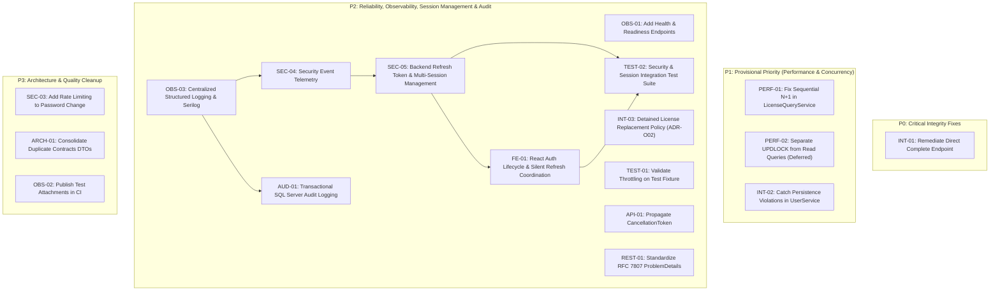

# Engineering Remediation Roadmap & Backlog

> **Authority Level:** Authoritative Engineering Prioritization & Backlog  
> **Parent Document:** [`AGENTS.md`](./AGENTS.md)  
> **Repository Root:** `D:\DVLD-WPF`  
> **Governance Phase:** Phase B (Setup Complete — Remediation Execution Not Yet Authorized)  

---

## 1. Roadmap Architecture & Execution Principles

This roadmap formalizes the remediation items discovered and verified during Phase A (`phase-a-repository-discovery.md`) and Phase A.1 (`phase-a-supplementary-review.md`).

### 1.1 Core Roadmap Rules
1. **Prioritization Framework:** Items are grouped strictly into P0 (Critical Integrity), P1 (Provisional Engineering Priority), P2 (Reliability, Observability & Business Policies), and P3 (Quality & Architecture Cleanup).
2. **P1 Engineering Prioritization Clarification:** P1 represents a provisional engineering prioritization based on static code analysis, NOT a measured production severity classification. Actual production latency degradation, deadlock frequency, and throughput impact remain unmeasured until profiled.
3. **Phase Implementation Boundary:** Phase B authorizes only the creation of governance documentation. **Zero items on this roadmap may be implemented during Phase B.** Inclusion in the engineering roadmap, dependency graph, backlog, or planning schedule does not constitute authorization to execute a phase or implement its work items. Each phase requires separate explicit human authorization before implementation begins.
4. **Status Lifecycle:** Items use explicit statuses: `Confirmed`, `Proposed`, `Needs Business Approval`, `Needs Runtime Validation`, `Planned`, and `Completed`. No item is marked `Completed` until implemented and verified in code.

---

## 2. Remediation Priority Hierarchy

---

## 3. Detailed Remediation Backlog

### 3.1 P0: Critical Integrity Defects

#### [INT-01] Direct Application Completion Endpoint Removal
- **Finding ID:** `INT-01`
- **Evidence Classification:** `CONFIRMED`
- **Priority:** `P0 (Critical)`
- **Affected Components:** `API/DVLD.Api/Controllers/ApplicationsController.cs` (lines 85–90), `Application/Services/ApplicationService.cs` (`CompleteApplicationAsync`).
- **Description:** `POST /api/applications/{id}/complete` directly updates an application's status to `Completed` (`EnApplicationStatus.Completed`) without validating test pass prerequisites or creating downstream license records. This corrupts applicant records and locks them out of ever receiving a license.
- **Proposed Action:** Propose deleting the `CompleteApplicationAsync` endpoint from `ApplicationsController` and removing the underlying method from `IApplicationService` and `ApplicationService`.
- **Dependencies / Mandatory Approvals:** **Explicit Human Engineering Approval Required.** Removing or changing a public API endpoint represents a potentially breaking API contract change. Explicit approval is required before removing the endpoint, altering its public contract, or removing its associated service method.
- **Verification Requirements:** `dotnet build`, execute API integration tests verifying endpoint returns 404.
- **Status:** `Confirmed / Planned`

---

### 3.2 P1: Provisional Engineering Priority (Performance & Concurrency)

#### [PERF-01] Sequential N+1 in LicenseQueryService
- **Finding ID:** `PERF-01`
- **Evidence Classification:** `CONFIRMED`
- **Priority:** `P1 (Provisional Engineering Priority)`
- **Affected Components:** `Application/Services/LicenseQueryService.cs` (lines 237–252).
- **Description:** For paged license listings, the service loops through each item sequentially, executing an individual database query (`GetNewerLicenseForDriverAndClassAsync`) for each row. On a page of 50 items, this generates 51 database round-trips.
- **Proposed Action:** Replace sequential loop with a single batch projection query retrieving newer license statuses in one SQL query.
- **Dependencies / Approvals:** Architecture review of DTO projection.
- **Verification Requirements:** Unit tests in `Application.UnitTests` asserting single batch retrieval and correct mapping.
- **Status:** `Confirmed / Planned`

#### [PERF-02] Pessimistic Lock on Read-Only License Queries
- **Finding ID:** `PERF-02`
- **Evidence Classification:** `CONFIRMED (Locking Behavior); Unmeasured Production Impact`
- **Priority:** `P1 (Provisional Engineering Priority)`
- **Affected Components:** `Infrastructure/Repositories/LicenseRepository.cs` (lines 28–41).
- **Description:** `GetLicenseByIdAsync` hardcodes raw SQL `WITH (UPDLOCK, HOLDLOCK)`. Because `U` locks are mutually incompatible, concurrent read-only requests (`GET /api/licenses/{id}`) serialize against each other and serialize behind active update transactions.
- **Proposed Action:** Refactor `GetLicenseByIdAsync` to execute an ordinary, non-locking shared read. Introduce a separate, explicit method `GetForUpdateAsync()` exclusively for mutating workflows (`LicenseRenewalService`, `LicenseReplacementService`).
- **Dependencies / Approvals:** Audit all callers to ensure update workflows invoke `GetForUpdateAsync()`.
- **Verification Requirements:** Infrastructure integration tests verifying concurrent reads do not block.
- **Status:** `Confirmed / Planned`

#### [INT-02] Unhandled Exception on Concurrent User Creation (Persistence Boundary)
- **Finding ID:** `INT-02`
- **Evidence Classification:** `CONFIRMED`
- **Priority:** `P1 (Provisional Engineering Priority)`
- **Affected Components:** `Application/Services/UserService.cs`, `Infrastructure/Repositories/UserRepository.cs`.
- **Description:** When creating a user with a duplicate `UserName` or `PersonID`, unique database indexes cause persistence to fail. The exception escapes unhandled, triggering `GlobalExceptionHandler` and returning HTTP 500 instead of a client conflict error.
- **Proposed Architectural Remediation Direction:** Preserve strict architectural layering. Do **not** couple `Application` to `Microsoft.EntityFrameworkCore` merely to catch `DbUpdateException`. Instead, translate persistence constraint violations at the `Infrastructure` repository/UnitOfWork boundary into application-level failure results (`Result<UserDto>.Failure("Username or Person is already assigned to a user.")`), allowing the API layer to map the outcome to HTTP 409 Conflict. The specific design pattern remains subject to approval during Phase 12.
- **Dependencies / Approvals:** Architectural review of error translation pattern.
- **Verification Requirements:** Unit and integration tests asserting failure Result and HTTP 409 status on duplicate creation.
- **Status:** `Confirmed / Planned`

---

### 3.3 P2: Reliability, Observability & Business Decisions

#### [INT-03] Detained License Replacement Validation
- **Finding ID:** `INT-03`
- **Evidence Classification:** `TECHNICAL GAP CONFIRMED — BUSINESS RULE REQUIRES APPROVAL`
- **Priority:** `P2`
- **Affected Components:** `Application/Services/LicenseReplacementService.cs` (lines 76–120).
- **Description:** Code currently allows issuing a replacement for a license that is actively detained.
- **Distinction of Evidence:**
  - *Observed Implementation:* `LicenseReplacementService` does not perform a detention check.
  - *Potential Business Gap:* A detained license could be replaced without clearance.
  - *Unverified Regulatory Status:* Whether replacing a detained license is prohibited by law or department policy is not documented in existing requirements and cannot be assumed. Lost-license and damaged-license replacement procedures must not be assumed to have identical requirements. Official policy verification remains required.
  - *Human Decision Prerequisite:* Mandatory business stakeholder sign-off is required before any code changes are introduced (`ADR-O02`).
- **Proposed Action (If Approved):** Inject `IDetainedLicenseRepository` into `LicenseReplacementService` and return `Result.Failure("Cannot replace a detained license.")`.
- **Dependencies / Approvals:** **Mandatory Business Decision Required (`ADR-O02`).**
- **Verification Requirements:** Unit and integration tests covering detained license replacement attempts.
- **Status:** `Needs Business Approval`

#### [TEST-01] Throttled Integration Test Migrations
- **Finding ID:** `TEST-01`
- **Evidence Classification:** `Proposed Remediation — Needs Runtime Validation`
- **Priority:** `P2`
- **Affected Components:** `Test/Infrastructure.IntegrationTests/SqlServerTestDatabase.cs` (lines 40–48).
- **Description:** During Phase 12.1 execution, 1 test out of 612 in `Infrastructure.IntegrationTests` failed with an SSL pre-login handshake timeout. Parallel xUnit test classes simultaneously invoking `MigrateAsync()` against LocalDB is a plausible contributing factor, but not a proven exclusive root cause.
- **Proposed Mitigation (Not Established Architecture):** Propose throttling database creation and schema migrations in `SqlServerTestDatabase.cs` using `SemaphoreSlim(2, 2)`.
- **Architectural Scope & Limitations:** An in-process static semaphore coordinates only threads within a single process. It does not coordinate separate test runner processes, out-of-process CLI executions, or multiple CI agents.
- **Runtime Validation Prerequisite:** Do not claim throttling prevents all SSL timeouts. Throttling requires runtime validation across multiple consecutive test runs.
- **Dependencies / Approvals:** None.
- **Verification Requirements:** Execute full suite across repeated runs to assess timeout mitigation.
- **Status:** `Needs Runtime Validation`

#### [API-01] Propagate CancellationToken Across Endpoints
- **Finding ID:** `API-01`
- **Evidence Classification:** `CONFIRMED`
- **Priority:** `P2`
- **Affected Components:** `API/DVLD.Api/Controllers/`, `Application/Services/`, `Infrastructure/Repositories/`.
- **Description:** Controller endpoints and repository queries omit `CancellationToken`, allowing queries to run to completion even after clients disconnect.
- **Proposed Action:** Add `CancellationToken cancellationToken = default` parameter to controllers, passing `HttpContext.RequestAborted` down through services to EF Core queries.
- **Dependencies / Approvals:** None.
- **Verification Requirements:** Verify compiler build; test client abort behavior.
- **Status:** `Confirmed / Planned`

#### [OBS-01] Health and Readiness Endpoints
- **Finding ID:** `OBS-01`
- **Evidence Classification:** `CONFIRMED`
- **Priority:** `P2`
- **Affected Components:** `API/DVLD.Api/Program.cs`.
- **Description:** No health check middleware is configured, preventing container orchestrators from verifying API liveness or database connectivity.
- **Proposed Action:** Register `builder.Services.AddHealthChecks().AddDbContextCheck<DVLDDbContext>()` and map `/healthz` and `/ready`.
- **Dependencies / Approvals:** **Explicit Human Approval Required.** Inspection of solution project manifests confirms that `Microsoft.Extensions.Diagnostics.HealthChecks.EntityFrameworkCore` (required for `AddDbContextCheck<DVLDDbContext>()`) is not installed in `DVLD.Api.csproj` or any other project. Explicit human engineering approval is required before adding this new NuGet dependency.
- **Verification Requirements:** Integration test querying `/healthz` and asserting HTTP 200 Healthy.
- **Status:** `Confirmed / Planned`

#### [SEC-01] Segregation of Duties Policy Decision
- **Finding ID:** `SEC-01`
- **Evidence Classification:** `BUSINESS DECISION REQUIRED (Current Implementation Preserved)`
- **Priority:** `P2`
- **Affected Components:** `API/DVLD.Api/Program.cs`, `ApplicationsController.cs`, `ClientApp/permissions.ts`.
- **Description:** Current policy bars `Admin` users from executing licensing counter actions (`StaffOnly`). Modifying this to `StaffOrAdmin` alters core Segregation of Duties.
- **Proposed Action:** Present policy options to business stakeholders. Retain `StaffOnly` unless formally approved.
- **Dependencies / Approvals:** **Mandatory Business Decision Required (`ADR-O01`).**
- **Verification Requirements:** Maintain existing test suite verifying `Admin` denial.
- **Status:** `Needs Business Approval`

#### [REST-01] Standardize Error Payloads on RFC 7807 ProblemDetails
- **Finding ID:** `REST-01`
- **Evidence Classification:** `CONFIRMED`
- **Priority:** `P2`
- **Affected Components:** `API/DVLD.Api/Controllers/AuthController.cs`, `GlobalExceptionHandler.cs`.
- **Description:** `AuthController` returns custom `{ error = "..." }` schemas, while `GlobalExceptionHandler` returns standard `ProblemDetails`.
- **Proposed Action:** Standardize all controller failure responses to return RFC 7807 `ProblemDetails`.
- **Dependencies / Approvals:** Coordinate with `ClientApp` error parsing utility (`apiClient.ts`).
- **Verification Requirements:** API integration tests checking response `Content-Type: application/problem+json`.
- **Status:** `Confirmed / Planned`

#### [OBS-03] Centralized Structured Application Logging & Correlation IDs
- **Finding ID:** `OBS-03`
- **Evidence Classification:** `APPROVED DESIGN / ROADMAP INTEGRATION`
- **Priority:** `P2`
- **Affected Components:** `API/DVLD.Api/Program.cs`, `API/DVLD.Api/Middleware/CorrelationIdMiddleware.cs`, `appsettings.json`, `appsettings.Development.json`.
- **Description:** Application currently relies on default Console logging with non-structured text and lacks correlation IDs to trace requests across controllers, application services, and EF Core operations. Structured diagnostics and rolling file persistence are missing.
- **Proposed Action:**
  - Integrate Serilog as the logging provider behind Microsoft `ILogger` abstractions.
  - Implement request correlation ID middleware (`X-Correlation-Id` header generation or pass-through, pushed into Serilog `LogContext`).
  - Configure structured JSON rolling file sink (`logs/dvld-.json`) alongside console output with retention limits.
  - Apply data masking/redaction rules to prevent sensitive data, passwords, and PII from leaking into logs.
  - *Operational Durability & Authority Boundaries:* Local Serilog rolling files serve strictly as an independent diagnostic and security telemetry channel outside the business SQL Server transaction. Local rolling files must NOT be described as automatically fully durable, fully queryable, tamper-proof, or a permanent audit authority. Production acceptance requires explicit operational decisions regarding retention periods, file-system access control permissions, disk capacity/rotation thresholds, backup/recovery policies, alerting on logging failures, protection against unauthorized modification/deletion, and centralized log aggregation (e.g., SIEM or cloud logging) if durable archival is required. Diagnostic logs do not replace committed SQL Server business audit records (`AuditLogs`).
- **Dependencies / Approvals:** **Explicit Human Approval Required** for adding `Serilog.AspNetCore` and file sinks NuGet packages to `DVLD.Api.csproj`.
- **Verification Requirements:** Verify log format output, correlation ID propagation in HTTP response headers and log context, and redaction verification via unit/integration tests.
- **Status:** `Planned / Not Authorized`

#### [SEC-04] Security Event Logging
- **Finding ID:** `SEC-04`
- **Evidence Classification:** `APPROVED DESIGN / ROADMAP INTEGRATION`
- **Priority:** `P2`
- **Affected Components:** `API/DVLD.Api/Controllers/AuthController.cs`, `API/DVLD.Api/Controllers/UsersController.cs`, `Application/Services/UserService.cs`, `Infrastructure/Identity/`.
- **Description:** Authentication attempts (successful and failed logins), user state changes (deactivation, password changes), and session revocations lack dedicated security-event telemetry, hindering anomaly detection and breach investigation.
- **Proposed Action:**
  - Introduce structured security event logging using a dedicated `ISecurityLogger` or domain-specific log events.
  - Record: Login Success, Login Failure (with reason/username, never passwords), Password Change, User Deactivation, Token Rotation, Token Reuse Detection, and Session Revocation.
  - Ensure client IP address and user-agent are logged with security events.
- **Dependencies / Approvals:** Depends on `OBS-03` for structured logging sink and correlation context.
- **Verification Requirements:** Unit and integration tests asserting security events are emitted on auth failures, password resets, and session revocations.
- **Status:** `Planned / Not Authorized`

#### [AUD-01] Transactional SQL Server Audit Logging for Core Business Mutations
- **Finding ID:** `AUD-01`
- **Evidence Classification:** `APPROVED DESIGN / ROADMAP INTEGRATION`
- **Priority:** `P2`
- **Affected Components:** `Domain/Entities/AuditLog.cs`, `Infrastructure/Persistence/DVLDDbContext.cs`, `Infrastructure/Persistence/Configurations/AuditLogConfiguration.cs`, `Infrastructure/UnitOfWork.cs`, `Application/Services/LicensingServices/`.
- **Description:** Critical licensing and user management mutations (license issuance, renewal, replacement, detention, release, user state changes) require an append-only, queryable audit trail capturing who performed the action, when, the affected entity, the action type, correlation tracking, and state deltas to satisfy internal architectural governance and operational traceability requirements (without asserting unverified statutory compliance claims).
- **Proposed Action:**
  - Introduce `AuditLogs` entity and table in SQL Server (`AuditLogId` bigint PK, `UserId` int nullable, `EntityName` nvarchar(100), `EntityId` nvarchar(100), `Action` nvarchar(50), `TimestampUtc` datetime2, `ChangesJson` nvarchar(max), `IpAddress` nvarchar(45), `CorrelationId` nvarchar(64), `Outcome` nvarchar(20)).
  - Transactional Semantics & Logging Boundaries:
    - *Committed Business Operations:* For successful sensitive business operations that require auditing, the corresponding audit record must be written to SQL Server. When atomicity is required, the audit record must be committed within the exact same database transaction managed by `UnitOfWork.SaveChangesAsync()`. The documentation does NOT claim that this requirement is already implemented; it remains a proposed specification requiring verification upon authorization.
    - *Atomic Rollback:* If writing the audit record fails, the enclosing database transaction MUST abort and roll back all changes. If that transaction rolls back, the associated transactional audit record rolls back as well. A business mutation must never commit if its audit trail cannot be persisted.
    - *Diagnostic vs. Transactional Audit Logging Boundaries:*
      - *Diagnostic/Application Logs (`OBS-03` / `SEC-04`):* Diagnostic logs via Serilog or `ILogger<T>` operate independently of the SQL business transaction. They may assist in diagnosing application failures, operational problems, and rollback events. However, diagnostic file sinks are not guaranteed to be durably persisted. Application termination, process crashes, disk exhaustion, filesystem failures, buffering, and other infrastructure failures can result in missing or incomplete diagnostic logs. They must NOT be presented as a guaranteed substitute for transactional audit records.
      - *Independent Administrative Audit (Future):* If durable database audit records for failed administrative operations are required in a future phase, they must be executed via an independent, separate database transaction.
  - Enforce trusted actor identity: The `UserId` must be extracted strictly from validated server-side claims (`ClaimsPrincipal`), never from untrusted client payloads.
  - Apply automated data masking/redaction on `ChangesJson` to prevent sensitive credentials and unnecessary PII from being logged.
  - Define explicit audit data governance: Audit records are designed for append-only application behavior; no API endpoints permit updating or deleting audit logs; table-level database permissions must restrict `UPDATE` and `DELETE`; formal data retention and archival policies must be defined prior to deployment. The design does NOT establish a complete tamper-evident, tamper-proof, or cryptographically immutable mechanism (such as hash chains or digital signatures); tamper-evidence remains an unresolved future requirement without an approved cryptographic mechanism.
- **Dependencies / Approvals:** **Explicit Human Approval Required** for EF Core schema migration to create the `AuditLogs` table. Depends on `OBS-03` for correlation ID propagation.
- **Verification Requirements:** Integration tests in `Infrastructure.IntegrationTests` verifying that successful licensing mutations persist an audit record within the transaction, and simulated audit persistence failures cause total transaction rollback.
- **Status:** `Planned / Not Authorized`

#### [SEC-05] Backend Refresh Token & Multi-Session Management
- **Finding ID:** `SEC-05`
- **Evidence Classification:** `PROPOSED ARCHITECTURE / ROADMAP SPECIFICATION (NOT IMPLEMENTED)`
- **Priority:** `P2`
- **Affected Components:** `Domain/Entities/UserSession.cs`, `Domain/Entities/RefreshToken.cs`, `Domain/Entities/RefreshTokenRecovery.cs` (Option A), `Infrastructure/Persistence/DVLDDbContext.cs`, `Infrastructure/Persistence/Configurations/`, `Application/Services/AuthService.cs`, `API/DVLD.Api/Controllers/AuthController.cs`, `API/DVLD.Api/Program.cs`.
- **Description:** Current JWT authentication issues access tokens without refresh capability or server-side session revocation mechanisms. Users cannot remain securely signed in across page reloads without persistent storage of access tokens, and compromised credentials cannot be revoked before JWT expiration.
- **Relational Data Model & Chain Integrity Analysis (Design Level Only — No Migrations):**
  - Conceptual entities providing historical lineage tracking and reuse detection:
    1. `UserSessions`: Represents one independent device/browser session (`SessionId` Guid PK, `UserId` int FK, `CreatedAtUtc`, `ExpiresAtUtc`, `LastActivityUtc`, `IsRevoked`, `RevokedAtUtc`, `IpAddress`, `UserAgent`).
    2. `RefreshTokens`: Multiple token records belonging to one session representing a rotation chain (`TokenId` Guid PK, `SessionId` Guid FK -> `UserSessions`, `TokenHash` nvarchar(64) SHA-256, `CreatedAtUtc`, `ExpiresAtUtc`, `UsedAtUtc` nullable, `RevokedAtUtc` nullable, `ReplacedByTokenId` nullable Guid FK -> `RefreshTokens`).
  - *Lineage Properties & Constraint Limitations:*
    - *Successor Pointer:* A scalar `ReplacedByTokenId` column allows a predecessor row to reference at most one successor token.
    - *Merging (Fan-In) Prevention:* A proposed filtered unique index (`CREATE UNIQUE INDEX [UX_RefreshTokens_ReplacedByTokenId] ON [RefreshTokens]([ReplacedByTokenId]) WHERE [ReplacedByTokenId] IS NOT NULL;`) can prevent multiple predecessor rows from referencing the same successor token.
    - *Cycle Prevention (Unresolved Design Requirement):* A self-referencing foreign key enforces referential integrity but does **not** independently prevent cycle formation ($A \to B \to A$). Timestamp ordering rules in application code mitigate common loops, but complete database-level cycle prevention remains an unresolved design requirement subject to administrative maintenance risks. The design does NOT claim a mathematically guaranteed acyclic chain.
    - *Session Consistency (Unresolved Schema Requirement):* Predecessor and successor tokens, as well as recovery records, must belong to the same `UserSession`. The basic proposed foreign keys do not enforce cross-row session consistency at the database engine level; enforcing this strictly in SQL Server would require composite keys `(SessionId, TokenId)` or validation triggers.
- **The Critical Recovery Consistency Gap & Architecture Alternatives (Option A vs. Option C):**
  - *The Consistency Gap:* In any design separating database rotation from recovery storage, if token rotation commits to SQL Server but the process terminates before recovery data is recorded, or if recovery data is lost, $T_1$ is marked consumed, $T_2$ exists only as an irreversible SHA-256 hash, and client retries cannot recover $T_2$.
  - *Option A — Durable Encrypted SQL Recovery Record (Design Alternative — Unselected):*
    - Conceptual Recovery Record Structure: Proposed persistence of an encrypted recovery record in a dedicated `RefreshTokenRecovery` table (`RecoveryId` Guid PK, `PredecessorTokenId` Guid FK, `SessionId` Guid FK, `RotationRequestId` Guid, `EncryptedPayload` varbinary(max), `KeyVersionId` nvarchar(50), `CreatedAtUtc` datetime2, `ExpiresAtUtc` datetime2). This is a conceptual proposal only; no database table, schema, or migration is approved or created.
    - *Distinction of Schema Constraints & Explicitly Unresolved Requirements:* The basic conceptual foreign keys do not solve every lineage or cross-session consistency problem. The following design requirements remain explicitly unresolved:
      1. Uniqueness of `(SessionId, RotationRequestId)`.
      2. Whether each predecessor refresh token can have only one recovery record.
      3. Enforcement that the predecessor, recovery record, and successor belong to the same session.
      4. Exact encrypted payload contents.
      5. Recovery-record retention and cleanup behavior.
      6. Expiration and handling of recovery records.
      7. Data Protection key availability and failure behavior.
      8. Atomic persistence of the rotation state and recovery payload.
    - *Cryptographic Proposal & Reality:* ASP.NET Core Data Protection (`IDataProtector`) remains a proposed implementation direction for protecting a recoverable successor-token payload, using a proposed purpose-based hierarchy (`CreateProtector("DVLD", "Auth", "Recovery", sessionId, rotationRequestId)`). No specific cryptographic algorithm or encryption suite (such as AES-256-GCM or any other cipher) is approved by this documentation. The actual algorithm, key-management configuration, key-ring persistence, key rotation, deployment configuration, and runtime behavior have not yet been verified. No claim of implemented encryption or verified cryptographic guarantees is permitted.
    - *Conditional Recovery Preconditions:* Durable recovery is possible **only when** all proposed operational preconditions are satisfied (committed in same SQL transaction, unexpired within the defined operational recovery boundary [duration undecided; e.g. illustrative 15s or 30s], correct predecessor presented, valid operation ID, valid Data Protection key, uncorrupted ciphertext). Expiration is not tied to an approved fixed 15-second duration.
    - *Trade-offs:* Database backups and transaction logs retain encrypted recovery material until overwritten. Distinguishes recovery ineligibility from physical deletion; requires an independently approved background or scheduled cleanup policy to prune expired rows (cleanup timing, retention duration, and deletion strategy remain unresolved).
    - *Governance Status:* **Option A remains an unselected design alternative awaiting explicit user approval.** It is NOT approved, selected, or declared superior to Option C.
  - *Option C — No Successor Recovery (Design Alternative — Unselected):*
    - Refresh tokens are stored strictly as one-way SHA-256 hashes rather than recoverable plaintext values.
    - Option C does not provide durable successor-token recovery.
    - *Failure Behavior:* If SQL Server commits but the response is permanently dropped (network loss, process crash, client timeout), the successor token cannot be reconstructed. The client must re-authenticate.
    - *Security & Operational Characteristics:*
      - Hash-only storage reduces exposure of recoverable token secrets in a database disclosure scenario (database backups and transaction logs contain only irreversible hashes).
      - It does NOT eliminate every consequence of database compromise.
      - It does NOT eliminate replay of a stolen, still-valid refresh token before that token is consumed, revoked, or expired.
      - It does NOT guarantee that all replay attacks are prevented or detected.
      - Eliminates database ciphertext storage and cryptographic key-management overhead.
      - Transient network drops on refresh require the user to log in again.
    - *Unresolved Option C Questions:* Whether a consumed session without recovery remains active, whether a failed retry revokes the session, whether re-authentication creates a new session, and how dormant session records are pruned.
    - *Governance Status:* **Option C remains an unselected design alternative awaiting explicit user approval.** It is NOT approved, selected, or recommended as the final architecture.
  - *Overall Architecture Governance:* **Both Option A and Option C remain unselected design alternatives awaiting explicit human engineering selection.** Neither option is marked approved.
- **RotationRequestId — Operation Correlation & Idempotency Semantics:**
  - *Entropy Accuracy:* Generated by the client as a UUIDv4 containing **122 cryptographically random bits** (6 version and variant bits reserved) sent via header `X-Rotation-Request-Id: <UUIDv4>`.
  - *Semantic Boundaries:* `RotationRequestId` is an **operation correlation and idempotency identifier**. It is NOT:
    - An authentication factor or credential.
    - Proof of client identity.
    - Proof that the caller is the original browser instance.
    - Independent proof of legitimate intent.
    - Protection against an attacker who has captured the complete HTTP request.
  - *Architectural Distinction:* The architecture strictly distinguishes:
    1. *Refresh Token possession:* Holding the raw token cookie.
    2. *Operation identification:* Identifying a specific network rotation attempt.
    3. *Retry correlation:* Associating a subsequent request with a prior attempt.
    4. *Idempotent response recovery:* Re-transmitting an already-created response.
    5. *Client-side request coordination:* Single-tab queueing and cross-tab mutexes.
    6. *Authentication and authorization:* Validating user claims and session validity.
  - *Denial-of-Service Risk:* A missing or mismatched `RotationRequestId` does NOT independently prove token theft. Automatically revoking a session solely due to a missing or mismatched header creates a serious denial-of-service risk where an adversary or proxy stripping headers can force user logouts. Session revocation must follow an explicitly approved policy based on evidence.
  - *Secret Capability Distinction:* `RotationRequestId` is an ordinary correlation identifier, not a high-entropy secret capability or bearer credential. Converting it into an authentication secret would require separate threat modeling, storage rules, and approval.
  - *Client Lifecycle:* Stored strictly in React memory within the active refresh Promise closure and discarded upon response. It is NEVER written to `localStorage` or `sessionStorage` (preventing persistent XSS extraction). A browser reload or tab close destroys the identifier in memory; if a response was lost mid-reload, the client cannot recover the prior rotation and falls back to clean re-authentication. Cross-tab coordination prevents race conditions in the browser, but does NOT solve backend concurrency or lost-response recovery.
- **Failure Classification & Operational Recovery Window Governance:**
  - *Recovery Window Duration Governance:*
    - *15 seconds:* Previously documented initial proposal, NOT approved.
    - *30 seconds:* Previously discussed alternative proposal, NOT approved.
    - *Governance Status:* **Final recovery duration is `UNDECIDED — REQUIRES EXPLICIT USER APPROVAL`.** Neither 15 seconds nor 30 seconds is approved or selected. In technical examples and test scenarios, `$T_{\text{recovery}}$` (with illustrative values such as 15s or 30s) is used strictly as a provisional, configurable parameter until human approval is granted.
  - *Operational Recovery Boundary Semantics & Separation of Retention:*
    - The recovery window is an **operational recovery boundary only**, NOT a mathematical security proof or definitive evidence of token theft. Expiration of the window indicates that the operational retry period has lapsed, not that an adversary has intercepted the token.
    - *Separation of Recovery Eligibility from Physical Retention:*
      1. *Recovery Eligibility:* Once the configured recovery window ($T_{\text{recovery}}$) expires, the recovery record is no longer eligible for token-response recovery.
      2. *Physical Retention:* The record may remain physically stored in SQL Server after recovery eligibility expires; expiration of recovery eligibility does not imply immediate physical deletion.
      3. *Cleanup & Deletion:* Physical deletion or pruning is a separate administrative operation governed by an independently defined retention and cleanup policy.
      4. *Unresolved Retention Parameters:* Cleanup timing, retention duration, scheduling, and deletion strategy remain unresolved and require future explicit approval. (No new database column, schema, migration, or implementation requirement is introduced merely to represent expiration).
  - *Preservation of Distinct Parameter Boundaries:* The architecture strictly distinguishes:
    1. *Operational Recovery Duration ($T_{\text{recovery}}$):* Short operational window (e.g., illustrative 15s or 30s, undecided) for network retry and idempotent recovery.
    2. *Access Token Lifetime:* Short-lived credential lifetime (15 minutes).
    3. *Refresh Token Idle Lifetime:* Sliding window lifetime (7 days).
    4. *Absolute Session Lifetime:* Bounded total session lifetime (30 days).
    5. *Security Incident Detection & Revocation Policy:* Independent policy determining whether presentation of consumed credentials outside recovery triggers session revocation or ordinary rejection.
  - *Unresolved Operational Details:* Whether window is calculated from application or database clock, authoritative clock source, clock skew tolerance across instances, exact cleanup timing, and behavior at boundary timestamps.
  - *Four Distinct Failure Categories:*
    1. *Authentication Failures:* Invalid token, expired token, revoked session, revoked token $\rightarrow$ Standard HTTP 401.
    2. *Infrastructure Failures:* SQL Server unavailable, DB timeout, Data Protection key store unavailable, instance failure $\rightarrow$ System error (HTTP 500/503), no session revocation.
    3. *Data Integrity Failures:* Corrupted payload, authentication tag failure, inconsistent lineage $\rightarrow$ Fail closed (HTTP 401), diagnostic alerting, investigate before revocation.
    4. *Suspected Security Incidents:* Confirmed token reuse outside recovery boundary, concurrent conflicting credential presentations $\rightarrow$ High-priority security telemetry (`SEC-04`), session revocation per approved policy.
  - *Preserved Policy Alternatives (Undecided):*
    - *Policy 1 — Session Revocation After Recovery Boundary:* If a previously consumed refresh token is presented after the defined operational recovery boundary (duration undecided, e.g. illustrative 15s or 30s), revoke the associated session according to the documented policy. The recovery boundary is an operational recovery boundary, not a guarantee that every replay attack can be detected or prevented.
    - *Policy 2 — Ordinary Rejection Without Automatic Revocation:* If a previously consumed refresh token is presented, reject the request with HTTP 401 without automatically revoking the associated session.
    - *Decision Status:* **Both Policy 1 and Policy 2 remain `UNDECIDED — REQUIRES EXPLICIT USER APPROVAL`.** Neither policy is selected, approved, or implemented.
- **Token State Evaluation Precedence & Detection Trade-off:**
  - Token Lifetimes: Access token: 15 minutes; Refresh token idle: 7 days; Absolute session lifetime: 30 days.
  - Explicit Token Expiry Rule: `TokenExpiry = Min(Now + 7 days, SessionCreatedAtUtc + 30 days)`.
  - Strict Priority Order at `POST /api/auth/refresh`:
    1. *Session Revoked (`Session.IsRevoked == true`):* Ordinary Rejection (HTTP 401).
    2. *Session Expired (`Now > Session.ExpiresAtUtc` or idle timeout exceeded):* Ordinary Rejection (HTTP 401).
    3. *Token Explicitly Revoked (`Token.RevokedAtUtc IS NOT NULL`):* Ordinary Rejection (HTTP 401).
    4. *Token Expired Naturally (`Now > Token.ExpiresAtUtc`):* Ordinary Rejection (HTTP 401). An expired token alone is NEVER treated as theft. Prompt user for re-authentication.
    5. *Token Previously Consumed (`Token.UsedAtUtc IS NOT NULL`):*
       - *Recovery Check (Option A):* If presentation satisfies recovery conditions (unexpired, matching operation ID, key available, ciphertext valid), server safely re-transmits successor response.
       - *Reuse Handling:* If outside recovery boundary, or under Option C, enforce reuse policy according to unselected Policy 1 (Session Revocation After Recovery Boundary) or Policy 2 (Ordinary Rejection Without Automatic Revocation), both pending explicit user approval.
    6. *Active & Valid Token (`UsedAtUtc IS NULL`, `RevokedAtUtc IS NULL`, `Now <= ExpiresAtUtc`):* Proceed with atomic token rotation.
  - *Explicit State-Precedence Detection Trade-off:* Because Natural Expiration (Rule 4) takes precedence over Consumed Reuse (Rule 5), presenting an old consumed token after its natural 7-day expiration boundary results in an ordinary 401 rejection rather than triggering theft detection. This trade-off deliberately prevents false-positive security alerts and aggressive session invalidations caused by dormant browser tabs or background processes re-awakening weeks later, while accepting that delayed probe attacks with expired tokens will be rejected rather than flagged as an active breach.
- **CSRF, Cookie Security & Origin Validation:**
  - Cookie Configuration: `refreshToken` cookie set on login, rotated on refresh, cleared on logout (`Max-Age=0`). Attributes: `HttpOnly=true`, `SameSite=Lax`, `Secure=true` in production (`false` in local HTTP development), `Path=/api/auth`.
  - CSRF Defense: For cookie-authenticated state-changing endpoints (`/refresh`, `/logout`, `/logout-all`), enforce CSRF protection via custom header verification (`X-Requested-With: XMLHttpRequest` or Anti-CSRF token) and Anti-CSRF validation.
  - Origin / Referer Validation: Validate incoming `Origin` (or `Referer` if absent) against strictly whitelisted application deployment origins on all state-changing auth requests; reject mismatches with HTTP 403 Forbidden.
  - CORS Configuration: With credentials enabled (`Access-Control-Allow-Credentials: true`), allowed origins must be explicitly enumerated in `appsettings.json` matching actual deployment origins (wildcards strictly prohibited).
  - Nuanced XSS Defense: Acknowledge that while `HttpOnly` prevents client script from reading the raw token value, it does not prevent an active XSS payload from issuing authenticated ambient-credential requests; defense-in-depth requires CSRF checks, strict Origin validation, Content Security Policy, and memory-only storage of access tokens.
- **Complete Canonical Endpoint Surface:**
  - `POST /api/auth/login`: Authenticates credentials; returns memory-only access token; creates initial session and token record; sets `refreshToken` cookie.
  - `POST /api/auth/refresh`: Validates refresh cookie, enforces origin/CSRF, validates token chain, rotates token atomically, sets new cookie, returns new access token. Enforces reuse detection and recovery according to selected Option A or Option C.
  - `POST /api/auth/logout`: Revokes current session and token chain in DB; clears `refreshToken` cookie (`Max-Age=0`).
  - `POST /api/auth/logout-all`: Revokes all active sessions for current user; clears cookie.
  - `GET /api/auth/sessions`: Lists active sessions for current user (device, IP, created, last activity, current session flag).
  - `DELETE /api/auth/sessions/{sessionId}`: Revokes a specific targeted session belonging to the authenticated user (requires `Authorization: Bearer <token>` and `X-Requested-With: XMLHttpRequest`).
- **Dependencies / Approvals:** **Explicit Human Approval Required** for EF Core schema migration (`UserSessions`, `RefreshTokens`, and optional `RefreshTokenRecovery` tables) and auth endpoint additions. Depends on `OBS-03` and `SEC-04`. Technically decoupled from `AUD-01` (permitting parallel design).
- **Verification Requirements:** Unit and integration tests validating token rotation, rotation chain tracking, evaluation precedence, recovery behavior under selected option, reuse detection, CSRF header rejection, origin checks, and cookie attributes.
- **Status:** `Planned / Not Authorized`

#### [FE-01] React Authentication Lifecycle & Silent Refresh Coordination
- **Finding ID:** `FE-01`
- **Evidence Classification:** `PROPOSED ARCHITECTURE / ROADMAP SPECIFICATION (NOT IMPLEMENTED)`
- **Priority:** `P2`
- **Affected Components:** `ClientApp/src/context/AuthContext.tsx`, `ClientApp/src/services/apiClient.ts`, `ClientApp/src/hooks/useAuth.ts`, `ClientApp/src/App.tsx`.
- **Description:** React client currently manages tokens without silent refresh coordination. If an access token expires during multi-request rendering or across multiple open tabs, uncoordinated refresh requests trigger race conditions, false-positive reuse detection, and cascading logouts.
- **Proposed Action:**
  - Maintain access token exclusively in React memory (`AuthContext` state). Never store access tokens in `localStorage` or `sessionStorage`.
  - Single-Tab Request Queue: Configure `apiClient` Axios interceptor with an asynchronous request queue for 401 responses: pause outgoing requests during an active refresh, execute a single `/api/auth/refresh` call with credentials and client-generated `X-Rotation-Request-Id` (UUIDv4 with 122 random bits), update memory access token, and replay queued requests.
  - Lifecycle on Network Drops & Reloads: `RotationRequestId` is retained in memory during the active refresh Promise closure and discarded immediately upon response. If a network timeout occurs, Axios retries presenting the exact same `X-Rotation-Request-Id`. If the browser tab is reloaded during an in-flight network drop, memory is cleared, resetting the retry context (prompting clean re-authentication).
  - Cross-Tab Refresh Coordination: Implement cross-tab coordination (via `BroadcastChannel("dvld_auth")` or `Web Locks API` / shared refresh mutex) so that only ONE tab initiates the `/api/auth/refresh` request while other open tabs wait or receive the refreshed access token, preventing concurrent rotation race conditions and complementing backend atomic serialization. Note: Cross-tab coordination manages client-side timing only; it does not solve backend process failures or lost-response recovery.
  - Cross-Tab Logout Synchronization: Broadcast logout events across tabs to immediately purge in-memory access tokens and redirect to `/login`.
  - Targeted Session Revocation: Invoke canonical endpoint `DELETE /api/auth/sessions/{sessionId}` with Bearer token and custom header when users dismiss individual sessions in device management UI.
  - CSRF Compliance: Ensure Axios client automatically attaches required custom headers (e.g. `X-Requested-With: XMLHttpRequest`) on all requests to satisfy backend CSRF checks.
  - Graceful session expiration handling with user notification and return-URL redirect.
- **Dependencies / Approvals:** Depends on `SEC-05` backend refresh endpoints and cookie transport.
- **Verification Requirements:** Vitest/RTL unit tests covering: silent refresh interceptor queueing, single refresh call for multiple concurrent 401s, cross-tab refresh deduplication, multi-tab logout sync, `DELETE /api/auth/sessions/{sessionId}` invocation, and memory-only token storage verification.
- **Status:** `Planned / Not Authorized`

#### [TEST-02] Security, Session & Transactional Audit Integration Test Suite
- **Finding ID:** `TEST-02`
- **Evidence Classification:** `PROPOSED TEST STRATEGY (NOT IMPLEMENTED / NOT EXECUTED)`
- **Priority:** `P2`
- **Affected Components:** `Test/API.IntegrationTests/Controllers/AuthControllerTests.cs`, `Test/Infrastructure.IntegrationTests/Persistence/AuditLogPersistenceTests.cs`, `ClientApp/src/**/*.test.tsx`.
- **Description:** Test coverage does not exist for session lifecycle, token rotation chains, token reuse revocation of affected sessions, cookie security attributes, transactional rollback on audit log failure, or frontend single-tab and cross-tab refresh coordination.
- **Proposed Test Strategy (Categorized by Architectural Scope):**
  - **Category 1: Common Authentication & Rotation Tests (Options A & C):**
    1. *Successful first rotation:* Login -> refresh -> access token returned + new cookie set + old token consumed in SQL Server.
    2. *Concurrent duplicate requests:* Two requests hitting `/api/auth/refresh` simultaneously for same session are serialized by `UPDLOCK`; exactly one rotates token.
    3. *Process failure before transaction commit:* Transaction aborts; predecessor token remains unconsumed; retry proceeds with normal rotation.
    4. *Expired consumed-token precedence:* Consumed token presented after natural 7-day expiration boundary returns ordinary 401 without triggering reuse alert (Rule 4 precedence).
    5. *Session-scoped revocation:* Verify revoking session A leaves user session B on another device active and unaffected.
    6. *Canonical session revocation:* `DELETE /api/auth/sessions/{sessionId}` terminates target session.
    7. *Plaintext token exclusion:* Assert logs, telemetry, and error payloads never contain raw refresh token strings.
    8. *Token chain constraints:* Filtered unique index `UX_RefreshTokens_ReplacedByTokenId` prevents multiple predecessors from pointing to same successor.
    9. *CSRF & Origin protection:* State-changing auth endpoints reject requests missing custom header or invalid origin.
  - **Category 2: Option A-Specific Tests (Durable Encrypted SQL Recovery):**
    10. *Lost HTTP response after committed rotation:* Response dropped; retry with same `RotationRequestId` and predecessor cookie within configured recovery window ($T_{\text{recovery}}$, e.g. illustrative 15s or 30s) recovers successor token.
    11. *Recovery after application restart:* Process terminates after SQL Server commit; on restart, retry with same `RotationRequestId` succeeds via durable recovery record (if Option A is authorized).
    12. *Repeated retry within recovery window:* Multiple retries with same `RotationRequestId` within the configured recovery window ($T_{\text{recovery}}$, duration undecided) succeed without generating new database tokens or mutating rotation chain.
    13. *Recovery record ineligibility vs. physical cleanup:* Verify that once the configured recovery window ($T_{\text{recovery}}$, duration undecided) expires, the recovery record is no longer eligible for token-response recovery. Verify separately that physical retention and eventual deletion/pruning operate under an independently defined retention policy (timing, retention duration, and deletion strategy remain unresolved and require future approval), rather than immediate physical deletion upon window expiration (no new database schema or migration required merely for expiration).
    14. *Different operation identity with same predecessor token:* Verify that a request presenting a consumed predecessor token with a mismatched operation identifier (`RotationRequestId`) is rejected; whether the associated session is revoked remains subject to a future explicitly approved security policy (Policy 1 vs Policy 2 remain undecided; neither policy is approved).
    15. *Same operation identity with different predecessor token:* Verify that presenting the same operation identifier with a different predecessor token results in HTTP 401 rejection due to token-operation binding mismatch. HTTP 401 rejection does not automatically mean the session is revoked; a token-operation binding mismatch alone does not authorize automatic session revocation, and any revocation behavior remains subject to an explicitly approved policy.
    16. *Ciphertext corruption fail-closed:* Verify malformed or corrupted recovery payloads fail closed without compromising server state.
  - **Category 3: Option C-Specific Tests (No Successor Recovery):**
    17. *Lost response re-authentication (Option C):* Verify that without successor-token recovery, a dropped response after a committed rotation results in HTTP 401 requiring clean user re-authentication. This test scenario is explicitly dependent on future unresolved session lifecycle decisions: whether the old session remains active or is revoked, whether re-authentication creates a new session, and how abandoned or dormant session records are cleaned up.
    18. *Zero ciphertext database assertion:* Verify SQL Server contains strictly SHA-256 hashes and zero recovery tables or ciphertexts.
  - **Category 4: Policy-Dependent Tests (Pending Policy 1 vs Policy 2 Selection — Undecided):**
    19. *Late retry enforcement:* Test session revocation after recovery boundary (Policy 1) vs ordinary 401 rejection without automatic revocation (Policy 2) when retry arrives after the configured recovery boundary ($T_{\text{recovery}}$, duration undecided).
    20. *Mismatched operation ID handling:* Test rejection behavior without automatic session revocation on missing or mismatched `RotationRequestId`, or evaluate as an unresolved policy question.
  - **Category 5: Multi-Instance & Key-Management Tests (Proposed for Option A):**
    21. *Multi-instance recovery:* Proposed verification where recovery record committed by Instance 1 is read and decrypted by Instance 2 via shared key ring (if Option A is authorized).
    22. *Data Protection key rotation:* Proposed verification of key-ring rotation behavior during recovery record lifecycle (if Option A is authorized).
  - **Category 6: Frontend & Persistence Atomicity Tests:**
    23. *Transactional audit atomicity:* Verify in `Infrastructure.IntegrationTests` that audit failure forces total business rollback (`AUD-01`).
    24. *Frontend queueing & coordination:* Verify in `ClientApp` Vitest/RTL single-tab 401 queueing and cross-tab refresh deduplication.
- **Dependencies / Approvals:** Depends on `SEC-05`, `FE-01`, and `AUD-01`.
- **Verification Requirements:** Proposed test strategy only. When implementation is eventually authorized, all integration tests must run against isolated test databases (`DVLD_IntegrationTests_<GUID>`) and never connect to `DVLDf`.
- **Status:** `Planned / Not Authorized`

---

### 3.4 P3: Architecture & Quality Cleanup

#### [SEC-03] Rate Limiting on Password Change
- **Finding ID:** `SEC-03`
- **Evidence Classification:** `CONFIRMED`
- **Priority:** `P3`
- **Affected Components:** `API/DVLD.Api/Controllers/AuthController.cs` (lines 117–134).
- **Description:** `/api/auth/change-password` lacks rate limiting, creating potential brute-force risk on active sessions.
- **Proposed Action:** Apply `[EnableRateLimiting("PasswordChangeLimit")]` with sliding window policy.
- **Status:** `Confirmed / Planned`

#### [ARCH-01] Consolidate Duplicated Contracts DTOs
- **Finding ID:** `ARCH-01`
- **Evidence Classification:** `CONFIRMED`
- **Priority:** `P3`
- **Affected Components:** `DVLD.Contracts`, `Application/DTOs`.
- **Description:** Multiple DTOs are declared identically in both `DVLD.Contracts` and `Application`.
- **Proposed Action:** Centralize shared contracts in `DVLD.Contracts` and reference them in `Application`.
- **Status:** `Confirmed / Planned`

#### [OBS-02] Pipeline Test Attachment Staging
- **Finding ID:** `OBS-02`
- **Evidence Classification:** `CONFIRMED`
- **Priority:** `P3`
- **Affected Components:** `azure-pipelines.yml`.
- **Description:** CI pipeline does not stage test attachments to a unified directory for TRX publishing.
- **Proposed Action:** Configure `PublishTestResults@2` to publish TRX attachments directly in the pipeline run summary.
- **Status:** `Confirmed / Planned`

---

## 4. Phase Authorization Summary

> Inclusion in the engineering roadmap, dependency graph, backlog, or planning schedule does not constitute authorization to execute a phase or implement its work items. Each phase requires separate explicit human authorization before implementation begins.

| Phase | Scope & Key Work Items | Current Status | Authorization Prerequisite & Dependencies |
|---|---|---|---|
| **Phase A / A.1** | Deep Repository Discovery & Supplementary Review | **Completed** | Concluded & documented in `docs/audits/`. |
| **Phase B** | Engineering Governance Suite Setup | **Completed** | Approved and documented across governance markdown suite. |
| **Phases C / D / E** | Decisions, Detention Domain & Concurrency Investigation | **Completed** | ADR-O01 approved; ADR-O02 provisionally selected; Concurrency investigation closed. |
| **Phase 12.2** | P0 & P1 Critical Integrity & Performance (`INT-01`, `INT-02`, `PERF-01`) | **PROPOSED / NOT AUTHORIZED** | Requires explicit human review and approval of Phase 12.2 scope. |
| **Phase 12.3** | P2 Observability, Reliability & Transactional Audit Logging (`OBS-01`, `OBS-03`, `SEC-04`, `AUD-01`, `REST-01`, `API-01`, `INT-03`, `TEST-01`) | **PLANNED / NOT AUTHORIZED** | Requires Phase 12.2 completion; NuGet approval for Serilog/HealthChecks; DB migration approval for `AuditLogs`; ADR-O02 verification for `INT-03`. |
| **Phase 12.4** | Full-Stack Session Management & Frontend Testing (`SEC-05`, `FE-01`, `TEST-02`, ClientApp Vitest/RTL) | **PLANNED / NOT AUTHORIZED** | Requires Phase 12.3 baseline (`OBS-03`/`SEC-04` telemetry; `AUD-01` decoupled); explicit approval for `UserSessions` and `RefreshTokens` DB migrations; cookie auth endpoint changes. |
| **Phase 12.5** | P3 Architecture Cleanup, Password Rate Limiting & CI Hardening (`ARCH-01`, `SEC-03`, `OBS-02`) | **PLANNED / NOT AUTHORIZED** | Scheduled following Phase 12.4 completion. |