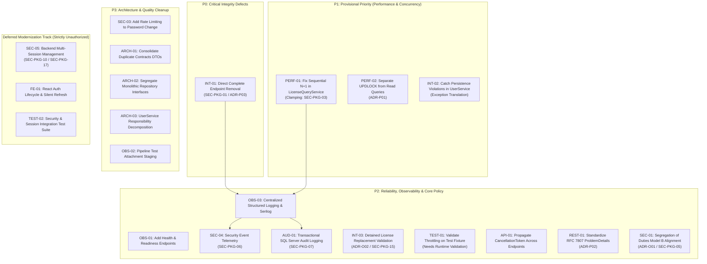

# Engineering Remediation Roadmap & Backlog

> **Authority Level:** Sole Authoritative Engineering Prioritization, Backlog & Execution Roadmap  
> **Parent Document:** [`AGENTS.md`](./AGENTS.md)  
> **Repository Root:** `D:\DVLD-WPF`  
> **Baseline Commit:** `9b6d22f8728463f7b80c1341582016e1dda1972f`  
> **Governance Status:** CONSOLIDATED & ENFORCED (Phase 1)  

---

## 1. Roadmap Architecture & Execution Principles

This document constitutes the sole authoritative engineering execution roadmap and backlog for the Driver & Vehicle Licensing Department (DVLD) platform. It consolidates all verified remediation items, architecture decision alignments, and security specifications across the repository.

### 1.1 Non-Negotiable Governance & Authorization Rules
1. **Roadmap Inclusion Does Not Authorize Implementation:** Inclusion of an item, task, or phase in this roadmap, dependency graph, or backlog schedule does **not** constitute authorization to write code, modify schemas, or execute work. Every implementation phase requires separate, explicit human engineering authorization before work begins.
2. **Approved Policy Does Not Authorize Code Changes:** The approval of an architectural or civic policy record (such as `ADR-O01` Model B) establishes the conceptual policy standard only. Translating approved policies into code modifications (e.g., altering controller authorization attributes or frontend route guards) requires explicit implementation authorization.
3. **Proposed Work Is Not Authorized Work:** All items marked `PROPOSED`, `PLANNED`, or `CONFIRMED / PLANNED` are scheduled proposals. They carry zero execution authority until authorized under an approved phase gate.
4. **Deferred Work Remains Deferred:** Work items assigned to deferred tracks (`SEC-05`, `FE-01`, `TEST-02`, `SEC-PKG-17`) are explicitly excluded from initial production release planning. They remain deferred and strictly unauthorized until formally reprioritized by the Project Owner.
5. **External Regulatory Approvals Are Independent Gates:** Legal and regulatory rulings from the Licensing Authority (such as `ADR-O02` / `DEC-POL-01` and `DEC-POL-02`) are external prerequisite gates under Gate 3. Engineering teams may not anticipate or assume statutory approval. No implementation code may be introduced until written regulatory confirmation is recorded.
6. **Database Schema Changes Require Independent Approval:** Schema modifications, table alterations, and Entity Framework Core migrations (including Schema Gate 5 for user lockout columns) require separate human DBA review, explicit approval, and isolated verification against ephemeral test databases (`DVLD_IntegrationTests_<GUID>`). Migrations to `DVLDf` are strictly prohibited.
7. **Documenting a Gate Does Not Satisfy It:** Logging an operational requirement, regulatory condition, or risk gate in documentation does not fulfill that gate. Gates remain unsatisfied until verifiable runtime evidence, DBA sign-off, or formal human authorization is executed.
8. **Task Readiness vs Implementation Authorization:** Technical readiness (analysis complete, solution designed, zero schema changes) does **not** constitute authorization to begin coding. All Phase 12.2 through 12.5 tasks remain strictly **PROPOSED / UNAUTHORIZED** until explicit human authorization is granted. For comprehensive subsystem maturity evaluations and stage-by-stage dependency mappings, consult the standalone master plan [`docs/PROJECT-COMPLETION-MASTER-PLAN.md`](./docs/PROJECT-COMPLETION-MASTER-PLAN.md).

---

## 2. Remediation Priority Hierarchy

The canonical backlog is organized into four prioritized tiers based on verified system impact:

---

## 3. Canonical Remediation Backlog

### 3.1 P0: Critical Integrity Defects

#### [INT-01] Direct Application Completion Endpoint Removal
- **Finding ID:** `INT-01`
- **Evidence Classification:** `CONFIRMED`
- **Priority:** `P0 (Critical)`
- **Affected Components:** `API/DVLD.Api/Controllers/ApplicationsController.cs` (lines 85–90), `Application/Services/ApplicationService.cs` (`CompleteApplicationAsync`).
- **Description:** `POST /api/applications/{id}/complete` allows authenticated staff to update an application's status directly to `Completed` (`EnApplicationStatus.Completed`), bypassing fee payment, test passage, and license issuance workflows. This corrupts applicant records and locks them out of ever receiving a license.
- **Proposed Technical Remediation:** Delete the `CompleteApplicationAsync` endpoint from `ApplicationsController` and remove the underlying method from `IApplicationService` and `ApplicationService`.
- **Governing Architectural Decisions:** `ADR-P03` (Permanent Endpoint Deletion) cross-referenced to `DEC-APP-01` (Option 1: Immediate route deletion selected by Project Owner).
- **Associated Security Package:** `SEC-PKG-01` (CompleteApplication Route Deletion & Telemetry).
- **Dependencies & Mandatory Approvals:** **Explicit Human Engineering Approval Required.** Removing or changing a public API endpoint represents a breaking contract change. Explicitly authorized by Project Owner selecting `DEC-APP-01` Option 1.
- **Verification Requirements:** Execute API integration tests verifying endpoint returns HTTP 404 Not Found.
- **Current Status:** `Verified`
- **Implementation Authorization:** **AUTHORIZED (Phase 12.2 Scope).**

---

### 3.2 P1: Provisional Engineering Priority (Performance & Concurrency)

#### [PERF-01] Sequential N+1 in LicenseQueryService
- **Finding ID:** `PERF-01`
- **Evidence Classification:** `CONFIRMED`
- **Priority:** `P1 (Provisional Engineering Priority)`
- **Affected Components:** `Application/Services/LicenseQueryService.cs` (lines 237–252).
- **Description:** For paged license listings, the service loops through each item sequentially, executing an individual database query (`GetNewerLicenseForDriverAndClassAsync`) per row. On a page of 50 items, this generates 51 database round-trips.
- **Proposed Technical Remediation:** Replace sequential per-row queries with a single set-based SQL query utilizing `ROW_NUMBER() OVER (PARTITION BY DriverID, LicenseClass ORDER BY IssueDate DESC)` or a compiled EF Core LINQ join.
- **Associated Security Package:** `SEC-PKG-03` establishes phase acceptance criteria for clamping list pagination query bounds ($PageSize \le 100$).
- **Dependencies & Approvals:** Review of LINQ projection query plan on test database.
- **Verification Requirements:** Integration tests verifying identical output projection with database query count asserting exactly 1 round-trip.
- **Current Status:** `Confirmed / Planned`
- **Implementation Authorization:** **NOT AUTHORIZED (Phase 12.2 Scope).**

#### [PERF-02] Pessimistic Lock on Read-Only License Queries
- **Finding ID:** `PERF-02`
- **Evidence Classification:** `CONFIRMED (Locking Behavior); Unmeasured Production Impact`
- **Priority:** `P1 (Provisional Engineering Priority)`
- **Affected Components:** `Infrastructure/Repositories/LicenseRepository.cs` (lines 28–41).
- **Description:** `GetLicenseByIdAsync` hardcodes `WITH (UPDLOCK, HOLDLOCK)` table hints on read-only queries, serializing readers against concurrent updates and other readers.
- **Proposed Technical Remediation:** Refactor `GetLicenseByIdAsync` to execute shared non-locking reads. Introduce a dedicated `GetForUpdateAsync` method exclusively for state-modifying write workflows per `ADR-P01`.
- **Governing Architectural Decisions:** `ADR-P01` (Separation of Non-Locking Reads from Update-Locking Queries).
- **Dependencies & Approvals:** Review of repository contract changes.
- **Verification Requirements:** Concurrent read performance benchmarks; integration tests verifying readers do not block readers.
- **Current Status:** `Confirmed / Planned`
- **Implementation Authorization:** **NOT AUTHORIZED (Phase 12.2 Scope).**

#### [INT-02] User Creation Persistence Boundary Exception Translation
- **Finding ID:** `INT-02`
- **Evidence Classification:** `CONFIRMED`
- **Priority:** `P1 (Provisional Engineering Priority)`
- **Affected Components:** `Application/Services/UserService.cs`, `Infrastructure/Repositories/UserRepository.cs`.
- **Description:** When creating a user with a duplicate `UserName` or `PersonID`, unique database indexes cause persistence to fail with an unhandled exception that propagates to `GlobalExceptionHandler` and returns HTTP 500 instead of a client conflict error.
- **Proposed Technical Remediation:** Preserve strict architectural layering. Do not couple `Application` to `Microsoft.EntityFrameworkCore`. Translate persistence constraint violations (`DbUpdateException`) at the `Infrastructure` repository/UnitOfWork boundary into domain failure results (`Result<UserDto>.Failure("Username or Person is already assigned to a user.")`), mapped by controllers to HTTP 409 Conflict.
- **Scope Boundary Enforcement:** `INT-02` is strictly an exception-translation task at the database persistence boundary. It does **not** encompass administrator self-demotion or active administrator counting, which are tracked separately under `SEC-PKG-04`.
- **Dependencies & Approvals:** Architectural review of repository error-translation pattern.
- **Verification Requirements:** Integration tests asserting `Result.Failure` and HTTP 409 Conflict on duplicate user creation.
- **Current Status:** `Confirmed / Planned`
- **Implementation Authorization:** **NOT AUTHORIZED (Phase 12.2 Scope).**

---

### 3.3 P2: Reliability, Observability & Core Policy

#### [OBS-01] Health and Readiness Endpoints
- **Finding ID:** `OBS-01`
- **Evidence Classification:** `CONFIRMED`
- **Priority:** `P2`
- **Affected Components:** `API/DVLD.Api/Program.cs`.
- **Description:** DVLD.Api lacks standard `/health/live` and `/health/ready` endpoints for container orchestrators, load balancers, and monitoring systems.
- **Proposed Technical Remediation:** Register ASP.NET Core Health Checks middleware with SQL Server connectivity checks.
- **Dependencies & Approvals:** Review of health probe security (suppressing detailed connection errors from anonymous callers).
- **Verification Requirements:** Automated tests checking HTTP 200 on healthy probes and HTTP 503 on degraded connectivity.
- **Current Status:** `Confirmed / Planned`
- **Implementation Authorization:** **NOT AUTHORIZED (Phase 12.3 Scope).**

#### [OBS-03] Centralized Structured Application Logging & Correlation IDs
- **Finding ID:** `OBS-03`
- **Evidence Classification:** `APPROVED DESIGN / ROADMAP INTEGRATION`
- **Priority:** `P2`
- **Affected Components:** `API/DVLD.Api/Program.cs`, `API/DVLD.Api/Middleware/CorrelationIdMiddleware.cs`, `appsettings.json`.
- **Description:** Application relies on default Console logging with non-structured text and lacks correlation IDs to trace requests across controllers, application services, and EF Core queries.
- **Proposed Technical Remediation:**
  - Integrate Serilog behind standard `ILogger` abstractions.
  - Implement request correlation ID middleware (`X-Correlation-Id` header pass-through and generation, pushed to Serilog `LogContext`).
  - Configure structured JSON rolling file sink (`logs/dvld-.json`) with retention and PII redaction rules.
- **Dependencies & Approvals:** Explicit human approval required for adding `Serilog.AspNetCore` NuGet package.
- **Verification Requirements:** Log inspection asserting valid JSON formatting, correlation ID propagation, and PII masking.
- **Current Status:** `Confirmed / Planned`
- **Implementation Authorization:** **NOT AUTHORIZED (Phase 12.3 Scope).**

#### [SEC-04] Security Event Telemetry & Logging
- **Finding ID:** `SEC-04`
- **Evidence Classification:** `APPROVED DESIGN / ROADMAP INTEGRATION`
- **Priority:** `P2`
- **Affected Components:** `Application/Interfaces/ISecurityAuditService.cs`, `API/DVLD.Api/Controllers/AuthController.cs`, `Application/Services/UserService.cs`.
- **Description:** Authentication and user-management services log only standard application diagnostics. No tamper-evident, structured audit log exists for logins, logouts, password changes, or account status updates.
- **Proposed Technical Remediation:** Define dedicated `ISecurityAuditService` emitting structured `SecurityEvent` payloads to an isolated security sink per `DEC-AUD-01` and `DEC-AUD-02`.
- **Associated Security Package:** `SEC-PKG-06` (Structured Security Audit Trail & Event Framework).
- **Governing Architectural Decisions:** `DEC-AUD-01` (Storage Sink Selection) and `DEC-AUD-02` (Fail-Open Ring Buffer Policy).
- **Dependencies & Approvals:** Approval of audit sink storage topology.
- **Verification Requirements:** Unit and integration tests asserting emission of security events on login success/failure and password change.
- **Current Status:** `Confirmed / Planned`
- **Implementation Authorization:** **NOT AUTHORIZED (Phase 12.3 Scope).**

#### [AUD-01] Transactional SQL Server Audit Logging for Core Business Mutations
- **Finding ID:** `AUD-01`
- **Evidence Classification:** `APPROVED DESIGN / ROADMAP INTEGRATION`
- **Priority:** `P2`
- **Affected Components:** `Domain/Entities/AuditLog.cs`, `Infrastructure/Persistence/DVLDDbContext.cs`, `Infrastructure/Persistence/Configurations/AuditLogConfiguration.cs`, `Infrastructure/UnitOfWork.cs`.
- **Description:** Core licensing mutations (license issuance, renewals, replacements, detentions, releases) lack persistent, queryable SQL audit records tracking acting user, timestamp, before/after values, and client IP.
- **Proposed Technical Remediation:** Implement `AuditLog` entity in `Domain`, configure EF Core entity mapping in `Infrastructure`, and integrate audit capture inside `UnitOfWork.SaveChangesAsync` to ensure business mutations and audit records commit atomically within the same database transaction.
- **Associated Security Package:** `SEC-PKG-07` (Transactional Security Event Instrumentation).
- **Dependencies & Approvals:** Human DBA approval for EF Core schema migration creating `AuditLogs` table.
- **Verification Requirements:** Integration tests verifying atomic rollback of business mutations if audit record insert fails.
- **Current Status:** `Confirmed / Planned`
- **Implementation Authorization:** **NOT AUTHORIZED (Phase 12.3 Scope).**

#### [INT-03] Detained License Replacement Validation
- **Finding ID:** `INT-03`
- **Evidence Classification:** `TECHNICAL GAP CONFIRMED — REGULATORY APPROVAL REQUIRED`
- **Priority:** `P2`
- **Affected Components:** `Application/Services/LicenseReplacementService.cs` (lines 76–120).
- **Description:** `LicenseReplacementService` currently issues replacements for lost or damaged licenses without verifying whether the underlying license is actively detained under an administrative or judicial seizure order.
- **Proposed Technical Remediation:** Inject `IDetainedLicenseRepository` into `LicenseReplacementService` and return `Result.Failure("Cannot replace an actively detained license.")` if an active detention record exists.
- **Associated Security Package:** `SEC-PKG-15` (Detained License Replacement Precondition Enforcement).
- **Governing Architectural Decisions:** `ADR-O02` (Provisional Selection of Option A) cross-referenced to `DEC-POL-01` (Regulatory Confirmation Pending).
- **Scope Boundary Enforcement:** `INT-03` governs domestic license replacement exclusively. International driving permit detention verification is tracked separately under `SEC-PKG-16` / `DEC-POL-02`.
- **Dependencies & Approvals:** **Mandatory External Regulatory Sign-Off Required (`DEC-POL-01` under Gate 3).** Zero implementation code is permitted until written confirmation is received from the Licensing Authority.
- **Verification Requirements:** Integration tests asserting failure Result when attempting to replace an actively detained license.
- **Current Status:** `Confirmed / Planned`
- **Implementation Authorization:** **NOT AUTHORIZED (Phase 12.3 Scope).**

#### [TEST-01] Throttled Integration Test Migrations
- **Finding ID:** `TEST-01`
- **Evidence Classification:** `Proposed Remediation — Needs Runtime Validation`
- **Priority:** `P2`
- **Affected Components:** `Test/Infrastructure.IntegrationTests/SqlServerTestDatabase.cs` (lines 40–48).
- **Description:** During Phase 12.1 discovery, 1 test out of 612 in `Infrastructure.IntegrationTests` failed with an SSL pre-login handshake timeout. Parallel xUnit test classes simultaneously invoking `MigrateAsync()` against LocalDB is a plausible contributing factor.
- **Proposed Technical Remediation:** Throttle database creation and schema migrations in `SqlServerTestDatabase.cs` using `SemaphoreSlim(2, 2)`.
- **Verification Requirements:** Empirical validation across multiple consecutive test runs on LocalDB proving zero SSL handshake timeouts under concurrent xUnit execution.
- **Current Status:** **`NOT COMPLETED / RUNTIME VALIDATION REQUIRED`**
- **Implementation Authorization:** **NOT AUTHORIZED (Phase 12.3 Scope).**

#### [TEST-03] Test-Host Database Isolation & Startup Write Removal
- **Finding ID:** `TEST-03`
- **Evidence Classification:** `CONFIRMED — REMEDIATED & VERIFIED`
- **Priority:** `P0 (Data Safety)`
- **Affected Components:** `API/DVLD.Api/Program.cs`, `Infrastructure/Configuration/SqlServerConnectionSafety.cs`, `Test/API.IntegrationTests/Infrastructure/ApiWebApplicationFactory.cs`, `Test/API.IntegrationTests/Infrastructure/TestHostDatabaseSafety.cs`, `Test/API.IntegrationTests/Infrastructure/TestHostEnvironment.cs`, `Test/API.IntegrationTests/Infrastructure/ConnectionAttemptRecorder.cs`.
- **Description:** `Program.cs` executed a license-expiration database write before `app.Run()`. Because `WebApplicationFactory` runs the entry point up to `app.Run()`, every controller-test host performed that write. `ApiWebApplicationFactory` replaced application services but did not override `ConnectionStrings:DVLDConnection`, so the host inherited `Server=.;Database=DVLDf` from `appsettings.json`. On a developer machine with that instance reachable, running the API test suite could deactivate licenses in the protected database.
- **Technical Remediation Implemented:**
  1. Removed the inline startup sweep. `LicenseExpirationBackgroundService` already performs its first sweep immediately at startup and then on its polling interval, so production expiration processing is unchanged while host construction performs no database work.
  2. Added `SqlServerConnectionSafety.EnsureSafeForHost`, a pure connection-string guard (it never opens a connection). Test hosts — environment `Testing` or `DVLD_TEST_HOST=1` — may only target `DVLD_IntegrationTests_(Api_)?<GUID>`; `DVLD`, `DVLDf`, `master`, and unapproved catalogs are rejected at startup.
  3. `ApiWebApplicationFactory` pins an isolated, non-existent test catalog, supplies a test-only JWT signing key, and installs a `DbConnectionInterceptor` that counts connection attempts.
  4. Test assemblies set `DVLD_TEST_HOST=1` through a module initializer, so every host they create is validated, including factories that do not set `Testing` explicitly.
- **Verification Requirements:** Safety tests proving the guard rejects `DVLD`/`DVLDf`/unapproved catalogs, that a test host configured with `DVLDf` fails fast without connecting, that the mock host opens zero connections while serving requests, that the resolved `DbContext` catalog is an isolated test database, and that cleanup naming/configuration validators reject application databases.
- **Current Status:** **`Verified`** (17 safety test cases across guard, host, and cleanup suites).
- **Implementation Authorization:** **AUTHORIZED (explicit REST-01 task Part A) & COMPLETED.**

#### [API-01] Propagate CancellationToken Across Endpoints
- **Finding ID:** `API-01`
- **Evidence Classification:** `CONFIRMED — REMEDIATED & VERIFIED`
- **Priority:** `P2`
- **Affected Components:** `API/DVLD.Api/Controllers/` (20 controllers), `API/DVLD.Api/BackgroundServices/LicenseExpirationBackgroundService.cs`, `Application/Interfaces/`, `Application/Services/` (26 services), `Infrastructure/Repositories/` (15 repositories), `Infrastructure/Services/PhysicalFileStorageService.cs`.
- **Description:** Controller actions, service methods, and repository queries omitted `CancellationToken` parameters, allowing orphaned database queries to continue executing after client disconnection.
- **Technical Remediation Implemented:** Propagated `CancellationToken` from all 109 async controller actions across 20 controllers (out of 110 total actions, where `AuthController.Me` is the sole synchronous claims-reading action) through all async application service methods, `IFileStorageService`/`PhysicalFileStorageService` stream operations (`CopyToAsync`, `FlushAsync`), and repository queries to 100% of EF Core async operations (`ToListAsync`, `FirstOrDefaultAsync`, `SingleOrDefaultAsync`, `SingleAsync`, `AnyAsync`, `CountAsync`, `AddAsync`, `ToDictionaryAsync`, `ExecuteUpdateAsync`, `ExecuteSqlInterpolatedAsync`) and `UnitOfWork` transaction/save operations across all 5 domain bundles. Also propagated `stoppingToken` in `LicenseExpirationBackgroundService` and guaranteed `OperationCanceledException` is never swallowed. Full inventory and final audit recorded in `docs/audits/api-01-cancellation-token-inventory.md`.
- **Verification Requirements:** Verified by 935 passing tests in `Application.UnitTests` (0 failed), 461 passing controller and background service integration tests in `API.IntegrationTests` (0 failed), and clean compilation of `Infrastructure.IntegrationTests` (0 warnings, 0 errors; 34 database-free tests passed, while 622 SQL-dependent tests require external `DVLD_TEST_CONNECTION` configuration).
- **Current Status:** **`Verified`** (All 5 domain bundles & Final Audit 100% implemented and verified).
- **Implementation Authorization:** **AUTHORIZED & COMPLETED (Phase 12.3 Scope).**

#### [REST-01] Standardize Error Payloads on RFC 7807 ProblemDetails
- **Finding ID:** `REST-01`
- **Evidence Classification:** `CONFIRMED — REMEDIATED & VERIFIED`
- **Priority:** `P2`
- **Affected Components:** `API/DVLD.Api/Results/ResultHttpMapper.cs`, `API/DVLD.Api/Results/ApiProblemDetails.cs`, `API/DVLD.Api/Security/GlobalExceptionHandler.cs`, `API/DVLD.Api/Controllers/AuthController.cs`, `API/DVLD.Api/Controllers/PeopleController.cs`, `API/DVLD.Api/Program.cs`, `Application/Common/Results/`, `ClientApp/src/services/apiClient.ts`.
- **Description:** `AuthController` returned custom `{ error = "..." }` schemas, `PeopleController` returned a custom upload envelope, and `GlobalExceptionHandler` returned standard `ProblemDetails`. Middleware-generated failures (401 challenge, 403 forbidden, unmatched-route 404, rate-limiter 429) had empty bodies, malformed JSON surfaced as 500, and every `Result` failure without an explicit category surfaced as 500.
- **Error Catalog Outcome:** All failure factories in `Application/Services` were audited. The earlier report's "143 `Result.Failure` call sites" was a combined regular expression over every failure factory; measured counts are **26 `Result.Failure(...)`** and **43 `Result<T>.FromFailure(...)`**. The 26 direct sites are persistence/consistency failures (zero rows affected, repository update returned false, missing parent aggregate) and correctly remain HTTP 500. The genuine misclassifications were the login contract (401 encoded as an ad-hoc body) and the absence of an authentication category in `ErrorType`. Full catalog in `docs/audits/rest-01-error-handling-and-test-database-safety.md`.
- **Technical Remediation Implemented:**
  1. `ErrorType.Unauthorized` added and propagated by all `PropagateFailure<T>` translators; `AuthService` returns it for invalid credentials.
  2. `ResultHttpMapper` rewritten as the single deterministic `ErrorType` → HTTP translator, with `ValidationProblemDetails` for validation (aggregated `detail` plus structured `errors`), and explicit 401/403/404/409/500 mappings.
  3. A successful `Result` passed to the failure mapper no longer throws; it logs a programming error and fails closed with a generic 500.
  4. `ApiProblemDetails` centralizes payload construction (`status`, `title`, `detail`, `type`, `instance`, `traceId`, `application/problem+json`).
  5. `ApiBehaviorOptions.InvalidModelStateResponseFactory` produces `ValidationProblemDetails` for model-binding and malformed-body failures.
  6. `UseStatusCodePages` renders ProblemDetails for responses produced outside MVC (401, 403, 404, 405, 429).
  7. `GlobalExceptionHandler` maps client cancellation to 499, malformed requests to 400, curated duplicate conflicts to 409, and unexpected failures to a generic 500 with no internal detail.
  8. `AuthController` and `PeopleController` custom envelopes were removed.
  9. The React transport parses ProblemDetails into a typed `ApiError`/`UnauthorizedError`/`ForbiddenError` with field errors and trace id.
- **HTTP Mapping Rules:** Validation → 400 (`ValidationProblemDetails`); authentication failure → 401; authorization failure → 403; missing resource → 404; current-state conflict → 409; unexpected infrastructure/application failure → 500. No 200 is returned for a failed operation.
- **Scope Boundary Enforcement:** `REST-01` is strictly a backend response standardization and client parser alignment task. It does **not** include React Error Boundaries, frontend error component trees, or client recovery logic (which remain candidate requirements under `FE-ERR`).
- **Governing Architectural Decisions:** `ADR-P02` (Standardized RFC 7807 ProblemDetails across All Endpoints).
- **Verification Requirements:** Integration tests verifying `Content-Type: application/problem+json`, standard payload schema, per-request `traceId`, 401/403/404/405/409/500 behavior, malformed JSON handling, safe 500 responses, and unchanged success contracts. Result-mapping unit tests cover every `ErrorType`.
- **Current Status:** **`Verified`**.
- **Implementation Authorization:** **AUTHORIZED (explicit REST-01 task) & COMPLETED.**

#### [AUTH-01] Persisted Refresh-Token Sessions, Rotation & Revocation Lifecycle
- **Finding ID:** `AUTH-01`
- **Evidence Classification:** `CONFIRMED — REMEDIATED & VERIFIED`
- **Priority:** `P0 (Security)`
- **Affected Components:** `Domain/Entities/{User,UserSession}.cs`, `Application/Services/{AuthService,RefreshTokenService,UserService}.cs`, `Application/Interfaces/`, `Infrastructure/Repositories/UserSessionRepository.cs`, `Infrastructure/Configurations/`, `Infrastructure/Migrations/20261109163257_AuthSessions*`, `API/DVLD.Api/{Program.cs,Controllers/AuthController.cs,Security/JwtTokenService.cs}`, `ClientApp/src/{context,services,utils,components}`.
- **Description:** 240-minute non-revocable bearer tokens, no refresh token, tokens persisted in web storage, and no invalidation on password/role/activation changes.
- **Technical Remediation Implemented:** 15-minute access tokens with an `sst` security-stamp claim validated per request; SHA-256-hashed opaque refresh tokens in a persisted `UserSessions` family model with a 14-day absolute / 7-day idle lifetime; single-winner rotation via a conditional `UPDATE`; 30-second reuse grace with 409 retry, then family revocation on confirmed reuse; logout, logout-all, password-change, role-change and deactivation revocation; HttpOnly `SameSite=Lax` cookie transport with a CSRF header and credential-scoped CORS; React single-flight refresh, one retry per request, proactive renewal, cross-tab logout synchronization and removal of all token persistence.
- **Verification Requirements:** Auth unit tests (login/refresh/rotation/reuse/expiry/idle/logout/stamp), service-level concurrency test, API contract tests for cookie attributes/CSRF/401-409 behavior, and full database-free regression.
- **Evidence:** **945** Application unit tests passed (0 failed), **514** database-free API tests passed (0 failed); frontend lint/build exit 0.
- **Current Status:** **`Verified`** (database-free + SQL persistence/rotation/reuse/revocation; **cross-process concurrency not verified**).
- **Implementation Authorization:** **AUTHORIZED & COMPLETED.**
- **Known Limitation:** SQL persistence and single-winner rotation are verified across independent contexts/transactions in one process (`AUTH-01-POST`, 12 SQL tests). Cross-process/two-API-instance concurrency remains unverified; grace-window timing is covered by injected-clock unit tests only.

#### [SEC-01] Segregation of Duties Model B Policy Alignment
- **Finding ID:** `SEC-01`
- **Evidence Classification:** `APPROVED POLICY RECORD — IMPLEMENTATION NOT AUTHORIZED`
- **Priority:** `P2`
- **Affected Components:** `API/DVLD.Api/Program.cs`, `ApplicationsController.cs`, `LicensesController.cs`, `ClientApp/src/utils/permissions.ts`.
- **Description:** Operational licensing counter actions are restricted to `Staff`. Administrators receive HTTP 403 Forbidden. Frontend navigation currently permits administrators to navigate to License History, causing permission mismatch errors.
- **Proposed Technical Remediation:** Align frontend navigation guards with approved Model B rules. Maintain backend `StaffOnly` authorization policies.
- **Associated Security Package:** `SEC-PKG-05` (License History Segregation of Duties Enforcement).
- **Governing Architectural Decisions:** `ADR-O01` (Approved Policy: Model B) cross-referenced to `DEC-RBAC-01` (Unapproved Inspection Proposal).
- **Dependencies & Approvals:** Formal implementation authorization under Phase 12.2 / Phase 12.4.
- **Verification Requirements:** Frontend and backend tests verifying administrators cannot access counter actions and do not experience broken UI navigation.
- **Current Status:** `Approved Policy / Implementation Planned`
- **Implementation Authorization:** **NOT AUTHORIZED.**

---

### 3.4 P3: Architecture & Quality Cleanup

#### [SEC-03] Rate Limiting on Password Change
- **Finding ID:** `SEC-03`
- **Evidence Classification:** `CONFIRMED`
- **Priority:** `P3`
- **Affected Components:** `API/DVLD.Api/Controllers/AuthController.cs` (lines 117–134).
- **Description:** `/api/auth/change-password` lacks endpoint rate limiting, creating potential brute-force risk on active user sessions.
- **Proposed Technical Remediation:** Apply `[EnableRateLimiting("PasswordChangeLimit")]` with sliding-window policy.
- **Scope Boundary Enforcement:** `SEC-03` is strictly an endpoint rate-limiting task on `change-password`. It does **not** encompass login timing side-channel defenses (`SEC-PKG-08`), password complexity policies (`SEC-PKG-09`), or account lockout counters (`SEC-PKG-11`).
- **Verification Requirements:** Integration tests asserting HTTP 429 Too Many Requests when exceeding configured rate limits.
- **Current Status:** `Confirmed / Planned`
- **Implementation Authorization:** **NOT AUTHORIZED (Phase 12.5 Scope).**

#### [ARCH-01] Consolidate Duplicated Contracts DTOs
- **Finding ID:** `ARCH-01`
- **Evidence Classification:** `CONFIRMED`
- **Priority:** `P3`
- **Affected Components:** `DVLD.Contracts`, `Application/DTOs`.
- **Description:** Duplicate DTO definitions exist across `DVLD.Contracts` and `Application/DTOs`, causing redundant mapping code.
- **Proposed Technical Remediation:** Consolidate shared request/response models into `DVLD.Contracts`.
- **Verification Requirements:** Solution build succeeds with zero compiler warnings or duplicate type ambiguities.
- **Current Status:** `Confirmed / Planned`
- **Implementation Authorization:** **NOT AUTHORIZED (Phase 12.5 Scope).**

#### [ARCH-02] Segregate Monolithic Repository Interfaces (ILicenseRepository ISP Refinement)
- **Finding ID:** `ARCH-02`
- **Evidence Classification:** `CONFIRMED`
- **Priority:** `P3`
- **Affected Components:** `Application/Interfaces/ILicenseRepository.cs`, `Infrastructure/Repositories/LicenseRepository.cs`.
- **Description:** `ILicenseRepository` has accumulated 25 methods coupling core CRUD operations, pagination filters, background scheduled sweeps (`DeactivateExpiredLicensesAsync`), and dashboard reporting aggregates (`GetRenewalSummaryAsync`), violating the Interface Segregation Principle (ISP) and complicating unit test doubles.
- **Proposed Technical Remediation:** Segregate into cohesive role interfaces (`ILicenseRepository`, `ILicenseExpirationMaintenanceRepository`, `ILicenseReportingRepository`). Concrete `LicenseRepository` implements all interfaces preserving binary compatibility, while services depend strictly on their required role interface.
- **Scope Boundary Enforcement:** Pure C# interface segregation refactoring. Zero database schema modifications, zero API contract changes, zero entity changes.
- **Verification Requirements:** Solution build succeeds with zero errors; unit tests for `LicenseExpirationBackgroundService` compile and run using isolated maintenance interface mocks.
- **Current Status:** `Proposed / Planned`
- **Implementation Authorization:** **NOT AUTHORIZED (Phase 12.5 Scope).**

#### [ARCH-03] UserService Responsibility Decomposition Assessment (SRP Refinement)
- **Finding ID:** `ARCH-03`
- **Evidence Classification:** `CONFIRMED`
- **Priority:** `P3`
- **Affected Components:** `Application/Services/UserService.cs`, `Application/Interfaces/IUserService.cs`.
- **Description:** `UserService` (590 lines) conflates user demographic CRUD with credential verification, BCrypt password hashing, and role authorization checks, concentrating multiple distinct responsibilities into a single service class.
- **Proposed Technical Remediation:** Evaluate decomposing `UserService` into focused components—specifically extracting an `IUserCredentialService` or `IPasswordHashingService` for credential and password operations—while retaining user profile orchestration in `UserService`. Zero premature abstractions prior to Phase 12.5.
- **Scope Boundary Enforcement:** Pure C# application service refactoring. Zero database schema modifications, zero API route or contract changes.
- **Verification Requirements:** Solution build succeeds with zero compiler warnings; existing unit and integration tests for user creation, update, and password change pass with code 0.
- **Current Status:** `Proposed / Planned`
- **Implementation Authorization:** **NOT AUTHORIZED (Phase 12.5 Scope).**

#### [OBS-02] Pipeline Test Attachment Staging
- **Finding ID:** `OBS-02`
- **Evidence Classification:** `CONFIRMED`
- **Priority:** `P3`
- **Affected Components:** `azure-pipelines.yml`.
- **Description:** CI pipeline does not stage test attachments to a unified directory for TRX publishing.
- **Proposed Technical Remediation:** Configure `PublishTestResults@2` to publish TRX attachments directly in the pipeline run summary.
- **Scope Boundary Enforcement:** `OBS-02` is strictly a test-result staging task in Azure Pipelines. It does **not** encompass automated software composition analysis (SCA) dependency scanning (`SEC-PKG-14`).
- **Verification Requirements:** Pipeline execution produces published test run summary with attached TRX files.
- **Current Status:** `Confirmed / Planned`
- **Implementation Authorization:** **NOT AUTHORIZED (Phase 12.5 Scope).**

---

### 3.5 Informational & Rejected Backlog Items

#### [API-02] Unpaged Small Static Lookups
- **Finding ID:** `API-02`
- **Evidence Classification:** `REJECTED (INFORMATIONAL)`
- **Governing Architectural Decisions:** `ADR-R03`.
- **Description:** Reference tables (`ApplicationTypes`, `TestTypes`, `Countries`) contain tiny, static datasets. Paginating them introduces client overhead with zero database performance gain.
- **Status:** `REJECTED / INACTIVE`.

#### [SEC-02] Citizen Photo Access Ownership
- **Finding ID:** `SEC-02`
- **Evidence Classification:** `REJECTED (INFORMATIONAL)`
- **Governing Architectural Decisions:** `ADR-R02`.
- **Description:** Multi-tenant IDOR claims on citizen photos are rejected. Authenticated staff manage public citizen records under role-based authorization and audit logging.
- **Status:** `REJECTED / INACTIVE`.

#### [PERF-03] Task.Run for In-Process CPU Work
- **Finding ID:** `PERF-03`
- **Evidence Classification:** `REJECTED (INFORMATIONAL)`
- **Governing Architectural Decisions:** `ADR-R01`.
- **Description:** Wrapping CPU-bound work in `Task.Run` in ASP.NET Core causes ThreadPool starvation. CPU work must run synchronously on the request thread.
- **Status:** `REJECTED / INACTIVE`.

---

### 3.6 Deferred Modernization Track (Strictly Unauthorized)

#### [SEC-05] Backend Refresh Token & Multi-Session Management
- **Finding ID:** `SEC-05`
- **Evidence Classification:** `PROPOSED ARCHITECTURE / ROADMAP SPECIFICATION (NOT IMPLEMENTED)`
- **Priority:** `P2 (Deferred Modernization)`
- **Affected Components:** `Domain/Entities/UserSession.cs`, `Domain/Entities/RefreshToken.cs`, `Infrastructure/Persistence/DVLDDbContext.cs`, `Application/Services/AuthService.cs`, `API/DVLD.Api/Controllers/AuthController.cs`.
- **Description:** Implements database-backed refresh tokens with family tracking, token reuse detection, and multi-session revocation.
- **Associated Security Packages:** `SEC-PKG-10` (Token Lifetime Bounding) and `SEC-PKG-17` (Refresh Token Lifecycle & Session Modernization).
- **Governing Architectural Decisions:** `DEC-SEC05-01` (Transport Mechanism) and `DEC-SEC05-02` (Reuse Invalidation Scope).
- **Current Status:** **`DEFERRED / STRICTLY UNAUTHORIZED`**.

#### [FE-01] React Authentication Lifecycle & Silent Refresh Coordination
- **Finding ID:** `FE-01`
- **Evidence Classification:** `PROPOSED ARCHITECTURE / ROADMAP SPECIFICATION (NOT IMPLEMENTED)`
- **Priority:** `P2 (Deferred Modernization)`
- **Affected Components:** `ClientApp/src/context/AuthContext.tsx`, `ClientApp/src/services/apiClient.ts`, `ClientApp/src/hooks/useAuth.ts`.
- **Description:** Manages silent token refresh, in-memory token state, and session timeout warnings in the React SPA.
- **Associated Security Package:** `SEC-PKG-17`.
- **Current Status:** **`DEFERRED / STRICTLY UNAUTHORIZED`**.

#### [TEST-02] Security, Session & Transactional Audit Integration Test Suite
- **Finding ID:** `TEST-02`
- **Evidence Classification:** `PROPOSED TEST STRATEGY (NOT IMPLEMENTED / NOT EXECUTED)`
- **Priority:** `P2 (Deferred Modernization)`
- **Affected Components:** `Test/API.IntegrationTests/Controllers/AuthControllerTests.cs`, `Test/Infrastructure.IntegrationTests/Persistence/AuditLogPersistenceTests.cs`.
- **Description:** Comprehensive integration test harness validating session rotation, token revocation, and transactional audit commits.
- **Current Status:** **`DEFERRED / STRICTLY UNAUTHORIZED`**.

---

## 4. Security Package Specifications (All 17 Packages)

The 17 security packages defined in [`docs/archive/security-sources/SECURITY-MASTER-PLAN.md`](./docs/archive/security-sources/SECURITY-MASTER-PLAN.md) are incorporated as technical specifications, acceptance criteria, or operational gates. The unified risk inventory associates each package with its canonical risk (where foundational Phase A findings `RSK-S01`–`RSK-S13` map to `RSK-01`–`RSK-14`, `RSK-16`, and 7 additional risk records `RSK-08`, `RSK-11`, `RSK-15`, `RSK-17`–`RSK-20` complete the 20-risk inventory; full canonical mapping is maintained in [`SECURITY-STANDARDS.md`](./SECURITY-STANDARDS.md) §7). No artificial task mappings are applied, and no new task IDs are created:

| Package ID | Title & Technical Specification | Governance Classification | Attached Canonical Task / Gate | Governing Authority & Status |
|:---|:---|:---|:---|:---:|
| **`SEC-PKG-01`** | Direct Application Completion Route Removal & Telemetry | Canonical Task Specification | [`INT-01`](#int-01-direct-application-completion-endpoint-removal) | Software Architect / `ADR-P03`, `DEC-APP-01` |
| **`SEC-PKG-02`** | `ImagePath` Parameter Stripping from Citizen DTOs | Unassigned Security Specification | Citizen / Person API Boundary | System Architect / `DEC-FILE-01` (Wave 0) |
| **`SEC-PKG-03`** | Unbounded Query Pagination Clamping ($PageSize \le 100$) | Phase Acceptance Criterion | [`PERF-01`](#perf-01-sequential-n1-in-licensequeryservice) & List Queries | API Lead / Phase 12.2 Acceptance |
| **`SEC-PKG-04`** | Administrative Privilege Safety & Anti-Self-Demotion | Unassigned Security Specification | `UserService` Business Logic | Application Architect / Wave 0 |
| **`SEC-PKG-05`** | License History Segregation of Duties Enforcement | Canonical Task Specification | [`SEC-01`](#sec-01-segregation-of-duties-model-b-policy-alignment) | Business Stakeholders / `ADR-O01`, `DEC-RBAC-01` |
| **`SEC-PKG-06`** | Dedicated Security Audit Trail & Event Framework | Canonical Task Specification | [`SEC-04`](#sec-04-security-event-telemetry--logging) | Project Owner / `DEC-AUD-01`, `DEC-AUD-02` |
| **`SEC-PKG-07`** | Transactional Security Event Instrumentation | Canonical Task Specification | [`AUD-01`](#aud-01-transactional-sql-server-audit-logging-for-core-business-mutations) | Database Architect / Wave 1 |
| **`SEC-PKG-08`** | Constant-Time Password Verification & Timing Defense | Unassigned Security Specification | `AuthService.AuthenticateAsync` | Application Architect / Wave 2 |
| **`SEC-PKG-09`** | NIST SP 800-63B Credential Complexity Enforcement | Unassigned Security Specification / Phase Acceptance | `UserValidator.ValidatePassword` | Project Owner / `DEC-CRED-01` (Wave 2) |
| **`SEC-PKG-10`** | Stateless JWT Lifetime Bounding & Unique `jti` | Deferred Architecture Specification / Proposal | [`SEC-05`](#sec-05-backend-refresh-token--multi-session-management) (Stateless JWT) | Project Owner / `DEC-AUTH-01`, `DEC-AUTH-02` |
| **`SEC-PKG-11`** | Account-Level Lockout Defense & Brute-Force Counter | Schema-Dependent Security Specification | `Users` Table Schema Gate 5 | Project Owner / `DEC-CRED-02`, `RSK-05`, Gate 5 |
| **`SEC-PKG-12`** | HTTP Security Headers & Reverse Proxy Trust | Operational Release Gate | `Program.cs` Middleware Pipeline | System Architect / `DEC-DEP-01`, `DEC-DEP-02` |
| **`SEC-PKG-13`** | Production Configuration Hardening & Secret Isolation | Operational Release Gate | `appsettings.Production.json` | DevOps Lead / `DEC-DEP-01` (Wave 3) |
| **`SEC-PKG-14`** | Automated Dependency Vulnerability Scanning (SCA) | Unassigned Security Specification / Operational CI | CI/CD Pipeline Scanning | DevOps / Security Lead (Separate from `OBS-02`) |
| **`SEC-PKG-15`** | Detained License Replacement Precondition Enforcement | Canonical Task Specification | [`INT-03`](#int-03-detained-license-replacement-validation) | Licensing Authority / `ADR-O02`, `DEC-POL-01` |
| **`SEC-PKG-16`** | International Permit Domestic Detention Verification | External Regulatory Decision Specification | `InternationalService` (Gate 3) | Licensing Authority / `DEC-POL-02` (Distinct from `INT-03`) |
| **`SEC-PKG-17`** | Refresh Token Lifecycle & Session Modernization | Deferred Architecture Specification | [`SEC-05`](#sec-05-backend-refresh-token--multi-session-management) / [`FE-01`](#fe-01-react-authentication-lifecycle--silent-refresh-coordination) | Architect / Project Owner (Strictly Unauthorized) |

---

## 5. Phase Authorization & Execution Summary

> [!WARNING]
> **Phase Execution Non-Authorization Boundary:**  
> Phases 12.2 through 12.5 remain **PLANNED / PROPOSED / STRICTLY UNAUTHORIZED**. Zero implementation authority is granted. No code, configuration, or database modifications may be performed under any Phase 12 work stream until explicit human authorization is granted.

| Phase | Scope & Key Work Items | Governance Status | Prerequisites & Authorization Dependencies |
|:---|:---|:---:|:---|
| **Phase A / A.1** | Deep Repository Discovery & Supplementary Review | **Completed** | Concluded and documented in `docs/audits/`. |
| **Phase B** | Engineering Governance Suite Setup | **Completed** | Approved and documented across governance markdown suite. |
| **Phases C / D / E** | Decisions, Detention Domain & Concurrency Investigation | **Completed** | `ADR-O01` approved; `ADR-O02` provisionally selected; concurrency review closed. |
| **Phase 12.2** | P0 & P1 Critical Integrity & Performance (`INT-01`, `INT-02`, `PERF-01`) | **PROPOSED / NOT AUTHORIZED** | Requires explicit human review and approval of Phase 12.2 scope; telemetry verification for `INT-01` (`DEC-APP-01`). |
| **Phase 12.3** | P2 Observability, Reliability & Transactional Audit Logging (`OBS-01`, `OBS-03`, `SEC-04`, `AUD-01`, `REST-01`, `API-01`, `INT-03`, `TEST-01`) | **PLANNED / NOT AUTHORIZED** | Requires Phase 12.2 completion; NuGet approval for Serilog/HealthChecks; human DBA approval for `AuditLogs` migration; `DEC-POL-01` regulatory confirmation for `INT-03`; empirical validation of `TEST-01`. |
| **Phase 12.4** | Frontend Alignment, Test Harness Setup & SoD Verification (`SEC-01` Client Guards, Vitest/RTL Setup) | **PLANNED / NOT AUTHORIZED** | Requires Phase 12.3 baseline; Vitest framework setup in `ClientApp/`; explicit human approval for frontend role guard changes. |
| **Phase 12.5** | P3 Architecture Cleanup, Password Rate Limiting & CI Hardening (`ARCH-01`, `ARCH-02`, `ARCH-03`, `SEC-03`, `OBS-02`) | **PLANNED / NOT AUTHORIZED** | Scheduled following Phase 12.4 completion. |
| **Deferred Modernization Track** | Full-Stack Session Management (`SEC-05`, `FE-01`, `TEST-02`, `SEC-PKG-17`, `DEC-SEC05-01/02`) | **DEFERRED / STRICTLY UNAUTHORIZED** | Excluded from initial production milestones; requires formal Project Owner authorization and schema review for `UserSessions` and `RefreshTokens`. |

> [!NOTE]
> **Targeted authorization recorded (2026-11-09):** `REST-01` (RFC 7807 ProblemDetails standardization) and its prerequisite `TEST-03` (test-host database isolation and removal of the startup expiration sweep) were explicitly authorized as a dedicated engineering task and are **Verified**. All other Phase 12.3 items and every other phase remain unauthorized exactly as stated above.

---

## 6. Multi-Dimensional Verification Gates & Test Evidence Baseline

### 6.1 Multi-Dimensional Verification Gates
- **Gate 1 (Planning Baseline):** Authoritative governance documents reconciled and approved.
- **Gate 2 (Package Proposal Approval):** Individual engineering packages reviewed before coding.
- **Gate 3 (Licensing Authority / Legal Sign-off):** External written confirmation on statutory policies (`ADR-O02` / `DEC-POL-01` and `DEC-POL-02`).
- **Gate 4 (Automated Test Verification):** 100% test pass rate across unit and integration suites without regressions.
- **Gate 5 (Database Schema Review):** Explicit human DBA approval and down-migration verification for schema changes (`AuditLogs`, `Users` lockout).
- **Gate 6 (API Breaking Change Gate):** ClientApp alignment and deprecation notice window for public contract alterations (`CompleteApplication`, DTOs).
- **Gate 7 (Deployment & Infrastructure Review):** Verified reverse proxy, header configuration, and secret isolation.
- **Gate 8 (Roadmap Phase Transition / Risk Acceptance):** Formal human sign-off on phase completion and documented Risk Owner acceptance for deferred risks (`RSK-11`).

### 6.2 Test Evidence Baseline (Historical Discovery Evidence)
The test metrics recorded below originate exclusively from the Phase A repository discovery run executed at baseline commit `29e43d6ce26ff6e7f516c45f4f475b10bdc2bfd3` (dated 2026-11-08). In compliance with read-only rules, no test runner was executed during Phase 1 consolidation. These figures serve as **Historical Discovery Baseline Evidence**:

- **`Test/Application.UnitTests/Application.UnitTests.csproj`:** 919 passed, 0 failed, 0 skipped (duration: ~14s).
- **`Test/Infrastructure.IntegrationTests/Infrastructure.IntegrationTests.csproj`:** 612 tests cataloged; 611 passed, 1 failed with transient SSL handshake timeout in `SqlServerTestDatabase.cs:40-48` (`TEST-01`, duration: 4m 21s).
- **`Test/API.IntegrationTests/API.IntegrationTests.csproj`:** 1 passed (`ApplicationsSmokeTests`), 435 skipped / unexecuted.

---

## 7. Deferred Architecture Findings & Candidate Tasks

The following findings were identified during the REST-01 review but are **explicitly out of scope**. They are recorded as candidates only; none is authorized, scheduled, or implemented. Candidate IDs use the non-canonical `CAND-` prefix so they cannot collide with governed task identifiers.

| Candidate ID | Finding | Severity | Prerequisites / Dependencies | Suggested Scope |
|:---|:---|:---:|:---|:---|
| `CAND-01` | JWT role/password staleness: role is embedded at issue time for 240 minutes; password changes do not invalidate existing tokens; no `jti`/security stamp. | **P0 (Security)** | ADR for token revocation strategy; possible `Users` security-stamp column (Gate 5 schema review). | `SEC-05` / `SEC-PKG-10` |
| `CAND-02` | Last-administrator invariant uses check-then-act without a transaction or lock; concurrent demotions can leave zero active administrators. | **P0 (Availability/Security)** | Transactional fix inside `UserService`; no schema change. | `SEC-PKG-04` |
| `CAND-03` | `GetUserForUpdateAsync`, `GetPersonForUpdateAsync`, and `ApplicationRepository.GetApplicationForUpdateAsync` perform plain reads despite their names; read-modify-write paths have lost-update exposure. | **P1 (Integrity)** | Introduce real `UPDLOCK` reads inside transactions or rename the methods and add optimistic concurrency. | Repository concurrency hardening |
| `CAND-04` | `Result.Failure` is used for persistence anomalies that also occur on legitimate no-op updates; zero-row updates surface as HTTP 500. | **P2 (API Semantics)** | Requires business sign-off on no-op update semantics. | Application service cleanup |
| `CAND-05` | BCrypt hashing and SkiaSharp image processing are implemented inside the `Application` layer instead of behind infrastructure ports. | **P3 (Architecture)** | Move implementations to `Infrastructure`; introduce `IPasswordHasher`. | `ARCH-01` follow-up |
| `CAND-06` | The backend has no solution of its own; the only `.sln` lives under the frozen `Presentation (WPF)/` folder and couples backend CI to WPF. | **P2 (Build/CI)** | Create a backend solution and update `azure-pipelines.yml`. | CI/CD redesign |
| `CAND-07` | No central package management; EF Core, Microsoft.Extensions.*, xunit, and Test SDK versions drift across projects (including 10.x Microsoft.Extensions packages on `net8.0`). | **P2 (Supply Chain)** | `Directory.Packages.props` and framework alignment; NuGet approval. | Package governance |
| `CAND-08` | `DVLDDbContextFactory` hardcodes `Database=DVLDf`, so design-time migration commands target the protected database. | **P1 (Data Safety)** | Requires human DBA approval and migration tooling review. | Migration safety |
| `CAND-09` | Unpaged list endpoints (`PeopleController.GetAll` fallback, `ApplicationService.GetAllApplicationsAsync`) bypass the 100-row page clamp. | **P2 (Performance)** | Pagination contract change; client alignment. | `PERF` follow-up |
| `CAND-10` | The domain model is anemic: entities expose public setters and the appointment state machine is enforceable only in services. | **P3 (Architecture)** | Domain redesign; no schema change required. | `ARCH` follow-up |
| `CAND-11` | `UnitOfWork` is ~690 lines with a hand-rolled commit-verification tracker and limited focused coverage; `BeginTransactionAsync` overloads bypass the retry execution strategy. | **P3 (Maintainability)** | Remove non-strategy overloads from `IUnitOfWork`; add focused tests. | Transaction hardening |
