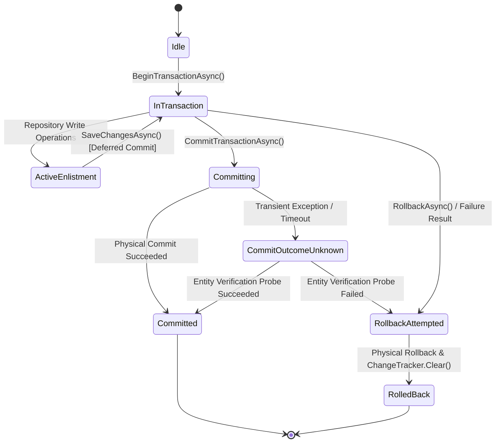

# Engineering & Architectural Standards

> **Authority Level:** Mandatory Backend & Full-Stack Development Standards  
> **Parent Document:** [`AGENTS.md`](./AGENTS.md)  
> **Repository Root:** `D:\DVLD-WPF`  
> **Baseline Commit:** `29e43d6ce26ff6e7f516c45f4f475b10bdc2bfd3`  

---

## 1. Architectural Foundation & Layered Boundaries

The DVLD backend is structured as an evidence-based Onion / Clean Architecture. All code contributions must honor strict directional dependency constraints:

```text
                  ┌───────────────────────────────┐
                  │      Presentation (API)       │ (DVLD.Api — Composition Root & Controllers)
                  └───────┬───────────────┬───────┘
                          │ references    │ references
                          ▼               │
       ┌────────────────────────┐         │
       │     Infrastructure     │         │
       └───────────┬────────────┘         │
                   │ references           │
                   ├──────────────────────┘
                   │
                   ▼
       ┌────────────────────────┐
       │      Application       │  (Application Services, DTOs, Interfaces, Business Rules)
       └───────────┬────────────┘
                   │ references
                   ▼
       ┌────────────────────────┐
       │         Domain         │  (Entities, Enums, Value Objects — Pure C#)
       └────────────────────────┘
```

### 1.1 Layer Responsibilities & Rules
1. **Domain Layer (`Domain/`):**
   - Contains pure entity models (`Person`, `User`, `ApplicationD`, `License`, `Driver`, `Test`, etc.).
   - Contains domain enums (`EnApplicationStatus`, `EnIssueReason`, etc.).
   - **Rule:** Zero dependencies on external libraries, EF Core attributes, or other solution layers.
2. **Application Layer (`Application/`):**
   - Owns use-case orchestration (`PersonService`, `LicenseIssuanceService`, `UserService`, etc.).
   - Defines repository and infrastructure abstractions (`IPersonRepository`, `IUnitOfWork`, `IFileStorageService`).
   - Defines application DTOs and validation rules.
   - **Rule:** Depends only on `Domain`. Must **never** reference `Infrastructure`, `DVLD.Api`, or EF Core packages (`Microsoft.EntityFrameworkCore`).
3. **Infrastructure Layer (`Infrastructure/`):**
   - Implements data persistence via `DVLDDbContext`, EF Core entity configurations, and SQL Server repositories.
   - Implements `IUnitOfWork` and transaction execution strategies.
   - Implements external physical file storage (`PhysicalFileStorageService`).
   - **Rule:** References `Application` (to implement interfaces) and `Domain` (to map entities). Must never expose EF Core `DbSet<T>` or EF entities directly outside repository boundaries when returning paged API data.
4. **Presentation / Web API Layer (`API/DVLD.Api/`):**
   - Thin ASP.NET Core controllers responsible for HTTP routing, model binding, authorization enforcement, and status code mapping.
   - Serves as the composition root for Dependency Injection, referencing `Application`, `Infrastructure`, and `DVLD.Contracts`.
   - **Rule:** Controllers must contain **zero business logic**. All business orchestration must delegate to Application Services.

---

## 2. Shared Contracts & DTO Boundaries

- `DVLD.Contracts` serves as the shared binary contract project referenced by `DVLD.Api` and `Presentation (WPF)`.
- `ClientApp` consumes JSON contracts over HTTP matching the API schema.
- **DTO Consolidation Principle (ARCH-01):** Duplicate DTOs currently exist across `DVLD.Contracts` and `Application/DTOs`. Where identical structures exist, prefer referencing shared definitions or maintaining explicit mapping via extension methods rather than scattered object initializers.

---

## 3. Functional Result Pattern & Error Handling

The application standardizes on the **`Result` / `Result<T>` pattern** to model operation outcomes without throwing domain exceptions for expected business failures.

```csharp
// Standard Result Pattern Definition
public class Result
{
    public bool IsSuccess { get; }
    public string? Error { get; }
    public static Result Success();
    public static Result Failure(string error);
}

public class Result<T> : Result
{
    public T? Value { get; }
    public static Result<T> Success(T value);
    public static Result<T> Failure(string error);
}
```

### 3.1 Service Error-Handling Rules & Persistence Boundaries
1. **Expected Business Failures:** Return `Result.Failure("Descriptive reason")` (e.g., license expired, applicant not qualified, person not found).
2. **Persistence Exception Boundary (INT-02 Architectural Principle):**
   - The `Application` layer must **not** introduce dependencies on EF Core packages (`Microsoft.EntityFrameworkCore`) or catch EF Core-specific database exceptions (such as `DbUpdateException`) directly.
   - `Infrastructure` owns database-specific persistence behavior, unique constraint detection, and error translation.
   - `Application` owns use-case execution and communicates application-level outcomes expressed via `Result` / `Result<T>`.
   - `API` maps application outcomes to appropriate HTTP responses.
   - For remediation of constraint violations (such as duplicate user creation INT-02), the architectural remediation direction must translate persistence conflicts at the infrastructure boundary into an application-level failure result without coupling `Application` to EF Core.
3. **Controller Status Code Mapping:**
   - `Result.IsSuccess == true` -> Return `Ok(result.Value)`, `Created(...)`, or `NoContent()`.
   - `Result.IsSuccess == false` -> Map to appropriate client error:
     - Entity missing -> HTTP 404 (Not Found).
     - Validation/Business rule failure -> HTTP 400 (Bad Request).
     - Concurrent state conflict -> HTTP 409 (Conflict).
4. **API Schema Standardization (REST-01):**
   - All error responses must adhere to **RFC 7807 `ProblemDetails`**.
   - Custom anonymous error envelopes (`return BadRequest(new { error = "..." })`) are prohibited in new and refactored code.

---

## 4. Unit of Work & Transaction Boundaries

The backend implements a sophisticated, explicit transaction state machine in `Infrastructure/Repositories/UnitOfWork.cs`.



### 4.1 Transaction Management Standards
1. **Scoped Lifecycle:** `DVLDDbContext` and `IUnitOfWork` are registered as Scoped services. A single HTTP request shares a single DbContext instance.
2. **Deferred Physical Commit:** Calling `SaveChangesAsync()` during an active transaction stages changes in EF Core's change tracker and flushes SQL statements to the open transaction, but does **not** commit the transaction. Only `CommitTransactionAsync()` commits.
3. **Automatic Rollback & Tracker Clearing:** If an operation returns a failure `Result` or throws an exception, `RollbackAsync()` must be invoked, and `ChangeTracker.Clear()` must be executed to prevent poisoned in-memory state from leaking into subsequent requests.
4. **Ambiguous Commit Verification:** `UnitOfWork` implements post-exception verification probes. When an uncertain commit failure occurs, it queries SQL Server to verify whether the primary entity was committed before deciding to retry or fail.
5. **Execution Strategies:** Multi-statement transactions must be wrapped inside `IExecutionStrategy.ExecuteAsync()` to enable SQL Server retry logic for transient network failures.

---

## 5. SQL Server Concurrency & Locking Standards

Data integrity under concurrent access is enforced through a combination of database constraints, application locks, and row-level locking hints.

### 5.1 Application-Level Mutual Exclusion (`sp_getapplock`)
`sp_getapplock` is not a blanket requirement for all multi-entity workflows. Rather, it is a specialized concurrency control mechanism required strictly where all of the following criteria are met:
1. **Genuine Concurrency Race:** A demonstrable concurrent race condition exists that cannot be resolved through single-statement atomic operations.
2. **Constraint Insufficiency:** Existing database constraints (such as unique indexes, filtered unique indexes, or foreign keys) and standard transaction isolation levels are insufficient to protect the business invariant without excessive table-level locking.
3. **Approved Locking Strategy:** The workflow has an explicit, approved locking design documented in an Architecture Decision Record (such as test appointment slot capacity management in `ADR-004`).
4. **Compliance with ADR-004 Conditions:** The implementation satisfies all documented ADR-004 requirements:
   - Consistent deterministic resource naming across all code paths.
   - Explicit transaction scope (`@LockOwner = 'Transaction'`).
   - Exclusive lock mode (`@LockMode = 'Exclusive'`) with timeout handling.
   - Verification of return codes (`>= 0` indicating successful acquisition).
   - Uniform protocol adherence across all reservation and modification paths.

*Current Implementation Example (Test Appointment Scheduling):*
- In test appointment slot scheduling, application locks are coordinated per test slot (`DVLD_Slot_{testTypeId}_{dateTime}`) and per applicant (`DVLD_Applicant_{personId}_{date}`). This locking strategy is intended to protect appointment capacity against concurrent overbooking without serializing the entire `TestAppointments` table, conditional on:
  - Successful lock acquisition (validating return codes `>= 0`).
  - Consistent deterministic resource naming across all scheduling and rescheduling entry points.
  - Correct transaction ownership (`@LockOwner = 'Transaction'`) aligned with the active transaction lifetime.
  - All relevant reservation, modification, and cancellation paths uniformly following the exact same locking protocol.
  - Correct handling of lock acquisition timeouts, deadlocks, and failure outcomes.
  The mere invocation of `sp_getapplock` does not automatically guarantee correctness if any concurrent path bypasses the lock protocol or fails to handle lock timeouts.

### 5.2 Row-Level Locking Rules (PERF-02 Standard)
1. **Read-Only Queries:** Ordinary queries (e.g. `GET /api/licenses/{id}`, search, pagination) must **never** specify `WITH (UPDLOCK, HOLDLOCK)`. They must execute as standard shared-read queries without blocking concurrent readers.
2. **Update Queries:** Methods intended to lock a row for modification must be explicitly separated and named `GetForUpdateAsync()` or `GetLicenseForRenewalAsync()`.
3. **Lock Compatibility Awareness:** Remember that SQL Server `UPDLOCK` (`U`) locks are incompatible with other `U` locks. Unwarranted `UPDLOCK` hints on read queries serialize readers against other readers.

---

## 6. Asynchronous Programming & Cancellation Tokens

1. **Async Everywhere:** All I/O operations (database queries, file storage, HTTP requests) must use asynchronous methods (`await`, `ToListAsync`, `SaveChangesAsync`).
2. **No `Task.Run` for CPU-Bound Web Work (PERF-03 Rejected):** ASP.NET Core request threads are already ThreadPool threads. Wrapping CPU-bound operations (such as BCrypt hashing or SkiaSharp image processing) in `Task.Run` induces context switches and thread pool starvation. Execute CPU tasks synchronously on the request thread.
3. **CancellationToken Propagation (API-01 Standard):**
   - Controller endpoints must accept `CancellationToken cancellationToken = default` (bound to `HttpContext.RequestAborted`).
   - All Application Services, Unit of Work, and repository query methods must accept and forward the `CancellationToken` to avoid orphaned long-running database queries when clients disconnect.

---

## 7. Minimal-Change & Code Cleanliness Principles

1. **Targeted Diffs:** Never reformat an entire file to change one line. Retain existing indentation, spacing, and bracket styles.
2. **Preserve Documentation:** Preserve all existing comments, docstrings, and license headers unless explicitly instructed to update them.
3. **No Unapproved Patterns:** Do not introduce MediatR, CQRS, Dapper, AutoMapper, or external message queues. The repository architecture relies on explicit C# interfaces, DI, and manual mapping for transparency and debuggability.