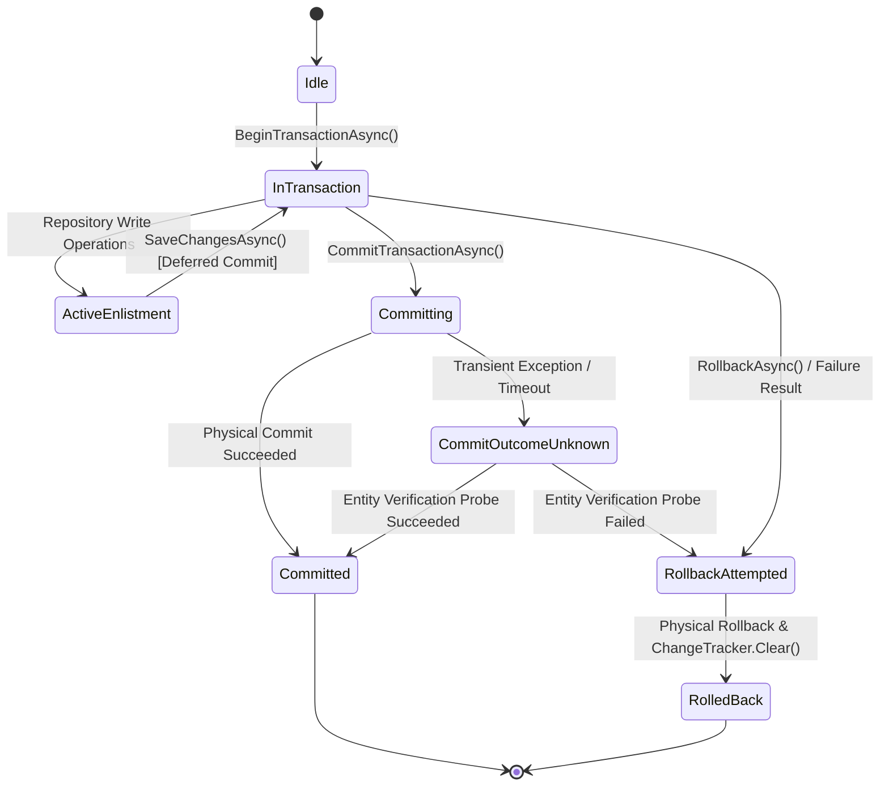
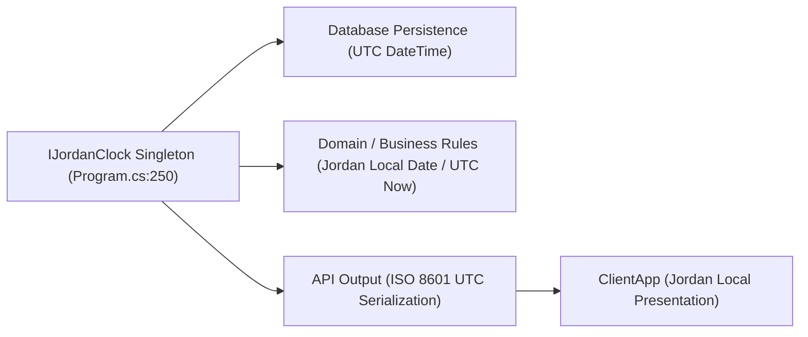

# Engineering & Architectural Standards

> **Authority Level:** Mandatory Backend & Full-Stack Development Standards  
> **Parent Document:** [`AGENTS.md`](./AGENTS.md)  
> **Master Plan Reference:** [`docs/PROJECT-COMPLETION-MASTER-PLAN.md`](./docs/PROJECT-COMPLETION-MASTER-PLAN.md)  
> **Repository Root:** `D:\DVLD-WPF`  
> **Baseline Commit:** `baa356705c3b5c364a9c5aabf0cd62a5aa21e4b9`  
> **Governance Status:** CONSOLIDATED & ENFORCED (Phase 2.1 Reconciled)  

---

## 1. Architectural Foundation & Layered Boundaries

The DVLD backend is structured as an evidence-based Onion / Clean Architecture. All code contributions must honor strict directional dependency constraints:

```text
                  ┌──────────────────────────────┐
                  │      Presentation (API)       │ (DVLD.Api — Composition Root & Controllers)
                  └───────┬──────────────┬───────┘
                          │ references    │ references
                          ▼               │
       ┌──────────────────────────────┐   │
       │     Infrastructure           │   │
       └──────────────┬───────────────┘   │
                   │ references           │
                   ├──────────────────────┘
                   │
                   ▼
       ┌──────────────────────────────┐
       │      Application             │  (Application Services, DTOs, Interfaces, Business Rules)
       └──────────────┬───────────────┘
                   │ references
                   ▼
       ┌──────────────────────────────┐
       │         Domain               │  (Entities, Enums, Value Objects — Pure C#)
       └──────────────────────────────┘
```

### 1.1 Layer Responsibilities & Rules
1. **Domain Layer (`Domain/`):**
   - Contains pure entity models (`Person`, `User`, `ApplicationD`, `License`, `Driver`, `Test`, etc.).
   - Contains domain enums (`EnApplicationStatus`, `EnIssueReason`, etc.).
   - **Rule:** Zero dependencies on external libraries, EF Core attributes, or other solution layers.
2. **Application Layer (`Application/`):**
   - Owns use-case orchestration (`PersonService`, `LicenseIssuanceService`, `UserService`, etc.).
   - Defines repository and infrastructure abstractions (`IPersonRepository`, `IUnitOfWork`, `IFileStorageService`, `ISecurityAuditService`).
   - Defines application DTOs and validation rules.
   - **Rule:** Depends only on `Domain`. Must **never** reference `Infrastructure`, `DVLD.Api`, or EF Core packages (`Microsoft.EntityFrameworkCore`).
3. **Infrastructure Layer (`Infrastructure/`):**
   - Implements data persistence via `DVLDDbContext`, EF Core entity configurations, and SQL Server repositories.
   - Implements `IUnitOfWork` and transaction execution strategies.
   - Implements external physical file storage (`PhysicalFileStorageService`).
   - **Rule:** References `Application` (to implement interfaces) and `Domain` (to map entities). Must never expose EF Core `DbSet<T>` or EF entities directly outside repository boundaries when returning paged API data.
4. **Presentation / Web API Layer (`API/DVLD.Api/`):**
   - Thin ASP.NET Core controllers responsible for HTTP routing, model binding, authorization enforcement, and status code mapping.
   - Serves as the composition root for Dependency Injection, referencing `Application`, `Infrastructure`, and `DVLD.Contracts`.
   - **Rule:** Controllers must contain **zero business logic**. All business orchestration must delegate to Application Services.

---

## 2. Shared Contracts & DTO Boundaries

- `DVLD.Contracts` serves as the shared binary contract project referenced by `DVLD.Api` and `Presentation (WPF)`.
- `ClientApp` consumes JSON contracts over HTTP matching the API schema.
- **DTO Consolidation Principle (ARCH-01):** Duplicate DTOs currently exist across `DVLD.Contracts` and `Application/DTOs`. Where identical structures exist, prefer referencing shared definitions or maintaining explicit mapping via extension methods rather than scattered object initializers.

---

## 3. Functional Result Pattern & Error Handling

The application standardizes on the **`Result` / `Result<T>` pattern** to model operation outcomes without throwing domain exceptions for expected business failures.

```csharp
// Standard Result Pattern Definition
public class Result
{
    public bool IsSuccess { get; }
    public string? Error { get; }
    public static Result Success();
    public static Result Failure(string error);
}

public class Result<T> : Result
{
    public T? Value { get; }
    public static Result<T> Success(T value);
    public static Result<T> Failure(string error);
}
```

### 3.1 Service Error-Handling Rules & Persistence Boundaries
1. **Expected Business Failures:** Return `Result.Failure("Descriptive reason")` (e.g., license expired, applicant not qualified, person not found).
2. **Persistence Exception Boundary (INT-02 Architectural Principle):**
   - The `Application` layer must **not** introduce dependencies on EF Core packages (`Microsoft.EntityFrameworkCore`) or catch EF Core-specific database exceptions (such as `DbUpdateException`) directly.
   - `Infrastructure` owns database-specific persistence behavior, unique constraint detection, and error translation.
   - `Application` owns use-case execution and communicates application-level outcomes expressed via `Result` / `Result<T>`.
   - `API` maps application outcomes to appropriate HTTP responses.
   - For remediation of constraint violations (such as duplicate user creation INT-02), the architectural remediation direction must translate persistence conflicts at the infrastructure boundary into an application-level failure result without coupling `Application` to EF Core.
3. **Controller Status Code Mapping (single mapping authority: `API/DVLD.Api/Results/ResultHttpMapper.cs`):**
   - `Result.IsSuccess == true` -> Return `Ok(result.Value)`, `Created(...)`, or `NoContent()`.
   - `Result.IsSuccess == false` -> Map by `ErrorType`:
     - `Validation` -> HTTP 400 `ValidationProblemDetails` (aggregated `detail` plus structured `errors`).
     - `Unauthorized` (caller not authenticated) -> HTTP 401.
     - `Forbidden` (authenticated but not permitted) -> HTTP 403.
     - `NotFound` -> HTTP 404.
     - `Conflict` (current resource state prevents the operation) -> HTTP 409.
     - `Failure` (or an undefined value) -> HTTP 500 with a generic message; internal detail is never echoed.
   - A successful `Result` must never be converted into a failure response, and the mapper must never throw because a controller passed a success value.
4. **API Schema Standardization (REST-01):**
   - All error responses must adhere to **RFC 7807 `ProblemDetails`** with `Content-Type: application/problem+json` and the fields `status`, `title`, `detail`, `type`, `instance`, and `traceId`.
   - Middleware-generated failures (401 challenge, 403 forbidden, unmatched-route 404, method-not-allowed 405, rate-limiter 429), model-binding failures, and unhandled exceptions use the same envelope.
   - Custom anonymous error envelopes (`return BadRequest(new { error = "..." })`) are prohibited in new and refactored code.

---

## 4. Unit of Work & Transaction Boundaries

The backend implements a sophisticated, explicit transaction state machine in `Infrastructure/Repositories/UnitOfWork.cs`.



### 4.1 Transaction Management Standards
1. **Scoped Lifecycle:** `DVLDDbContext` and `IUnitOfWork` are registered as Scoped services. A single HTTP request shares a single DbContext instance.
2. **Deferred Physical Commit:** Calling `SaveChangesAsync()` during an active transaction stages changes in EF Core's change tracker and flushes SQL statements to the open transaction, but does **not** commit the transaction. Only `CommitTransactionAsync()` commits.
3. **Automatic Rollback & Tracker Clearing:** If an operation returns a failure `Result` or throws an exception, `RollbackAsync()` must be invoked, and `ChangeTracker.Clear()` must be executed to prevent poisoned in-memory state from leaking into subsequent requests.
4. **Ambiguous Commit Verification:** `UnitOfWork` implements post-exception verification probes. When an uncertain commit failure occurs, it queries SQL Server to verify whether the primary entity was committed before deciding to retry or fail.
5. **Execution Strategies:** Multi-statement transactions must be wrapped inside `IExecutionStrategy.ExecuteAsync()` to enable SQL Server retry logic for transient network failures.

---

## 5. SQL Server Concurrency & Locking Standards

Data integrity under concurrent access is enforced through a combination of database constraints, application locks, and row-level locking hints.

### 5.1 Application-Level Mutual Exclusion (`sp_getapplock`)
`sp_getapplock` is not a blanket requirement for all multi-entity workflows. Rather, it is a specialized concurrency control mechanism required strictly where all of the following criteria are met:
1. **Genuine Concurrency Race:** A demonstrable concurrent race condition exists that cannot be resolved through single-statement atomic operations.
2. **Constraint Insufficiency:** Existing database constraints (such as unique indexes, filtered unique indexes, or foreign keys) and standard transaction isolation levels are insufficient to protect the business invariant without excessive table-level locking.
3. **Approved Locking Strategy:** The workflow has an explicit, approved locking design documented in an Architecture Decision Record (such as test appointment slot capacity management in `ADR-004`).
4. **Compliance with ADR-004 Conditions:** The implementation satisfies all documented ADR-004 requirements:
   - Consistent deterministic resource naming across all code paths.
   - Explicit transaction scope (`@LockOwner = 'Transaction'`).
   - Exclusive lock mode (`@LockMode = 'Exclusive'`) with timeout handling.
   - Verification of return codes (`>= 0` indicating successful acquisition).
   - Uniform protocol adherence across all reservation and modification paths.

*Current Implementation Example (Test Appointment Scheduling):*
- In test appointment slot scheduling, application locks are coordinated per test slot (`DVLD_Slot_{testTypeId}_{dateTime}`) and per applicant (`DVLD_Applicant_{personId}_{date}`). This locking strategy is intended to protect appointment capacity against concurrent overbooking without serializing the entire `TestAppointments` table, conditional on:
  - Successful lock acquisition (validating return codes `>= 0`).
  - Consistent deterministic resource naming across all scheduling and rescheduling entry points.
  - Correct transaction ownership (`@LockOwner = 'Transaction'`) aligned with the active transaction lifetime.
  - All relevant reservation, modification, and cancellation paths uniformly following the exact same locking protocol.
  - Correct handling of lock acquisition timeouts, deadlocks, and failure outcomes.
  The mere invocation of `sp_getapplock` does not automatically guarantee correctness if any concurrent path bypasses the lock protocol or fails to handle lock timeouts.

### 5.2 Row-Level Locking Rules (PERF-02 Standard)
1. **Read-Only Queries:** Ordinary queries (e.g. `GET /api/licenses/{id}`, search, pagination) must **never** specify `WITH (UPDLOCK, HOLDLOCK)`. They must execute as standard shared-read queries without blocking concurrent readers.
2. **Update Queries:** Methods intended to lock a row for modification must be explicitly separated and named `GetForUpdateAsync()` or `GetLicenseForRenewalAsync()`.
3. **Lock Compatibility Awareness:** Remember that SQL Server `UPDLOCK` (`U`) locks are incompatible with other `U` locks. Unwarranted `UPDLOCK` hints on read queries serialize readers against other readers.

---

## 6. Asynchronous Programming & Cancellation Tokens

1. **Async Everywhere:** All I/O operations (database queries, file storage, HTTP requests) must use asynchronous methods (`await`, `ToListAsync`, `SaveChangesAsync`).
2. **No `Task.Run` for CPU-Bound Web Work (PERF-03 Rejected):** ASP.NET Core request threads are already ThreadPool threads. Wrapping CPU-bound operations (such as BCrypt hashing or SkiaSharp image processing) in `Task.Run` induces context switches and thread pool starvation. Execute CPU tasks synchronously on the request thread.
3. **CancellationToken Propagation (API-01 Standard):**
   - Controller endpoints must accept `CancellationToken cancellationToken = default` (bound to `HttpContext.RequestAborted`).
   - All Application Services, Unit of Work, and repository query methods must accept and forward the `CancellationToken` to avoid orphaned long-running database queries when clients disconnect.

---

## 7. Minimal-Change & Code Cleanliness Principles

1. **Targeted Diffs:** Never reformat an entire file to change one line. Retain existing indentation, spacing, and bracket styles.
2. **Preserve Documentation:** Preserve all existing comments, docstrings, and license headers unless explicitly instructed to update them.
3. **No Unapproved Patterns:** Do not introduce MediatR, CQRS, Dapper, AutoMapper, or external message queues. The repository architecture relies on explicit C# interfaces, DI, and manual mapping for transparency and debuggability.

---

## 8. Time & Timezone Handling Invariants (Jordan Standard Time Standard)

The DVLD management system enforces strict, deterministic time-handling rules across persistence, application logic, and user presentation:



1. **UTC Storage Invariant:**
   - All `DateTime` timestamps stored in SQL Server must represent UTC (`DateTimeKind.Utc`).
   - Direct database column storage of local time is strictly prohibited to ensure temporal consistency and seamless data replication.
2. **Deterministic Timezone Representation:**
   - Official department civic business operates under **Jordan Standard Time (`Asia/Amman`)**.
   - Note on Daylight Saving Time: Jordan permanently abolished seasonal DST in October 2022. The kingdom observes UTC+3 year-round.
3. **Clock Abstraction & DI Registration (`IJordanClock`):**
   - Direct invocation of `DateTime.Now`, `DateTime.Today`, or `DateTime.UtcNow` inside domain entities, repositories, or application services is prohibited.
   - All components must inject [`IJordanClock`](./Application/Interfaces/IJordanClock.cs) (registered as a singleton in `API/DVLD.Api/Program.cs` line 250).
   - The authoritative interface defines:
     ```csharp
     public interface IJordanClock
     {
         DateTime Now { get; }      // Jordan local wall-clock date and time (DateTimeKind.Unspecified)
         DateOnly Today { get; }    // Jordan local calendar date
         DateTime UtcNow { get; }   // Current UTC instant (DateTimeKind.Utc)
     }
     ```
   - `IJordanClock.Now`: Returns the current Jordan local wall-clock date and time.
   - `IJordanClock.Today`: Returns the current Jordan local calendar date (used for applicant minimum legal age checks, license issue dates, expiration dates, and appointment slot scheduling).
   - `IJordanClock.UtcNow`: Returns the current UTC instant for technical timestamps (such as JWT tokens and audit records).
4. **Client & API Presentation:**
   - Backend API endpoints return ISO 8601 formatted UTC strings (e.g. `2026-11-08T12:00:00Z`).
   - `ClientApp` parses ISO strings and displays formatted dates according to Jordanian administrative conventions.

---

## 9. Security Architecture & Defensive Specifications (By Governance Category)

To prevent unapproved proposals from being mistaken for active code, every security specification is classified under one of five explicit governance categories:

1. `[EXISTING VERIFIED BEHAVIOR]` — Active code verified in repository baseline.
2. `[APPROVED ENGINEERING STANDARD]` — Formally approved standard governing future implementations.
3. `[PROPOSAL — UNAPPROVED]` — Engineered proposal submitted for Project Owner evaluation; not authorized.
4. `[DEFERRED / UNAUTHORIZED]` — Excluded from current milestones; postponed to a future roadmap phase.
5. `[OPERATIONAL OR EXTERNAL APPROVAL GATE]` — Conditioned upon external legal sign-off, DBA review, or formal risk acceptance.

---

### 9.1 Authentication & Stateless JWT Architecture

- **Stateless API Model `[EXISTING VERIFIED BEHAVIOR]`:** `DVLD.Api` operates as a stateless API. Client sessions authenticate via JWT Bearer tokens passed in the `Authorization` header (`Bearer <token>`).
- **Dynamic Database Revocation `[EXISTING VERIFIED BEHAVIOR]` (`ADR-003`):** To enforce immediate account revocation, `JwtBearerEvents.OnTokenValidated` in `Program.cs` queries `IUserService.IsUserActiveAsync(userId)` directly against SQL Server on every authenticated request.
- **Client-Side In-Memory Storage `[EXISTING VERIFIED BEHAVIOR]`:** `ClientApp` holds JWT tokens in memory during execution (`sessionStorage` for page reloads). Persistent browser local storage of access tokens is prohibited.
- **Stateless JWT Lifetime Reduction & JTI `[PROPOSAL — UNAPPROVED]` (`DEC-AUTH-01`, `SEC-PKG-10`):**
  - Baseline issues 240-minute (4-hour) tokens without `jti` claims (`RSK-04`).
  - `SEC-PKG-10` proposes reducing access token lifetime to 30 minutes and emitting a unique `jti` GUID claim.
  - **Governance Status:** The 30-minute duration is an **unapproved proposal**, NOT an approved production setting. Implementation carries zero authorization until approved under Gate 2.
- **Server-Side Token Revocation Store `[PROPOSAL — UNAPPROVED]` (`DEC-AUTH-02`):** Distributed Redis blacklists or database token-tracking tables remain open proposals for future consideration.
- **Full-Stack Session Modernization `[DEFERRED / UNAUTHORIZED]` (`SEC-05`, `FE-01`, `SEC-PKG-17`, `DEC-SEC05-01/02`):** Database-backed refresh tokens, cookie session transport, and multi-session revocation remain strictly deferred and unauthorized.

---

### 9.2 Authorization Boundaries & Segregation of Duties Model B

- **Segregation of Duties Model B Policy `[APPROVED POLICY — IMPLEMENTATION NOT AUTHORIZED]` (`ADR-O01`, `SEC-01`):**
  - Operational counter mutations (`Applications`, `Licenses`, `Detentions`, `Tests`) are strictly restricted to `Staff` via `[Authorize(Policy = "StaffOnly")]`.
  - `Admin` role is restricted to user management, system configuration, and audit oversight. Administrators do not inherit operational counter privileges.
  - **Governance Status:** Approved policy record. Translating this policy into code changes in backend controllers or frontend route guards remains **NOT AUTHORIZED** until Phase 12.2 / Phase 12.4.
- **Administrative Read-Only Inspection Access `[PROPOSAL — UNAPPROVED]` (`DEC-RBAC-01`):** Evaluates granting administrators read-only GET visibility on counter records for audit oversight. Counter endpoints remain strictly `StaffOnly` unless an ADR amendment is formally approved.
- **Frontend Route Guard Alignment `[PROPOSAL — UNAPPROVED]` (`SEC-PKG-05`):** Proposal to align `ClientApp` route guards with backend `StaffOnly` policies to eliminate HTTP 403 navigation errors on License History (`RSK-12`).

---

### 9.3 Credential Verification & Password Policy

- **Modern BCrypt Hashing `[EXISTING VERIFIED BEHAVIOR]`:** `UserService.cs` invokes `BCrypt.Net.BCrypt.HashPassword(dto.Password)` (standard BCrypt with work factor 11). `AuthService.cs` verifies credentials via `BCrypt.Net.BCrypt.Verify(dto.Password, user.Password)`.
- **Constant-Time Verification & Timing Defense `[PROPOSAL — UNAPPROVED]` (`SEC-PKG-08`):**
  - Proposal to execute a constant-time dummy BCrypt verification (work factor 11) in `AuthService.AuthenticateAsync` when a username is not found, eliminating response-time side-channels (`RSK-03`).
  - **Governance Status:** Unapproved proposal; carries zero implementation authorization.
- **NIST SP 800-63B Password Complexity Standard `[PROPOSAL — UNAPPROVED]` (`DEC-CRED-01`, `SEC-PKG-09`):**
  - Current code enforces only length 8–100 (`UserValidator.cs:196-215`).
  - Proposal to adopt NIST SP 800-63B (minimum 12–16 characters, top-10,000 breached password blocklist, elimination of arbitrary character composition rules).
  - **Governance Status:** Unapproved proposal; carries zero implementation authorization.
- **Password-Change Rate Limiting `[PROPOSAL — UNAPPROVED]` (`SEC-03`):** Proposed sliding-window endpoint throttling on `POST /api/auth/change-password` scheduled under Phase 12.5.

---

### 9.4 Account-Level Lockout Defense & Anti-Brute-Force Standards

- **IP-Based Login Rate Limiting `[EXISTING VERIFIED BEHAVIOR]`:** `Program.cs:157-175` enforces IP-partitioned rate limiting (10 requests/minute) on login routes.
- **Account Lockout Architecture `[PROPOSAL — UNAPPROVED]` (`DEC-CRED-02`, `SEC-PKG-11`):**
  - Proposal to introduce database-backed failed attempt counters and lockout timestamps on `Users`.
  - Threshold ($N$ failures) and lockout duration ($M$ minutes) remain unresolved under `DEC-CRED-02`.
- **Database Schema Migration `[OPERATIONAL APPROVAL GATE]` (Schema Gate 5):**
  - Adding `AccessFailedCount`, `LockoutEnd`, and `LockoutEnabled` to `Users` requires explicit human DBA review. Zero migrations are authorized.
- **Denial-of-Service Risk Acceptance `[OPERATIONAL APPROVAL GATE]` (`RSK-05`, `DEC-CRED-02`):**
  - Hard lockout exposes staff accounts to denial-of-service lockout attacks. Enabling lockout logic is conditioned on formal Risk Owner sign-off.

---

### 9.5 Administrative Privilege Safety & Anti-Self-Demotion

- **Hardcoded Admin Logic `[EXISTING CODE (TO BE REMEDIATED)]` (`RSK-09`):** `UserService.cs:350-370` protects user ID 2 and username `"ayhm"` via hardcoded checks.
- **Dynamic Administrative Safety Standard `[PROPOSAL — UNAPPROVED]` (`SEC-PKG-04`):**
  - Proposal to replace hardcoded strings with atomic database queries asserting at least one active administrator remains, and preventing active administrators from self-demoting or self-deactivating.
  - **Governance Status:** Unapproved proposal; carries zero implementation authorization.

---

### 9.6 Input Sanitization & Physical File Storage Security

- **Storage Root Directory Traversal Check `[EXISTING VERIFIED BEHAVIOR]`:** `PhysicalFileStorageService.cs:185-207` (`ResolveFullPath`) verifies that all resolved physical paths begin with the canonical `_storageRoot` prefix and contains no `..` or `:` characters, blocking directory traversal.
- **Image Binary Re-encoding `[EXISTING VERIFIED BEHAVIOR]`:** Uploaded photos are decoded and re-encoded via SkiaSharp into WEBP format in `ImageProcessingService.cs:137-141`, stripping malicious EXIF payloads.
- **DTO `ImagePath` Parameter Stripping `[PROPOSAL — UNAPPROVED]` (`DEC-FILE-01`, `SEC-PKG-02`):**
  - Proposal to remove client-supplied `ImagePath` strings from `CreatePersonRequest` and `UpdatePersonRequest` to eliminate cross-user image deletion vulnerabilities within `_storageRoot` (`RSK-02`).
  - **Governance Status:** Unapproved proposal; carries zero implementation authorization.

---

### 9.7 Query Pagination Clamping & Data Minimization

- **Basic Entity Pagination `[EXISTING VERIFIED BEHAVIOR]`:** Pagination exists across People, Drivers, Licenses, and Local Applications when query parameters are supplied.
- **Unpaged Fallback Defect `[EXISTING CODE (TO BE REMEDIATED)]` (`RSK-10`):** `PeopleController.cs:48` falls back to unpaged `GetAllPeopleAsync()` if query parameters are omitted.
- **Mandatory Server-Side Clamping `[PROPOSAL — UNAPPROVED]` (`SEC-PKG-03`):**
  - Proposal to enforce default parameters (page 1, size 10), clamp maximum page size to 50, and eliminate unpaged bulk queries.
  - **Governance Status:** Scheduled acceptance criterion under Phase 12.2; carries zero current implementation authorization.
- **Citizen PII Masking & Data Minimization `[OPERATIONAL APPROVAL GATE]` (`RSK-11`):**
  - Plaintext citizen PII is exposed to all staff without field-level masking. Dynamic masking is a deferred architecture specification.
  - **Production Release Gate:** The platform is **ineligible for production release** under `RSK-11` until documented formal risk acceptance is granted under Gate 8 by the appointed Risk Owner.

---

### 9.8 HTTP Security Headers & Reverse Proxy Trust

- **Defensive HTTP Response Headers `[PROPOSAL — UNAPPROVED]` (`SEC-PKG-12`):** Proposal to inject `X-Content-Type-Options: nosniff`, `X-Frame-Options: DENY`, `Referrer-Policy`, and `HSTS` via middleware.
- **Reverse Proxy CIDR Forwarding `[OPERATIONAL APPROVAL GATE]` (`DEC-DEP-01`):** Configuration of `ForwardedHeadersOptions` with exact `KnownProxies` and `KnownNetworks` CIDRs conditioned on deployment hosting selection.
- **Content Security Policy Ownership `[APPROVED ENGINEERING STANDARD]` (`DEC-DEP-02`):** CSP headers belong to the web host serving the React SPA HTML shell. `DVLD.Api` serves strictly JSON and does not emit HTML CSP headers.
- **Production Secret Isolation `[OPERATIONAL APPROVAL GATE]` (`SEC-PKG-13`):** Mandates injection of production connection strings and JWT signing keys via environment variables or secret vaults.

---

### 9.9 Software Composition Analysis (SCA) & CI Hardening

- **Automated CI Dependency Scanning `[PROPOSAL — UNAPPROVED]` (`SEC-PKG-14`):**
  - Proposal to integrate automated vulnerability scanning (`dotnet list package --vulnerable`, `npm audit`) on pull requests.
  - **Scope Boundary:** Independent operational requirement; strictly decoupled from `.trx` test-attachment publishing (`OBS-02`).

---

### 9.10 Civic Licensing Regulatory Verification Preconditions

- **Detained License Replacement Precondition `[OPERATIONAL / REGULATORY GATE]` (`INT-03`, `SEC-PKG-15`, `ADR-O02`, `DEC-POL-01`):**
  - Proposal to inject `IDetainedLicenseRepository` into `LicenseReplacementService` to block replacing actively detained licenses.
  - **Governance Status:** Provisionally selected internal policy (`ADR-O02`). Code modifications remain **STRICTLY BLOCKED** pending formal written confirmation from the Licensing Authority under Gate 3 (`DEC-POL-01`).
- **International Driving Permit Detention Check `[OPERATIONAL / REGULATORY GATE]` (`SEC-PKG-16`, `DEC-POL-02`):**
  - Proposal to verify domestic license detention in `InternationalService` before issuing international driving permits.
  - **Governance Status:** Operationally distinct from `INT-03`. Code modifications remain **STRICTLY BLOCKED** pending formal written confirmation from the Licensing Authority under Gate 3 (`DEC-POL-02`).

---

### 9.11 Workflow State Machine & Application Completion Route Integrity

- **Prohibition of Direct Application Completion `[PROPOSAL — UNAPPROVED]` (`INT-01`, `SEC-PKG-01`, `ADR-P03`, `DEC-APP-01`):**
  - `POST /api/applications/{id}/complete` allows authenticated `Staff` users to transition an application directly to `Completed` without verifying prerequisite workflow conditions (vision/theory/practical test passage, fee payments, license issuance).
  - **Remediation Specification (`SEC-PKG-01`):** Hard deletion of `POST /api/applications/{id}/complete` route and corresponding service method in `ApplicationService.cs` under canonical task `INT-01` (`ADR-P03`).
  - **Governance & Approval Gate:** Deletion is blocked on empirical telemetry observation window under `DEC-APP-01` and Gate 6 (API Breaking Change Gate) to confirm zero unrepresented external consumers before route removal.

---

## 10. Security Audit Trail Architecture & Failure Handling (`DEC-AUD-02`)

The platform architecture distinguishes between transactional business auditing and high-speed security event telemetry:

```mermaid
flowchart TD
    subgraph SecurityTelemetry ["Security Event Telemetry (SEC-04)"]
        AUTH_EV["Authentication & Admin Events (Login, Lockout, Demote)"]
        AUTH_EV --> EMIT["ISecurityAuditService.EmitEventAsync(SecurityEvent)"]
        EMIT --> SINK_TRY{"Primary Sink Available?<br/>(Rolling JSON / SQL)"}
        SINK_TRY -- Yes --> SINK_OK["Write Event to Primary Sink"]
        SINK_TRY -- No (Exception) --> SINK_FAIL["Log Diagnostic Warning (ILogger)"]
        SINK_FAIL --> RING_BUF["Push to In-Memory Fallback Ring Buffer<br/>(PROPOSAL — UNAPPROVED DEC-AUD-02)"]
        RING_BUF --> DRAIN["Drain Worker Flushes to Secondary Log on Recovery"]
    end

    subgraph TransactionalSQL ["Transactional SQL Audit (AUD-01)"]
        MUT["Licensing Service Mutation (Issue, Renew, Detain)"]
        MUT --> TX["UnitOfWork Open Transaction"]
        TX --> AUD_ROW["Insert AuditLog Record (ActorID, Action, Before/After JSON)"]
        AUD_ROW --> COMMIT["Atomic Commit (Business Entity + Audit Record)"]
        COMMIT -- Failure --> ROLLBACK["Atomic Rollback (Zero Partial Write)"]
    end
```



### 10.1 Structured Security Event Logging `[PROPOSAL — UNAPPROVED]` (`SEC-04`, `SEC-PKG-06`)
- Security audit events must capture: `EventID` (GUID), `ActorID` (int/null), `Action` (enum), `TargetEntityType`, `TargetEntityID`, `TimestampUtc`, `OutcomeStatus`, `ClientIP`, `UserAgent`, and `CorrelationID`.
- **Payload Redaction `[APPROVED ENGINEERING STANDARD]`:** Passwords, password hashes, JWT token strings, and unnecessary citizen PII must **never** be logged.
- **Storage Sink Selection `[PROPOSAL — UNAPPROVED]` (`DEC-AUD-01`):** Rolling JSON log files with OS ACLs proposed for initial deployment; dedicated SQL table proposed for enterprise monitoring.

### 10.2 Transactional Audit Logging for Core Mutations `[PROPOSAL — UNAPPROVED]` (`AUD-01`, `SEC-PKG-07`)
- Licensing mutations (`Licenses`, `DetainedLicenses`, `Applications`) require transactional persistence in an `AuditLogs` table.
- Audit records must be inserted inside the active database transaction within `UnitOfWork.SaveChangesAsync()`. If the transaction rolls back, the audit record rolls back atomically, preventing phantom entries.

### 10.3 Complete `DEC-AUD-02` In-Memory Ring Buffer Specification `[PROPOSAL — UNAPPROVED — NOT AUTHORIZED]`

> [!WARNING]
> **Proposed Architectural Design Only:**  
> The in-memory fallback ring buffer, circular queue structure, 10,000-event capacity limit, eviction policy, and background drain worker described below represent an **unimplemented architectural design proposal** under open decision `DEC-AUD-02`. Zero code implementing this design exists in the active codebase.

1. **Strategic Problem Statement:** What failure handling policy should govern the system if the primary security audit sink is unavailable?
2. **Evaluated Alternatives:**
   - *Option 1 (Fail-Closed):* Reject incoming user requests and security-sensitive operations if the audit sink write fails.
   - *Option 2 (Fail-Open with Local In-Memory Fallback Ring Buffer — Recommended Proposal):* Log a diagnostic warning, buffer the event in an in-memory circular ring buffer, and allow the core business operation to proceed.
3. **Proposed Fail-Open Rationale:** A failure in the security audit logging pipeline (disk full, network partition, permission fault) must not cause departmental denial of service for citizen counter operations. Operational availability takes precedence over immediate synchronous audit write confirmation.
4. **Proposed Ring Buffer Structure:**
   - Thread-safe bounded circular queue using `System.Collections.Concurrent.ConcurrentQueue<SecurityEvent>`.
   - **Fixed Capacity:** Exactly **10,000 events** (~4–8 MB RAM footprint).
   - **Overflow Eviction Policy:** Oldest buffered event is dequeued and dropped (FIFO eviction) when capacity is reached, preventing Out-Of-Memory (OOM) crashes. An internal atomic drop counter tracks dropped events.
5. **Proposed Recovery & Drain Worker:** A background hosted service (`AuditBufferDrainWorker`) periodically flushes buffered events to a secondary emergency local file (`logs/audit-fallback-.log`) or back to the primary sink once connectivity recovers.
6. **Data-Loss vs. Availability Trade-Off:** Explicitly accepts potential event loss during prolonged outages exceeding 10,000 events or catastrophic process crashes while events reside in memory; mitigated by degraded health check telemetry and emergency alerts when the drop counter exceeds zero.

---

## 11. Security Governance & Authorization Boundaries

The following boundaries govern all engineering activities across the repository:

1. **Policy Approval Does Not Authorize Code Changes:** Approval of `ADR-O01` (Model B) establishes the civic standard only. Modifying controllers or frontend guards remains strictly unauthorized until Phase 12.2 / Phase 12.4 is approved.
2. **Proposed Controls Are Not Approved Production Settings:** All proposed token lifetimes, password standards, and lockout thresholds are submitted proposals requiring explicit Project Owner sign-off.
3. **`SEC-05` Session Modernization Track:** Refresh token rotation, cookie session transport, and multi-session tracking remain **DEFERRED AND STRICTLY UNAUTHORIZED**.
4. **Token Lifetime Proposal (`DEC-AUTH-01`):** The 30-minute access token lifetime is an **unapproved proposal**.
5. **PII Risk Acceptance (`RSK-11`):** Formal risk acceptance for plaintext citizen PII exposure has **NOT** been granted. Risk Owner assignment remains pending. The platform is ineligible for production release without documented sign-off under Gate 8.
6. **Database Schema Gate 5:** Physical schema modifications to `Users` require explicit human DBA approval. Migrations to `DVLDf` are prohibited.
7. **External Regulatory Approval Gates:** Rulings on `ADR-O02` / `DEC-POL-01` and `DEC-POL-02` are external statutory gates under Gate 3. Zero code changes are authorized without written regulatory confirmation.
8. **Decoupling of Civic Invariants:** `SEC-PKG-16` (international permit detention) is strictly distinct from `INT-03` (domestic license replacement).
9. **Zero New Canonical Task IDs:** All security specifications are incorporated without creating new canonical backlog IDs.
10. **Canonical Risk Register Integration:** Active engineering standards reference risks using unified identifiers (`RSK-01`–`RSK-20`), where foundational Phase A empirical findings (`RSK-S01`–`RSK-S13`) are remapped (e.g. `RSK-S08` maps to `RSK-03` Timing Defense; `RSK-08` is exclusively Multi-Factor Authentication; `RSK-05` governs Account Lockout DoS; `RSK-11` governs Plaintext PII Exposure). The authoritative canonical mapping ledger is maintained in [`SECURITY-STANDARDS.md`](./SECURITY-STANDARDS.md) §7.

---

## 12. SOLID Principles & Clean Code Standards

To ensure long-term maintainability, testability, and structural integrity across the DVLD codebase, all active development and future remediation must adhere to the five SOLID principles grounded in actual empirical source evidence:

### 12.1 Single Responsibility Principle (SRP)
- **Status:** **Partially Compliant.**
- **Empirical Baseline:**
  - *Compliant Architecture:* Workflow-specific service decomposition in license management cleanly separates concerns: [`LicenseIssuanceService`](file:///d:/DVLD-WPF/Application/Services/LicenseIssuanceService.cs), [`LicenseRenewalService`](file:///d:/DVLD-WPF/Application/Services/LicenseRenewalService.cs), [`LicenseReplacementService`](file:///d:/DVLD-WPF/Application/Services/LicenseReplacementService.cs), and [`LicenseQueryService`](file:///d:/DVLD-WPF/Application/Services/LicenseQueryService.cs). Validation is cleanly isolated in static validator classes (`PersonValidator`, `UserValidator`), and DTO projection is isolated in mappers (`UserMapper`, `PersonMapper`).
  - *Identified Gaps:* [`UserService.cs`](file:///d:/DVLD-WPF/Application/Services/UserService.cs) (590 lines) conflates user demographic CRUD with credential verification, BCrypt password hashing, and role authorization checks. [`ApplicationsController.cs`](file:///d:/DVLD-WPF/API/DVLD.Api/Controllers/ApplicationsController.cs#L85-L90) houses the orphan `Complete` endpoint bypassing business workflow services (`INT-01`).
  - *Future Remediation Direction:* Under proposed roadmap task `ARCH-03`, assess decomposing `UserService` into a dedicated `IUserCredentialService` (password hashing, credential validation) while preserving user profile orchestration in `UserService`, avoiding unnecessary abstractions until Phase 12.5.
- **Architectural Rules:**
  1. API Controllers must act solely as thin HTTP transport coordinators (routing, model binding, authorization, status code mapping via `ResultHttpMapper`). Controllers must never execute business rules or interact directly with Entity Framework DbContexts.
  2. Application Services must orchestrate a single bounded business workflow. Domain entities must remain pure POCOs free of infrastructure or presentation dependencies.

### 12.2 Open/Closed Principle (OCP)
- **Status:** **Partially Compliant.**
- **Empirical Baseline:**
  - *Compliant Architecture:* Repository abstractions (`IPersonRepository`, `ILicenseRepository`) and service interfaces enable behavioral extension via decorators (e.g., caching decorators for static lookups under `API-02`) without altering core business orchestration.
  - *Identified Gaps:* Examination progression in [`TestWorkflowService.cs`](file:///d:/DVLD-WPF/Application/Services/TestWorkflowService.cs#L16-L21) hardcodes the sequential array `[Theory, Written, Practical]`. Adding or modifying test types requires modifying procedural service logic rather than configuring extensible domain rules.
- **Architectural Rules:**
  1. Prefer polymorphism, strategy patterns, and decorator patterns over sprawling `switch` statements when branching on domain entity types or examination classifications.
  2. Error handling and domain response envelopes must extend `Result<T>` rather than altering core method signatures.

### 12.3 Liskov Substitution Principle (LSP)
- **Status:** **Verified Compliant.**
- **Empirical Baseline:**
  - *Compliant Architecture:* The domain model avoids fragile polymorphic inheritance hierarchies. Standalone POCO entities (`Person`, `User`, `License`) use clean composition and 1-to-1 foreign key relationships. Repository implementations (`PersonRepository`, `LicenseRepository`) honor all contract invariants of their respective interfaces without throwing `NotImplementedException` or mutating caller expectations. [`PhysicalFileStorageService`](file:///d:/DVLD-WPF/Infrastructure/Services/PhysicalFileStorageService.cs) honors `IFileStorageService` return semantics across missing keys and valid streams.
- **Architectural Rules:**
  1. Subtypes or interface implementations must be fully substitutable for their base abstractions without altering program correctness or throwing unexpected runtime exceptions.
  2. Avoid entity inheritance hierarchies in Entity Framework Core mappings (favor Table-Per-Type or clean composition over Table-Per-Hierarchy with discriminator columns).

### 12.4 Interface Segregation Principle (ISP)
- **Status:** **Partially Compliant.**
- **Empirical Baseline:**
  - *Compliant Architecture:* License workflow interfaces are cleanly segregated into client-specific contracts (`ILicenseIssuanceService`, `ILicenseRenewalService`, `ILicenseReplacementService`, `ILicenseQueryService`). Infrastructure services expose small, focused interfaces (`IJordanClock`, `IFileStorageService`, `IImageProcessingService`).
  - *Identified Gaps:* [`ILicenseRepository.cs`](file:///d:/DVLD-WPF/Application/Interfaces/ILicenseRepository.cs#L7-L56) has expanded into a monolithic 25-method interface coupling CRUD queries, pagination filters, background maintenance (`DeactivateExpiredLicensesAsync`), and dashboard reporting aggregates (`GetRenewalSummaryAsync`), forcing test fixtures and alternative implementations to satisfy dozens of unrelated methods.
- **Architectural Rules:**
  1. Clients must not be forced to depend on interface methods they do not use. Monolithic repositories must be refactored into cohesive role interfaces (e.g. `ILicenseRepository`, `ILicenseExpirationMaintenanceRepository`, `ILicenseReportingRepository` under roadmap task `ARCH-02`).
  2. Service interfaces consumed by API controllers must expose only the operation methods required by those endpoints.

### 12.5 Dependency Inversion Principle (DIP)
- **Status:** **Verified Compliant.**
- **Empirical Baseline:**
  - *Compliant Architecture:* High-level orchestration in `Application/` depends strictly on abstractions defined in `Application/Interfaces/` (`IUnitOfWork`, `IPersonRepository`, `IFileStorageService`). Low-level implementations reside in `Infrastructure/` and `API/DVLD.Api/`. [`Application/Application.csproj`](file:///d:/DVLD-WPF/Application/Application.csproj) references only `Domain/` and contains **zero** project references to `Infrastructure/` or `DVLD.Api/`. All dependencies are bound in the IoC container in [`Program.cs`](file:///d:/DVLD-WPF/API/DVLD.Api/Program.cs#L200-L295).
- **Architectural Rules:**
  1. High-level modules must never depend on low-level modules; both must depend on abstractions.
  2. Abstractions must never depend on implementation details. Details (EF Core, SQL Server, file system, BCrypt) must depend on abstractions.
  3. Strict inward reference direction: `Domain` $\leftarrow$ `Application` $\leftarrow$ `Infrastructure` / `DVLD.Api`.

---

## 13. System Design & Scalability Standards for DVLD Modular Monolith

### 13.1 Architecture Style — Modular Monolith
The DVLD system is architecturally designed and validated as an enterprise **Modular Monolith** (`ADR-001`). Microservice decomposition is explicitly rejected (`ADR-R03`) due to the tight transactional coupling inherent in civic licensing (license creation, application completion, test appointment validation, and fee charging must execute as a single atomic SQL Server transaction). Introducing distributed sagas, two-phase commits, and eventual consistency introduces unacceptable legal credential hazards for a departmental agency.

### 13.2 Transactional Consistency & Partition Fail-Safe Standards
As a centralized single-database enterprise application, the CAP theorem does not apply as a blanket architectural label. Rather, the following foundational consistency standards govern:
1. **Strong Transactional Consistency (ACID):** Critical civic licensing workflows (license issuance, examination progression, license replacement, and detention lifecycle) require strict transactional atomicity and immediate consistency. Eventual consistency is unacceptable for legally binding credentials.
2. **Fail-Safe Behavior on Dependency/Partition Failure:** If a distributed partition or external dependency failure (e.g. distributed cache, external payment gateway, or network storage) prevents guaranteeing a critical business invariant, the operation must **fail safely** (abort the transaction and return an RFC 7807 problem details response) rather than commit an inconsistent or partially completed state.

### 13.3 Evaluation Matrix: The 17 System Design Concepts

| Concept | Classification | Technical Justification & Implementation Baseline |
|---|:---:|---|
| **1. Load Balancing** | **Prepare for Future** | `DVLD.Api` is stateless (JWT auth, no in-memory session state). Multiple API nodes can sit behind an L7 reverse proxy (Nginx / Azure Application Gateway / IIS ARR) as concurrency expands across regional offices. |
| **2. Caching** | **Implement Now** | Roadmap task `API-02`: In-memory caching (`IMemoryCache`) for immutable static reference lookups (`Countries`, `LicenseClasses`, `ApplicationTypes`, `TestTypes`). Eliminates redundant database roundtrips for frequent UI dropdowns. |
| **3. CDN** | **Not Applicable / Not Justified** | DVLD is an internal civic intranet/extranet application for staff and officers. Citizen photographs are sensitive biometric data that must never be cached on public CDN edge nodes. Static SPA bundles are served via local web servers. |
| **4. API Gateway** | **Not Applicable / Not Justified** | DVLD is a single Modular Monolith Web API, not a microservice fleet. Introducing YARP, Ocelot, or Kong adds unnecessary network hops and operational latency without architectural benefit. Reverse proxy needs are met by IIS/Kestrel. |
| **5. Microservices** | **Not Applicable / Not Justified** | Formally rejected under `ADR-001` / `ADR-R03`. Civic credential issuance requires strong ACID transactions across multiple aggregates. Distributed transactions introduce eventual consistency bugs and unnecessary operational complexity. |
| **6. Monolithic Architecture** | **Implement Now** | Current verified architecture. Modular Monolith with clean internal layer boundaries (`Domain`, `Application`, `Infrastructure`, `DVLD.Api`). Optimal for deployment simplicity, operational debuggability, and transactional safety. |
| **7. Replication** | **Conditional — Only When Needed** | SQL Server Always On Availability Groups with asynchronous read-only replicas can be introduced if heavy analytical or reporting workloads cause lock contention on the primary OLTP instance. Unjustified at current staff scale. |
| **8. Partitioning** | **Conditional — Only When Needed** | Table partitioning (by Year/Month) on the `AuditLogs` table will be valuable once audit logging accumulates multi-million record histories. Database sharding is unjustified for regional civic licensing scale. |
| **9. Message Queues** | **Conditional — Only When Needed** | External asynchronous notifications (SMS/Email alerts for license expiration) or audit offloading can utilize RabbitMQ or Azure Service Bus in future phases (`SEC-05`). In-process hosted services cleanly handle current scheduled sweeps. |
| **10. Rate Limiting** | **Implement Now** | Roadmap tasks `SEC-03` (`POST /api/auth/change-password` rate limiting) and `SEC-PKG-03` (collection pagination clamping $PageSize \le 50$). Protects against brute-force attacks and resource exhaustion. |
| **11. Consistent Hashing** | **Not Applicable / Not Justified** | Applicable to distributed caching rings (Memcached/DynamoDB) across dynamic clusters. DVLD utilizes a centralized SQL Server database and single-node or shared Redis caches; consistent hashing has zero application. |
| **12. CAP Theorem (Consistency Principles)** | **Implement Now** | Apply relevant consistency principles; do not classify the entire application as CP. Strong transactional consistency is strictly enforced for all legal licensing mutations. |
| **13. Horizontal Scaling** | **Prepare for Future** | API tier is stateless and ready for horizontal scale. Full multi-instance deployment requires externalizing the distributed token revocation list (`DEC-AUTH-01`) and mounting shared network storage (SMB/NFS or Azure Blob) for citizen photos. |
| **14. Vertical Scaling** | **Implement Now** | The primary, cost-effective scaling path for DVLD. Scaling SQL Server database compute (vCPUs), memory (RAM for buffer pool), and high-throughput NVMe SSD storage easily supports tens of thousands of daily civic transactions. |
| **15. Fault Tolerance** | **Implement Now** | `GlobalExceptionHandler` RFC 7807 shielding, SQL Server execution retry strategy (`EnableRetryOnFailure` in `UnitOfWork.ExecuteInTransactionAsync`), and Health Checks (`OBS-01`). |
| **16. Circuit Breaker** | **Conditional — Only When Needed** | Circuit breakers (Polly) are appropriate when integrating unreliable external third-party HTTP services (e.g. national payment gateways or external SMS gateways). Unjustified for local database and storage calls. |
| **17. Event-Driven Architecture** | **Conditional — Only When Needed** | Direct service orchestration remains the approved design; in-process event buses were evaluated and rejected (`ADR-R01`, `ADR-R02`) to prevent speculative indirection. Internal domain events considered only when justified. |

---

## 14. Formal Technology Baseline & Evaluation

The technology stack is governed by verified package manifests and explicit architectural approvals. Zero unauthorized packages may be introduced:

| Engineering Area | Intended Baseline Technology | Governance Classification | Technical Rationale & Architectural Boundary |
|---|---|:---:|---|
| **Backend Framework** | ASP.NET Core 8 (`Microsoft.AspNetCore.App`) | **Existing and Retained** | Modern LTS web framework providing high-throughput Kestrel hosting, dependency injection, and endpoint routing. |
| **Programming Language** | C# 12 / .NET 8 SDK | **Existing and Retained** | Type-safe, high-performance runtime across `API/`, `Application/`, `Infrastructure/`, and `Domain/`. |
| **Frontend Framework** | React 19 (`react: ^19.3.1`) | **Existing and Retained** | Current active SPA in `ClientApp/`. Zero React 18 or legacy web dependencies. |
| **Frontend Language** | TypeScript (`typescript: ~6.0.3`) | **Existing and Retained** | Full type safety across contracts, API hooks, and UI components in `ClientApp/`. |
| **Frontend Build Tool** | Vite 8 (`vite: ^8.3.4`) | **Existing and Retained** | Fast HMR dev server and optimized production rollup bundler. |
| **UI Styling** | Tailwind CSS 4 (`tailwindcss: ^4.3.3`) | **Existing and Retained** | Modern utility-first CSS framework with Vite plugin integration. |
| **UI Primitives** | Radix UI Primitives | **Existing and Retained** | Accessible, unstyled UI components (Dialog, Dropdown, Select, Tooltip). |
| **Iconography** | Lucide React (`lucide-react: ^1.65.0`) | **Existing and Retained** | Lightweight SVG icon library. |
| **Relational Database** | Microsoft SQL Server (LocalDB / Enterprise) | **Existing and Retained** | Centralized transactional database supporting ACID transactions, table constraints, and `sp_getapplock`. |
| **ORM / Data Access** | Entity Framework Core 8 (`EF Core 8.0.24`) | **Existing and Retained** | Code-first mapping with migrations, change tracking, and execution retry strategies. |
| **API Architectural Style** | RESTful JSON Web API | **Existing and Retained** | HTTP verbs, RFC 7807 `ProblemDetails` error envelopes, and `Result<T>` mapping via `ResultHttpMapper`. |
| **API Documentation** | OpenAPI 3.0 / Swagger UI (`Swashbuckle.AspNetCore 6.6.2`) | **Existing and Retained** | Interactive API specification generated at `/swagger`. |
| **Authentication** | JWT Bearer Tokens (`JwtBearerHandler`) | **Existing and Retained** | Stateless HMAC-SHA256 tokens; lifecycle governed under `DEC-AUTH-01/02`. |
| **Authorization** | Policy-Based (`StaffOnly`, `AdminOnly`) | **Existing and Retained** | ASP.NET Core authorization policies enforcing Segregation of Duties (`ADR-O01`). |
| **Structured Logging** | Serilog (`Serilog.AspNetCore`) | **Approved Target** | Roadmap task `OBS-03` (Phase 12.3); requires NuGet approval before package install. |
| **Distributed Tracing** | OpenTelemetry | **Conditional / Verification Required** | Not currently installed. Conditional upon distributed APM requirements in future hosting topology. |
| **Backend Testing** | xUnit, Moq, FluentAssertions | **Existing and Retained** | 1,967 cataloged tests across `Application.UnitTests`, `Infrastructure.IntegrationTests`, and `API.IntegrationTests`. |
| **Frontend Unit Testing** | Vitest + React Testing Library | **Approved Target** | Roadmap candidate `FE-TEST` (Phase 12.4); requires npm approval before install. |
| **End-to-End (E2E) Testing** | Playwright | **Conditional / Verification Required** | Not currently installed. Conditional upon full-stack regression automation needs post-Phase 12.4. |
| **CI/CD Platform** | Azure Pipelines (`azure-pipelines.yml`) | **Existing and Retained** | Automated multi-stage build and test execution pipeline (`OBS-02`). |
| **Source Control** | Git + GitHub | **Existing and Retained** | Distributed version control governed by strict safety rules. |

### 13.4 Scalability, Reliability, Performance & Security Synthesis
1. **Stateless API Design:** Authentication relies on signed JWT Bearer tokens. Controller instances hold no user session state in memory.
2. **Transaction Integrity & Retries:** Multi-aggregate operations utilize `UnitOfWork.ExecuteInTransactionAsync`, which wraps operations in EF Core's `IExecutionStrategy` and resets the `ChangeTracker` on retry to handle transient database connection faults safely.
3. **Idempotency Guarantees:** Critical workflow endpoints (license issuance, detention release) enforce unique database constraints and application status validations (`AppStatus.Completed`, `IsActive = true`) to ensure replayed requests return deterministic conflict errors without duplicating legal credentials.
4. **Defense in Depth:** Input validation in static validators, parameterized SQL via EF Core, path normalization in file storage, and rate limiting protect against OWASP Top 10 vulnerabilities.
