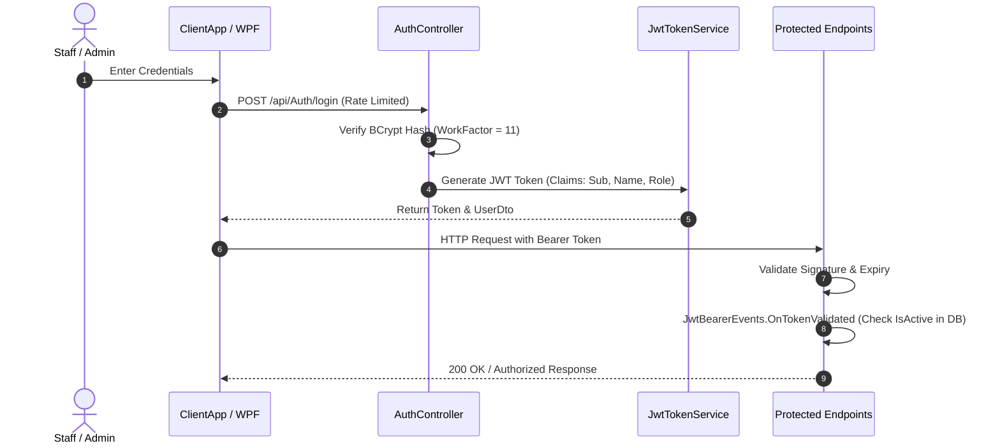

# Security Architecture & Authorization Standards

> **Authority Level:** Mandatory Security Baseline  
> **Parent Document:** [`AGENTS.md`](./AGENTS.md)  
> **Repository Root:** `D:\DVLD-WPF`  
> **Baseline Commit:** `29e43d6ce26ff6e7f516c45f4f475b10bdc2bfd3`  

---

## 1. Threat Model & Core Security Principles

The DVLD application is an enterprise government department management system. Authenticated actors are internal staff members and administrators managing citizen licensing records. Citizens do not hold user accounts or directly access the API.

The core security principles are:
1. **Defense in Depth:** The backend API is the absolute security boundary. Frontend route guards and UI role filtering are usability features, not security controls.
2. **Segregation of Duties (SoD):** The current API implementation enforces distinct operational roles between administrative personnel and counter staff, aligned with approved ADR-O01 (Model B).
3. **Fail-Closed Authorization:** Endpoints without explicit anonymous attributes require authentication. Endpoints modifying state require explicit role policies.
4. **Secret Confidentiality:** No passwords, signing keys, connection strings, or hash digests may ever be committed, logged, or documented in plaintext.

---

## 2. Authentication Architecture

Authentication is stateless and implemented using JWT Bearer tokens signed via HMAC-SHA256.

### 2.1 Dynamic Revocation Gate (`OnTokenValidated`)
In `Program.cs` (lines 148–172), `JwtBearerEvents.OnTokenValidated` intercepts every authenticated HTTP request:
- Extracts `UserId` from `ClaimTypes.NameIdentifier`.
- Resolves `IUserService` from the request-scoped service provider.
- Queries `await userService.IsUserActiveAsync(userId)`.
- If the user has been deactivated in SQL Server (`IsActive = 0`), execution immediately calls `context.Fail("User is inactive.")` and terminates the request.
- **Security Guarantee:** Deactivating a user in the database immediately revokes their API access without requiring token expiration or distributed cache blacklists.

### 2.2 Password Security & Secret Storage
- **Password Hashing:** Implemented in `AuthService.cs` and `UserService.cs` using `BCrypt.Net.BCrypt.HashPassword(password, workFactor: 11)`.
- **Secret Key Management:** The JWT signing key is configured in `appsettings.json` under `JwtSettings:SecretKey`. In staging/production environments, this value **must** be injected via environment variables or Azure Key Vault. Falling back to hardcoded development secrets in production is strictly prohibited.

---

## 3. Authorization Architecture & Policy Matrix

The API configures three distinct authorization policies in `Program.cs`:
- `AdminOnly`: `policy.RequireRole("Admin")`
- `StaffOnly`: `policy.RequireRole("Staff")`
- `StaffOrAdmin`: `policy.RequireRole("Admin", "Staff")`

### 3.1 The Canonical Role & Permission Matrix

| Controller / Endpoint Area | Active Authorization Policy | Admin Access | Staff Access | Architectural Rationale |
|---|---|---|---|---|
| **`UsersController`** (`/api/users/*`) | `[Authorize("AdminOnly")]` | **Allowed** | Denied | User management, password resets, role assignment. |
| **`ApplicationsController`** (`/api/applications/*`) | `[Authorize("StaffOnly")]` | Denied | **Allowed** | Operational licensing counter transactions (Segregation of Duties). |
| **`LicenseIssuanceController`** (`/api/licenses/issue-*`) | `[Authorize("StaffOnly")]` | Denied | **Allowed** | Issuing driver licenses upon test completion. |
| **`LicenseRenewalController`** (`/api/licenses/renew`) | `[Authorize("StaffOnly")]` | Denied | **Allowed** | Processing license renewals. |
| **`LicenseReplacementController`** (`/api/licenses/replace`) | `[Authorize("StaffOnly")]` | Denied | **Allowed** | Processing lost/damaged replacements. |
| **`DetainedLicensesController`** (`/api/detained-licenses/*`) | `[Authorize("StaffOnly")]` | Denied | **Allowed** | Detaining and releasing citizen licenses. |
| **`TestAppointmentsController`** (`/api/test-appointments/*`) | `[Authorize("StaffOrAdmin")]` | **Allowed** | **Allowed** | Scheduling and viewing test appointments. |
| **`TestsController`** (`/api/tests/*`) | `[Authorize("StaffOrAdmin")]` | **Allowed** | **Allowed** | Recording test results and exam lockouts. |
| **`PeopleController`** (`/api/people/*`) | `[Authorize("StaffOrAdmin")]` | **Allowed** | **Allowed** | Viewing and updating citizen demographic profiles. |
| **`AuthController.ChangePassword`** | `[Authorize]` | **Allowed** | **Allowed** | Authenticated session self-service password update. |

### 3.2 Approved Decision: Segregation of Duties (ADR-O01 / SEC-01)
- **Current Technical Implementation:** The active API implementation enforces `[Authorize("StaffOnly")]`, which strictly excludes `Admin` users from executing operational licensing counter actions. This behavior is reflected in `ClientApp/permissions.ts` and verified by unit test `ApplicationsControllerTests.cs:L35`.
- **Approved Architectural Policy:** In [`ENGINEERING-DECISIONS.md`](./ENGINEERING-DECISIONS.md), `ADR-O01` is formally recorded as: `APPROVED — Model B (Explicit Permission Separation)`. Administrators do not automatically inherit counter staff operational permissions; staff do not receive administrative user-management permissions; shared capabilities are explicitly granted via `StaffOrAdmin`.
- **Preservation of Current Behavior & Authorization Boundary:** Existing authorization behavior must remain unchanged. Approval of ADR-O01 records architectural policy agreement, but does **not** authorize code refactoring or policy relaxation without an authorized implementation milestone. Engineers and AI agents are strictly prohibited from changing `StaffOnly` to `StaffOrAdmin` or altering role access rules without explicit written Project Owner authorization.

---

## 4. Input Validation & File Upload Security

### 4.1 Citizen Profile Photos (`PeopleController` & `PhysicalFileStorageService`)
Profile photo uploads undergo strict multi-stage validation and sanitization before reaching physical storage:
1. **Allowed Formats & Re-Encoding:** Accepts `image/jpeg`, `image/png`, and `image/webp`. All accepted images are sanitized, oriented, resized to portrait proportions ($\le 600 \times 800$ px), stripped of EXIF metadata, and re-encoded to WebP format at quality 85 via SkiaSharp (`ImageProcessingService.cs`).
2. **File Size Limits:** Upload stream size is strictly capped at 5 MB (`5,242,880 bytes`).
3. **Decompression Bomb Protection:** Pre-decode validation enforces maximum dimensions of 4096 px and a maximum total pixel count of 16,000,000 pixels.
4. **Magic Byte Verification:** File headers are validated against constant byte arrays before decoding:
   - JPEG: `0xFF, 0xD8, 0xFF`
   - PNG: `0x89, 0x50, 0x4E, 0x47, 0x0D, 0x0A, 0x1A, 0x0A`
   - WebP: `RIFF` and `WEBP` signatures
5. **Path Traversal Prevention & Server-Generated Keys:** Storage keys are generated as random GUIDs (`Guid.NewGuid():N + ".webp"`). Original client-supplied filenames, extensions, and directory paths are discarded.
6. **Storage Location:** Files reside strictly outside `wwwroot` in an isolated directory configured by `Storage:PersonImagesPath` (defaulting to `LocalAppData/DVLD/Storage/people`). Direct public HTTP execution or browsing is impossible.
7. **Authorization & Access:** Photo upload, retrieval, and deletion endpoints on `PeopleController` enforce `[Authorize("StaffOrAdmin")]`. Public unauthenticated access is forbidden. Image streaming occurs via authenticated HTTP GET with ETag and private caching headers (`Cache-Control: private, max-age=86400, must-revalidate`).
8. **File/Database Consistency & Compensation Lifecycle:**
   - *Upload Save Ordering:* 1) Process and re-encode in memory; 2) Write new WebP file to disk; 3) Update `People.ImagePath` in EF Core DbContext; 4) Commit via `_unitOfWork.SaveChangesAsync()`.
   - *Failure Compensation:* If `SaveChangesAsync()` fails or returns $\le 0$, the newly written file is immediately deleted via `_fileStorageService.DeleteAsync(newKey)` to prevent orphaned disk files.
   - *Old Image Cleanup:* Upon successful database commit of a replacement photo, the previous physical file is deleted asynchronously.
   - *Photo Deletion:* `DELETE /api/people/{id}/photo` sets `ImagePath = null` in the database, commits via UnitOfWork, and then deletes the physical file.
   - *Orphan File Cleanup:* Immediate compensating delete is verified and implemented in code. A periodic background orphan scavenger remains a proposed future improvement.
9. **Absolute Prohibition on Manual DB Restoration:**
   AI agents and automated tools are strictly prohibited from executing manual database restoration scripts or direct filesystem batch updates under `AGENTS.md` Section 5. Disaster recovery and backups are sysadmin infrastructure operations outside agent authority.

### 4.2 Open Business Decision: Detained License Replacement (INT-03)
- **Observed System Behavior:** Static inspection confirms that `LicenseReplacementService` currently does not inject `IDetainedLicenseRepository` and does not check `IsLicenseDetainedAsync` before issuing a replacement.
- **Potential Business-Rule Gap:** Without a detention check, an applicant holding a detained license could technically be issued a replacement license.
- **Unverified Regulatory / Legal Requirements:** Whether replacing a detained license is prohibited by departmental regulations or traffic law is not documented in existing requirements and remains unverified. No legal rule can be assumed or invented.
- **Human Decision Prerequisite:** Formally resolving this gap requires explicit stakeholder/business policy direction (`ADR-O02` in [`ENGINEERING-DECISIONS.md`](./ENGINEERING-DECISIONS.md)). Engineers must not modify `LicenseReplacementService` to block detained license replacements until authorized by an approved business decision.

---

## 5. Rate Limiting & Denial of Service Protection

- **Active Rate Limiting:** `AuthController.Login` is protected by `[EnableRateLimiting("LoginRateLimit")]` using ASP.NET Core's built-in sliding window rate limiter.
- **Required Hardening (SEC-03):** `AuthController.ChangePassword` currently lacks rate limiting. Applying a sliding window rate limiter to prevent automated brute-force attempts on active sessions is scheduled as P3 in [`ENGINEERING-ROADMAP.md`](./ENGINEERING-ROADMAP.md).

---

## 6. Audit Logging & Security Event Tracing

- High-impact events (failed logins, password changes, license revocations, administrative user deactivations) must be logged at `LogLevel.Warning` or `LogLevel.Information` with contextual metadata (User ID, IP address, timestamp).
- Sensitive values (plain text passwords, JWT signing keys, credit card or banking details) must **never** be logged. Structured logging templates must sanitize user inputs.