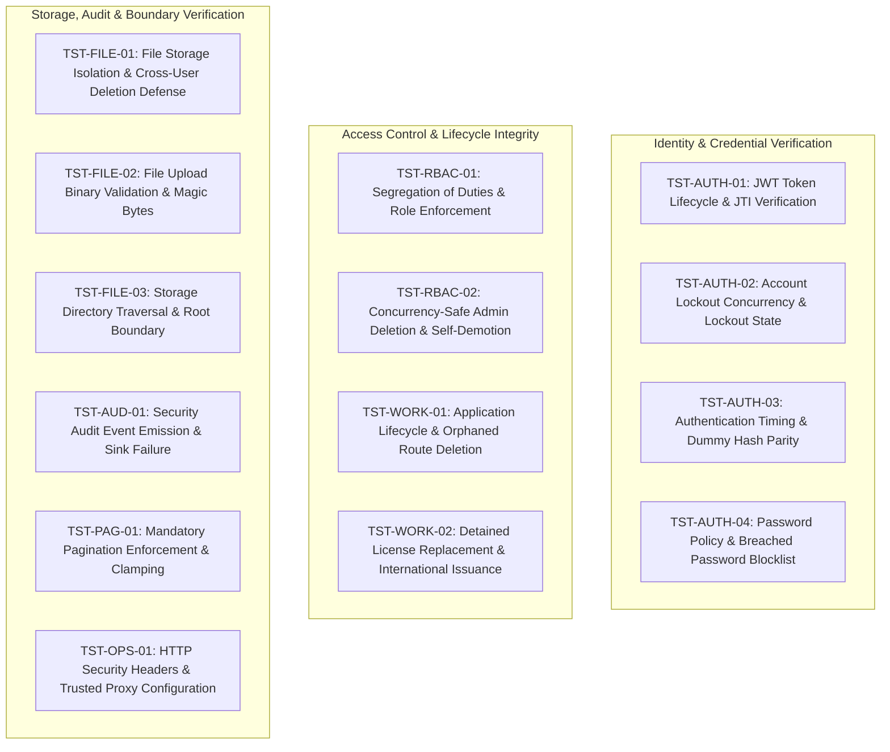

# Testing Architecture & Verification Standards

> **Authority Level:** Mandatory Testing & Quality Assurance Standards  
> **Parent Document:** [`AGENTS.md`](./AGENTS.md)  
> **Master Plan Reference:** [`docs/PROJECT-COMPLETION-MASTER-PLAN.md`](./docs/PROJECT-COMPLETION-MASTER-PLAN.md)  
> **Repository Root:** `D:\DVLD-WPF`  
> **Baseline Commit:** `baa356705c3b5c364a9c5aabf0cd62a5aa21e4b9`  
> **Governance Status:** CONSOLIDATED & ENFORCED (Phase 2)  

---

## 1. Testing Philosophy & Test Suite Taxonomy

The DVLD repository enforces a three-tiered testing strategy ensuring fast feedback, accurate contract verification, and robust persistence validation:

```text
       ┌──────────────────────────────────────────────┐
       │             API.IntegrationTests             │  (436 cataloged tests; 1 smoke test run in Phase 12.1)
       │    End-to-End HTTP & WebApplicationFactory   │  Uses Ephemeral Test DB
       └──────────────────────┬───────────────────────┘
                              │
       ┌──────────────────────▼───────────────────────┐
       │       Infrastructure.IntegrationTests        │  (612 cataloged tests; 611 passed, 1 SSL timeout)
       │     Real SQL Server Repositories & UoW       │  Uses Ephemeral Test DB
       └──────────────────────┬───────────────────────┘
                              │
       ┌──────────────────────▼───────────────────────┐
       │            Application.UnitTests             │  (919 cataloged tests; 919 passed)
       │     Pure In-Memory Logic, Moq, Fast          │  Zero Database Access
       └──────────────────────────────────────────────┘
```

---

## 2. Critical Database Safety & Test Isolation Rules

All integration test suites execute against real SQL Server instances. To prevent catastrophic data loss or test contamination, the following rules are non-negotiable:

### 2.1 The Dynamic Database Isolation & Lifecycle Protocol
1. **Isolated Naming Requirement:** Every test class or test run must create and bind to an ephemeral, uniquely named test database formatted exactly as:
   `DVLD_IntegrationTests_<GUID>` (e.g., `DVLD_IntegrationTests_3b9f4a12c8...`).
2. **Explicit Connection String Requirement:** Integration tests must read the database server connection string exclusively from the `DVLD_TEST_CONNECTION` environment variable.
3. **Strict Prohibition on Fallback to `DVLDf`:**
   - Test fixtures are **strictly prohibited** from falling back to `DVLDf`, `master`, or any local developer database if `DVLD_TEST_CONNECTION` is missing.
   - If `DVLD_TEST_CONNECTION` is not set, test initialization must **fail immediately** with an explicit configuration error.
4. **Administrative Connection vs. Test Database:**
   - Connecting to `master` strictly as an administrative database to issue `CREATE DATABASE` or `DROP DATABASE` for an isolated test database is permitted where required.
   - Using `master` as an actual integration test database is strictly prohibited.
5. **Verified Teardown & Ownership Protocol:**
   Before executing `DROP DATABASE` during fixture teardown, the test harness must verify:
   - The target database name starts with `DVLD_IntegrationTests_`.
   - The database name belongs to the isolated test connection (`DVLD_TEST_CONNECTION`).
   - The target is **not** `DVLDf`, `master`, `tempdb`, `model`, or `msdb`.
   - The test run has verified ownership of the database it intends to delete.
   - If ownership cannot be established, teardown must **fail safely without dropping the database**.

---

## 3. Test Project Structure & Guidelines

### 3.1 Application Unit Testing (`Test/Application.UnitTests/`)
- **Focus:** Use-case logic, DTO validation, Result pattern return values, and domain rules.
- **Constraints:** Zero database access, zero network calls. Dependencies must be mocked via Moq.
- **Clock Abstraction:** Mock `IJordanClock` to control UTC now, local today, and date boundaries deterministically.
- **Verification Rule:** Assert that business rules return expected `Result<T>` values (success or failure) and that appropriate log warnings/errors are emitted.

### 3.2 Infrastructure Integration Testing (`Test/Infrastructure.IntegrationTests/`)
- **Focus:** EF Core repository queries, `UnitOfWork` transactions, ambiguous commit recovery, `sp_getapplock` concurrency, and database constraints.
- **Base Fixture:** `SqlServerTestDatabase.cs` coordinates database creation, schema migration via `context.Database.MigrateAsync()`, and database teardown.
- **Data Seed Isolation:** Each test method must insert its own prerequisite test entities or roll back transactions to avoid inter-test coupling.

### 3.3 API Integration Testing (`Test/API.IntegrationTests/`)
- **Focus:** HTTP endpoint contracts, route parameter binding, model validation, and authorization policies (`AdminOnly`, `StaffOnly`, `StaffOrAdmin`).
- **Base Fixture:** Custom `WebApplicationFactory<Program>` (`SqlServerApiWebApplicationFactory.cs`) that boots the ASP.NET Core test server, intercepts authentication with mock JWT handlers, and targets an isolated `DVLD_IntegrationTests_<GUID>` database.

---

## 4. Concurrency, Migration Throttling & Test Flakiness (TEST-01)

### 4.1 TEST-01 Evidence Classification & Historical Context
- **Classification:** `Proposed Remediation — Needs Runtime Validation`
- **Observed Historical Failure:** In Phase 12.1 execution of `Infrastructure.IntegrationTests`, exactly 1 test out of 612 failed (`LocalDrivingLicenseApplicationRepositoryTests.GetApplicationsPagedAsync_ReturnsPagedList`):
  `Microsoft.Data.SqlClient.SqlException: A connection was successfully established with the server, but then an error occurred during the pre-login handshake. (SSL Provider: The wait operation timed out.)`
- **Suspected Contributing Factor:** Parallel xUnit test classes simultaneously triggered `MigrateAsync()` against SQL Server LocalDB. High transient I/O and connection contention during initial database creation and schema migration is a **plausible contributing factor**, but not a proven exclusive root cause.
- **Proposed Mitigation (Not Established Architecture):** Throttling database creation and schema migrations in `SqlServerTestDatabase.cs` using an in-process `SemaphoreSlim(2, 2)`, similar to `SqlServerApiWebApplicationFactory.cs`.
- **Architectural Scope & Limitations:** An in-process static semaphore coordinates threads only within a single running process. It does **not** coordinate independent test runner processes, out-of-process CLI executions, or multiple parallel CI agents.
- **Runtime Validation Requirement:** Do **not** claim that migration throttling will prevent all SSL handshake timeouts. This proposed mitigation requires runtime validation across multiple consecutive test executions before being classified as resolved.

---

## 5. Historical Test Evidence Baseline (Phase 12.1 Results)

For baseline reference, historical execution metrics recorded during the Phase 12.1 audit are cataloged below.

> **Crucial Audit Note:** These counts represent **historical Phase 12.1 audit data**, NOT current test execution results. Discovered/cataloged tests must never be confused with executed tests.

| Test Project | Discovered / Cataloged | Historical Executed | Historical Passed | Historical Failed | Observed Execution Behavior / Failure Mode |
|---|---:|---:|---:|---:|---|
| **`Application.UnitTests`** | 919 | 919 | **919** | 0 | 100% pass rate in memory. |
| **`API.IntegrationTests`** | 436 | 1 | **1** | 0 | Only 1 smoke test (`Swagger_EndpointReturnsSuccessAndCorrectContentType`) was executed and passed. **435 tests were cataloged but not executed.** |
| **`Infrastructure.IntegrationTests`** | 612 | 612 | **611** | **1** | 611 passed. Exactly 1 test failed due to a transient SSL pre-login handshake timeout. |
| **`ClientApp/` (Frontend)** | 0 | 0 | **0** | **0** | Zero automated tests in `ClientApp/` at current inspected baseline (`FE-TEST` candidate requirement). |
| **Total Test Inventory** | **1,967** | **1,532** | **1,531** | **1** | Total cataloged test suite size: 1,967 tests. (1,967 is the cataloged inventory, NOT the passed count). |

---

## 6. Continuous Integration & Test Reporting (OBS-02)

### 6.1 Azure Pipelines (`azure-pipelines.yml`)
- **Pipeline Definition:** The pipeline YAML defines test steps for `Application.UnitTests`, `Infrastructure.IntegrationTests`, and `API.IntegrationTests` targeting dynamic LocalDB instances.
- **Current CI Runtime Status:** **Needs Verification** (Cannot be inferred from static YAML inspection or historical Phase 12.1 local counts alone).
- **Publication Requirement:** Test results must be captured and published using the `PublishTestResults@2` task with `.trx` formatting.
- **Attachment Staging (OBS-02 Remediation):** Failed integration test logs and attachments must be staged to a unified directory (`$(Agent.TempDirectory)/TestResults`) to enable rapid debugging directly within the Azure DevOps portal tabs without downloading raw terminal console streams.

---

## 7. Security Test Suite Specifications (`TST-*` Framework)

This section transfers all 14 security verification test suites specified in the Security Master Plan. These suites define the mandatory verification standards for authentication, authorization, data boundary containment, and defensive mechanisms.



---

### 7.1 TST-AUTH-01: JWT Token Lifecycle & JTI Verification
- **Test Suite ID:** `TST-AUTH-01`
- **Associated Security Package:** `SEC-PKG-10` (`RSK-04`, `DEC-AUTH-01`, `DEC-AUTH-02`)
- **Target Components:** `API/DVLD.Api/Security/JwtTokenService.cs`, `API/DVLD.Api/Program.cs`
- **Execution Environment:** In-Memory TestServer (`API.IntegrationTests`)
- **Security Property Verified:** Token authenticity, bounded expiration, and cryptographic uniqueness.
- **Preconditions:** Test user account registered and active in ephemeral test database.
- **Test Scenarios:**
  1. Authenticate with valid credentials; inspect JWT claims.
  2. Verify payload contains valid non-empty `jti` GUID claim (`System.IdentityModel.Tokens.Jwt.JwtRegisteredClaimNames.Jti`).
  3. Verify token expiration claim (`exp`) matches configured target lifetime (defaulting to 240 minutes; asserted against configured duration if amended under `DEC-AUTH-01`).
  4. Advance test clock beyond expiration instant; execute authenticated request against protected endpoint (`GET /api/users/current`).
- **Expected Behavior:** Requests with expired tokens receive HTTP 401 Unauthorized with `Bearer error="invalid_token"`. Issued tokens always emit unique `jti` identifiers.
- **Dependencies & Status:** Proposed test suite. Implementation of `jti` claim is pending Gate 2 authorization under `SEC-PKG-10`. Existing unit tests in `JwtTokenServiceClockTests.cs` verify clock time conversion and UTC kind anchoring, but do not assert `jti` claim generation or token invalidation.

---

### 7.2 TST-AUTH-02: Account Lockout Concurrency & Lockout Enforcement
- **Test Suite ID:** `TST-AUTH-02`
- **Associated Security Package:** `SEC-PKG-11` (`RSK-05`, `DEC-CRED-02`, Schema Gate 5)
- **Target Components:** `API/DVLD.Api/Controllers/AuthController.cs`, `Infrastructure/Persistence/DVLDDbContext.cs`
- **Execution Environment:** Ephemeral Test Database (`DVLD_IntegrationTests_<GUID>`)
- **Security Property Verified:** Atomic counter increments, lost-update immunity under concurrency, and lockout state transitions.
- **Preconditions:** Test database migrated with Schema Gate 5 columns (`AccessFailedCount`, `LockoutEnd`, `LockoutEnabled`).
- **Test Scenarios:**
  1. Trigger concurrent failed login requests ($N = 10$) simultaneously against a single user account using `Task.WhenAll`.
  2. Verify database counter `AccessFailedCount` reflects exact total failed attempts without lost updates.
  3. Exceed configured threshold ($N$ failures as selected under `DEC-CRED-02`); verify account transitions to locked state (`LockoutEnd > JordanClock.UtcNow`).
  4. Submit valid credentials for the locked account prior to `LockoutEnd` expiration.
- **Expected Behavior:** Locked account rejects valid credentials with HTTP 400/401 indicating account lockout. Correct credentials do not authenticate until lockout duration expires.
- **Dependencies & Status:** Proposed test suite. **STRICTLY BLOCKED** on Schema Gate 5 approval and `DEC-CRED-02` threshold selection.

---

### 7.3 TST-AUTH-03: Authentication Timing & Dummy Hash Parity
- **Test Suite ID:** `TST-AUTH-03`
- **Associated Security Package:** `SEC-PKG-08` (`RSK-03`)
- **Target Components:** `Application/Services/AuthService.cs` (`AuthenticateAsync`)
- **Execution Environment:** Unit Test Harness (`Application.UnitTests`)
- **Security Property Verified:** Elimination of side-channel response-time discrepancies between existing and non-existing usernames.
- **Preconditions:** In-memory mocks for `IUserRepository` and `IJordanClock`.
- **Two-Tier Verification Standard:**
  1. **Tier 1 — Deterministic Execution Verification (Mandatory Gate):**
     - Assert that when `UserRepository.FindByUsernameAsync` returns null, `AuthService` unconditionally executes `BCrypt.Net.BCrypt.Verify` against a pre-computed dummy hash with work factor 11.
     - Verified deterministically in unit test suite without timing jitter.
  2. **Tier 2 — Statistical Performance Analysis (Supporting Telemetry):**
     - In controlled local benchmark harness, sample execution times of Branch A (non-existent username) and Branch B (valid username with invalid password) across interleaved iterations ($N = 100$) following 50 warmup iterations.
     - Evaluate descriptive distribution metrics (mean, standard deviation).
- **Measurement Governance Rule:** Statistical timing tests serve exclusively as non-blocking telemetry. Unstable statistical p-value thresholds are **strictly prohibited from acting as blocking CI build gates** to prevent spurious failures caused by OS context switching or garbage collection.
- **Dependencies & Status:** Proposed test suite. Implementation pending Gate 2 approval under `SEC-PKG-08`.

---

### 7.4 TST-AUTH-04: Password Policy & Breached Password Blocklist
- **Test Suite ID:** `TST-AUTH-04`
- **Associated Security Package:** `SEC-PKG-09` (`RSK-07`, `DEC-CRED-01`)
- **Target Components:** `Application/Validators/UserValidator.cs` (`ValidatePassword`)
- **Execution Environment:** Unit Test Harness (`Application.UnitTests`)
- **Security Property Verified:** Enforcement of credential entropy and rejection of known breached passwords.
- **Preconditions:** Configured NIST SP 800-63B validator with top-10,000 breached password memory set.
- **Test Scenarios:**
  1. Submit passwords violating length bounds ($< 12$ characters).
  2. Submit known breached passwords (e.g. `password123456`, `admin12345678`).
  3. Submit passwords containing username substrings.
  4. Submit high-entropy conforming passphrases ($\ge 16$ characters, e.g. `correct-horse-battery-staple`).
- **Expected Behavior:** Scenarios 1–3 return `ValidationResult` failure with descriptive error messages. Scenario 4 returns success.
- **Dependencies & Status:** Proposed test suite. Blocked on Project Owner decision `DEC-CRED-01`.

---

### 7.5 TST-RBAC-01: Segregation of Duties & Role Enforcement
- **Test Suite ID:** `TST-RBAC-01`
- **Associated Security Package:** `SEC-PKG-05` (`RSK-12`, `RSK-15`, `ADR-O01`, `DEC-RBAC-01`)
- **Target Components:** `API/DVLD.Api/Controllers/`, `API/DVLD.Api/Program.cs`
- **Execution Environment:** Integration TestServer (`API.IntegrationTests`)
- **Security Property Verified:** Strict boundary separation between administrative governance and counter operations (Model B).
- **Preconditions:** Seeded `Admin` user token and `Staff` user token.
- **Test Scenarios:**
  1. `Admin` token invokes operational counter endpoints (`POST /api/applications`, `POST /api/licenses/renew`, `POST /api/licenses/replace`, `POST /api/detentions`).
  2. `Staff` token invokes user management endpoints (`POST /api/users`, `PUT /api/users/{id}`, `DELETE /api/users/{id}`).
  3. Both tokens invoke shared demographic endpoints (`GET /api/people/{id}`).
- **Expected Behavior:** Scenario 1 returns HTTP 403 Forbidden. Scenario 2 returns HTTP 403 Forbidden. Scenario 3 returns HTTP 200 OK.
- **Dependencies & Status:** Proposed test suite. Governed by approved policy `ADR-O01`.

---

### 7.6 TST-RBAC-02: Concurrency-Safe Admin Deletion & Self-Demotion
- **Test Suite ID:** `TST-RBAC-02`
- **Associated Security Package:** `SEC-PKG-04` (`RSK-09`)
- **Target Components:** `Application/Services/UserService.cs`, `Infrastructure/Repositories/UserRepository.cs`
- **Execution Environment:** Ephemeral Test Database (`DVLD_IntegrationTests_<GUID>`)
- **Security Property Verified:** Immunity against administrator self-lockout and race-conditioned zero-admin states.
- **Preconditions:** Database seeded with exactly one active administrator account.
- **Test Scenarios:**
  1. Acting administrator attempts to deactivate or delete their own account (`actingUserId == targetUserId`).
  2. Acting administrator attempts to change their own role from `Admin` to `Staff`.
  3. Two concurrent requests attempt to deactivate the last two remaining administrators simultaneously.
- **Expected Behavior:** Scenarios 1 and 2 return `Result.Failure("Cannot demote or deactivate the active administrator account.")`. Scenario 3 succeeds for exactly one administrator and fails for the second, leaving at least one active administrator.
- **Dependencies & Status:** Proposed test suite. Implementation pending Gate 2 approval under `SEC-PKG-04`. Existing unit test `UserServiceTests.UpdateUserAsync_SelfDemotion_ReturnsForbidden` provides partial unit-level validation with Moq mocks, but does not provide dynamic, concurrency-safe integration verification against SQL Server.

---

### 7.7 TST-WORK-01: Application Lifecycle & Orphaned Route Deletion
- **Test Suite ID:** `TST-WORK-01`
- **Associated Security Package:** `SEC-PKG-01` (`RSK-01`, `RSK-19`, `INT-01`, `ADR-P03`, `DEC-APP-01`)
- **Target Components:** `API/DVLD.Api/Controllers/ApplicationsController.cs`, `Application/Services/ApplicationService.cs`
- **Execution Environment:** Integration TestServer (`API.IntegrationTests`)
- **Security Property Verified:** Elimination of unauthorized application status completion bypass.
- **Preconditions:** Application seeded in status `New` without passed tests or paid fees.
- **Test Scenarios:**
  1. Issue HTTP request: `POST /api/applications/{id}/complete`.
  2. Attempt to transition application to `Completed` via standard legitimate workflow (`LicenseIssuanceService.IssueFirstTimeLicenseAsync`) with prerequisite tests incomplete.
- **Expected Behavior:** Scenario 1 returns HTTP 404 Not Found (following hard deletion under `ADR-P03`) or emits telemetry with deprecation notice (during observation window under `DEC-APP-01`). Scenario 2 returns `Result.Failure` with HTTP 400 Bad Request.
- **Dependencies & Status:** Proposed test suite. Execution gated on telemetry observation under `DEC-APP-01`. Existing controller test `ApplicationsControllerTests.Complete_WhenSuccessful_ReturnsNoContent` tests the legacy 204 behavior of the bypass route, not the required 404 deletion / deprecation telemetry standard.

---

### 7.8 TST-WORK-02: Detained License Replacement & International Issuance
- **Test Suite ID:** `TST-WORK-02`
- **Associated Security Packages:** `SEC-PKG-15`, `SEC-PKG-16` (`RSK-13`, `RSK-14`, `INT-03`, `ADR-O02`, `DEC-POL-01`, `DEC-POL-02`)
- **Target Components:** `Application/Services/LicenseReplacementService.cs`, `Application/Services/InternationalService.cs`
- **Execution Environment:** Ephemeral Test Database (`DVLD_IntegrationTests_<GUID>`)
- **Security Property Verified:** Enforcement of detention invariants across domestic replacements and international driving permit issuance.
- **Preconditions:** Seeded driver holding an active domestic driving license with an active, unreleased record in `DetainedLicenses`.
- **Test Scenarios:**
  1. Submit replacement request for lost or damaged license: `POST /api/licenses/{id}/replace`.
  2. Submit international driving permit application: `POST /api/international-licenses`.
- **Expected Behavior:** Scenario 1 returns `Result.Failure("Cannot replace an actively detained license.")` with HTTP 400. Scenario 2 returns `Result.Failure("Cannot issue international driving permit for a detained domestic license.")` with HTTP 400.
- **Dependencies & Status:** Proposed test suite. **STRICTLY BLOCKED** on Gate 3 written regulatory confirmation (`DEC-POL-01` and `DEC-POL-02`).

---

### 7.9 TST-FILE-01: File Storage Isolation & Cross-User Deletion Defense
- **Test Suite ID:** `TST-FILE-01`
- **Associated Security Package:** `SEC-PKG-02` (`RSK-02`, `DEC-FILE-01`)
- **Target Components:** `API/DVLD.Api/Controllers/PeopleController.cs`, `DVLD.Contracts/Person/CreatePersonRequest.cs`
- **Execution Environment:** Integration TestServer (`API.IntegrationTests`)
- **Security Property Verified:** Prevention of client-supplied path injection and cross-user photo file deletion within `_storageRoot`.
- **Preconditions:** Seeded citizen Person A with legitimate photo stored on disk (`photo_A.webp`).
- **Test Scenarios:**
  1. Submit `CreatePersonRequest` containing JSON property `"ImagePath": "photo_A.webp"`.
  2. Verify JSON model binder ignores or rejects property; inspect created Person B record.
  3. Delete Person B via `DELETE /api/people/{id}`.
  4. Verify physical file `photo_A.webp` remains intact on disk.
- **Expected Behavior:** Person B is created without hijacking Person A's photo key. Deleting Person B does not delete Person A's photo.
- **Dependencies & Status:** Proposed test suite. Implementation pending Gate 2 approval under `SEC-PKG-02`.

---

### 7.10 TST-FILE-02: File Upload Binary Validation & Magic Bytes
- **Test Suite ID:** `TST-FILE-02`
- **Associated Security Package:** `SEC-PKG-02`
- **Target Components:** `Infrastructure/Services/PhysicalFileStorageService.cs`, `API/DVLD.Api/Controllers/PeopleController.cs`
- **Execution Environment:** Unit Test Harness (`Application.UnitTests`)
- **Security Property Verified:** Detection and rejection of disguised executable or non-image payloads via binary signature inspection.
- **Preconditions:** In-memory file streams with valid extensions but invalid binary content.
- **Test Scenarios:**
  1. Upload Windows PE binary (`.exe` starting with `MZ` / `4D 5A`) renamed to `photo.jpg`.
  2. Upload HTML script (`<script>alert(1)</script>`) renamed to `avatar.png`.
  3. Upload valid JPEG binary (`FF D8 FF E0...`).
- **Expected Behavior:** Scenarios 1 and 2 throw validation failure and reject upload with HTTP 400 Bad Request. Scenario 3 passes binary inspection and re-encodes successfully.
- **Dependencies & Status:** Proposed test suite. Existing unit tests in `ImageProcessingServiceTests.cs` (`ProcessPersonPhoto_ExecutableSignatureMZ_ReturnsValidationFailure`, `SvgContent`, `HtmlContent`) provide partial matching coverage for binary validation, but the full canonical integration security suite remains unauthorized pending Gate 2 under `SEC-PKG-02`.

---

### 7.11 TST-FILE-03: Storage Directory Traversal & Root Boundary
- **Test Suite ID:** `TST-FILE-03`
- **Associated Security Package:** `SEC-PKG-02`
- **Target Components:** `Infrastructure/Services/PhysicalFileStorageService.cs` (`ResolveFullPath`)
- **Execution Environment:** Unit Test Harness (`Application.UnitTests`)
- **Security Property Verified:** Absolute path traversal boundary containment within `_storageRoot`.
- **Preconditions:** Initialized `PhysicalFileStorageService` with dummy storage directory.
- **Test Scenarios:**
  1. Request file resolution for `../../windows/system32/cmd.exe`.
  2. Request file resolution with null byte injection: `photo.jpg\0../../secret.txt`.
  3. Request file resolution with absolute drive root: `C:\inetpub\wwwroot\web.config`.
- **Expected Behavior:** All scenarios throw `ArgumentException("Path traversal outside storage root is not permitted.")`.
- **Dependencies & Status:** Active test standard. Core path check implemented in `PhysicalFileStorageService.cs:185-207`. Matching unit test methods exist in `PhysicalFileStorageServiceTests.cs:105-131` (`GetAsync_PathTraversalKey_ReturnsNullOrThrows` and `DeleteAsync_PathTraversalKey_ReturnsFalse`) and were historically included in the Phase 12.1 unit test pass (919/919 passed); not executed during read-only audit passes.

---

### 7.12 TST-AUD-01: Security Audit Event Emission & Sink Failure
- **Test Suite ID:** `TST-AUD-01`
- **Associated Security Packages:** `SEC-PKG-06`, `SEC-PKG-07` (`RSK-06`, `SEC-04`, `AUD-01`, `DEC-AUD-01`, `DEC-AUD-02`)
- **Target Components:** `Application/Services/SecurityAuditService.cs`, `Infrastructure/Repositories/UnitOfWork.cs`
- **Execution Environment:** In-Memory TestServer / Ephemeral Test Database
- **Security Property Verified:** Emission of structured security telemetry and verified fail-open ring buffer resilience.
- **Preconditions:** Injected mock audit sink configured to simulate disk write failure.
- **Test Scenarios:**
  1. Execute successful login; assert `SecurityEvent` emitted with correct `ActorID`, timestamp, and masked payload.
  2. Simulate audit sink outage (disk full / permission denied); execute user authentication.
  3. Assert core login workflow completes successfully (HTTP 200) without throwing unhandled server exception.
  4. Verify failed audit event was captured in local in-memory fallback ring buffer (`DEC-AUD-02`).
- **Expected Behavior:** Audit events capture required forensics. Audit sink faults do not block citizen authentication (Fail-Open behavior verified).
- **Dependencies & Status:** Proposed test suite. Implementation pending Gate 2 authorization under `SEC-04` and `AUD-01`.

---

### 7.13 TST-PAG-01: Mandatory Pagination Enforcement & Clamping
- **Test Suite ID:** `TST-PAG-01`
- **Associated Security Package:** `SEC-PKG-03` (`RSK-10`, `RSK-20`)
- **Target Components:** `API/DVLD.Api/Controllers/PeopleController.cs`, `API/DVLD.Api/Controllers/UsersController.cs`
- **Execution Environment:** Integration TestServer (`API.IntegrationTests`)
- **Security Property Verified:** Defense against memory exhaustion and bulk citizen data harvesting via unbounded queries.
- **Preconditions:** Ephemeral test database seeded with 120 citizen records.
- **Test Scenarios:**
  1. Issue `GET /api/people` without query parameters.
  2. Issue `GET /api/people?pageNumber=1&pageSize=500`.
  3. Issue `GET /api/people?pageNumber=-1&pageSize=0`.
- **Expected Behavior:** Scenario 1 returns exactly 10 records (page 1 default). Scenario 2 returns exactly 50 records (clamped to max bound 50). Scenario 3 returns HTTP 400 Bad Request.
- **Dependencies & Status:** Proposed test suite. Active endpoints partially paged; default clamping pending Phase 12.2.

---

### 7.14 TST-OPS-01: HTTP Security Headers & Trusted Proxy Configuration
- **Test Suite ID:** `TST-OPS-01`
- **Associated Security Package:** `SEC-PKG-12` (`RSK-16`, `DEC-DEP-01`, `DEC-DEP-02`)
- **Target Components:** `API/DVLD.Api/Program.cs` (Middleware Pipeline)
- **Execution Environment:** Integration TestServer (`API.IntegrationTests`)
- **Security Property Verified:** Defensive HTTP response headers and spoofed forwarded header rejection.
- **Preconditions:** ASP.NET Core test host booted with production middleware profile.
- **Test Scenarios:**
  1. Submit `GET /api/applications/types`; inspect response headers.
  2. Submit request with spoofed header `X-Forwarded-For: 8.8.8.8` from untrusted client IP.
- **Expected Behavior:** Scenario 1 asserts presence of `X-Content-Type-Options: nosniff`, `X-Frame-Options: DENY`, `Referrer-Policy: strict-origin-when-cross-origin`. Scenario 2 asserts API rate-limiting middleware evaluates actual socket IP, ignoring spoofed forwarded IP.
- **Dependencies & Status:** Proposed test suite. Implementation pending Gate 7 authorization under `SEC-PKG-12`.

---

### 7.15 Test Suite Multi-Dimensional Status & Authorization Ledger

> [!IMPORTANT]
> **Test Suite Implementation Non-Authorization Declaration & Dimension Separation:**
> Documenting a security test suite specification establishes the testing standard only. It does **not** indicate that the test suite has been authorized, implemented, executed, or passed. All 14 suites are governed across four independent dimensions: 1) Specification completeness; 2) Source-code presence; 3) Implementation authorization; and 4) Documented execution evidence.

| Test Suite ID | Specification Exists | Dedicated Test Source | Matching Test Methods Present | Implementation Authorization | Historical Execution Evidence (Phase 12.1) | Current Audit Status |
|:---|:---:|:---:|:---:|:---:|:---:|:---:|
| **`TST-AUTH-01`** | Yes (§7.1) | No | No (Clock tests verify UTC anchoring, not `jti`) | **NOT AUTHORIZED** (`SEC-PKG-10` / Gate 2) | No documented execution | Unexecuted |
| **`TST-AUTH-02`** | Yes (§7.2) | No | No | **BLOCKED** (Schema Gate 5 / `DEC-CRED-02`) | No documented execution | Unexecuted |
| **`TST-AUTH-03`** | Yes (§7.3) | No | No | **NOT AUTHORIZED** (`SEC-PKG-08` / Gate 2) | No documented execution | Unexecuted |
| **`TST-AUTH-04`** | Yes (§7.4) | No | No | **NOT AUTHORIZED** (`SEC-PKG-09` / `DEC-CRED-01`) | No documented execution | Unexecuted |
| **`TST-RBAC-01`** | Yes (§7.5) | No | No | **NOT AUTHORIZED** (`SEC-PKG-05` / `ADR-O01`) | No documented execution | Unexecuted |
| **`TST-RBAC-02`** | Yes (§7.6) | No | Partial (`UserServiceTests.cs` mocked self-demotion) | **NOT AUTHORIZED** (`SEC-PKG-04` / Gate 2) | Unit test executed in Phase 12.1; integration suite unexecuted | Unexecuted |
| **`TST-WORK-01`** | Yes (§7.7) | No | Partial (`ApplicationsControllerTests.cs` legacy 204 test) | **NOT AUTHORIZED** (`INT-01` / `DEC-APP-01` Gate 6) | Unit test executed in Phase 12.1; deletion suite unexecuted | Unexecuted |
| **`TST-WORK-02`** | Yes (§7.8) | No | No | **BLOCKED ON LEGAL** (Regulatory Gate 3) | No documented execution | Unexecuted |
| **`TST-FILE-01`** | Yes (§7.9) | No | No | **NOT AUTHORIZED** (`SEC-PKG-02` / `DEC-FILE-01`) | No documented execution | Unexecuted |
| **`TST-FILE-02`** | Yes (§7.10)| No | Partial (`ImageProcessingServiceTests.cs` MZ/SVG/HTML tests)| **NOT AUTHORIZED** (`SEC-PKG-02` / Gate 2) | Unit test executed in Phase 12.1; full endpoint suite unexecuted | Unexecuted |
| **`TST-FILE-03`** | Yes (§7.11)| No (Co-located)| **Yes** (`PhysicalFileStorageServiceTests.cs:105-131`) | **Active Code Standard** | **Passed** in Phase 12.1 (919/919 unit tests passed) | Static Verified (Unexecuted) |
| **`TST-AUD-01`** | Yes (§7.12)| No | No | **NOT AUTHORIZED** (`SEC-04` / `AUD-01` / Gate 2) | No documented execution | Unexecuted |
| **`TST-PAG-01`** | Yes (§7.13)| No | No | **DEFERRED** (`SEC-PKG-03` / Phase 12.2) | No documented execution | Unexecuted |
| **`TST-OPS-01`** | Yes (§7.14)| No | No | **NOT AUTHORIZED** (`SEC-PKG-12` / Gate 7) | No documented execution | Unexecuted |
| **`TEST-01`** | Yes (§4.1) | N/A (Harness) | Semaphore Throttling in Test WebAppFactory | Proposed Mitigation (**Needs Validation**) | 1 SSL timeout observed in Phase 12.1 | Unexecuted |
| **`TEST-02`** | Yes (Roadmap)| No | No | **DEFERRED / UNAUTHORIZED** (`SEC-05` Modernization) | No documented execution | Unexecuted |
