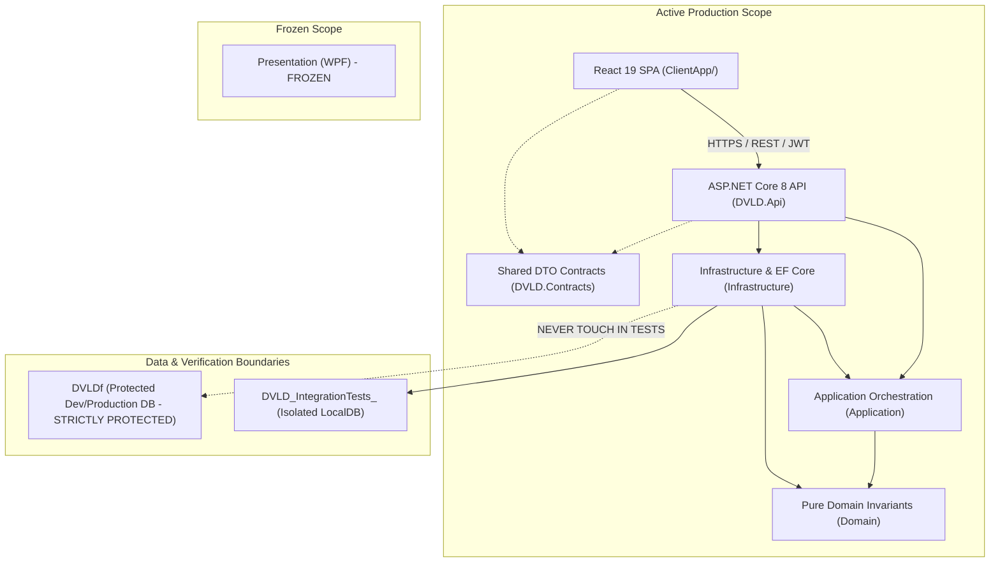
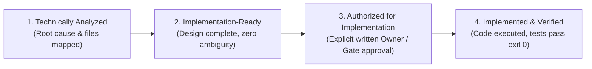
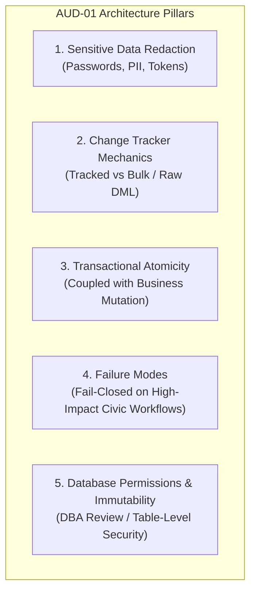

# DVLD — Project Completion Master Plan
## Comprehensive Implementation Baseline & Execution Strategy

> **Authority Level:** Authoritative Consolidation & Master Completion Plan  
> **Parent Document:** [`AGENTS.md`](../AGENTS.md)  
> **Canonical Cross-References:** [`ENGINEERING-ROADMAP.md`](../ENGINEERING-ROADMAP.md) | [`ENGINEERING-DECISIONS.md`](../ENGINEERING-DECISIONS.md) | [`ENGINEERING-STANDARDS.md`](../ENGINEERING-STANDARDS.md) | [`SECURITY-STANDARDS.md`](../SECURITY-STANDARDS.md) | [`TESTING-STANDARDS.md`](../TESTING-STANDARDS.md) | [`AI-ENGINEERING-INSTRUCTIONS.md`](../AI-ENGINEERING-INSTRUCTIONS.md) | [`docs/IMPLEMENTATION-EXECUTION-LOG.md`](./IMPLEMENTATION-EXECUTION-LOG.md)
> **Repository Root:** `D:\DVLD-WPF`  
> **Active Backend:** ASP.NET Core 8 Web API (`DVLD.Api`)  
> **Active Frontend:** React 19 SPA (`ClientApp/`)  
> **Legacy Scope:** Presentation (WPF) — **FROZEN / EXCLUDED**  
> **Current Status:** CONSOLIDATED BASELINE (Zero Implementation Authorization Granted)

---

## 1. Executive Summary and Project Scope

### 1.1 Purpose and Mission
This document establishes the comprehensive, evidence-backed implementation master plan for completing the Driver & Vehicle Licensing Department (DVLD) platform. It consolidates all verified requirements, approved architectural decision records (ADRs), security package specifications, testing baselines, operational reliability goals, and production cutover requirements into a single structured reference.

The primary objective is transitioning the repository from repeated documentation audits toward methodical, phase-authorized product completion while strictly enforcing all governance controls, approval gates, and data protection rules.

### 1.2 System Scope & Operational Boundaries
The active production system consists of:
- **Core Domain & Persistence:** .NET 8 layered architecture (`Domain`, `Application`, `Infrastructure`, `DVLD.Contracts`).
- **Web API Service:** ASP.NET Core 8 Web API (`DVLD.Api`) providing RESTful endpoints, JWT authentication, and policy-based authorization.
- **Client Application:** React 19 Single Page Application (`ClientApp/`) built with TypeScript, Vite, Tailwind CSS, and Radix UI primitives.
- **Automated Verification:** Multi-tier automated test harness (`Test/Application.UnitTests`, `Test/Infrastructure.IntegrationTests`, `Test/API.IntegrationTests`).

**Strict Operational Freeze:** The legacy desktop client located in `Presentation (WPF)/` is completely frozen and excluded from all active development, refactoring, and auditing.



### 1.3 Governance Authority & Non-Negotiable Rules
1. **Master Plan Context:** This Master Plan consolidates and contextualizes requirements, but does **not** replace the canonical documents:
   - [`ENGINEERING-ROADMAP.md`](../ENGINEERING-ROADMAP.md) remains the sole authoritative engineering execution backlog.
   - [`ENGINEERING-DECISIONS.md`](../ENGINEERING-DECISIONS.md) remains the sole authoritative decision register.
   - [`SECURITY-STANDARDS.md`](../SECURITY-STANDARDS.md) and [`TESTING-STANDARDS.md`](../TESTING-STANDARDS.md) remain the sole technical authorities for security controls and test specifications.
   - [`docs/IMPLEMENTATION-EXECUTION-LOG.md`](./IMPLEMENTATION-EXECUTION-LOG.md) serves as the authoritative chronological ledger and audit trail for task lifecycle tracking and execution verification.
2. **Zero Implementation Authority:** Publication of this Master Plan grants **zero** authorization to write code, modify schemas, install packages, or execute migrations. Phases 12.2 through 12.5 remain strictly **PROPOSED / UNAUTHORIZED**.
3. **Database Protection:** The database `DVLDf` is strictly protected. Zero integration tests, automated drops, truncations, or unverified migrations may ever target `DVLDf`. All automated integration tests run exclusively against ephemeral test databases (`DVLD_IntegrationTests_<GUID>`).

### 1.4 Product Scope Decision — Single Organization Architecture (Rejection of Multi-Tenancy)
The DVLD platform is formally designated and designed as an enterprise production management system for a **single organization** (the civic licensing authority). It is explicitly **not** a multi-tenant SaaS platform.
- **Centralized Relational Infrastructure:** A single centralized SQL Server database (`DVLDf`) backs all authorized departmental branch offices and counter operations.
- **Role & Access Model:** Access control is strictly user- and role-based (`Staff`, `Admin`) under Segregation of Duties (`ADR-O01`).
- **Zero Multi-Tenant Artifacts:** Tenant IDs, dynamic schema resolution, tenant isolation middleware, and tenant partitioning are explicitly excluded from the architecture.

---

## 2. System Architecture and Subsystem Maturity Assessment

Rather than relying on arbitrary, indefensible completion percentages, the platform is evaluated across seven discrete subsystem maturity tiers:

| Subsystem | Qualitative Maturity Level | Current Operational Reality & Key Evidence |
|---|---|---|
| **Core Civic Licensing Domain** | **Substantially Complete / Mature** | All primary civic use cases are implemented in `Application/Services` and `Domain/Entities`: Local & International License Applications, 3-tier Sequential Testing (Vision $\to$ Written $\to$ Practical), License Issuance, Renewals, Replacements (Lost/Damaged), and Detain/Release lifecycle. |
| **API & Routing Layer** | **Functionally Complete / Pending Hardening** | 10 RESTful controllers in `DVLD.Api/Controllers` provide complete CRUD and workflow triggers. Endpoints return typed `Result<T>` envelopes mapped to standard HTTP status codes via `ResultHttpMapper.cs`. Hardening required: removal/gating of orphan bypass `POST /api/applications/{id}/complete` (`INT-01`), pagination clamping (`SEC-PKG-03`), and static lookup optimization (`API-02`). |
| **Persistence & Transactions** | **Production Core / Missing Audit Infrastructure** | EF Core 8 with SQL Server backing via `DVLDDbContext.cs` and `UnitOfWork.cs`. Explicit database transactions protect multi-aggregate workflows (`IssueDrivingLicenseAsync`, `RenewLicenseAsync`, `ReplaceLicenseAsync`, `ReleaseDetainedLicenseAsync`). Missing: `AuditLogs` entity/table (`AUD-01`), lockout tracking columns (`SEC-PKG-11`), and database unique constraint exception translation (`INT-02`). |
| **Security & Access Control** | **Baseline Implemented / Advanced Gaps** | JWT bearer authentication (`JwtTokenService.cs`) and PBKDF2/BCrypt hashing (`BCrypt-Net-Next`) are operational. Role authorization policies (`StaffOnly`, `AdminOnly`) are applied. Missing: account lockout after failed attempts (`SEC-PKG-11`), password complexity policy enforcement (`SEC-PKG-10`), token revocation list (`DEC-AUTH-01`), client photo path decoupling (`SEC-PKG-02`), and regulatory biometric retention compliance (Gate 8). |
| **Automated Testing Suite** | **Comprehensive Backend Unit & Integration / Zero Frontend** | 1,967 cataloged backend tests (919 unit tests, 612 infrastructure integration tests, 436 API integration tests). In historical Phase 12.1 runs, 1,531 passed, 1 failed (transient SSL pre-login timeout), and 435 remained unexecuted. The React frontend has **zero** automated tests (no Vitest, no Jest, no RTL). |
| **React SPA Frontend** | **Core UI Functional / Missing Production Safety** | React 19 + TypeScript 6 + Vite 8 SPA. Navigation, authentication state, data tables, and modal workflows are functional. Missing: React Error Boundary (`FE-ERR`), automated component/integration tests (`FE-TEST`), mobile card collapse for narrow screens (`FE-RESP`), and defensive client-side role guards on protected navigation links (`SEC-01`). |
| **Observability, Operations & CI** | **Basic Logging / Missing Enterprise Telemetry** | ASP.NET Core default `ILogger` writing plain console output. Missing: Serilog structured logging with request correlation IDs (`OBS-03`), ASP.NET Core Health Checks (`OBS-01`), automated CI test execution with artifact publishing, disaster recovery runbooks, and formal backup topology (`OPS-DR`). |

### 2.1 SOLID Principles Compliance Matrix
A comprehensive source-code evaluation of the five SOLID principles is formally maintained in [`ENGINEERING-STANDARDS.md`](../ENGINEERING-STANDARDS.md) §12:

| Principle | Compliance Status | Key Code Evidence & Architectural Finding |
|---|:---:|---|
| **Single Responsibility (SRP)** | **Partially Compliant** | Focused service decomposition in license workflows (`LicenseIssuanceService`, `LicenseRenewalService`, `LicenseReplacementService`, `LicenseQueryService`); gap identified in `UserService.cs` (590 lines conflating CRUD with credential checks and role authorization). |
| **Open/Closed (OCP)** | **Partially Compliant** | Repository abstractions and `Result<T>` envelopes support extension without modifying consumers; gap identified in `TestWorkflowService.cs` where sequential test progression (`[Theory, Written, Practical]`) is hardcoded in procedural logic. |
| **Liskov Substitution (LSP)** | **Verified Compliant** | Clean POCO composition over fragile entity inheritance; repository implementations strictly honor interface invariants; `PhysicalFileStorageService` honors `IFileStorageService` contracts. |
| **Interface Segregation (ISP)** | **Partially Compliant** | Fine-grained license service contracts; gap identified in monolithic `ILicenseRepository.cs` (25 methods coupling CRUD, pagination, background cleanup, and reporting), addressed via roadmap task `ARCH-02`. |
| **Dependency Inversion (DIP)** | **Verified Compliant** | Clean Architecture dependency flow: `Application.csproj` references only `Domain.csproj` with zero references to `Infrastructure` or `DVLD.Api`. All dependencies injected via interfaces in `Program.cs`. |

### 2.2 System Design & Scalability Evaluation (17 Concepts)
The DVLD system is architected as an enterprise **Modular Monolith** (`ADR-001`, `ADR-R03`) adhering strictly to the **CP (Consistency & Partition Tolerance)** principle under the CAP Theorem. Full technical justifications for all 17 system design concepts are maintained in [`ENGINEERING-STANDARDS.md`](../ENGINEERING-STANDARDS.md) §13:

| Concept | Classification | Core Architectural Rationale for DVLD |
|---|:---:|---|
| **1. Load Balancing** | **Prepare for Future** | Stateless JWT authentication enables horizontal load balancing across multiple Kestrel nodes as regional center concurrency grows. |
| **2. Caching** | **Implement Now** | Roadmap task `API-02`: In-memory caching for immutable static reference tables (`Countries`, `LicenseClasses`, `ApplicationTypes`, `TestTypes`). |
| **3. CDN** | **Not Applicable / Not Justified** | Internal departmental extranet/intranet; citizen photographs are private biometric PII and must never be cached on public edge CDNs. |
| **4. API Gateway** | **Not Applicable / Not Justified** | Modular Monolith Web API requires no microservice routing layer. Reverse proxy needs are handled by standard IIS/Kestrel. |
| **5. Microservices** | **Not Applicable / Not Justified** | Formally rejected (`ADR-001`, `ADR-R03`). Civic credential issuance requires strong ACID transactions across multiple aggregates; distributed sagas introduce legal credential hazards. |
| **6. Monolithic Architecture** | **Implement Now** | Current Modular Monolith architecture is optimal for operational debuggability, single-unit deployment, and transactional safety. |
| **7. Replication** | **Conditional — Only When Needed** | SQL Server Always On read replicas can be added if heavy reporting queries compete with OLTP counter transactions. |
| **8. Partitioning** | **Conditional — Only When Needed** | Table partitioning on `AuditLogs` for multi-year legal retention; database sharding is unjustified for regional civic scale. |
| **9. Message Queues** | **Conditional — Only When Needed** | Asynchronous notifications (SMS/Email) or audit offloading in future phases (`SEC-05`); in-process background services cleanly handle current sweeps. |
| **10. Rate Limiting** | **Implement Now** | Roadmap tasks `SEC-03` (password change endpoint limiter) and `SEC-PKG-03` (query collection clamping $PageSize \le 50$). |
| **11. Consistent Hashing** | **Not Applicable / Not Justified** | No dynamic distributed caching rings or sharded database clusters exist or are required. |
| **12. CAP Theorem (Consistency Principles)** | **Implement Now** | Apply relevant consistency principles; do not classify the entire application as CP. Strong transactional consistency is strictly enforced for all legal licensing mutations. |
| **13. Horizontal Scaling** | **Prepare for Future** | API tier is stateless; requires shared distributed token revocation list (`DEC-AUTH-01`) and centralized storage for photos before multi-node scale. |
| **14. Vertical Scaling** | **Implement Now** | Primary scaling model: provisioning dedicated SQL Server CPU cores, RAM, and NVMe SSD storage easily supports tens of thousands of daily civic operations. |
| **15. Fault Tolerance** | **Implement Now** | `GlobalExceptionHandler` RFC 7807 shielding, SQL Server execution retry strategy (`EnableRetryOnFailure`), and Health Checks (`OBS-01`). |
| **16. Circuit Breaker** | **Conditional — Only When Needed** | Justified when integrating external third-party HTTP services (e.g. government payment gateways); unjustified for internal SQL Server calls. |
| **17. Event-Driven Architecture** | **Conditional — Only When Needed** | Direct service orchestration remains the approved model; in-process event buses were evaluated and rejected (`ADR-R01`, `ADR-R02`). Internal domain events considered only when justified. |

### 2.3 Formal Technology Baseline & Evaluation
The technology stack is governed by verified package manifests and explicit architectural approvals. Zero unauthorized packages may be introduced:

| Engineering Area | Intended Baseline Technology | Governance Classification | Technical Rationale & Architectural Boundary |
|---|---|:---:|---|
| **Backend Framework** | ASP.NET Core 8 (`Microsoft.AspNetCore.App`) | **Existing and Retained** | Modern LTS web framework providing high-throughput Kestrel hosting, dependency injection, and endpoint routing. |
| **Programming Language** | C# 12 / .NET 8 SDK | **Existing and Retained** | Type-safe, high-performance runtime across `API/`, `Application/`, `Infrastructure/`, and `Domain/`. |
| **Frontend Framework** | React 19 (`react: ^19.3.1`) | **Existing and Retained** | Current active SPA in `ClientApp/`. Zero React 18 or legacy web dependencies. |
| **Frontend Language** | TypeScript (`typescript: ~6.0.3`) | **Existing and Retained** | Full type safety across contracts, API hooks, and UI components in `ClientApp/`. |
| **Frontend Build Tool** | Vite 8 (`vite: ^8.3.4`) | **Existing and Retained** | Fast HMR dev server and optimized production rollup bundler. |
| **UI Styling** | Tailwind CSS 4 (`tailwindcss: ^4.3.3`) | **Existing and Retained** | Modern utility-first CSS framework with Vite plugin integration. |
| **UI Primitives** | Radix UI Primitives | **Existing and Retained** | Accessible, unstyled UI components (Dialog, Dropdown, Select, Tooltip). |
| **Iconography** | Lucide React (`lucide-react: ^1.65.0`) | **Existing and Retained** | Lightweight SVG icon library. |
| **Relational Database** | Microsoft SQL Server (LocalDB / Enterprise) | **Existing and Retained** | Centralized transactional database supporting ACID transactions, table constraints, and `sp_getapplock`. |
| **ORM / Data Access** | Entity Framework Core 8 (`EF Core 8.0.24`) | **Existing and Retained** | Code-first mapping with migrations, change tracking, and execution retry strategies. |
| **API Architectural Style** | RESTful JSON Web API | **Existing and Retained** | HTTP verbs, RFC 7807 `ProblemDetails` error envelopes, and `Result<T>` mapping via `ResultHttpMapper`. |
| **API Documentation** | OpenAPI 3.0 / Swagger UI (`Swashbuckle.AspNetCore 6.6.2`) | **Existing and Retained** | Interactive API specification generated at `/swagger`. |
| **Authentication** | JWT Bearer Tokens (`JwtBearerHandler`) | **Existing and Retained** | Stateless HMAC-SHA256 tokens; lifecycle governed under `DEC-AUTH-01/02`. |
| **Authorization** | Policy-Based (`StaffOnly`, `AdminOnly`) | **Existing and Retained** | ASP.NET Core authorization policies enforcing Segregation of Duties (`ADR-O01`). |
| **Structured Logging** | Serilog (`Serilog.AspNetCore`) | **Approved Target** | Roadmap task `OBS-03` (Phase 12.3); requires NuGet approval before package install. |
| **Distributed Tracing** | OpenTelemetry | **Conditional / Verification Required** | Not currently installed. Conditional upon distributed APM requirements in future hosting topology. |
| **Backend Testing** | xUnit, Moq, FluentAssertions | **Existing and Retained** | 1,967 cataloged tests across `Application.UnitTests`, `Infrastructure.IntegrationTests`, and `API.IntegrationTests`. |
| **Frontend Unit Testing** | Vitest + React Testing Library | **Approved Target** | Roadmap candidate `FE-TEST` (Phase 12.4); requires npm approval before install. |
| **End-to-End (E2E) Testing** | Playwright | **Conditional / Verification Required** | Not currently installed. Conditional upon full-stack regression automation needs post-Phase 12.4. |
| **CI/CD Platform** | Azure Pipelines (`azure-pipelines.yml`) | **Existing and Retained** | Automated multi-stage build and test execution pipeline (`OBS-02`). |
| **Source Control** | Git + GitHub | **Existing and Retained** | Distributed version control governed by strict safety rules. |

---

## 3. Current Verified Implementation Status & Lifecycle Taxonomy

To maintain absolute precision across documentation and pair-programming sessions, all engineering work items are governed by four distinct lifecycle states:



1. **Technically Analyzed:** The problem, root cause, architectural layers, affected files, and potential risks have been thoroughly investigated and verified via static source inspection. (Does **not** grant permission to code).
2. **Implementation-Ready:** The detailed technical solution design is complete, prerequisites and boundaries are verified, impact on other components is understood, and no architectural ambiguity remains. (Does **not** grant permission to code).
3. **Authorized for Implementation:** Explicit, written human approval has been granted by the Project Owner for a specific phase, scope, and task set, satisfying all relevant Approval Gates and ADR sign-offs. **Only tasks in this state may be executed.**
4. **Implemented and Verified:** Code changes have been made, targeted builds executed, automated tests run and passed (exit code 0), git diff inspected, and evidence recorded confirming remediation without regressions.

---

## 4. Known Defects, Security Gaps, and Technical Debt

The canonical remediation backlog (`ENGINEERING-ROADMAP.md`) tracks 22 prioritized engineering tasks:

### 4.1 Tier P0: Critical Integrity Defects
- **`INT-01` (`POST /api/applications/{id}/complete` Bypass Endpoint):**
  - *Location:* [`ApplicationsController.cs#L85-L90`](file:///d:/DVLD-WPF/API/DVLD.Api/Controllers/ApplicationsController.cs#L85-L90) and [`ApplicationService.cs#L165-L172`](file:///d:/DVLD-WPF/Application/Services/ApplicationService.cs#L165-L172).
  - *Defect:* A public staff endpoint transitions applications directly to `Completed` status, completely bypassing prerequisite vision, written, and practical driving tests and license issuance rules.
  - *Status:* Technically Analyzed. Blocked on Project Owner decision `DEC-APP-01` (Option 1: Immediate Deletion vs Option 2: 30-Day Deprecation Telemetry) under Approval Gate 6. **Unauthorized (Phase 12.2).**

### 4.2 Tier P1: Performance & Concurrency Reliability
- **`INT-02` (Duplicate User Persistence Boundary & Exception Mapping):**
  - *Location:* [`UserService.cs#L256-L301`](file:///d:/DVLD-WPF/Application/Services/UserService.cs#L256-L301) and [`GlobalExceptionHandler.cs#L45-L60`](file:///d:/DVLD-WPF/API/DVLD.Api/Security/GlobalExceptionHandler.cs#L45-L60).
  - *Defect:* Pre-check logic (`IsUsernameTakenAsync`, `IsUserExistsByPersonIdAsync`) is vulnerable to race conditions under concurrent requests. The resulting database unique constraint violation throws a `DbUpdateException` that escapes to `GlobalExceptionHandler`, returning an unhandled **HTTP 500** instead of a structured **HTTP 409 Conflict**.
  - *Status:* Technically Analyzed & Implementation-Ready. Pure C# exception handling fix. **Unauthorized (Phase 12.2).**
- **`PERF-01` (Sequential N+1 in `LicenseQueryService`):**
  - *Location:* [`LicenseQueryService.cs#L237-L252`](file:///d:/DVLD-WPF/Application/Services/LicenseQueryService.cs#L237-L252).
  - *Defect:* `IsLicenseEligibleForRenewAsync` executes an asynchronous single-row database lookup inside a loop over candidate licenses if a newer license is missing from the initial in-memory list, causing $N$ round-trips.
  - *Status:* Technically Analyzed & Implementation-Ready. Pure query batching fix (`GetNewerLicensesForDriversAndClassesAsync`). **Unauthorized (Phase 12.2).**
- **`PERF-02` (Read Queries with UPDLOCK Removal):**
  - *Status:* Resolved in Phase 11.3 (Verified).

### 4.3 Tier P2: Observability, Reliability & Core Policy
- **`OBS-01` (Health & Readiness Endpoints):** Add ASP.NET Core Health Checks for SQL Server, file storage, and memory. Blocked on NuGet approval. **Unauthorized (Phase 12.3).**
- **`OBS-03` (Structured Logging & Correlation IDs):** Add Serilog and propagate HTTP `TraceIdentifier` / `X-Correlation-ID`. Blocked on NuGet approval. **Unauthorized (Phase 12.3).**
- **`SEC-04` (Security Event Telemetry):** Introduce `ISecurityAuditService` domain contract for authentication and administrative events. **Unauthorized (Phase 12.3).**
- **`AUD-01` (Transactional SQL Server Audit Logging):** Create `AuditLogs` table and change interception hook. Blocked on Schema Gate 5, DBA review, and `DEC-AUD-01`. **Unauthorized (Phase 12.3).**
- **`INT-03` (Replacement License Class Invariant):** Enforce strict `LicenseClass` inheritance during replacement workflows. Blocked on `DEC-POL-01` under Gate 3. **Unauthorized (Phase 12.3).**
- **`TEST-01` (Integration Test Migration Throttling):** Introduce concurrency throttling on `SqlServerTestDatabase` to eliminate transient SSL handshake timeouts. **Unauthorized (Phase 12.3).**
- **`API-01` (`CancellationToken` Propagation):** Ensure all async controller and service methods accept and pass `CancellationToken`. **Unauthorized (Phase 12.3).**
- **`REST-01` (RFC 7807 Standard Error Standardization):** Ensure all validation and error envelopes strictly conform to RFC 7807 `ProblemDetails`. **Unauthorized (Phase 12.3).**

### 4.4 Tier P3: Architecture Cleanup & CI Hardening
- **`ARCH-01` (Layer Separation & Inappropriate Direct Dependencies):** Remove any leaky cross-layer references. **Unauthorized (Phase 12.5).**
- **`ARCH-02` (Monolithic Repository Interface Segregation):** Refactor monolithic `ILicenseRepository` (25 methods) into cohesive role interfaces (`ILicenseRepository`, `ILicenseExpirationMaintenanceRepository`, `ILicenseReportingRepository`). **Unauthorized (Phase 12.5).**
- **`ARCH-03` (UserService Responsibility Decomposition):** Assess decomposing `UserService` (590 lines) into focused credential and profile orchestration services. **Unauthorized (Phase 12.5).**
- **`SEC-03` (Login Rate Limiting):** IP and username rate limiting for authentication endpoints. Blocked on Redis / in-memory rate limiting ADR. **Unauthorized (Phase 12.5).**
- **`OBS-02` (CI/CD Pipeline Hardening):** Publish `.trx` test results and capture execution artifacts in Azure Pipelines. **Unauthorized (Phase 12.5).**
- **`API-02` (Static Lookup Caching):** In-memory caching for immutable lookup tables (`ApplicationTypes`, `TestTypes`, `LicenseClasses`, `Countries`). **Unauthorized (Phase 12.5).**

---

## 5. Security Risks and Security Packages (`SEC-PKG-*`)

The repository maintains an authoritative catalog of 20 canonical security risks (`RSK-01` through `RSK-20`) mapped directly to 17 security packages (`SEC-PKG-01` through `SEC-PKG-17`) in [`SECURITY-STANDARDS.md`](../SECURITY-STANDARDS.md):

| Risk ID | Risk Title | Addressed By | Key Mitigation & Implementation Scope |
|:---:|---|:---:|---|
| **`RSK-01`** | Direct Application Completion Bypass | `SEC-PKG-01` / `INT-01` | Deprecate or remove `POST /api/applications/{id}/complete` (`DEC-APP-01`). |
| **`RSK-02`** | `ImagePath` Parameter Injection / Path Traversal | `SEC-PKG-02` | Strip `ImagePath` from `CreatePersonRequest` and `UpdatePersonRequest`. Require `POST /api/people/{id}/photo`. |
| **`RSK-03`** | Credential Verification Latency Timing Side-Channel | `SEC-PKG-08` | Execute dummy BCrypt verification on non-existent usernames to ensure constant-time response. |
| **`RSK-04`** | Concurrent Booking Race Conditions | `ADR-004` | Enforce distributed slot mutual exclusion via SQL Server `sp_getapplock`. *(Implemented & Active)*. |
| **`RSK-05`** | Missing Account-Level Lockout Defense | `SEC-PKG-11` | Add `AccessFailedCount`, `LockoutEnd`, `LockoutEnabled` to `Users` table (`DEC-CRED-02`). |
| **`RSK-06`** | Absence of Dedicated Security Audit Trail | `SEC-PKG-06` / `AUD-01` | Implement transactional `AuditLogs` and `ISecurityAuditService`. |
| **`RSK-07`** | Weak Password Complexity Policy | `SEC-PKG-09` / `DEC-CRED-01` | Enforce NIST SP 800-63B password complexity standards. |
| **`RSK-08`** | Absence of Multi-Factor Authentication (MFA) | `DEC-AUTH-03` | MFA for administrative roles. *(Deferred to Future Phase)*. |
| **`RSK-09`** | Hardcoded Administrator Protections / SPOF | `SEC-PKG-04` | Dynamic administrator safety checks ensuring at least one active admin remains. |
| **`RSK-10`** | Unbounded Collection Retrieval / Resource Exhaustion | `SEC-PKG-03` | Enforce hard pagination clamping ($PageSize \le 50$) across all collection endpoints. |
| **`RSK-11`** | Plaintext PII Exposure in Citizen & User DTOs | Gate 8 | Data minimization, masking, and legal retention review under Gate 8. *(Pending Legal Review)*. |
| **`RSK-12`** | License History Authorization Mismatch | `SEC-PKG-05` / `DEC-RBAC-01` | Enforce ADR-O01 Model B role policies across license history endpoints. |
| **`RSK-13`** | Circumvention of License Detention in Replacement | `SEC-PKG-15` / `INT-03` | Enforce detention check and class invariant in replacement workflow (`DEC-POL-01`). |
| **`RSK-14`** | Circumvention of Detention in International Permit | `SEC-PKG-16` / `DEC-POL-02` | Enforce detention check prior to issuing international permits. |
| **`RSK-15`** | Administrative Read Visibility Restrictions | `DEC-RBAC-01` | Maintain ADR-O01 Model B policy alignment. |
| **`RSK-16`** | Missing HTTP Security Headers & Untrusted Proxies | `SEC-PKG-12` / `DEC-DEP-01` | Configure HSTS, CSP, X-Frame-Options, and ASP.NET Core ForwardedHeaders. |
| **`RSK-17`** | Production Configuration & Secret Exposure Hazards | `SEC-PKG-13` / `DEC-DEP-01` | Enforce Azure Key Vault or environment variable secret injection in production. |
| **`RSK-18`** | Absence of Automated Dependency Scanning in CI | `SEC-PKG-14` | Integrate `dotnet list package --vulnerable` and `npm audit` into CI pipeline. |
| **`RSK-19`** | Unrepresented External Callers for Complete Application | `DEC-APP-01` | Telemetry logging window to detect legacy callers before complete removal. |
| **`RSK-20`** | Authorized Insider Mass PII Harvesting | `SEC-PKG-03` | Clamping and export auditing to mitigate mass data scraping. |

---

## 6. Audit Logging Architecture Requirements (`AUD-01`)

The design and implementation of `AUD-01` must resolve five critical engineering and security requirements:



### 6.1 Sensitive Data Redaction
- **Credentials & Hashes:** Any mutation to `User.Password` must **never** record the plaintext or hashed password string in `OldValues` or `NewValues`. Redaction must record `[REDACTED]`.
- **Secrets & Tokens:** JWTs, refresh tokens, and internal secret keys must be excluded from audit payloads.
- **Citizen PII Masking:** The `People` table contains sensitive citizen identifiers (`NationalNo`, `FirstName`, `LastName`, `Address`, `Phone`, `Email`, `DateOfBirth`). Logging unmasked PII into an unencrypted audit table presents privacy and data-leak risks. Masking rules (e.g. `NationalNo: ***456` or logging modified field names without raw values) must be enforced based on security engineering best practices and statutory legal review.
- **Physical Paths:** Internal server storage paths generated during file upload must be normalized.

### 6.2 Change Tracking Mechanics: Tracked Entities vs Direct SQL
- **EF Core Change Tracker Coverage:** The `UnitOfWork` interceptor inspecting `ChangeTracker.Entries()` reliably captures entity state modifications executed via tracked LINQ queries as well as `FromSqlRaw` queries that materialize tracked entity types with primary keys.
- **Bulk & Direct Execution Blind Spots:** Operations executed via `ExecuteUpdateAsync()` or `ExecuteDeleteAsync()` (EF Core 7+) bypass the Change Tracker completely because they translate directly into SQL statements executed on the database engine without creating in-memory `EntityEntry` objects.
- **Raw DML & External Writes:** Direct DML statements executed via `ExecuteSqlRawAsync`, stored procedures that mutate state, or external database scripts execute out-of-band without Change Tracker visibility.
- **Architectural Rule:** Core civic workflows currently operate via tracked entities and will be intercepted by `UnitOfWork`. If bulk operations or raw DML are introduced in the future, they must explicitly emit domain audit events via `ISecurityAuditService` (`SEC-04`) or rely on database-level change capture (e.g., SQL Server Temporal Tables or CDC).

### 6.3 Transactional Consistency & Rollback Atomicity
- **Atomicity Invariant:** An audit record must never state that a civic credential was created, issued, or released if the business transaction failed and rolled back.
- **Enforcement:** Audit log records must be added to the `AuditLogs` DbSet within the **exact same** database transaction (`IDbContextTransaction`) managed by `UnitOfWork`. Both the business entity changes and the audit entries commit together in a single atomic SQL transaction. If the transaction rolls back, all associated audit records roll back automatically.

### 6.4 Failure Behavior: Fail-Closed vs Fallback
- **Fail-Closed Operations:** For high-impact civic actions—specifically:
  - License Issuance (`IssueDrivingLicenseAsync`)
  - License Detention and Release (`DetainLicenseAsync`, `ReleaseDetainedLicenseAsync`)
  - User Account Creation and Role Modification (`AddUserAsync`, `UpdateUserAsync`)
  
  Audit logging must **fail closed**. If the audit record cannot be written, the entire business transaction must roll back and return an error. A licensing authority cannot permit un-audited state changes on legal credentials.
- **Fail-Open / Fallback Scenarios:** Read-only access logging, search telemetry, or background health sweeps may use a durable disk fallback (or fail open) to prevent service denial during transient audit database contention.

### 6.5 Database Permissions & Immutability Alternatives
The database permissions for the `AuditLogs` table must enforce immutability without breaking normal CRUD permissions on core business tables (`People`, `Users`, `Applications`, `Licenses`). Four architectural alternatives are under evaluation for human DBA approval under Schema Gate 5:
1. **Alternative A (Table-Level Permissions on Single Principal):** Single application database user granted standard CRUD on business tables, but granted `INSERT` and explicitly denied `UPDATE` and `DELETE` on `AuditLogs` (`DENY UPDATE, DELETE ON dbo.AuditLogs TO [DVLD_Api_User]`).
2. **Alternative B (Dual Database Principals):** Operational API user granted business CRUD and `INSERT`-only on `AuditLogs`; separate Compliance Auditor user granted `SELECT`-only on `AuditLogs` with zero business table access.
3. **Alternative C (Stored Procedure Abstraction):** Revoke direct table access to `AuditLogs` and force all writes through a stored procedure (`sp_InsertAuditLog`) running with elevated rights (`WITH EXECUTE AS OWNER`).
4. **Alternative D (SQL Server Ledger Tables):** Utilize SQL Server 2022+ Ledger Tables to cryptographically enforce append-only immutability at the database engine level.

---

## 7. Structured Application Logging, Correlation IDs, and Observability

### 7.1 Centralized Structured Logging (`OBS-03`)
- **Package Addition:** Add `Serilog.AspNetCore`, `Serilog.Sinks.Console`, and `Serilog.Sinks.File` to `DVLD.Api.csproj` (requires formal NuGet dependency approval).
- **Request Correlation Pipeline:** Configure ASP.NET Core middleware to capture incoming `X-Correlation-ID` headers or generate an RFC 4122 GUID. Assign this identifier to `HttpContext.TraceIdentifier`.
- **Enrichment:** Enrich all log events with `TraceIdentifier`, `UserId`, `UserRole`, `RequestMethod`, `RequestPath`, and `ClientIp`.
- **Cross-Layer Coupling:** `OBS-03` establishes the correlation pipeline that `SEC-04` (`ISecurityAuditService`) and `AUD-01` (`AuditLogs`) rely on to link entity change records to external HTTP requests.

---

## 8. Health Checks and Operational Reliability

### 8.1 Health & Readiness Endpoints (`OBS-01`)
- **Package Addition:** Add `AspNetCore.HealthChecks.SqlServer` and `Microsoft.Extensions.Diagnostics.HealthChecks` to `DVLD.Api.csproj` (requires formal NuGet approval).
- **Endpoint Structure:**
  - `GET /health/live`: Liveness probe verifying the ASP.NET Core process is responsive.
  - `GET /health/ready`: Readiness probe verifying connectivity to SQL Server, accessibility of the physical photo storage directory, and available memory.
- **Response Format:** Return JSON with component status, latency, and description, adhering to RFC standard health response conventions.

---

## 9. Backend Engineering Tasks and Phased Dependencies

Backend tasks are structured to decouple artificial bottlenecks, allowing independent code-level improvements to proceed once authorized without waiting for schema changes:

```mermaid
flowchart TD
    subgraph Track 1: Independent Code Hotfixes
        T_INT02["INT-02: User Uniqueness 409 Translation"]
        T_PERF01["PERF-01: Batch License Newer Lookups"]
        T_INT01["INT-01: Bypass Endpoint Gating\n(Pending DEC-APP-01)"]
    end

    subgraph Track 2: Database Schema & Audit
        T_AUD01["AUD-01: AuditLogs Table & Hook\n(Schema Gate 5 & DEC-AUD-01)"]
        T_SEC11["SEC-PKG-11: User Lockout Columns\n(Schema Gate 5 & DEC-CRED-02)"]
        T_INT03["INT-03: Replacement Class Validation\n(Gate 3 & DEC-POL-01)"]
    end

    subgraph Track 3: Telemetry & Observability
        T_OBS03["OBS-03: Serilog & Correlation IDs\n(NuGet Approval)"]
        T_OBS01["OBS-01: ASP.NET Health Checks\n(NuGet Approval)"]
        T_SEC04["SEC-04: ISecurityAuditService"]
        T_TEST01["TEST-01: Test Concurrency Throttling"]
    end

    Track 1 -.->|Zero Schema Dependencies| Track 2
    T_OBS03 --> T_SEC04
    T_SEC04 --> T_AUD01
```

---

## 10. React Frontend Completion Requirements

### 10.1 Automated Frontend Test Harness (`FE-TEST`)
- **Current Baseline:** Zero automated tests exist in `ClientApp/`. `package.json` lacks a test script and test dependencies.
- **Requirement:** Install `vitest`, `@testing-library/react`, and `jsdom` (requires npm package approval).
- **Scope:** Author unit and integration tests covering authentication state, protected navigation routes, form validation, and data table filtering.

### 10.2 React Error Boundary (`FE-ERR`)
- **Current Baseline:** Zero implementations of `componentDidCatch` or `ErrorBoundary` in `ClientApp/src`.
- **Requirement:** Implement a global React Error Boundary wrapping the route hierarchy in `App.tsx` with a user-friendly error recovery UI, preventing unhandled runtime errors from unmounting the entire application.

### 10.3 Mobile Responsive Collapse (`FE-RESP`)
- **Current Baseline:** Data tables use Tailwind `overflow-x-auto` horizontal scrolling. Functional on desktop/tablet, but suboptimal on narrow mobile viewports ($< 640\text{px}$).
- **Requirement:** Implement an adaptive view that collapses dense multi-column tables (e.g. Local Driving Applications) into stacked responsive cards on small screens.

### 10.4 Client-Side Route Guards (`SEC-01`)
- **Requirement:** Align client-side navigation guards with backend authorization policies (`StaffOnly`, `AdminOnly`) to prevent unauthorized users from viewing restricted UI routes.

---

## 11. Testing Strategy and Accurately Qualified Historical Test Evidence

### 11.1 Reconciled Historical Test Evidence Baseline
The repository's automated test catalog comprises 1,967 tests across three backend projects. Historical metrics from Phase 12.1 execution are qualified below:

| Test Project | Total Cataloged Tests | Historical Passed | Historical Failed | Historical Unexecuted | Execution Context & Notes |
|---|---:|---:|---:|---:|---|
| **`Application.UnitTests`** | **919** | **919** | **0** | **0** | Fast in-memory unit tests; 100% pass rate in Phase 12.1 historical run. |
| **`Infrastructure.IntegrationTests`** | **612** | **611** | **1** | **0** | 1 failure observed under parallel class execution due to transient SSL handshake timeout (`TEST-01`). |
| **`API.IntegrationTests`** | **436** | **1** | **0** | **435** | **435 tests were NOT executed.** Only 1 smoke test (`ApiSmokeTests`) was executed in Phase 12.1. |
| **`ClientApp/` (Frontend)** | **0** | **0** | **0** | **0** | Zero automated tests currently exist in the frontend workspace. |
| **Total Automated Catalog** | **1,967** | **1,531** | **1** | **435** | **Historical Phase 12.1 evidence. Not freshly verified.** |

> [!CAUTION]
> **No Universal Pass Claim:** The repository does **not** claim all automated tests currently pass. 435 API integration tests remain unexecuted in historical records, and integration tests exhibit concurrency sensitivity under unthrottled LocalDB migrations (`TEST-01`).

### 11.2 Ephemeral Test Database Lifecycle Rules
All integration tests must strictly follow the safety rules defined in [`TESTING-STANDARDS.md`](../TESTING-STANDARDS.md):
1. Databases must be dynamically created with unique names: `DVLD_IntegrationTests_<GUID>`.
2. Integration tests must **never** connect to or execute migrations against `DVLDf`.
3. Before automated deletion during fixture teardown, test fixtures must verify database ownership and confirm the target name matches the generated GUID.

---

## 12. CI/CD Requirements and Quality Gates

### 12.1 Azure Pipelines (`azure-pipelines.yml`)
- **Test Results Publishing (`OBS-02`):** Configure `PublishTestResults@2` to publish `.trx` test execution logs for all three test projects.
- **Artifact Staging:** Stage failed test output and screenshots to `$(Agent.TempDirectory)/TestResults`.
- **Quality Gates:**
  - Backend Build: Zero warnings with `TreatWarningsAsErrors=true`.
  - Frontend Build: `npm.cmd --prefix ClientApp run build` exits 0 with zero TypeScript errors.
  - Test Execution: All unit and integration test suites pass with code 0.
  - Vulnerability Audit: Automated check for package vulnerabilities (`dotnet list package --vulnerable`, `npm audit`).

### 12.2 SQL Test Environment Milestones
| Milestone | Status | Evidence & Scope |
|---|---|---|
| **`CI-SQL-01`** — Azure Pipelines SQL Server Test Reliability | **Implemented — Static Review Complete; Azure Runtime Pending** | Run-specific LocalDB provisioning, post-start identity query, dynamic `SqlExpectedInstance` publication, and `DVLD_TEST_EXPECTED_INSTANCE` wiring to both API and Infrastructure SQL test tasks inspected; ownership-verified cleanup preserved. Azure-hosted pipeline execution has **not** been performed. |
| **`LOCAL-SQL-01`** — Stable Local SQL Test Environment | **Completed and Runtime Verified** | `eng/scripts/Start-LocalTestEnvironment.ps1` dynamically discovers the LocalDB identity, sets process-scoped test variables, rejects pre-existing Visual Studio processes, launches the solution, and pins the identity until Visual Studio exits. Executed locally; all Test Explorer tests confirmed passing by the user (baseline 945 / 670 / 614 = 2229). See `docs/IMPLEMENTATION-EXECUTION-LOG.md` Session 19. |

---

## 13. Backup, Disaster Recovery, and Hosting Dependencies (`OPS-DR`)

### 13.1 Operational Recovery Objectives (Candidate Proposals)
- **Recovery Point Objective (RPO):** Proposed target $\le$ 1 hour.
- **Recovery Time Objective (RTO):** Proposed target $\le$ 4 hours.

> [!IMPORTANT]
> **Candidate Status Only:** The RPO and RTO values above are **engineering candidate proposals**, not approved commitments. Production backup schedules, cloud storage providers (Azure Blob, AWS S3), and failover runbooks cannot be approved until the Project Owner defines the physical or cloud hosting topology.

---

## 14. Legal and Regulatory Review Requirements

### 14.1 Technical Best Practice vs Statutory Legal Mandate
- **Data Minimization & Masking:** Masking citizen personal data (`NationalNo`, phone numbers, email addresses) in audit logs is an established **security engineering best practice**.
- **Absence of Legal Evidence:** The repository does not contain authoritative statutory gazette texts or written legal opinions on the **Jordan Personal Data Protection Law (Law No. 24 of 2023)**.
- **Legal Prerequisite (Approval Gate 8):** Data retention periods for citizen records, photograph storage guidelines, biometric retention limits, and data subject rights must remain formally designated as **unresolved legal-review items** awaiting formal review and sign-off by legal counsel under Gate 8 (`RSK-11`). Technical documentation must not invent statutory retention periods.

---

## 15. All Six Execution Stages and Phased Dependencies

Implementation will proceed across six structured stages upon explicit Project Owner phase authorization:

```mermaid
flowchart TD
    subgraph Stage 1: Core Integrity & Code Hotfixes
        S1_INT02["INT-02: User Uniqueness 409 Translation"]
        S1_PERF01["PERF-01: Batch License Lookups"]
        S1_INT01["INT-01: Applications Complete Gating\n(Pending DEC-APP-01)"]
    end

    subgraph Stage 2: Schema Migrations & Persistence
        S2_AUD01["AUD-01: AuditLogs Table & Hook\n(Schema Gate 5 & DEC-AUD-01)"]
        S2_SEC11["SEC-PKG-11: User Lockout Columns\n(Schema Gate 5 & DEC-CRED-02)"]
        S2_INT03["INT-03: Replacement Class Validation\n(Gate 3 & DEC-POL-01)"]
    end

    subgraph Stage 3: Observability, Health & Reliability
        S3_OBS03["OBS-03: Serilog & Correlation IDs\n(NuGet Approval)"]
        S3_OBS01["OBS-01: ASP.NET Health Checks\n(NuGet Approval)"]
        S3_SEC04["SEC-04: ISecurityAuditService"]
        S3_TEST01["TEST-01: Test Concurrency Throttling"]
    end

    subgraph Stage 4: Frontend Modernization & Harness
        S4_FETEST["FE-TEST: Vitest / RTL Setup\n(npm Approval)"]
        S4_FEERR["FE-ERR: React Error Boundary"]
        S4_FERESP["FE-RESP: Mobile Responsive Collapse"]
        S4_SEC01["SEC-01: Client Route Guards"]
    end

    subgraph Stage 5: Security Hardening & Rate Limiting
        S5_SECPKG02["SEC-PKG-02: Photo Path Contract Strip\n(Gate 2 & Frontend Sync)"]
        S5_SEC03["SEC-03: Password Rate Limiting"]
        S5_ARCH01["ARCH-01: Layer Separation"]
    end

    subgraph Stage 6: Operational Readiness & Cutover
        S6_OPSDR["OPS-DR: Backup & Recovery Runbooks"]
        S6_CI["CI/CD: Pipeline Hardening"]
        S6_GATE8["Gate 8: Biometric / Legal Review"]
    end

    Stage 1 --> Stage 2
    Stage 1 -.->|Can run in parallel| Stage 4
    Stage 2 --> Stage 3
    Stage 3 --> Stage 5
    Stage 4 --> Stage 5
    Stage 5 --> Stage 6
```

---

## 16. Approval Gates and Unresolved Decisions Register

Implementation cannot commence on gated items until the following human stakeholder decisions are approved:

| Gate / Decision ID | Scope & Subject | Required Authority | Prerequisites & Options | Impacted Tasks |
|:---:|---|:---:|---|:---:|
| **`DEC-APP-01` / Gate 6** | Application Complete Bypass Remediation | Project Owner | Option 1: Immediate Deletion<br>Option 2: 30-Day Deprecation Telemetry | `INT-01` |
| **`DEC-CRED-02`** | Account Lockout Policy Thresholds | Project Owner | Specify max failed attempts (rec: 5), lockout duration (rec: 15 min), and reset window. | `SEC-PKG-11` |
| **`DEC-CRED-01`** | Password Complexity Policy | Project Owner | Define length, character classes, or zxcvbn entropy score. | `SEC-PKG-09` |
| **`DEC-AUD-01`** | Audit Storage Sink & Redaction | Project Owner & Legal | Define audit retention duration, PII masking rules, and fail-closed transaction scope. | `AUD-01` |
| **`DEC-POL-01` / Gate 3** | Replacement License Class Policy | Licensing Authority | Regulatory confirmation on strict class inheritance during replacement. | `INT-03` |
| **`DEC-AUTH-01`** | JWT Revocation Strategy | Project Owner | Option 1: DB blacklist table<br>Option 2: Short token expiry (15 min) + refresh token revocation. | `ADR-003` |
| **Schema Gate 5** | Database Schema Alterations | Human DBA Review | Authorize EF Core migrations for `AuditLogs` and `Users` lockout columns. | `AUD-01`, `SEC-PKG-11` |
| **Approval Gate 2** | Breaking API Contract Changes | Project Owner | Authorize stripping `ImagePath` from person request DTOs. | `SEC-PKG-02` |
| **Approval Gate 8** | Legal & Biometric Retention Sign-Off | Legal Counsel | Formal sign-off on photograph storage, biometric retention, and privacy compliance. | `RSK-11` |

---

## 17. Definition of Done — Project Completion Criteria across 14 Dimensions

A task or release milestone is not complete because documentation asserts completion. Completion requires passing targeted verification, verified git diffs, and evidence-backed runtime artifacts across all 14 project dimensions:

| Dimension | Measurable Completion Criteria & Acceptance Gate |
|---|---|
| **1. Architecture & SOLID** | Clean Architecture dependency rules strictly verified (`Domain` $\leftarrow$ `Application` $\leftarrow$ `Infrastructure` / `DVLD.Api`). IoC container bindings verified. No circular dependencies. Monolithic repositories segregated (`ARCH-02`). |
| **2. Functional Business Workflows** | 100% of civic workflows (Applications, 3-tier sequential tests, License Issuance, Renewals, Replacements, Detain/Release) execute with zero uncaught exceptions and conform to [`LICENSING-DOMAIN-SPECIFICATION.md`](./domain/LICENSING-DOMAIN-SPECIFICATION.md). |
| **3. Authentication & Authorization** | JWT authentication operational with short-lived tokens and verified revocation mechanism (`DEC-AUTH-01/02`). Role-based policies (`StaffOnly`, `AdminOnly`) enforced on all mutating endpoints. Zero anonymous access to sensitive routes. |
| **4. Security Engineering** | Account lockout operational (`SEC-PKG-11`). Rate limiting enforced on authentication (`SEC-03`). ImagePath parameter stripped from person contracts (`SEC-PKG-02`). Automated dependency audit (`SEC-PKG-14`) passes with zero critical/high CVEs. |
| **5. Database Integrity** | All EF Core migrations reviewed and authorized under Schema Gate 5. Unique constraints and foreign keys validated. Unit of Work transaction boundaries protect multi-aggregate operations. Zero migrations execute against `DVLDf`. |
| **6. API Contract Consistency** | 10 RESTful controllers strictly return typed `Result<T>` envelopes mapped to standard HTTP status codes via `ResultHttpMapper`. RFC 7807 `ProblemDetails` formatted for all errors. Direct bypass endpoint `POST /api/applications/{id}/complete` remediated (`INT-01`). |
| **7. Frontend Functionality & UX** | React 19 SPA compiles with zero TypeScript errors (`tsc -b`). Responsive layout renders across desktop, tablet, and mobile viewports. Global React Error Boundary (`FE-ERR`) prevents blank-screen unmounts. |
| **8. Unit & Integration Testing** | 100% of discovered backend tests (1,967 tests) execute and pass with exit code 0. Frontend Vitest/RTL harness operational (`FE-TEST`). Zero flaky test runs under concurrency (`TEST-01`). Ephemeral test databases cleaned up. |
| **9. Performance & Scalability** | License renewals eliminate sequential N+1 queries (`PERF-01`). Collection queries enforce pagination clamping ($PageSize \le 50$, `SEC-PKG-03`). Static lookup tables cached in memory (`API-02`). Database queries execute with sub-100ms p95 latency. |
| **10. Logging & Observability** | Serilog structured logging operational (`OBS-03`). HTTP request correlation IDs (`TraceIdentifier` / `X-Correlation-ID`) propagated across logs and audit trails. Health check endpoints (`/health/live`, `/health/ready`, `OBS-01`) operational. |
| **11. Backup & Disaster Recovery** | Database backup topology approved by Project Owner (`OPS-DR`). Recovery Point Objective (RPO) and Recovery Time Objective (RTO) validated via automated restore drill on non-production environment. |
| **12. CI/CD & Deployment** | Azure Pipelines build and test stages execute automatically on PR. Test execution results published via `.trx` artifacts (`OBS-02`). Production configuration externalized to environment variables or secret vaults (`SEC-PKG-13`). |
| **13. Documentation Integrity** | All roadmap tasks, decision records, risk mappings, and test matrices remain synchronized across canonical documents. Zero broken Markdown links. Changes documented in session and continuity logs. |
| **14. Production Readiness Sign-Off** | Written legal counsel sign-off recorded under Gate 8 (`RSK-11` citizen PII and biometric retention). Regulatory licensing authority sign-off recorded under Gate 3 (`DEC-POL-01`). Final Project Owner cutover authorization granted. |

---

## 18. Document Authority, Maintenance & Synchronization

1. **Document Maintenance:** Any modification to roadmap priorities, architectural decisions, or security standards must originate in the respective canonical document (`ENGINEERING-ROADMAP.md`, `ENGINEERING-DECISIONS.md`, `SECURITY-STANDARDS.md`, `TESTING-STANDARDS.md`) and subsequently be synchronized into this Master Plan.
2. **Canonical Links:**
   - [`AGENTS.md`](../AGENTS.md) — Universal Mandatory Repository Governance
   - [`ENGINEERING-ROADMAP.md`](../ENGINEERING-ROADMAP.md) — Authoritative Remediation Backlog & Phasing
   - [`ENGINEERING-DECISIONS.md`](../ENGINEERING-DECISIONS.md) — Authoritative ADR & Policy Register
   - [`ENGINEERING-STANDARDS.md`](../ENGINEERING-STANDARDS.md) — Architecture & Persistence Standards
   - [`SECURITY-STANDARDS.md`](../SECURITY-STANDARDS.md) — Security Baseline & Risk Register
   - [`TESTING-STANDARDS.md`](../TESTING-STANDARDS.md) — Test Isolation & Security Test Suites
   - [`AI-ENGINEERING-INSTRUCTIONS.md`](../AI-ENGINEERING-INSTRUCTIONS.md) — Operational Workflow & Protocol
   - [`docs/domain/LICENSING-DOMAIN-SPECIFICATION.md`](./domain/LICENSING-DOMAIN-SPECIFICATION.md) — Civic Licensing Domain Invariants

---

*This document was compiled from verified repository evidence and canonical governance specifications. Implementation remains strictly subject to human phase authorization.*
