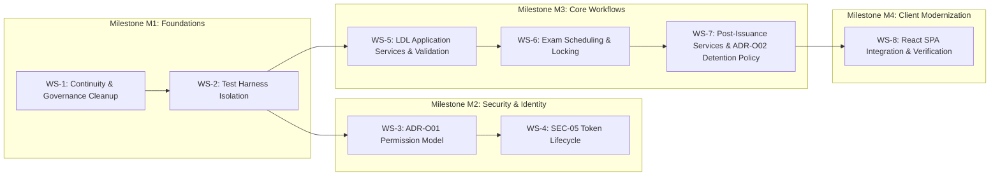

# DVLD — Modernization Development Plan

> [!NOTE]
> **Historical Archival Notice:**
> This document is preserved strictly as a historical planning source. It is **NOT** an active roadmap, decision register, or current implementation authority.
> - **Current Execution Roadmap:** [`ENGINEERING-ROADMAP.md`](../../../ENGINEERING-ROADMAP.md)
> - **Current Decision Register:** [`ENGINEERING-DECISIONS.md`](../../../ENGINEERING-DECISIONS.md)
> - **Active Civic Domain Specification:** The core business rules originally in Section 2 were extracted and are maintained in [`docs/domain/LICENSING-DOMAIN-SPECIFICATION.md`](../../domain/LICENSING-DOMAIN-SPECIFICATION.md).
> - **Active Technical Standards:** [`ENGINEERING-STANDARDS.md`](../../../ENGINEERING-STANDARDS.md), [`TESTING-STANDARDS.md`](../../../TESTING-STANDARDS.md), and [`SECURITY-STANDARDS.md`](../../../SECURITY-STANDARDS.md).
> All text and metadata below represent the original historical artifact.

> **System Name:** Driver & Vehicle Licensing Department (DVLD) Management System  
> **Repository Root:** `D:\DVLD-WPF`  
> **Document Role:** Master Development Roadmap, Workstreams, Licensing Constraints & Evidence Backlog  
> **Status:** ACTIVE & ENFORCED  
> **Effective Date:** 2026-11-08  

---

## 1. Governance Boundary & Execution Authority

> [!IMPORTANT]
> **Implementation Authorization Invariant:**
> Inclusion of any workstream, milestone, or task in this plan **does NOT constitute authorization to implement code, modify database schemas, or run migrations**.  
> Each implementation phase requires explicit, independent written authorization from the Project Owner.  
> Currently:
> - **Phase 12.2, 12.3, and 12.4:** `STRICTLY NOT AUTHORIZED`.
> - **SEC-05 Implementation:** `STRICTLY NOT AUTHORIZED`.
> - **ADR-O01 Implementation:** `PLANNED (UNAUTHORIZED)`.
> - **ADR-O02 (Detained License Replacement / INT-03) Implementation:** `BLOCKED PENDING OFFICIAL POLICY VERIFICATION`.

---

## 2. Core Licensing Domain Business Constraints

*These domain invariants were extracted and validated from historical business discovery in [`docs/audits/phase-a-supplementary-review.md`](../../audits/phase-a-supplementary-review.md) §3.*

### 2.1 Local Driving License (LDL) Application Lifecycle
1. **Prerequisite Citizen Demographic Profile:** An applicant must exist in the `People` directory before an application can be created.
2. **Class-Specific Minimum Age:** An applicant must satisfy the minimum legal age for the target license class (e.g., 18 years for Class 3 Ordinary Driving License, 21 years for Heavy Transport / Buses).
3. **Application State Machine:**
   - **`New` (Status = 1):** Application created and unpaid/in-progress.
   - **`Cancelled` (Status = 2):** Explicitly cancelled by staff. Cancelled applications cannot be reopened, scheduled for tests, or completed.
   - **`Completed` (Status = 3):** Final license issued. Completed applications are locked and immutable.
4. **Active Application Constraint (Domain Rule):** An applicant cannot have more than one active (`New`) local driving license application for the **same license class** simultaneously. (Observed in application validation logic; not the subject of ADR-O02).

### 2.2 3-Tier Sequential Test Appointment System
Examinations must strictly follow this unalterable linear progression:
$$\text{Vision Test (Type 1)} \longrightarrow \text{Written Test (Type 2)} \longrightarrow \text{Street/Practical Test (Type 3)}$$

1. **Strict Prerequisite Enforcement:**
   - To schedule a Written Test appointment, the applicant **must have passed** the Vision Test.
   - To schedule a Practical Test appointment, the applicant **must have passed** the Written Test.
2. **Appointment Lockout & Concurrency:**
   - An applicant can only have one active (`Unlocked`) appointment per test type at any given time.
   - Once a test is recorded (`Pass` or `Fail`), the appointment becomes `Locked` and immutable.
3. **Retake Test Rules:**
   - If an applicant fails a test, they must schedule a **Retake Test Appointment**.
   - Retake test appointments incur both the standard test fee and a retake application fee.
   - Retake scheduling is blocked until the previous test result is officially locked and recorded as a failure.

### 2.3 First-Time Driver License Issuance
1. **Completion Prerequisite:** All three examinations (Vision, Written, Practical) must be passed.
2. **Driver Registration:** If the applicant is not already registered as a driver, a new `Driver` record is created linking their `PersonID`.
3. **License Generation:** A `License` record is created with:
   - Issue Date = Current Jordan Local Date.
   - Expiration Date = Current Date + `DefaultValidityLength` years (from `LicenseClasses`).
   - `IsActive` = `true`.
   - `IssueReason` = `1` (First Time).
4. **Application Completion:** The parent `Application` status is updated to `Completed` (`3`) within the same transaction.

### 2.4 Post-Issuance Workflows
1. **License Renewal:**
   - Allowed only if the current license is expired or within the authorized renewal window.
   - The old license is deactivated (`IsActive = false`), and a new license record is generated linked to the same driver with `IssueReason = 2` (Renew).
2. **License Replacement (Damaged or Lost):**
   - Requires an active license (`IsActive = true`).
   - If replaced as Damaged (`IssueReason = 3`), standard damage fee applies.
   - If replaced as Lost (`IssueReason = 4`), replacement fee applies.
   - The old license is deactivated immediately upon replacement.
3. **License Detention & Release:**
   - An active license may be detained with a recorded fine amount.
   - A detained license cannot be renewed or replaced while actively detained.
   - **Release Workflow:** Requires payment of the fine application fee and fine amount; updates `IsReleased = true`, `ReleaseDate = UTC Now`, and `ReleaseApplicationID`.

---

## 3. Workstreams, Milestones & Phased Roadmap

| Workstream ID | Workstream Title | Priority | Target Milestone | Execution Status |
|---|---|---|---|---|
| **WS-1** | Continuity Suite & Documentation Cleanup | Critical | M1 (Foundations) | **Authorized (In Progress)** |
| **WS-2** | Ephemeral Integration Test Harness Validation | Critical | M1 (Foundations) | Planned (Unauthorized) |
| **WS-3** | ADR-O01 Explicit Permission Model Implementation | High | M2 (Security) | Planned (Unauthorized) |
| **WS-4** | SEC-05 Multi-Session & Token Rotation Implementation | High | M2 (Security) | Proposed (Unauthorized) |
| **WS-5** | LDL Application Services & Domain Validation Rules | Medium | M3 (Core Services) | Planned (Unauthorized) |
| **WS-6** | 3-Tier Exam Appointment Concurrency & Locking | High | M3 (Core Services) | Planned (Unauthorized) |
| **WS-7** | Post-Issuance Services & ADR-O02 Detained Replacement Policy | Medium | M3 (Core Services) | Blocked on Policy Verification (ADR-O02) |
| **WS-8** | React SPA Contract Verification & Error Handling | Medium | M4 (Client) | Planned (Unauthorized) |

---

## 4. Evidence-Backed Findings Register (Three-Dimensional Model)

The following historical findings—extracted from Phase A ([`docs/audits/phase-a-repository-discovery.md`](../../audits/phase-a-repository-discovery.md)) and Phase A.1 ([`docs/audits/phase-a-supplementary-review.md`](../../audits/phase-a-supplementary-review.md))—are tracked across three orthogonal dimensions:

| Finding ID & Description | Dimension A: Evidence Status | Dimension B: Decision Status | Dimension C: Implementation Status | Source Anchor & Baseline |
|---|---|---|---|---|
| **FIND-01: Admin Permission Segregation (SEC-01)** Controllers enforce `StaffOnly`, excluding Admin from licensing counters. | `Confirmed by current source inspection` | `Approved (ADR-O01 Model B)` | `Planned (Unauthorized)` | Phase A.1 §7.1 & `ApplicationsController.cs` (Baseline `29e43d6`) |
| **FIND-02: Simultaneous Active LDL Applications (Domain Rule)** Code currently allows multiple active applications if class differs. | `Historically evidenced, current validity not verified` | `Proposed` | `Not started (Unauthorized)` | Phase A.1 §3.1 & `LocalDrivingLicenseApplicationsController.cs` |
| **FIND-03: Stateless JWT Without Server-Side Revocation** Tokens cannot be invalidated on logout; 60-min window. | `Confirmed by current source inspection` | `Proposed (SEC-05)` | `Not started (Unauthorized)` | Phase A §11.2 & `AuthController.cs` |
| **FIND-04: Test Appointment Race Condition Risk** Appointment locking lacks optimistic concurrency token. | `Supported by evidence, requires further validation` | `Proposed` | `Not started (Unauthorized)` | Phase A.1 §5.2 (SQL Locking Analysis) |
| **FIND-05: Detained License Replacement Policy (ADR-O02 / INT-03)** `LicenseReplacementService` lacks `IDetainedLicenseRepository` check to verify if a license is actively detained. | `Confirmed by current source inspection` | `Provisionally selected (ADR-O02)` | `Not started (Blocked on Policy Verification)` | Phase A.1 §3.6, `LicenseReplacementService.cs` & `ENGINEERING-DECISIONS.md#ADR-O02` |
| **FIND-06: File Upload Magic Byte & WebP Re-Encoding** Uploads validated for magic bytes, constrained, and encoded to WebP. | `Confirmed by current source inspection` | `Approved` | `Verified` | Phase A §11.4, `ImageProcessingService.cs`, `PhysicalFileStorageService.cs` |
| **FIND-07: Jordan Standard Time Invariant** UTC database storage paired with `IJordanClock` display singleton. | `Confirmed by current source inspection` | `Approved` | `Verified` | Phase A §6.3, `IJordanClock.cs`, `Program.cs:250` |
| **FIND-08: Ephemeral Test Database Strategy** `DVLD_IntegrationTests_<GUID>` prevents developer DB pollution. | `Confirmed by current source inspection` | `Approved` | `Implemented, verification pending` | Phase A.1 §9 & `TESTING-STANDARDS.md` |

---

## 5. Milestone Verification Gates

Prior to authorizing any phase transition, the following gate criteria must be satisfied:

1. **Gate M1 (Foundations Entry Criteria):**
   - Clean documentation baseline established on `docs/documentation-cleanup`.
   - Zero broken Markdown links.
   - Master execution verification passing.
2. **Gate M2 (Security Transition Criteria):**
   - Ephemeral database harness dry-run passing with exit code 0.
   - Explicit Project Owner authorization of Phase 12.2.
   - Official sign-off on SEC-05 transport option (Option A vs. Option C).
3. **Gate M3 (Core Services Criteria):**
   - ADR-O02 (Detained License Replacement Policy) official policy verified and signed off prior to implementing WS-7 license replacement logic.
   - Zero regression in unit test suites.
   - All licensing mutations encapsulated within UnitOfWork transaction blocks.
