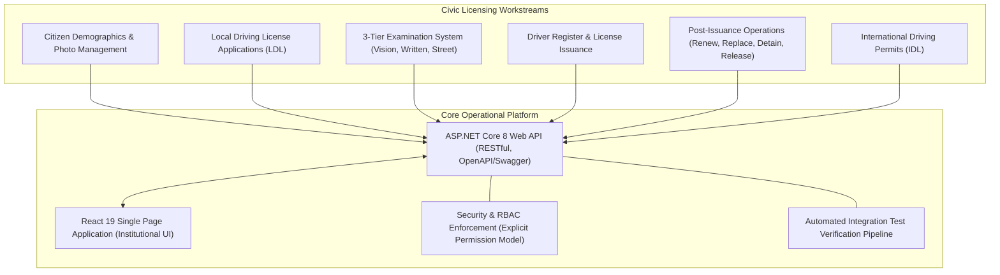

# DVLD — Modernization Development Vision

> **System Name:** Driver & Vehicle Licensing Department (DVLD) Management System  
> **Repository Root:** `D:\DVLD-WPF`  
> **Target Systems:** ASP.NET Core 8 Web API (`API/DVLD.Api`) & React 19 SPA (`ClientApp/`)  
> **Document Role:** Authoritative System Vision, Modernization Objectives & Product Principles  
> **Status:** ACTIVE & ENFORCED  
> **Effective Date:** 2026-11-08  

---

## 1. Executive Summary & Purpose of Modernization

The Driver & Vehicle Licensing Department (DVLD) management system is undergoing a comprehensive enterprise modernization. Originally conceived as a monolithic desktop application in Windows Presentation Foundation (WPF), the system manages critical civic services including citizen demographics, driver records, multi-class licensing, examination appointments, license renewals, replacements, and legal detentions.

### Why the System is Being Modernized:
1. **Architectural Decoupling:** Transition from a legacy desktop client directly coupled to local data structures toward a secure, resilient, layered service-oriented architecture (Clean Architecture with ASP.NET Core 8 Web API and a responsive React 19 Single Page Application).
2. **Concurrency & Data Integrity:** Eliminate transaction boundaries vulnerabilities, race conditions in examination scheduling, and unmanaged concurrent updates by instituting strict UnitOfWork patterns, database locking invariants, and idempotent operation flows.
3. **Auditing & Enterprise Security:** Modernize identity management, enforce Segregation of Duties (SoD), eliminate unvalidated file uploads, protect against path traversal and decompression attacks, and prepare for robust multi-session token lifecycles.
4. **Engineering Rigor & Testability:** Replace manual testing habits with fully automated, isolated test harnesses operating against ephemeral SQL Server databases (`DVLD_IntegrationTests_<GUID>`), guaranteeing zero risk to operational data.

---

## 2. Product Objectives & Intended Capabilities

### Approved Product Objectives:
1. **Single Source of Civic Truth:** Maintain verified demographic records and high-fidelity citizen photographs, eliminating duplicate identity profiles and ensuring deterministic national number validation.
2. **Deterministic Licensing Lifecycle:** Enforce strict sequential test progression (Vision $\rightarrow$ Written $\rightarrow$ Practical/Street) where applicants cannot advance or sit for a subsequent test without officially passing the prerequisite exam.
3. **Multi-Class Licensing Management:** Maintain explicit separation between license classes (Classes 1 through 7), tracking minimum age requirements, validity duration, and fee structures.
4. **Comprehensive Post-Issuance Workflows:** Support full operational lifecycles including:
   - Routine license renewal with automatic validity period extension.
   - Damaged and lost license replacement workflows with validation of active status.
   - Legal license detention with customizable fine assessment and secure payment-backed release workflows.
5. **International Driving Permit Issuance:** Validate active Class 3 local driver licenses before issuing standard international driving permits.

---

## 3. Target User Experience & Modern Client Direction

The user interface layer is anchored entirely by `ClientApp/`, a modern React 19 SPA engineered with TypeScript and Vite.

### Key User Experience Tenets:
- **Fast, Responsive Navigation:** Sub-second client-side routing with clean institutional styling (Tailwind CSS v4 and accessible Radix UI primitives).
- **Keyboard-Driven Workflows:** Integrated global command palette (`Ctrl+K`) for rapid navigation across licensing directories and administrative tools.
- **Immediate Visual Feedback:** Clear status indicators, non-blocking asynchronous modal dialogs, and robust client-side validation paired with standardized RFC 7807 problem details error alerts.
- **Session Continuity:** Seamless per-tab session isolation using browser `sessionStorage`, with automated 401 interception ensuring predictable re-authentication without loss of context.

---

## 4. Quality, Maintainability, Security & Reliability Goals

| Quality Attribute | Architectural Target | Invariant Standard |
|---|---|---|
| **Security & RBAC** | Strict Segregation of Duties (SoD) | Approved ADR-O01 Model B: Admin and Staff have mutually exclusive operational permissions. No automatic role inheritance. |
| **Data Consistency** | Explicit UnitOfWork Transactions | Domain mutations occur within strictly scoped transactions. Compensating rollbacks handle external side-effects (e.g., file storage). |
| **Auditability & Traceability** | Immutable Operational Logging | All civic license status changes, appointments, exam scores, and financial fee collections record creating user, timestamps, and reason. |
| **Media Safety** | Sanitized WebP Re-Encoding | All citizen photos are inspected for magic bytes, constrained to 5 MB and 16M pixels, resized to portrait proportions, and re-encoded to WebP. |
| **Time Standard** | UTC Persistence & Jordan Display | All timestamps stored in UTC. Jordan Standard Time (`Asia/Amman`) utilized for civic business days, test scheduling, and user display via `IJordanClock`. |
| **Test Isolation** | Zero Development DB Interference | Integration tests dynamically provision and destroy ephemeral databases. Zero testing or mutation is permitted against `DVLDf`. |

---

## 5. Explicit Exclusions & Legacy Boundaries

To preserve architectural clarity and eliminate project drift, the following boundaries are non-negotiable:

1. **WPF Client Frozen:** The legacy desktop application located in `Presentation (WPF)/` is **frozen** and explicitly out of scope. No engineering effort, refactoring, or modernization applies to WPF unless authorized in writing by the Project Owner.
2. **Production/Local Database `DVLDf` Strictly Protected:** No automated test runner, AI assistant, or engineering script may connect to, migrate, query, or drop `DVLDf`.
3. **No Speculative Complex Frameworks:** Introduction of external message brokers (RabbitMQ/Kafka), microservices, Redis distributed caching, or CQRS/MediatR frameworks is prohibited without an approved ADR in `ENGINEERING-DECISIONS.md`.
