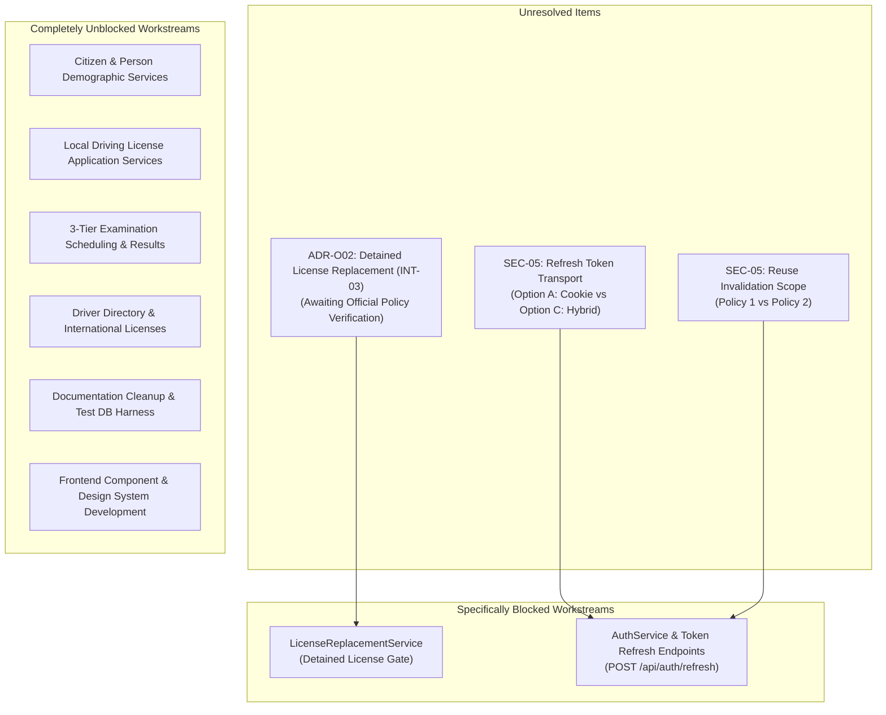

# DVLD — Risks, Open Decisions & Blocker Register

> **System Name:** Driver & Vehicle Licensing Department (DVLD) Management System  
> **Repository Root:** `D:\DVLD-WPF`  
> **Document Role:** Centralized Catalog of Unresolved Decisions, Technical Risks & Workstream Scoping  
> **Status:** ACTIVE & ENFORCED  
> **Effective Date:** 2026-11-08  

---

## 1. Governance Principle: Targeted Workstream Scoping

> [!IMPORTANT]
> **Independent Workstream Non-Blocking Rule:**
> An unresolved architectural decision or business policy gap **blocks ONLY the specific workstream or endpoint directly dependent upon it**.  
> Unresolved decisions must **never** be treated as global blockers that halt independent development planning, architecture specification, frontend UI development, or unaffected domain services.

---

## 2. Register of Open Architectural Decisions

| Decision ID | Item Name | Current Status | Specifically Blocked Scope | Unblocked Independent Scope | Required Evidence / Decision Needed |
|---|---|---|---|---|---|
| **ADR-O02** | Detained License Replacement Policy (INT-03) | `PROVISIONALLY SELECTED — OFFICIAL POLICY VERIFICATION REQUIRED` | Validation check inside `LicenseReplacementService` to prevent replacing actively detained licenses. | Application submission, person management, user management, tests, international licenses, renewals. | Official written confirmation of department regulatory policy on whether actively detained licenses may be replaced. Unresolved questions: association with LicenseID vs DriverID, active detention detection, historical record preservation, and lost vs damaged replacement rules. |
| **SEC-05.1** | Refresh Token Transport Mechanism | `UNRESOLVED` | `POST /api/auth/refresh` endpoint and client interceptors in `ClientApp/apiClient.ts`. | Core business workflows, domain use cases, static analysis, test harness setup. | Project Owner selection between Option A (HttpOnly cookie) and Option C (Hybrid transport). |
| **SEC-05.2** | Token Reuse Invalidation Scope | `UNRESOLVED` | Token family revocation logic in `RefreshTokenService`. | All non-auth backend and frontend features. | Project Owner selection between Policy 1 (invalidate compromised sub-tree) and Policy 2 (invalidate entire family). |
| **SEC-05.3** | Grace Recovery Window & Retention Duration | `UNRESOLVED` | Concurrency handling in token rotation and scheduled background purge job. | All non-auth backend and frontend features. | Decision on recovery window duration (15s vs. 30s) and separation of physical retention from eligibility expiry. |

---

## 3. Register of Technical & Operational Risks

| Risk ID | Risk Category | Risk Description | Severity | Likelihood | Mitigation Strategy & Verification Evidence |
|---|---|---|---|---|---|
| **RSK-01** | Database Protection | Inadvertent execution of tests or migrations against developer database `DVLDf`. | Critical | Low | Strict enforcement of `DVLD_IntegrationTests_<GUID>` harness in `TESTING-STANDARDS.md`. Zero database connections in unapproved commands. |
| **RSK-02** | Concurrency / Race Condition | Concurrent test appointment booking leading to duplicate active appointments. | High | Medium | Enforce pessimistic lock or optimistic concurrency tokens (`RowVersion`) on `TestAppointments` and `LocalDrivingLicenseApplications`. |
| **RSK-03** | Media Storage Consistency | Database failure after physical image write leaving orphaned files on disk. | Medium | Low | Verified compensating transaction: `PersonService.UploadPersonPhotoAsync` immediately deletes the written file if `SaveChangesAsync()` fails. |
| **RSK-04** | Authentication Drift | Stateless JWT 60-min window leaves revoked users active until token expiration. | High | High | Implement SEC-05 refresh token rotation and multi-session store once authorized by Project Owner. |
| **RSK-05** | Decompression Bomb | Malicious citizen photo upload consuming excessive server memory during decode. | High | Low | Verified in `ImageProcessingService.cs`: Enforce strict bounds of $\le 5$ MB, max dimension $4096$ px, and total pixels $\le 16,000,000$. |

---

## 4. Owner Decision Escalation Gates

The following decisions are logged for Project Owner escalation prior to beginning implementation phases:

1. **Gate D-1: Official Ratification of ADR-O02 (INT-03):**  
   Confirm whether the provisional policy prohibiting the replacement of an actively detained license until the detention is officially released is ratified as departmental regulatory policy.
2. **Gate D-2: SEC-05 Implementation Authorization & Parameter Selection:**  
   Select Option A or Option C for transport, Policy 1 or Policy 2 for reuse, and authorize Phase 12.2 when ready.
