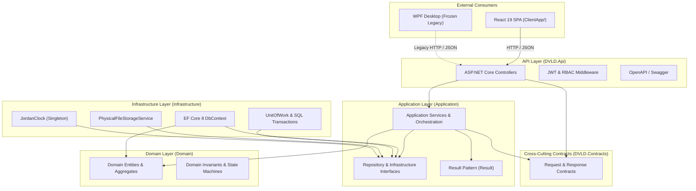
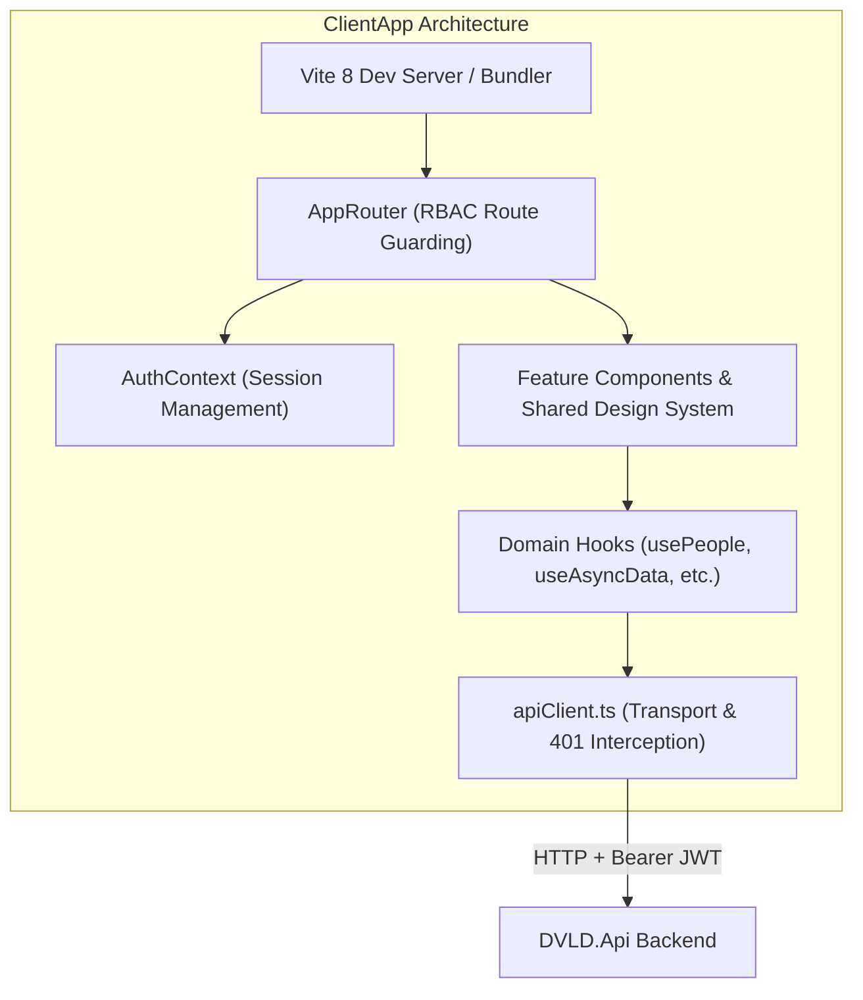
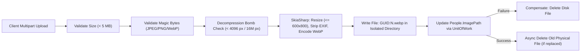

# DVLD — Target Technical Architecture

> **System Name:** Driver & Vehicle Licensing Department (DVLD) Management System  
> **Repository Root:** `D:\DVLD-WPF`  
> **Document Role:** Authoritative Technical Architecture, Component Boundaries & Design Patterns  
> **Status:** ACTIVE & ENFORCED  
> **Effective Date:** 2026-11-08  

---

## 1. Architectural Style & Layered Boundaries

The target backend architecture enforces strict **Clean Architecture (Layered Hexagonal)** principles. Dependencies flow strictly inwards toward the Domain model.

### Layer Rules & Invariants:
1. **Domain (`Domain/`):** Pure C# entities and invariants. Has **zero dependencies** on Application, Infrastructure, or API.
2. **Application (`Application/`):** Use-case orchestration and business interfaces. Depends only on `Domain/` and `DVLD.Contracts/`. **Must never depend on Infrastructure or API.**
3. **Infrastructure (`Infrastructure/`):** Implements interfaces defined in `Application/`. Depends on `Application/` and `Domain/`. Encapsulates EF Core, SQL Server queries, disk I/O, and external clocks.
4. **API (`API/DVLD.Api/`):** Composition root and HTTP transport. Depends on `Application/`, `Infrastructure/`, and `DVLD.Contracts/`. Dispatches incoming HTTP requests to application services.

### 1.1 API Routing, Endpoint Conventions & Status Code Guidance
- **Controller Route Attribute:** All 20 API controllers enforce the uniform route prefix `[Route("api/[controller]")]` combined with `[ApiController]`.
- **Response Format:** Successful responses serialize JSON payloads; failure responses uniformly return RFC 7807 `application/problem+json` via `ResultHttpMapper.ToActionResult()`.

#### HTTP Status Code Reference Matrix:

| Status Code | Standard Meaning | Existing Observed Implementation Status | Usage & Architecture Convention |
|---|---|---|---|
| **`200 OK`** | Success with payload | `Existing Observed Behavior` | Standard response for successful `GET` queries and `PUT` modifications returning updated DTOs (`return Ok(dto)`). |
| **`201 Created`** | Resource created | `Existing Observed Behavior` | Returned by creation endpoints (`POST`) via `return CreatedAtAction(...)` (e.g., `ApplicationsController.cs:60`, `PeopleController.cs:156`, `UsersController.cs:141`). Includes `Location` header. |
| **`204 NoContent`** | Success without payload | `Existing Observed Behavior` | Returned by void operational commands, state updates, and deletions (`DELETE`) via `return NoContent()` across controllers (e.g., `ApplicationsController.cs:75`, `PeopleController.cs:195`). |
| **`400 BadRequest`** | Syntax / Input validation failure | `Existing Observed Behavior` | Generated by `ResultHttpMapper` (`ResultHttpMapper.cs:24`) when `result.ErrorType == ErrorType.Validation`. Emits RFC 7807 `ProblemDetails` with validation message. |
| **`401 Unauthorized`** | Missing or invalid authentication | `Existing Observed Behavior` | Generated automatically by ASP.NET Core JWT Bearer authentication handler when the `Authorization: Bearer <token>` header is missing, expired, or has an invalid signature. |
| **`403 Forbidden`** | Insufficient permissions / SoD block | `Existing Observed Behavior` | Generated by ASP.NET Core authorization policies (`StaffOnly`, `AdminOnly`, `StaffOrAdmin`) or `ResultHttpMapper` (`ResultHttpMapper.cs:33`) when `result.ErrorType == ErrorType.Forbidden`. |
| **`404 NotFound`** | Target entity does not exist | `Existing Observed Behavior` | Generated by `ResultHttpMapper` (`ResultHttpMapper.cs:27`) when `result.ErrorType == ErrorType.NotFound` (e.g., person or license ID not found). |
| **`409 Conflict`** | Unique constraint / concurrency conflict | `Existing Observed Behavior` | Generated by `ResultHttpMapper` (`ResultHttpMapper.cs:30`) when `result.ErrorType == ErrorType.Conflict` (e.g., duplicate NationalNo or username violation). |
| **`422 Unprocessable Entity`** | Semantic business invariant violation | `Recommended Convention` | **Not currently emitted by `ResultHttpMapper`** (existing validation routes to `400`). Recommended as a future convention for syntactically valid JSON payloads that violate complex domain business rules (e.g. attempting to schedule a practical test before passing the written test). |

---

## 2. Status Classification of Architectural Components

To eliminate ambiguity between current code, approved decisions, and future proposals, all architectural components are classified as follows:

| Component / Subsystem | Architectural Classification | Source / Reference | Description & Status |
|---|---|---|---|
| **Clean Architecture Layering** | `Existing Verified Implementation` | `DVLD_WPF.sln` | Strict inwards dependency rule enforced across all projects. |
| **Result Pattern (`Result<T>`)** | `Existing Verified Implementation` | `Application.Common.Results` | Explicit error handling replacing exception-based control flow. |
| **UnitOfWork & EF Core 8** | `Existing Verified Implementation` | `Infrastructure/DVLDDbContext.cs` | Centralized `SaveChangesAsync` within atomic transactions. |
| **Jordan Clock Standard** | `Existing Verified Implementation` | `Application/Interfaces/IJordanClock.cs` | UTC storage in database; singleton conversion to `Asia/Amman`. |
| **Photo Upload & WebP Storage** | `Existing Verified Implementation` | `ImageProcessingService.cs` | SkiaSharp re-encoding, magic bytes, 5 MB cap, GUID filenames. |
| **Stateless JWT Auth (60-min)** | `Existing Verified Implementation` | `API/DVLD.Api/Program.cs` | Current production authentication. No token revocation blocklist. |
| **Explicit Permission Separation (Model B)** | `Approved Architectural Decision` | `ENGINEERING-DECISIONS.md` (ADR-O01) | Admin does not inherit Staff licensing permissions. Implementation planned. |
| **Ephemeral Test DB Lifecycle** | `Approved Architectural Decision` | `TESTING-STANDARDS.md` | `DVLD_IntegrationTests_<GUID>` provisioning. Dry-run pending. |
| **Multi-Session & Token Rotation** | `Proposed Future Architecture` | `ENGINEERING-ROADMAP.md` (SEC-05) | Rotating refresh tokens and multi-session store. **Not authorized**. |
| **Optimistic Concurrency (RowVersion)** | `Proposed Future Architecture` | Phase A.1 §5.2 | Adding concurrency tokens to appointment and application entities. |
| **Token Transport Option (A vs. C)** | `Unresolved Design Question` | `RISKS-AND-OPEN-DECISIONS.md` | HttpOnly cookie vs. hybrid header-body transport for refresh tokens. |
| **License Replacement Detention Gate** | `Unresolved Design Question` | `RISKS-AND-OPEN-DECISIONS.md` | Verifying whether detention blocks license replacement by regulation. |

---

## 3. Data Flow, Transaction & Concurrency Architecture

### 3.1 UnitOfWork & Transaction Boundaries
All database state mutations follow the atomic UnitOfWork pattern:
1. Operations acquire a scoped transaction when modifying multiple aggregate roots (e.g., Application Completion + License Generation).
2. Read operations execute as `AsNoTracking()` queries to prevent EF Core identity map bloat and eliminate memory overhead.
3. Transaction rollback guarantees that failure in secondary entities leaves no orphaned or partially mutated records.

### 3.2 Concurrency & Locking Strategy
- **Read-Committed Snapshot Isolation (RCSI):** Recommended for SQL Server to prevent readers from blocking writers and writers from blocking readers.
- **Critical Resource Locks:** Critical scheduling points (such as recording exam results or completing applications) acquire explicit pessimistic row locks or verify entity state before mutating to prevent concurrent duplicate test recording.

### 3.3 Data Access Mechanics & SQL Views Strategy
- **Source Verification (No SQL Views in EF Core):** Direct inspection of `Infrastructure/DVLDDbContext.cs` and `Infrastructure/Configurations/` confirms that `DVLDDbContext` defines exactly 14 `DbSet<T>` properties mapped to underlying relational base tables. No SQL Server views (`HasNoKey()` / `ToView()`) are mapped in the EF Core model, and no EF Core migrations create or alter database views.
- **Historical SQL Views Context (Unverified Context):** References in legacy documentation to denormalized SQL views (such as `LocalDrivingLicenseApplications_View` and `Drivers_View`) represent unverified historical context; no retained documentary evidence in the repository establishes their historical existence, and `DVLDf` remains uninspected.
- **Modern Architecture Invariant:** In the modernized .NET 8 backend, paginated data retrieval and complex search queries do **not** rely on database views. Instead, repositories in `Infrastructure/Repositories/` execute strongly-typed LINQ queries with `AsNoTracking()` and project directly into application DTOs (e.g. `LocalDrivingLicenseApplicationListDto`, `DriverListDto`) using EF Core `Select` projections and table joins. This architectural decision:
  1. Keeps data access database-agnostic and fully encapsulated within C# repositories.
  2. Guarantees that ephemeral integration test databases (`DVLD_IntegrationTests_<GUID>`) can be automatically provisioned from EF Core migrations without external database view scripts.
  3. Eliminates schema desynchronization risks between migrations and database views.

---

## 4. Frontend Architecture (`ClientApp/`)

The client application is an institutional Single Page Application engineered with React 19 and Vite:

### Key Client Conventions:
1. **Centralized Transport (`src/services/apiClient.ts`):** All API calls route through `apiRequest<T>()`. Direct `fetch()` calls in UI components are prohibited.
2. **Session Storage (`sessionStorage`):** Active session profile and access token reside in `sessionStorage` under `dvld_auth_session`, providing workstation per-tab isolation.
3. **Automated 401 Interception:** Any backend HTTP 401 automatically triggers `setUnauthorizedHandler()`, resetting React state, clearing stored tokens, and redirecting to the login screen with a friendly expiration notice.
4. **TypeScript Strictness:** Project reference build (`tsc -b`) enforces strict type-checking, explicit `import type` statements, and zero unused parameters.

---

## 5. Media & File Storage Architecture

Person photographs undergo strict pipeline processing before touching disk:

- **Storage Location:** Files are stored strictly outside the web application root (`wwwroot`) in the directory specified by `Storage:PersonImagesPath` (defaulting to `LocalAppData/DVLD/Storage`).
- **Failure Compensation:** If the database commit fails, the newly written disk file is immediately deleted to prevent storage leaks.
- **Direct HTTP Execution Forbidden:** Files are served only through authenticated streaming endpoints (`GET /api/people/{id}/photo`) with ETag and private caching headers. Direct static file execution is impossible.
