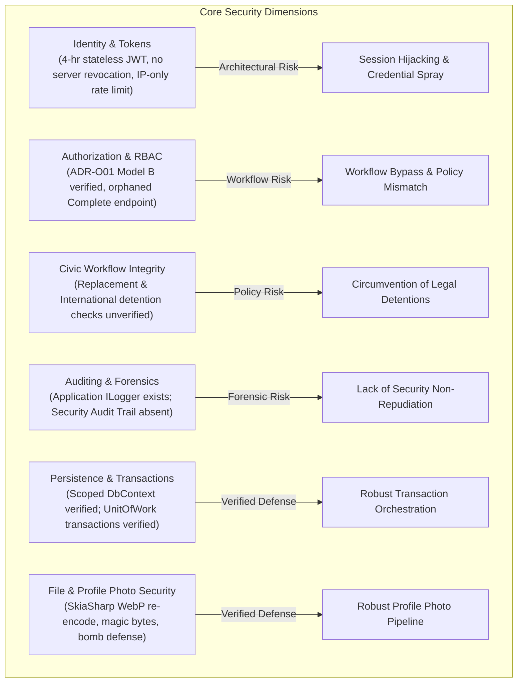
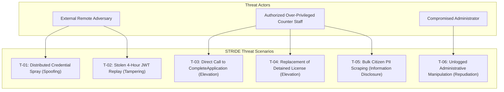
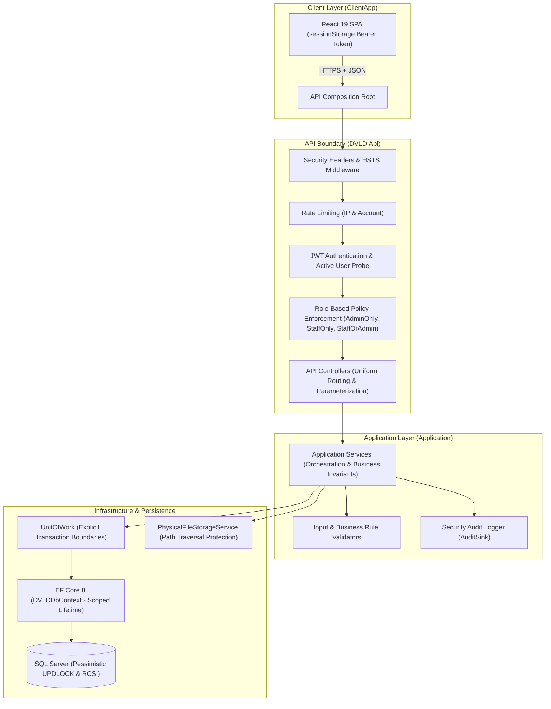
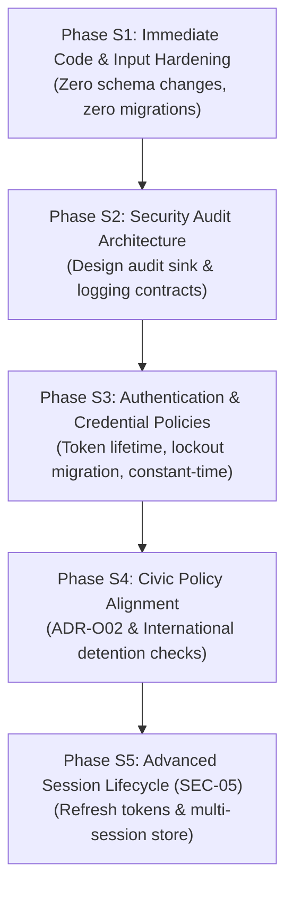

# DVLD — Security Implementation Readiness Assessment
## Comprehensive Security Architecture Review, Threat Model & Implementation Roadmap

> **Document Type:** Authoritative Technical Preparation & Security Assessment Deliverable  
> **Repository:** `D:\DVLD-WPF`  
> **Evaluation Baseline Commit:** `9b6d22f8728463f7b80c1341582016e1dda1972f`  
> **Active Branch:** `docs/documentation-cleanup`  
> **Governance Authority:** [AGENTS.md](../../../AGENTS.md) | [AI-ENGINEERING-INSTRUCTIONS.md](../../../AI-ENGINEERING-INSTRUCTIONS.md) | [SECURITY-STANDARDS.md](../../../SECURITY-STANDARDS.md) | [ENGINEERING-STANDARDS.md](../../../ENGINEERING-STANDARDS.md)  
> **Security Status:** `READ-ONLY PLANNING DELIVERABLE — ZERO CODE OR CONFIGURATION MUTATION`  

---

## 1. Executive Summary

This security implementation readiness assessment evaluates the security posture of the **Driver & Vehicle Licensing Department (DVLD)** management system. The evaluation encompassed the active ASP.NET Core 8 Web API backend (`DVLD.Api`), application use-case orchestration (`Application`), EF Core 8 persistence and infrastructure (`Infrastructure`), shared contracts (`DVLD.Contracts`), and the browser-based administrative client (`ClientApp` in React 19 + TypeScript).

The objective is to establish an empirical, evidence-based security baseline, classify confirmed vulnerabilities versus architectural strengths, articulate a STRIDE-based departmental threat model, register prioritized risks, and deliver a phased, dependency-aware security implementation roadmap.

### Key Assessment Findings Overview



### High-Level Posture Summary
1. **Existing Verified Defenses:**  
   - Direct source inspection refutes the historical concern regarding `IDbContextFactory`: `DVLDDbContext`, `UnitOfWork`, and all repositories are strictly registered as Scoped. A single context instance and change tracker are shared per HTTP request.
   - Profile photo uploads through `POST /api/people/{id}/photo` feature multi-stage validation: magic byte verification, SkiaSharp WebP re-encoding, image dimension constraints ($\le 4096$ px / $16\text{M}$ total pixels) for decompression bomb defense, and server-generated GUID storage keys outside `wwwroot`.
   - `Program.cs` implements an active user probe in `JwtBearerEvents.OnTokenValidated`, querying `IsUserActiveAsync` against the database on every authenticated request, immediately neutralizing tokens for deactivated accounts.
2. **Key Security Weaknesses & Implementation Gaps:**  
   - **Stateless Long-Lived JWT (4 Hours) Without Server-Side Revocation:** Access tokens have an expiration of 240 minutes (4 hours) with no refresh token mechanism, no server-side revocation store, and no token invalidation upon user logout or password change.
   - **Orphaned Application Completion Endpoint:** `POST /api/applications/{id}/complete` exposes an unconstrained state mutation allowing counter staff to mark applications as `Completed` without verifying test prerequisites.
   - **Circumvention of Legal Detentions (ADR-O02 / INT-03):** `LicenseReplacementService` does not verify whether a license is actively detained before issuing a replacement. (International license issuance also lacks a detention check; both represent distinct policy questions).
   - **Missing Account Lockout & Security Audit Trails:** Login rate limiting is IP-partitioned only (no account-level lockout against distributed brute-force), and the application lacks a dedicated security audit logging pipeline for authentication and privileged administrative actions (despite general application logging via `ILogger`).

---

## 2. Scope and Methodology

### 2.1 Scope of Assessment
The assessment was conducted entirely in **read-only static analysis mode**, inspecting:
- **Backend Architecture:** `API/DVLD.Api/` (Program, controllers, results, security filters, middleware, configuration).
- **Application Orchestration:** `Application/` (use-case services, validators, DTOs, mappers, interfaces).
- **Persistence & Infrastructure:** `Infrastructure/` (EF Core mappings, configurations, repositories, UnitOfWork, physical file storage, image processor).
- **Domain Entities:** `Domain/` (pure entities, enums, domain rules).
- **Contracts Boundary:** `DVLD.Contracts/` (request and response DTO schemas).
- **Frontend SPA:** `ClientApp/` (HTTP transport, session storage, route guards, RBAC utility).
- **Governance Suite:** All documents under `docs/` and root governance standards.

### 2.2 Prohibited Boundaries Maintained
- **Zero Database Connections:** Neither `DVLDf` nor any test database was connected to, queried, migrated, or mutated.
- **Zero Build or Test Execution:** No compilation or test runner was initiated.
- **Zero Code Mutations:** No application code, configuration, or manifest was modified.
- **Zero Git State Mutation:** No branch switching, committing, pushing, or staging occurred.

### 2.3 Evidence Classification Taxonomy
In strict compliance with governance instructions, every finding in this report is classified as:
- **`VERIFIED CURRENT IMPLEMENTATION`**: Observed and confirmed directly in active source code.
- **`VERIFIED SECURITY WEAKNESS`**: Confirmed flaw, omission, or exploit vector in current implementation.
- **`PARTIALLY IMPLEMENTED`**: Security control exists but has bypasses, gaps, or incomplete enforcement.
- **`NOT IMPLEMENTED`**: Completely absent from the codebase.
- **`UNVERIFIED`**: Hypothesized in earlier audits but unsupported by documentary or code evidence.
- **`PROPOSED IMPROVEMENT`**: Architectural enhancement exceeding baseline defense requirements.
- **`GOVERNANCE DECISION REQUIRED`**: Policy question requiring formal Project Owner resolution.

---

## 3. Repository and Architecture Baseline

```text
Repository Root: D:\DVLD-WPF
Active Branch:   docs/documentation-cleanup
HEAD Commit:     9b6d22f8728463f7b80c1341582016e1dda1972f (docs: consolidate engineering documentation and governance)
Target Stack:    .NET 8.0 (C# 12) + EF Core 8.0.18 + React 19.3.1 + Vite 8.3.4 + Tailwind CSS 4.3.3
```

### Layer Dependency Invariants
The Clean Architecture layers enforce strict inwards dependencies:
$$\text{API} \longrightarrow \text{Application} \longrightarrow \text{Domain} \longleftarrow \text{Infrastructure}$$
The domain layer has zero external dependencies. The application layer depends only on Domain and Contracts. The infrastructure layer implements interfaces declared in Application. The API acts as the composition root and HTTP entry point.

---

## 4. Existing Security Controls & Architectural Verification

The following security controls were verified through direct code inspection:

| Control Domain | Source Location | Implementation Details | Evidence Classification |
|---|---|---|---|
| **Active User Token Probe** | `API/DVLD.Api/Program.cs:94-126` | `JwtBearerEvents.OnTokenValidated` queries `IUserService.IsUserActiveAsync(userId)`. Inactive or deleted users are rejected on the immediate next request. | `VERIFIED CURRENT IMPLEMENTATION` |
| **Profile Photo Sanitization** | `Infrastructure/Services/ImageProcessingService.cs:40-120` | Magic byte inspection (JPEG `FF D8 FF`, PNG `89 50 4E 47`, WebP `RIFF`/`WEBP`). Dimensions capped at $4096$ px / $16\text{M}$ pixels. WebP re-encoding at quality 85. | `VERIFIED CURRENT IMPLEMENTATION` |
| **Path Traversal Protection** | `Infrastructure/Services/PhysicalFileStorageService.cs:198-210` | Validates that resolved paths strictly start with `_storageRoot` using `StringComparison.OrdinalIgnoreCase`. Storage located outside `wwwroot`. | `VERIFIED CURRENT IMPLEMENTATION` |
| **Pessimistic Concurrency Locking** | `Infrastructure/Repositories/*.cs` | Raw SQL row hints (`UPDLOCK, ROWLOCK`) used on critical updates (e.g. `ApplicationRepository.cs:184`, `TestAppointmentRepository.cs:47`). | `VERIFIED CURRENT IMPLEMENTATION` |
| **Scoped DbContext Lifecycle** | `API/DVLD.Api/Program.cs:192, 202` | `DVLDDbContext`, `UnitOfWork`, and all 14 repositories are Scoped. Single context per request; zero `IDbContextFactory` leaks. | `VERIFIED CURRENT IMPLEMENTATION` |
| **Global Exception Masking** | `API/DVLD.Api/Security/GlobalExceptionHandler.cs:45-56` | Unhandled exceptions return generic RFC 7807 `ProblemDetails` ($500$). Stack traces and internal exceptions are never exposed to clients. | `VERIFIED CURRENT IMPLEMENTATION` |
| **IP-Based Login Rate Limiting** | `API/DVLD.Api/Program.cs:157-175`, `AuthController.cs:26` | `FixedWindowLimiter` partitions by `RemoteIpAddress`: 5 permits per 1 minute window. Rejection code $429$. | `VERIFIED CURRENT IMPLEMENTATION` |
| **Role-Based Authorization Policies** | `API/DVLD.Api/Program.cs:133-146` | Three discrete ASP.NET Core authorization policies: `AdminOnly`, `StaffOnly`, and `StaffOrAdmin`. | `VERIFIED CURRENT IMPLEMENTATION` |
| **Deterministic Clock** | `Application/Services/JordanClock.cs` | Singleton `IJordanClock` enforces Jordan Standard Time (`Asia/Amman`, UTC+3 year-round) for civic scheduling and UTC for technical timestamps. | `VERIFIED CURRENT IMPLEMENTATION` |

### 4.1 DbContext, ChangeTracker, and Transaction Boundaries Analysis
To resolve historical ambiguity, the following technical distinctions are verified:

1. **Scoped DbContext Lifetime:**  
   In ASP.NET Core, `AddDbContext<DVLDDbContext>` defaults to `ServiceLifetime.Scoped`. All services, repositories, and `UnitOfWork` resolved within an HTTP request share the **exact same instance** of `DVLDDbContext` and its internal `ChangeTracker`. `IDbContextFactory` is absent from runtime code.
2. **Individual `SaveChanges` vs. Explicit Transactions:**  
   A Scoped DbContext does **not** automatically make an entire HTTP request atomic:
   - Each standalone call to `SaveChangesAsync()` opens and commits its own short-lived database transaction unless an explicit transaction was previously begun.
   - If an application service executes multiple `SaveChangesAsync()` calls sequentially without an explicit transaction, failure during a later step leaves preceding mutations committed in the database.
3. **Explicit `UnitOfWork` Transaction Boundaries:**  
   Multi-entity civic workflows (such as license issuance, renewal, replacement, and detention release) explicitly invoke `_unitOfWork.ExecuteInTransactionAsync(...)`. This method:
   - Opens an explicit database transaction (`IDbContextTransaction`).
   - Wraps the delegate inside EF Core's retrying execution strategy (`strategy.ExecuteAsync(...)`).
   - Clears the `ChangeTracker` on retry attempts (`attempt > 1`) to eliminate stale entity state.
4. **Workflows Requiring Focused Transaction Verification:**
   - **`PersonService` Photo Operations (`UploadPersonPhotoAsync` / `DeletePersonPhotoAsync`):** Combines physical filesystem I/O with database updates. If `SaveChangesAsync()` fails after writing to disk, compensating file deletion is executed; if the database commit succeeds but subsequent disk operations fail, orphaned files or stale keys may persist.
   - **`LocalDrivingLicenseApplicationService.CancelApplicationAsync`:** Calls `_applicationService.CancelApplicationAsync(...)` (which internally calls `_unitOfWork.SaveChangesAsync()`) inside an outer transaction block. Nesting implicit save calls inside outer transactions requires audit to ensure retry idempotency.

---

## 5. Detailed Verified Security Findings

### 5.1 Identity, Authentication & Session Lifecycle

#### SEC-FIND-01: Excessive Access Token Lifetime (4 Hours) Without Server-Side Revocation
- **Location:** `API/DVLD.Api/appsettings.json:8` (`"ExpirationMinutes": 240`), `API/DVLD.Api/Security/JwtTokenService.cs:26`, `API/DVLD.Api/Controllers/AuthController.cs`.
- **Classification:** `VERIFIED SECURITY WEAKNESS`
- **Current Behavior:** JWT access tokens are signed with HMAC-SHA256 and configured with a 240-minute (4-hour) lifetime. The token claims include `NameIdentifier`, `Name`, `FullName`, `PersonId`, and `Role`, but **omit a unique token ID (`jti`)**. The system has no token revocation blacklist or active session store. `AuthController` has no `POST /api/auth/logout` endpoint; logout in `ClientApp` is purely a client-side deletion of `sessionStorage`.
- **Security Implication:** An access token intercepted via network eavesdropping, browser compromise, or XSS remains valid for up to 4 hours. Closing the browser, clicking "Sign Out", or changing passwords does not invalidate the token.
- **Exploit Scenario:** An employee signs in on a shared workstation and logs out. An adversary retrieves the token string from browser cache or process memory and replays it against the API for the remainder of the 4-hour window.
- **Severity:** **HIGH**
- **Architecture & Policy Decision Required:**
  - The Project Owner must establish the target access token lifetime based on threat-model trade-offs (e.g. 15 minutes vs. 30 minutes vs. 60 minutes).
  - Explicitly separate these 5 concepts:
    1. *Access Token Lifetime:* Cryptographic validity of the stateless signature.
    2. *Server-Side Revocation:* Mechanism to reject active tokens before natural expiry.
    3. *Session Expiration:* Idle and absolute session timeouts managed in a session store (SEC-05).
    4. *Password-Change Invalidation:* Revoking existing tokens when credentials change.
    5. *Account Deactivation:* The existing `OnTokenValidated` probe, which immediately blocks deactivated users.

#### SEC-FIND-02: Missing Account-Level Brute-Force Lockout
- **Location:** `API/DVLD.Api/Program.cs:157-175`, `API/DVLD.Api/Controllers/AuthController.cs:26`.
- **Classification:** `VERIFIED SECURITY WEAKNESS`
- **Current Behavior:** `LoginRateLimit` partitions strictly by client IP address (`httpContext.Connection.RemoteIpAddress`). User entities in `Domain/Entities/User.cs` have no fields for `FailedLoginAttempts`, `LockoutEndUtc`, or `LastLoginDate`.
- **Security Implication:** An attacker utilizing proxy rotation or distributed cloud functions can execute password-guessing attacks against targeted administrative accounts without triggering IP rate limits or locking the target account.
- **Severity:** **HIGH**
- **Remediation:** Introduce account-level progressive lockout (e.g. 5 consecutive failed attempts locks account for 15 minutes) backed by database persistence and audit logging.

#### SEC-FIND-03: Side-Channel Timing Discrepancy During Credential Verification
- **Location:** `Application/Services/AuthService.cs:44-53`.
- **Classification:** `VERIFIED SECURITY WEAKNESS`
- **Current Behavior:**
  ```csharp
  if (user is null || !user.IsActive || !BCrypt.Net.BCrypt.Verify(dto.Password, user.Password))
  {
      return Result<LoginResponseDto>.FromFailure("Invalid username or password.");
  }
  ```
- **Security Implication:** If a username does not exist, the query returns `null`, and the method exits within ~1–2 ms. If the username exists, `BCrypt.Verify` executes, taking ~100–150 ms. An attacker measuring response latency can reliably enumerate valid system usernames.
- **Severity:** **MEDIUM**
- **Remediation:** Execute dummy BCrypt verification against a pre-computed hash when `user is null` to maintain constant-time response latency.

#### SEC-FIND-04: Password Policy Evaluation (NIST Guidelines vs. Composition Rules)
- **Location:** `Application/Validators/UserValidator.cs:196-215`.
- **Classification:** `VERIFIED SECURITY WEAKNESS` / `GOVERNANCE DECISION REQUIRED`
- **Current Behavior:** Password validation requires only:
  ```csharp
  if (password.Length < 8) errors.Add("Password must be at least 8 characters.");
  if (password.Length > 100) errors.Add("Password cannot exceed 100 characters.");
  ```
  No complexity or blacklist checks exist; passwords like `12345678` are accepted.
- **Policy Decision Matrix:**
  Rather than assuming legacy uppercase/lowercase/digit/symbol rules are optimal, the Project Owner should evaluate modern credential security standards (e.g. NIST SP 800-63B):

| Policy Dimension | Legacy Composition Rules | Modern NIST SP 800-63B Guidelines | Recommendation for DVLD |
|---|---|---|---|
| **Length Constraints** | 8–16 characters | Minimum 12–16 characters; maximum $\ge 64$ characters | Minimum 12 characters for staff; 16 for admin |
| **Character Sets** | Require 3 of 4 (Upper, Lower, Digit, Symbol) | Allow all ASCII and Unicode (spaces allowed); no mandatory symbols | Accept passphrases; do not forbid special characters |
| **Dictionary / Breach Check** | Not checked | Mandatory check against breached/common lists (HaveIBeenPwned / Top 10k) | Implement Top 10,000 weak password blocklist |
| **Periodic Expiration** | Mandatory 90-day reset (leads to predictable mutations) | Do not expire passwords arbitrarily without evidence of compromise | Revoke only on suspected breach or role transition |
| **MFA Protection** | Optional | Recommended for all administrative and operational access | Require TOTP/FIDO2 for `Admin` accounts |

---

### 5.2 Authorization, Workflows & Segregation of Duties (SoD)

#### SEC-FIND-05: Application Completion Endpoint (`POST /api/applications/{id}/complete`) Analysis
- **Location:** `API/DVLD.Api/Controllers/ApplicationsController.cs:85-90`, `Application/Services/ApplicationService.cs:165-195`.
- **Classification:** `VERIFIED SECURITY WEAKNESS`
- **Source Inspection of Callers:**
  - `ClientApp/`: **Zero callers** across all TypeScript/TSX components.
  - `Presentation (WPF)/`: **Zero callers** in legacy desktop code.
  - `Test/`: **Zero callers** in integration and unit test suites.
  - `Application/`: All legitimate domain workflows (`LicenseIssuanceService`, `LicenseRenewalService`, `LicenseReplacementService`, `DetainedLicenseService`, `InternationalService`) call `CompleteApplicationStateAsync(...)` internally, **not** `CompleteApplicationAsync(...)`.
- **Security Implication:** The endpoint allows any counter staff member to bypass driving examination requirements and fee settlements, directly completing an application via raw HTTP call.
- **Evaluation of Alternatives:**
  1. *Complete Removal (Recommended):* Delete the endpoint from `ApplicationsController.cs` and `IApplicationService`. Static analysis proves no internal repository consumer exists.
  2. *Elevate Authorization:* Restrict to `[Authorize(Policy = "AdminOnly")]` with explicit audit logging if retained for manual administrative overrides.
  3. *Uncertainty Note:* While static analysis proves zero callers in this repository, external callers (e.g. unrepresented legacy batch scripts or third-party ministry services) cannot be ruled out without operational stakeholder confirmation.

#### SEC-FIND-06: Detained License Replacement Policy (INT-03 / ADR-O02)
- **Location:** `Application/Services/LicenseReplacementService.cs:73-100`.
- **Classification:** `VERIFIED SECURITY WEAKNESS` / `GOVERNANCE DECISION REQUIRED`
- **Current Behavior:** `LicenseReplacementService` replaces lost or damaged licenses without verifying whether the license is actively detained. (In contrast, `LicenseRenewalService.cs:84` explicitly blocks renewal if detained).
- **Security Implication:** A citizen whose license was confiscated by traffic authorities can falsely report it lost and receive an active replacement.
- **Governance Invariant:**
  - Status remains: **`PROVISIONALLY SELECTED — OFFICIAL POLICY VERIFICATION REQUIRED`**.
  - This policy must **not** be presented as confirmed Jordanian law.
  - Implementation is **blocked** pending official written confirmation from licensing authorities regarding:
    1. Whether replacement is barred under all circumstances or allows administrative exception.
    2. Whether detention binds to `LicenseID`, `DriverID`, or both.
    3. Distinction between lost and damaged license procedures.

#### SEC-FIND-07: International License Issuance Detention Policy
- **Location:** `Application/Services/InternationalService.cs:149-176`.
- **Classification:** `GOVERNANCE DECISION REQUIRED`
- **Current Behavior:** `IssueInternationalLicenseAsync` checks that the local license is active and not expired, but does not check active detention status.
- **Governance Distinction:**
  - This is a **separate business policy question** from ADR-O02 (which specifically governs replacement).
  - It must not be conflated with ADR-O02 or assumed to be an automatic corollary.
  - Whether a driver with a detained local license is legally permitted to hold an international permit requires independent regulatory verification.

#### SEC-FIND-08: Hardcoded Primary Administrator Logic in UserService
- **Location:** `Application/Services/UserService.cs:350-370, 489-493`.
- **Classification:** `VERIFIED SECURITY WEAKNESS`
- **Current Behavior:** Hardcoded conditional checks protect user ID `2` and username `"ayhm"`:
  ```csharp
  if (id == 2 && user.Role == UserRole.Admin) { ... }
  if (string.Equals(user.UserName, "ayhm", StringComparison.OrdinalIgnoreCase) && ...) { ... }
  ```
- **Security Implication:** Creates brittle environment-specific assumptions that fail in reseeded or multi-tenant deployments, while introducing maintenance risks if administrative usernames change.
- **Remediation:** Replace hardcoded ID/name checks with dynamic entity flags (e.g. `IsSystemAccount`) and dynamic validation (`activeAdminCount <= 1`).

#### SEC-FIND-09: Functional Authorization Policy Mismatch on Person License History
- **Location:** `ClientApp/src/utils/permissions.ts:77-79`, `API/DVLD.Api/Controllers/LicensesController.cs:12`.
- **Classification:** `FUNCTIONAL DEFECT / POLICY MISMATCH`
- **Current Behavior:** Frontend permissions permit `'Person License History': ['Staff', 'Admin']`. However, `LicensesController` is strictly annotated `[Authorize(Policy = "StaffOnly")]`. When an Administrator accesses license history, the API responds with $403\text{ Forbidden}$.
- **Security Analysis:** This is **not a privilege escalation**; the backend correctly rejects the unauthorized role. It is a functional mismatch. Under ADR-O01 Model B (Explicit Permission Separation), whether Administrators should have read-only audit visibility into license history requires formal confirmation.

---

### 5.3 Input, File Storage & Sensitive Data Security

#### SEC-FIND-10: ImagePath Injection in Person CRUD DTOs
- **Location:** `API/DVLD.Api/Controllers/PeopleController.cs:150, 191`, `DVLD.Contracts/Person/CreatePersonRequest.cs`.
- **Classification:** `VERIFIED SECURITY WEAKNESS`
- **Current Behavior:** While `POST /api/people/{id}/photo` enforces magic bytes and SkiaSharp re-encoding, `Create` and `Update` endpoints accept raw `ImagePath` strings from client JSON payloads.
- **Path Traversal Reconciled:**
  - `PhysicalFileStorageService.ResolveFullPath` strictly verifies:
    ```csharp
    if (!fullPath.StartsWith(_storageRoot, StringComparison.OrdinalIgnoreCase))
        throw new ArgumentException("Path traversal outside storage root is not permitted.");
    ```
  - **Arbitrary filesystem deletion outside `_storageRoot` is impossible.**
- **Actual Attack Preconditions & Threat Scenario:**
  - An attacker supplies an `ImagePath` matching another person's storage key (e.g. `photo_personA.webp`) inside `_storageRoot`.
  - When the attacker's person record is subsequently deleted, `PersonService.DeletePersonAsync` invokes `_fileStorageService.DeleteAsync("photo_personA.webp")`, deleting another citizen's legitimate photograph.
- **Remediation:** Remove `ImagePath` from `CreatePersonRequest` and `UpdatePersonRequest`. Photo assignment must occur exclusively through the authenticated photo upload endpoints.

#### SEC-FIND-11: Security Audit Logging vs. Application Logging
- **Location:** `API/DVLD.Api/Controllers/AuthController.cs`, `Program.cs`.
- **Classification:** `VERIFIED SECURITY WEAKNESS`
- **Technical Clarification:**
  - **Application & Operational Logging IS Present:** `ILogger<T>` is actively injected across 10 application services and repositories (`PersonService`, `LicenseIssuanceService`, `DetainedLicenseService`, etc.).
  - **Security Audit Trail IS ABSENT:** `AuthController` does not inject `ILogger`. The system lacks a dedicated security audit log recording:
    1. Authentication events (login success, failure, lockout).
    2. Privileged administrative operations (role assignment, user deletion, password reset).
    3. Licensing lifecycle mutations (detentions, releases, cancellations).
- **Audit Event Requirements:**
  A security audit record must capture: `ActorID`, `Action`, `TargetEntityType`, `TargetEntityID`, `TimestampUtc`, `OutcomeStatus`, `ClientIP`, `UserAgent`, and `CorrelationID`.
  **Zero passwords, JWT tokens, or unnecessary personal data may be logged.** Storage mechanism (structured file sink vs. database table) is an open architectural decision.

---

## 6. Comprehensive Security Coverage Matrix

The following matrix assesses the complete system security scope, identifying current verification status and future assessment requirements:

| Assessment Domain | Verification Status | Code Evidence & Current Behavior | Future Assessment Requirements |
|---|---|---|---|
| **CORS Configuration** | `VERIFIED` | `Program.cs:308-315`: Strict origin (`http://localhost:5173`), `AllowAnyHeader()`, `AllowAnyMethod()`. `AllowCredentials()` disabled. | Re-evaluate if cookie-based auth (SEC-05) is introduced. |
| **Secret Management** | `VERIFIED` | `Program.cs:40-69`: Requires JWT key $\ge 32$ bytes. Secrets omitted from `appsettings.json`; uses `UserSecretsId` locally. | Audit production secret injection (Azure KeyVault, AWS Secrets). |
| **Cross-Site Scripting (XSS)** | `VERIFIED` | `ClientApp`: Built on React 19 JSX auto-escaping. Grep confirms zero occurrences of `dangerouslySetInnerHTML`. | Audit dynamic URL attributes (`href`, `src`) in custom table cells. |
| **Cross-Site Request Forgery (CSRF)** | `VERIFIED` | Active tokens use Bearer headers from `sessionStorage`. Browsers do not auto-attach Bearer tokens; immune to CSRF. | Mandatory anti-CSRF token implementation if cookie transport is adopted. |
| **Password Reset & Recovery** | `VERIFIED` | `AuthController.cs:117`: Only authenticated password change exists. Self-service reset (email/SMS) is **Not Implemented**. | Design secure tokenized reset workflow if self-service is requested. |
| **Multi-Factor Auth (MFA)** | `VERIFIED` | **Not Implemented**. All users authenticate solely via single-factor username + password. | Evaluate TOTP/FIDO2 requirement for `Admin` role. |
| **API Pagination & Query Abuse** | `PARTIALLY ASSESSED` | Pagination implemented for People, Drivers, Licenses, Local Applications. **Weakness:** `PeopleController.cs:48` falls back to unpaged `GetAll` if query params omitted. | Enforce mandatory server-side page size capping across all endpoints. |
| **Sensitive DTO Exposure** | `PARTIALLY ASSESSED` | `PeopleController` and `UsersController` return full citizen PII (NationalNo, phone, address) to all authenticated staff. | Evaluate role-based field masking on list responses. |
| **Dependency Vulnerabilities** | `PARTIALLY ASSESSED` | `package.json` and `.csproj` use modern packages (React 19, EF Core 8). No automated CVE scanning configured. | Integrate `dotnet list package --vulnerable` and `npm audit` into CI. |
| **Production Configuration** | `PARTIALLY ASSESSED` | `appsettings.json` has `AllowedHosts: "*"` and LocalDB connection string. `launchSettings.json` specifies development URLs. | Review production deployment manifests and Dockerfiles if added. |
| **File Ownership & Auth** | `VERIFIED` | `PeopleController` enforces `[Authorize(Policy = "StaffOrAdmin")]` on all photo endpoints. Citizen self-service is absent. | Restrict photo management strictly to authorized personnel. |
| **HTTP Security Headers** | `VERIFIED` | `Program.cs:388-406` lacks `app.UseHsts()` and custom headers middleware. | Implement headers tailored to JSON API vs. HTML host. |

---

## 7. Departmental Threat Model (STRIDE)

### STRIDE Scenario Breakdown & PII Assessment



#### Detailed PII Exfiltration Analysis (T-05)
- **Claimed Exposure:** Mass harvesting of citizen identity records.
- **Exact Endpoints:** `GET /api/people` (list) and `GET /api/people/{id}` (details).
- **Authorization Policy:** `[Authorize(Policy = "StaffOrAdmin")]` (Strictly rejected with $401\text{ Unauthorized}$ for anonymous callers).
- **Response DTO:** `PersonListResponse` (NationalNo, FullName, DateOfBirth, Phone, Email, CountryName) and `PersonResponse` (includes Address).
- **Pagination Vulnerability:** If query parameters are omitted, `PeopleController.cs:48` falls back to unpaged `GetAllPeopleAsync()`, returning the entire citizen database in a single payload.
- **Threat Nature:** This is **not an unauthenticated data breach**. It is an **authorized over-privileged insider threat** or account takeover scenario where a compromised staff credential extracts the citizen registry.
- **Mitigation:** Eliminate unpaged fallbacks, enforce maximum page size (e.g. 50), implement field-level masking (e.g. `NationalNo: "980*****"` on lists), and log mass export actions.

---

## 8. Prioritized Risk Register

The risk register differentiates confirmed vulnerabilities, missing controls, functional defects, and policy risks:

| Risk ID | Category | Description | Likelihood | Impact | Severity | Exploitability | Target Phase |
|---|---|---|---|---|---|---|---|
| **RSK-S01** | Confirmed Missing Control | Stateless 4-hour JWT allows replay and prevents logout invalidation (SEC-FIND-01). | High | High | **HIGH** | High | Phase S3 (Auth Policies) |
| **RSK-S02** | Confirmed Exploitable Weakness | Orphaned `POST /api/applications/{id}/complete` allows bypassing examination lifecycle (SEC-FIND-05). | Medium | Critical | **HIGH** | High | Phase S1 (Immediate Hardening) |
| **RSK-S03** | Confirmed Missing Control | Missing account-level lockout enables distributed credential guessing (SEC-FIND-02). | High | High | **HIGH** | Medium | Phase S3 (Auth Policies) |
| **RSK-S04** | Confirmed Missing Control | Zero security audit logging for authentication and administrative actions (SEC-FIND-11). | High | High | **HIGH** | N/A (Defensive) | Phase S2 (Audit Architecture) |
| **RSK-S05** | Policy-Dependent Risk | License replacement circumvents active police detention pending policy sign-off (SEC-FIND-06). | Medium | High | **HIGH** | Medium | Phase S4 (ADR-O02 Ratification) |
| **RSK-S06** | Policy-Dependent Risk | International license issuance ignores local license detention (SEC-FIND-07). | Low | High | **MEDIUM** | Low | Phase S4 (Policy Ratification) |
| **RSK-S07** | Confirmed Exploitable Weakness | Arbitrary `ImagePath` payload allows cross-user photo file deletion within storage root (SEC-FIND-10). | Medium | Medium | **MEDIUM** | Medium | Phase S1 (Immediate Hardening) |
| **RSK-S08** | Confirmed Exploitable Weakness | Timing side-channel enables valid username enumeration in login verification (SEC-FIND-03). | High | Low | **MEDIUM** | Medium | Phase S3 (Auth Policies) |
| **RSK-S09** | Architectural Risk | Hardcoded user ID `2` and username `"ayhm"` in UserService (SEC-FIND-08). | Medium | Medium | **MEDIUM** | Low | Phase S1 (Immediate Hardening) |
| **RSK-S10** | Confirmed Missing Control | Weak password policy accepts trivial passwords like `12345678` (SEC-FIND-04). | High | Medium | **MEDIUM** | Low | Phase S3 (Auth Policies) |
| **RSK-S11** | Architectural Risk | Unpaged fallback on `GET /api/people` allows bulk citizen data dumping (SEC-FIND-13). | Medium | High | **MEDIUM** | Medium | Phase S1 (Immediate Hardening) |
| **RSK-S12** | Proposed Improvement | Missing HSTS and HTTP security headers on API pipeline (SEC-FIND-12). | Medium | Low | **LOW** | Low | Phase S1 (Immediate Hardening) |
| **RSK-S13** | Functional Defect | Frontend permits Admin to access License History, but backend returns 403 (SEC-FIND-09). | High | Low | **LOW** | N/A (Usability) | Phase S1 (Immediate Hardening) |

---

## 9. Target Security Architecture



### HTTP Security Headers & Deployment Architecture Reconciled
Security headers must be tailored to the deployment topology:
1. **JSON API Responses (`DVLD.Api`):**
   - `X-Content-Type-Options: nosniff` (Mandatory: prevents MIME sniffing).
   - `Strict-Transport-Security: max-age=31536000; includeSubDomains` (Mandatory if exposed directly to clients; dependent on reverse proxy TLS termination).
   - `Referrer-Policy: strict-origin-when-cross-origin` (Mandatory).
   - *Note on CSP:* Adding a Content Security Policy (CSP) to a pure JSON API response **does not protect the React SPA HTML host document**.
2. **React SPA HTML Document (`index.html`):**
   - Served by web server / CDN (Nginx, IIS, Cloudflare).
   - `Content-Security-Policy: default-src 'self'; script-src 'self'; style-src 'self' 'unsafe-inline'; img-src 'self' data: blob:; connect-src 'self' http://localhost:5260 https://localhost:7125;`
   - `X-Frame-Options: DENY` or `frame-ancestors 'none'` (Prevents clickjacking of the web UI).
3. **Reverse Proxy Dependencies:**
   - When deploying behind a reverse proxy (IIS ARR, Nginx, Azure App Gateway) terminating TLS, ASP.NET Core requires `ForwardedHeadersMiddleware` (`X-Forwarded-Proto`, `X-Forwarded-For`) before `UseHttpsRedirection()` and `UseHsts()` to prevent infinite redirect loops.

---

## 10. Security Decisions Requiring Formal Resolution

| Decision ID | Security Domain | Specific Open Decision Points | Required Authority | Status |
|---|---|---|---|---|
| **ADR-O01** | RBAC Architecture | Model B is approved. Open decision: Should administrators receive dedicated read-only query endpoints for citizen license history and applications? | Project Owner | **Approved Policy; Implementation Unauthorized** |
| **ADR-O02** | Civic Detention Policy | Should license replacement be barred when a license is actively detained? Does detention bind to LicenseID, DriverID, or both? | Licensing Authority & Project Owner | **PROVISIONALLY SELECTED — OFFICIAL POLICY VERIFICATION REQUIRED** |
| **INT-DET** | International Licensing | Should international permit issuance verify and block actively detained domestic licenses? | Licensing Authority & Project Owner | **Open Business Policy Question** |
| **SEC-05** | Session Lifecycle | Transport mechanism (Option A HttpOnly cookie vs. Option C Hybrid). Token reuse detection scope (Policy 1 vs Policy 2). Recovery window duration (15s vs 30s). | Project Owner | **PROPOSED ARCHITECTURE — STRICTLY NOT AUTHORIZED** |
| **POL-TOK** | Token Hygiene | Target access token lifetime: 15 minutes vs. 30 minutes vs. 60 minutes based on operational tolerance. | Project Owner | **Open Architectural Decision** |
| **POL-PWD** | Credential Policy | Modern NIST length/blocklist policy vs. legacy character composition rules. | Project Owner | **Open Architectural Decision** |
| **POL-AUD** | Audit Persistence | Audit storage sink: Structured rolling JSON log files vs. dedicated database `AuditLogs` table. | Project Owner | **Open Architectural Decision** |

---

## 11. Dependency-Aware Security Implementation Roadmap

The implementation roadmap is restructured around architectural prerequisites. Designing the security audit sink early ensures all subsequent authentication and workflow changes are captured in audit trails.



### Phase S1: Immediate Code & Input Hardening (Zero Schema Changes)
- **Objective:** Eliminate critical workflow bypasses, sanitize input models, eliminate unpaged bulk queries, and resolve UI authorization mismatches.
- **Scope & Components Changed:**
  1. Remove `POST /api/applications/{id}/complete` from `ApplicationsController.cs` and `IApplicationService.cs`.
  2. Remove `ImagePath` property from `CreatePersonRequest` and `UpdatePersonRequest` in `DVLD.Contracts` and `PeopleController.cs`.
  3. Enforce mandatory pagination in `PeopleController.cs` (eliminate unpaged fallback returning all records).
  4. Refactor hardcoded user ID `2` and username `"ayhm"` in `UserService.cs` to dynamic `activeAdminCount` checks.
  5. Register HTTP security headers (`nosniff`, `DENY`, `strict-origin`) and `ForwardedHeaders` in `Program.cs`.
  6. Align `permissions.ts` on `'Person License History'` to prevent 403 functional failure.
- **Dependencies:** None. Completely bounded within application and API code.
- **Rollback Risk:** Very Low. Reversible via standard code revert.

### Phase S2: Security Audit Architecture & Event Logging Design
- **Objective:** Establish the audit logging infrastructure before implementing security-sensitive credential changes.
- **Scope & Components Changed:**
  1. Define `ISecurityAuditService` contract in `Application/Interfaces/`.
  2. Implement structured audit logging capturing: `ActorID`, `Action`, `Target`, `TimestampUtc`, `Outcome`, `IP`, `UserAgent`, `CorrelationID`.
  3. Instrument `AuthController.cs` to log all login attempts (success/failure) and password changes.
  4. Instrument `UserService.cs` to log user creation, role changes, deactivations, and deletions.
- **Dependencies:** Project Owner selection of audit sink (structured log files vs database table).

### Phase S3: Authentication & Credential Policy Implementation
- **Objective:** Mitigate brute-force attacks, timing side-channels, and weak passwords.
- **Scope & Components Changed:**
  1. Implement constant-time dummy BCrypt evaluation in `AuthService.cs` when user is null.
  2. Update `UserValidator.ValidatePassword` based on approved credential policy (e.g. 12-char minimum + blocklist).
  3. Update access token expiration in `appsettings.json` based on Project Owner decision.
  4. Create EF Core migration adding `FailedLoginAttempts` and `LockoutEndUtc` to `Users` table upon approval.
  5. Enforce progressive account lockout in `AuthService.cs` on repeated authentication failures.
- **Dependencies:** Human approval for EF Core database migration.

### Phase S4: Civic Policy Alignment (ADR-O02 & International Licensing)
- **Objective:** Prevent circumvention of legal license detentions in replacement and international workflows.
- **Scope & Components Changed:**
  1. Inject `IDetainedLicenseRepository` into `LicenseReplacementService.cs` and enforce detention check.
  2. Update `InternationalService.cs` to verify domestic license detention status.
- **Dependencies:** **BLOCKED** pending official regulatory policy sign-off on ADR-O02 and international license rules.

### Phase S5: Advanced Session Lifecycle & Refresh Tokens (SEC-05)
- **Objective:** Implement refresh token rotation, multi-session management, and instant token revocation.
- **Scope & Components Changed:**
  1. Create `RefreshToken` entity, configuration, and EF Core migration.
  2. Implement `POST /api/auth/refresh` and `POST /api/auth/logout`.
  3. Implement reuse detection and automatic family invalidation.
  4. Update `ClientApp/apiClient.ts` with silent refresh interceptors.
- **Dependencies:** **STRICTLY NOT AUTHORIZED** until Project Owner ratifies transport and reuse options and authorizes Phase 12.2.

---

## 12. Security Testing Strategy

Future verification of implemented security controls must execute automated unit and integration tests strictly adhering to repository safety rules:

### Mandatory Test Isolation Rules
1. **Zero Interaction with `DVLDf`:** All integration tests must execute against isolated, dynamically created databases named:
   $$\text{Database Name} = \texttt{DVLD\_IntegrationTests\_}\langle\text{GUID}\rangle$$
2. **Administrative Connection:** The test runner connects to `DVLD_TEST_CONNECTION` to provision and destroy the ephemeral database.
3. **Safety Assertions:** Before any teardown drop operation, the runner must verify ownership and assert that the target database name is not `DVLDf`.

### Comprehensive Test Suite Matrix
- **Authentication Unit Tests:** Verify rate limit rejection ($429$), account lockout enforcement after 5 consecutive failures, constant-time verification, and rejection of deactivated users.
- **Authorization & SoD Integration Tests:** Assert that Admin credentials receive $403\text{ Forbidden}$ on all `StaffOnly` counter endpoints; assert that Staff credentials receive $403$ on `UsersController`.
- **Workflow Integrity Tests:** Verify that `POST /api/applications/{id}/complete` cannot be invoked; verify that detained licenses cannot be renewed or replaced once policy is implemented.
- **File Upload Security Tests:** Assert rejection of executable headers (`.exe` renamed to `.jpg`), rejection of streams $> 5\text{ MB}$, and rejection of decompression bombs ($> 4096\text{ px}$).
- **Concurrency & Locking Tests:** Execute parallel test result submissions on the same appointment to verify that pessimistic row locking (`UPDLOCK`) prevents duplicate test entries.

---

## 13. Acceptance Criteria Framework

Acceptance criteria are divided into distinct verification gates to prevent premature claims of security completion:

### Gate 1: Design Acceptance (Documentation & Policy Alignment)
- [ ] Every protected endpoint has an explicit and verified authorization strategy aligned with ADR-O01 Model B.
- [ ] Token lifetime, password policy, and audit sink options are formally selected by the Project Owner.
- [ ] Detained license replacement policy is officially verified with licensing authorities prior to implementation.

### Gate 2: Implementation Acceptance (Code & Schema Verification)
- [ ] Zero unconstrained workflow endpoints exist; application completion occurs strictly within authorized orchestrators.
- [ ] Profile photo management is decoupled from person CRUD DTOs.
- [ ] Hardcoded user IDs and usernames are completely eliminated from business logic.
- [ ] Account lockout and constant-time authentication are implemented and verified.

### Gate 3: Security Verification (Automated Test Execution)
- [ ] Automated integration tests pass against ephemeral databases (`DVLD_IntegrationTests_<GUID>`).
- [ ] IDOR and role escalation test suites pass with zero unauthorized state mutations.
- [ ] Concurrency tests verify that pessimistic row locking prevents race conditions on test taking and license issuance.

### Gate 4: Operational Readiness (Deployment & Monitoring)
- [ ] Production configuration contains zero plaintext secrets; all unhandled exceptions emit generic RFC 7807 ProblemDetails.
- [ ] Structured security audit logging records all authentication, user management, and licensing events.
- [ ] Reverse proxy and forwarded headers middleware are validated against deployment topology.

---

## 14. Rollback and Operational Considerations

- **Configuration Rollback:** Reversible via environment variable or `appsettings.json` update without code deployment.
- **Endpoint Deprecation:** Removing `POST /api/applications/{id}/complete` is verified safe for internal clients (`ClientApp` and `WPF` do not call it); external caller uncertainty requires monitoring during deployment.
- **Database Schema Rollback:** Any future migration adding lockout columns must provide an idempotent `Down()` method dropping added columns safely without table rebuilds.

---

## 15. Governance and Authorization Matrix

| Proposed Security Action | Architectural Level | Required Authorization Authority | Current Authorization Status |
|---|---|---|---|
| **Remove Orphaned Complete Endpoint** | API / Application | Project Owner | **Pending Review (Phase S1)** |
| **Sanitize ImagePath from Person DTOs** | Contracts / API | Project Owner | **Pending Review (Phase S1)** |
| **Implement Constant-Time Hashing** | Application | Project Owner | **Pending Review (Phase S3)** |
| **Add Account Lockout Migration & Logic** | Infrastructure / DB | Project Owner (Schema Gate) | **Pending Review (Phase S3)** |
| **Implement Security Audit Logging Sink** | Cross-Cutting | Project Owner | **Pending Review (Phase S2)** |
| **Enforce Detention Check in License Replacement** | Application / Domain | Project Owner & Civic Authority | **BLOCKED on ADR-O02 Ratification** |
| **Implement SEC-05 Refresh Token Lifecycle** | Core Architecture | Project Owner | **STRICTLY NOT AUTHORIZED** |
| **Begin Phase 12.2 Implementation** | Roadmap Transition | Project Owner | **STRICTLY NOT AUTHORIZED** |

---

## 16. Final Readiness Determination

Based on the empirical findings, source-level verification, and strict governance boundaries established in this assessment, the final determination is:

### **READY WITH OPEN GOVERNANCE DECISIONS**

#### Summary of Decision Dependencies
1. **Immediate Execution Ready:** Phase S1 quick wins (removing orphaned complete endpoint, sanitizing `ImagePath` in contracts, security headers, refactoring hardcoded admin check) can proceed immediately upon Project Owner authorization.
2. **Audit Architecture Ready:** Phase S2 audit logging design can proceed upon selecting the audit storage sink.
3. **Schema Gate Required:** Phase S3 (account lockout) requires explicit human approval for an EF Core migration.
4. **Policy Verification Blocked:** Phase S4 remains blocked pending formal regulatory sign-off on ADR-O02 (INT-03 detained license replacement policy) and international license detention rules.
5. **Session Modernization Blocked:** SEC-05 and Phase 12.2 remain strictly unauthorized until transport and token family reuse options are formally selected by the Project Owner.

---

## 17. Explicit Change History & Evidence Reconciliation

| Revision Date | Section / Finding | Nature of Change & Evidence Reconciled | Authority |
|---|---|---|---|
| **2026-11-08** | §4.1 (DbContext & Transactions) | Clarified Scoped DbContext lifetime vs. ChangeTracker vs. SaveChanges vs. explicit UnitOfWork transactions. Refuted claim that Scoped DbContext automatically guarantees request-wide atomicity. Identified workflows requiring focused transaction verification. | EXECUTION 10 |
| **2026-11-08** | §5.1 (Access Token Lifetime) | Reconciled conflicting 15m vs. 30m durations. Formally classified access token lifetime as an open Project Owner architectural decision. Separated access token validity, revocation, session expiry, password change invalidation, and account deactivation. | EXECUTION 10 |
| **2026-11-08** | §5.1 (Password Policy) | Replaced simplistic uppercase/lowercase/digit composition mandate with a policy decision matrix comparing NIST SP 800-63B guidelines (length + blocklist) against legacy rules. | EXECUTION 10 |
| **2026-11-08** | §5.2 (Complete Application Endpoint) | Verified through source inspection that `POST /api/applications/{id}/complete` has zero callers in `ClientApp`, `WPF`, and `Test`. Documented remaining uncertainty regarding unrepresented external callers. Evaluated removal vs. restriction alternatives. | EXECUTION 10 |
| **2026-11-08** | §5.2 (ADR-O02 vs International Licensing) | Strictly decoupled ADR-O02 (INT-03 detained license replacement) from international license issuance. Confirmed neither is established Jordanian law. Classified international license detention as a separate unverified policy question. | EXECUTION 10 |
| **2026-11-08** | §5.3 (ImagePath Security) | Reconciled client `ImagePath` injection with `PhysicalFileStorageService.ResolveFullPath` path-root checking. Proved that arbitrary filesystem deletion outside `_storageRoot` is impossible. Accurately defined the attack vector as cross-user file deletion within `_storageRoot`. | EXECUTION 10 |
| **2026-11-08** | §5.3 (Security Audit Logging) | Clarified that general application logging via `ILogger` is actively implemented across services. Confirmed that what is missing is a structured Security Audit Trail for authentication and administrative mutations. | EXECUTION 10 |
| **2026-11-08** | §6 (Coverage Matrix) | Added comprehensive 12-domain security assessment coverage matrix (CORS, secrets, XSS, CSRF, password recovery, MFA, pagination, DTO exposure, dependencies, config, file auth, headers). | EXECUTION 10 |
| **2026-11-08** | §7 & §8 (Threat Model & PII) | Reassessed PII exfiltration scenario with exact source locations (`PeopleController.cs:48`), identifying unpaged fallback and clarifying that risk is an authorized insider threat, not an unauthenticated leak. | EXECUTION 10 |
| **2026-11-08** | §8 & §11 (Risk Register & Roadmap) | Categorized risks into confirmed weaknesses, missing controls, functional defects, and policy risks. Reordered roadmap phases to prioritize audit logging architecture (Phase S2) before credential changes. | EXECUTION 10 |
| **2026-11-08** | §13 (Acceptance Criteria) | Decoupled criteria from unapproved decisions (removed 30m mandate, unapproved detention rules). Structured criteria into Design, Implementation, Verification, and Operational gates. | EXECUTION 10 |
