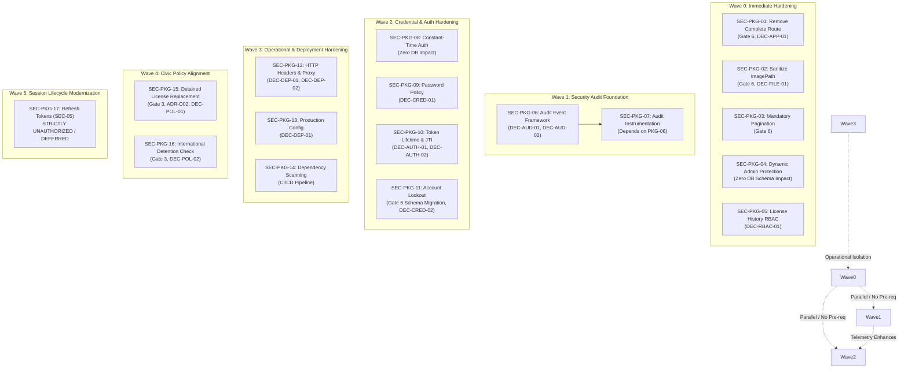
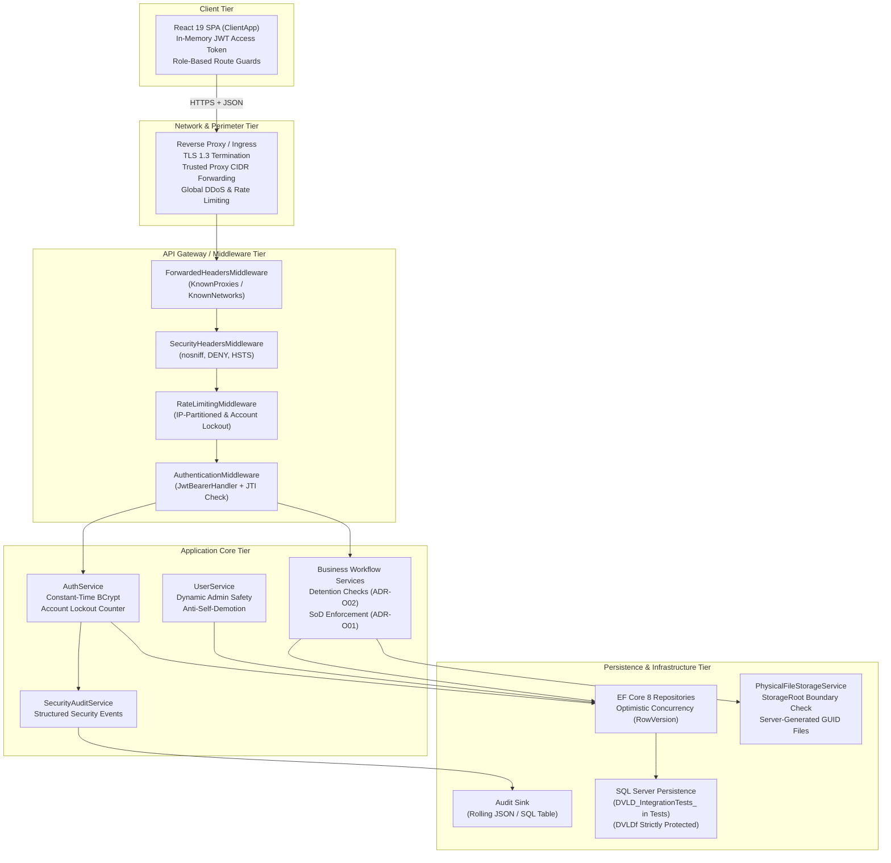

# DVLD — Security Master Plan
## Comprehensive Technical Security Roadmap, Risk Register & Implementation Specifications

> **Authority Level:** Architectural Security Proposal & Engineering Roadmap (Planning Baseline)  
> **Target Systems:** Active Backend ASP.NET Core 8 Web API (`DVLD.Api`), Application Core, Infrastructure Persistence, Domain, and React Single-Page Application (`ClientApp/`)  
> **Repository Root:** `D:\DVLD-WPF`  
> **Active Branch:** `docs/documentation-cleanup`  
> **Document Version:** 2.2 (Reconciled Engineering Baseline)  
> **Governance Status:** PROPOSAL / PLANNING BASELINE — **ZERO IMPLEMENTATION PACKAGES CURRENTLY AUTHORIZED**  
> **Protected Boundaries:**  
> 1. Production/Development Database `DVLDf` is strictly protected: NEVER connect to, query, migrate, drop, or wipe `DVLDf`.  
> 2. Ephemeral test database lifecycle (`DVLD_IntegrationTests_<GUID>`) strictly enforced for all automated integration testing.  
> 3. WPF Desktop Client (`Presentation (WPF)/`) is FROZEN and EXCLUDED from this security plan.  
> 4. SEC-05 / Phases 12.2, 12.3, and 12.4 are STRICTLY UNAUTHORIZED and deferred.  
> 5. ADR-O01 Model B accepted as policy only; administrative read-only license inspection implementation remains unauthorized.  
> 6. ADR-O02 (Detained License Replacement) is provisionally selected pending official Jordanian regulatory verification.  
> 7. International license detention enforcement is an open, separate regulatory policy question.  

---

## 1. Executive Summary & Document Charter

### 1.1 Executive Summary

This **Security Master Plan** establishes a unified, evidence-based, architecture-aware security implementation roadmap for the Driver & Vehicle Licensing Department (DVLD) platform. It consolidates the empirical findings from the Security Implementation Readiness Assessment (`SECURITY-IMPLEMENTATION-READINESS.md`), aligns them with core engineering governance (`AI-ENGINEERING-INSTRUCTIONS.md`, `ENGINEERING-STANDARDS.md`, `SECURITY-STANDARDS.md`), and structures remediation into a dependency-aware, non-linear execution sequence.

#### Document-Wide Reconciled Metrics
The platform security baseline comprises:
- **Master Risks:** Exactly **20** cataloged and classified security risks (`RSK-01` through `RSK-20`).
- **Implementation Packages:** Exactly **17** modular engineering packages (`SEC-PKG-01` through `SEC-PKG-17`).
- **Open Architecture & Policy Decisions:** Exactly **16** documented decisions requiring explicit human authorization (`DEC-AUTH-01` through `DEC-AUTH-03`, `DEC-CRED-01` through `DEC-CRED-02`, `DEC-AUD-01` through `DEC-AUD-02`, `DEC-APP-01`, `DEC-RBAC-01`, `DEC-FILE-01`, `DEC-DEP-01` through `DEC-DEP-02`, `DEC-POL-01` through `DEC-POL-02`, `DEC-SEC05-01` through `DEC-SEC05-02`).
- **Execution Waves:** Exactly **6** logically partitioned waves (**Wave 0** through **Wave 5**).
- **Dedicated Test Suites:** Exactly **14** security verification suites (`TST-AUTH-01` through `TST-AUTH-04`, `TST-RBAC-01` through `TST-RBAC-02`, `TST-WORK-01` through `TST-WORK-02`, `TST-FILE-01` through `TST-FILE-03`, `TST-AUD-01`, `TST-PAG-01`, `TST-OPS-01`).
- **Approval Gates:** Exactly **8** governance gates (**Gate 1** through **Gate 8**).
- **Readiness Finding Traceability:** All **13** original readiness findings (`SEC-FIND-01` through `SEC-FIND-13`) and supplementary assessment domains are fully mapped to specific risks, packages, test suites, and gates.

```
+-----------------------------------------------------------------------------------------------------------------+
|                                        SECURITY MASTER PLAN METRICS                                             |
+---------------------+-----------------------+---------------------+---------------------+-----------------------+
|  20 Master Risks    | 17 Packages           | 16 Open Decisions   | 6 Execution Waves   | 14 Test Suites        |
|  (RSK-01 - RSK-20)  | (SEC-PKG-01 - PKG-17) | (DEC-AUTH/CRED/...) | (Wave 0 - Wave 5)   | (TST-AUTH/RBAC/...)   |
+---------------------+-----------------------+---------------------+---------------------+-----------------------+
|  8 Approval Gates (Gate 1 - Gate 8)         | 100% Traceability across 13 Readiness Findings & 9 Domains        |
+---------------------------------------------+-------------------------------------------------------------------+
```

### 1.2 Document Charter & Strict Non-Authorization Invariants

This document is an **architectural planning and governance baseline only**. It does **NOT** authorize any code modifications, configuration adjustments, database alterations, package installations, or deployment operations.

Every package defined herein represents a structured proposal submitted for formal review. No package may be executed until explicit, written human authorization is granted under the appropriate approval gate.

The following non-negotiable governance invariants are enforced across all planning and future execution:
1. **Zero Premature Implementation:** Under no circumstances shall an AI agent interpret this document as authorization to begin source code or schema remediation. The current status of all packages is `READY FOR PROJECT OWNER REVIEW`.
2. **Absolute Protection of Production Database (`DVLDf`):** `DVLDf` is strictly protected from automated tools. Schema modifications require isolated EF Core migrations executed only against ephemeral test databases during testing, with production migration requiring separate human engineering sign-off and verified database backups.
3. **WPF Client Exclusion:** The legacy desktop client in `Presentation (WPF)/` is frozen. All client-side security remediations target the active React SPA (`ClientApp/`).
4. **Prohibition of Speculative Architectural Additions:** No unapproved frameworks or external dependencies (e.g., MediatR, CQRS libraries, Redis, distributed message brokers) may be introduced without an approved Architectural Decision Record (ADR).
5. **Phase Deferrals:** Multi-session token rotation and refresh token mechanics (SEC-05 / Phase 12.2), performance optimizations (Phase 12.3), and distributed enterprise messaging (Phase 12.4) remain unauthorized and out of scope.

---

## 2. Scope, Methodology & Classification Framework

### 2.1 Scope of the Security Plan

The platform scope encompasses all layers of the active DVLD modern application architecture:
- **Presentation Layer (SPA):** `ClientApp/` (React 19, TypeScript 5.8, Vite 6, Tailwind CSS). Focus: JWT lifecycle handling, role-based UI guard alignment, PII presentation, and secure HTTP communication.
- **API Boundary:** `API/DVLD.Api/` (ASP.NET Core 8 Web API). Focus: JWT authentication, role authorization policies, rate limiting, request validation, HTTP security headers, trusted reverse proxy integration, and global exception mapping.
- **Application Orchestration:** `Application/`. Focus: Business use-case validation, segregation of duties (SoD), constant-time credential comparison, authorization policies, and security audit event dispatching.
- **Domain Core:** `Domain/`. Focus: Pure enterprise invariants, business logic integrity, license validity state transitions, and detention invariants.
- **Persistence & Infrastructure:** `Infrastructure/`. Focus: SQL Server persistence, EF Core 8 mapping, concurrency token management, atomic database operations, and physical file storage isolation.
- **Contracts Boundary:** `DVLD.Contracts/`. Focus: Strongly-typed request/response DTOs, stripping of sensitive internal paths, and payload sanitization.
- **Automated Verification:** `Test/`. Focus: Unit test coverage and isolated integration tests using dynamic databases (`DVLD_IntegrationTests_<GUID>`).

### 2.2 Finding Classification Taxonomy

To ensure absolute technical precision and prevent inflated or unfounded security claims, all findings are categorized into one of six distinct tiers:
1. **Confirmed Exploitable Vulnerability:** A flaw where runtime exploitability has been demonstrated through verifiable execution paths, explicit actor prerequisites, known input vectors, and direct adverse impact under the current codebase state.
2. **Verified Security Weakness:** An empirically demonstrated deficiency in cryptographic, structural, or validation logic (e.g., measurable timing differences, unconstrained password rules) that elevates risk but requires specific contextual preconditions for exploitation.
3. **Architectural Security Risk:** A structural design limitation (e.g., stateless long-lived tokens without revocation, absence of audit logging) that limits defense-in-depth, resilience, or forensic traceability.
4. **Policy-Dependent Civic Rule:** A workflow rule whose correct enforcement depends on external statutory, administrative, or legal authority decisions (e.g., replacement of detained licenses under Jordanian Traffic Law).
5. **Operational & Deployment-Dependent Risk:** A security posture attribute that depends entirely on production hosting topology, environment configuration, reverse proxy headers, or deployment pipelines.
6. **Unverified Threat Scenario:** A hypothetical vulnerability or abuse scenario requiring runtime telemetry, historical caller audits, or external verification before it can be confirmed as exploitable.
7. **Functional Authorization Defect:** An inconsistency between client-side UI navigation guards and backend authorization attributes that leads legitimate users to unexpected access denial (e.g., HTTP 403 Forbidden) or exposes navigation links to routes where the user lacks backend permissions, without enabling privilege escalation or backend bypass.

### 2.3 Transparent Risk-Rating Methodology

Risk severity is determined using a qualitative matrix aligned with CVSS v3.1 principles, cross-referencing **Likelihood** (combining attack complexity, actor privileges, and user interaction) with **Impact** (confidentiality, integrity, availability, and statutory compliance):

| Likelihood / Impact | Low Impact | Medium Impact | High Impact | Critical Impact |
|:---|:---:|:---:|:---:|:---:|
| **High Likelihood** | LOW | MEDIUM | HIGH | **CRITICAL** |
| **Medium Likelihood** | LOW | MEDIUM | HIGH | HIGH |
| **Low Likelihood** | LOW | LOW | MEDIUM | HIGH |

- **Confidence Scores:** Assessed as High (verified via direct code inspection and static analysis), Medium (inferred from architectural patterns and partial traces), or Low (requiring external runtime verification).
- **Remediation Actionability:** Designated as *Actionable* (can proceed immediately upon package approval), *Blocked on Schema Gate* (requires DB migration approval), *Blocked on Policy* (requires legal/statutory sign-off), or *Deferred* (belongs to future unauthorized phases).


---

## 3. Master Risk Register

The following register details all 20 identified platform security risks, establishing strict classifications, static evidence, verified exploitability criteria, and remediation dispositions.

| Risk ID | Title & Summary Description | Source Code Location | Finding Classification | Likelihood | Impact | Severity | Exploitability Evidence & Preconditions | Confidence | Remediation Disposition |
|:---|:---|:---|:---|:---:|:---:|:---:|:---|:---:|:---|
| **RSK-01** | **Orphaned Application Completion Route**<br/>`POST /api/applications/{id}/complete` allows authenticated `Staff` users to complete an application directly, bypassing workflow checks. Code verifies the application exists and is not Completed or Cancelled, but does not verify fee payment, test passage, or license issuance. | `API/DVLD.Api/Controllers/ApplicationsController.cs:85-90`<br>`Application/Services/ApplicationService.cs:165-172` | Confirmed Exploitable Vulnerability | Medium | Critical | **HIGH** | Requires authenticated `Staff` role. Calling endpoint on an existing New application transitions status directly to Completed (status 3). | High | **Actionable** (Wave 0 / `SEC-PKG-01`, blocked on caller telemetry `DEC-APP-01`) |
| **RSK-02** | **ImagePath Cross-User Deletion within Storage Root**<br/>`CreatePersonRequest` and `UpdatePersonRequest` accept raw client `ImagePath`. Physical path traversal outside `_storageRoot` is prevented by `PhysicalFileStorageService.ResolveFullPath`, but an authenticated user can supply another citizen's image filename, causing physical deletion of that file upon update/delete. | `API/DVLD.Api/Controllers/PeopleController.cs:150, 191`<br>`DVLD.Contracts/Person/CreatePersonRequest.cs`<br>`Infrastructure/Services/PhysicalFileStorageService.cs:144` | Confirmed Exploitable Vulnerability | Medium | Medium | **MEDIUM** | Requires authenticated `Staff` role. Can delete arbitrary images residing within the storage root by predicting or harvesting existing image filenames. | High | **Actionable** (Wave 0 / `SEC-PKG-02`, `DEC-FILE-01`) |
| **RSK-03** | **Credential Verification Latency Timing Side-Channel**<br/>`AuthService.LoginAsync` short-circuits with `Result.Failure` without calling BCrypt when a username is not found. A non-existent username returns in ~1 ms vs ~120 ms for an existing user, enabling username enumeration. | `Application/Services/AuthService.cs:44-53` | Verified Security Weakness | High | Low | **MEDIUM** | Demonstrable execution branch difference. Timing difference enables statistical inference of valid staff usernames over network. | High | **Actionable** (Wave 2 / `SEC-PKG-08`) |
| **RSK-04** | **Stateless 4-Hour Access Token Without Revocation Capability**<br/>JWT access tokens are issued with a 240-minute (4-hour) expiration without a `jti` claim, revocation store, or logout invalidation endpoint. A compromised token remains valid for up to 4 hours. | `API/DVLD.Api/appsettings.json:8`<br>`API/DVLD.Api/Security/JwtTokenService.cs:26`<br>`API/DVLD.Api/Controllers/AuthController.cs` | Architectural Security Risk | High | High | **HIGH** | Exfiltrated tokens cannot be invalidated prior to natural expiration. Client-side logout merely discards the in-memory token. | High | **Blocked on Decision** (Wave 2 / `SEC-PKG-10`, `DEC-AUTH-01`, `DEC-AUTH-02`) |
| **RSK-05** | **Missing Account-Level Lockout Defense on Failed Logins**<br/>Login rate limiting is implemented only at the IP level (10 req/min). User accounts have no failed login attempt counters or lockout states in the database, allowing distributed credential brute-forcing. | `API/DVLD.Api/Program.cs:157-175`<br>`API/DVLD.Api/Controllers/AuthController.cs:26` | Architectural Security Risk | High | High | **HIGH** | Distributed attacks rotating client IP addresses bypass IP-based rate limiting entirely without locking the target account. | High | **Blocked on Schema Gate** (Wave 2 / `SEC-PKG-11`, `DEC-CRED-02`, Gate 5) |
| **RSK-06** | **Absence of Dedicated Security Audit Trail & Event Framework**<br/>`AuthController` and `UserService` log only standard application diagnostics. No tamper-evident, structured audit log exists for logins, logouts, password changes, permission grants, or account status updates. | `API/DVLD.Api/Controllers/AuthController.cs`<br>`Application/Services/UserService.cs` | Architectural Security Risk | High | High | **HIGH** | Forensic investigation after account compromise or privilege abuse is severely constrained; unauthorized administrative changes leave no audit trail. | High | **Actionable** (Wave 1 / `SEC-PKG-06`, `SEC-PKG-07`, `DEC-AUD-01`, `DEC-AUD-02`) |
| **RSK-07** | **Weak Password Complexity Policy & Absence of Breached Checks**<br/>`UserValidator.ValidatePassword` enforces only length between 8 and 100 characters. It lacks character diversity rules, dictionary checks, or breached password list verification (e.g., permits `12345678`). | `Application/Validators/UserValidator.cs:196-215` | Verified Security Weakness | High | Medium | **MEDIUM** | Staff and administrative accounts can be initialized with trivial or well-known dictionary passwords vulnerable to credential stuffing. | High | **Blocked on Decision** (Wave 2 / `SEC-PKG-09`, `DEC-CRED-01`) |
| **RSK-08** | **Absence of Multi-Factor Authentication (MFA) for Admin Roles**<br/>Administrative accounts with full department authority authenticate exclusively via single-factor static passwords. | `API/DVLD.Api/Controllers/AuthController.cs` | Architectural Security Risk | Medium | High | **MEDIUM** | Single credential compromise yields full system administration privileges without secondary verification. | High | **Blocked on Decision** (Deferred / `DEC-AUTH-03`) |
| **RSK-09** | **Hardcoded Administrator Identity & Race Conditions in UserService**<br/>`UserService.cs` protects administrator account `id == 2` and username `"ayhm"` via hardcoded string/ID comparisons, and lacks atomic concurrency checks when deleting/demoting administrators. | `Application/Services/UserService.cs:350-370, 489-493` | Architectural Security Risk | Medium | Medium | **MEDIUM** | Brittleness across environments (DB IDs vary); race conditions during concurrent admin deactivation can leave the system with zero active administrators. | High | **Actionable** (Wave 0 / `SEC-PKG-04`) |
| **RSK-10** | **Unpaged Bulk Fallback on Citizen Registry in PeopleController**<br/>`GET /api/people` falls back to returning all citizen records across the platform when query pagination parameters are omitted or malformed. | `API/DVLD.Api/Controllers/PeopleController.cs:48-57` | Verified Security Weakness | Medium | High | **MEDIUM** | An authenticated staff member or compromised token can trigger unpaged bulk database queries, causing memory pressure and enabling bulk data scraping. | High | **Actionable** (Wave 0 / `SEC-PKG-03`) |
| **RSK-11** | **Unrestricted Plaintext PII Exposure in Citizen & User DTOs**<br/>`PersonResponse` and `UserDetailsResponse` return unmasked national IDs, full birth dates, home addresses, phone numbers, and personal details to all authenticated staff without purpose-based masking. | `API/DVLD.Api/Controllers/PeopleController.cs:276-296`<br>`API/DVLD.Api/Controllers/UsersController.cs:72-92` | Architectural Security Risk | Medium | Medium | **MEDIUM** | Broad exposure of citizen personal identifiable information violates data minimization principles; requires formal privacy policy definition. | High | **Deferred Architecture (Formal Risk Acceptance Pending & Required for Production Release)**<br/>*Required Risk Owner Role:* Project Owner / Data Protection Officer.<br/>*Risk Owner Assignment Status:* **PENDING** (No named individual has been appointed).<br/>*Formal Risk Acceptance Status:* **NOT GRANTED**. Formal risk acceptance has not been authorized or executed.<br/>*Production Release Eligibility:* The platform is **ineligible for production release** under this risk until documented formal risk acceptance is obtained from the authorized Risk Owner.<br/>*Deferred Architecture Work:* Dynamic field-level PII masking and citizen data minimization DTO refactoring remain deferred to a future roadmap phase (partial mitigation in `SEC-PKG-02` sanitizes `ImagePath`).<br/>*Compensating Controls:* Mandatory staff JWT authentication, role authorization (`StaffOnly`), TLS 1.3 transit encryption, physical storage root containment (`SEC-PKG-02`).<br/>*Residual Risk:* Plaintext citizen PII remains visible to authorized staff without field-level masking.<br/>*Review/Approval Requirement:* Formal Gate 8 Architecture Review. |
| **RSK-12** | **License History Frontend/Backend Role Alignment Defect**<br/>`ClientApp` navigation allows administrators to access License History, but backend `LicensesController` enforces `[Authorize(Roles = "Staff")]`, returning 403 Forbidden to Administrators. | `ClientApp/src/utils/permissions.ts:77-79`<br>`API/DVLD.Api/Controllers/LicensesController.cs:12` | Functional Authorization Defect | High | Low | **LOW** | Frontend navigation erroneously permits `Admin` role to view License History page; backend `LicensesController` correctly enforces `[Authorize(Roles = "Staff")]`, resulting in 403 Forbidden. Defect does not permit unauthorized data access or privilege escalation. | High | **Actionable** (Wave 0 / `SEC-PKG-05`, `DEC-RBAC-01`) |
| **RSK-13** | **Circumvention of License Detention in Replacement Workflow**<br/>`LicenseReplacementService` issues replacement licenses for lost or damaged credentials without verifying whether the target license is currently detained under an active detention order. | `Application/Services/LicenseReplacementService.cs:73-100` | Policy-Dependent Civic Rule | Medium | High | **HIGH** | A driver whose domestic license has been legally seized or suspended could obtain an active replacement, circumventing judicial/administrative sanctions. | High | **Blocked on Policy** (Wave 4 / `SEC-PKG-15`, `ADR-O02`, `DEC-POL-01`, Gate 3) |
| **RSK-14** | **Circumvention of Detention in International Permit Issuance**<br/>`InternationalService` issues international driving permits based on domestic license existence without verifying whether the underlying domestic license is actively detained. | `Application/Services/InternationalService.cs:149-176` | Policy-Dependent Civic Rule | Low | High | **MEDIUM** | Driver with a suspended domestic license may obtain an international permit, undermining international licensing integrity. | High | **Blocked on Policy** (Wave 4 / `SEC-PKG-16`, `DEC-POL-02`, Gate 3) |
| **RSK-15** | **ADR-O01 Model B Administrative Read Visibility Restriction**<br/>Under strict Segregation of Duties (Model B), administrators cannot inspect operational counter records. Lack of read-only audit visibility impairs administrative oversight. | `ENGINEERING-DECISIONS.md#ADR-O01`<br>`API/DVLD.Api/Controllers/*.cs` | Policy-Dependent Civic Rule | High | Low | **LOW** | Structural policy tension between strict operational segregation and administrative audit oversight. | High | **Blocked on Decision** (Wave 0 / `SEC-PKG-05`, `DEC-RBAC-01`) |
| **RSK-16** | **Missing HTTP Security Headers & Unconfigured Trusted Proxies**<br/>HTTP pipeline omits `X-Content-Type-Options: nosniff`, `X-Frame-Options: DENY`, and `UseHsts`. `ForwardedHeadersOptions` is not configured with known proxies, allowing potential IP header spoofing. | `API/DVLD.Api/Program.cs:388-406` | Operational / Deployment-Dependent | Medium | Low | **LOW** | Clickjacking and MIME-sniffing risks; potential spoofing of `X-Forwarded-For` if hosted behind an untrusted reverse proxy without CIDR filtering. | High | **Actionable** (Wave 3 / `SEC-PKG-12`, `DEC-DEP-01`, `DEC-DEP-02`) |
| **RSK-17** | **Production Configuration & Plaintext Secret Exposure Hazards**<br/>`appsettings.json` specifies `AllowedHosts: "*"` and local development connection strings. Production requires environment variables, secret managers, and startup configuration validation. | `API/DVLD.Api/appsettings.json:1-20` | Operational / Deployment-Dependent | Low | Medium | **LOW** | Accidental deployment of development configurations could expose database credentials or allow unrestricted host header binding. | High | **Actionable** (Wave 3 / `SEC-PKG-13`, `DEC-DEP-01`) |
| **RSK-18** | **Absence of Automated Dependency Scanning in CI/CD Pipeline**<br/>No automated vulnerability scanning is integrated into build manifests or CI workflows to detect vulnerable NuGet or npm packages. | `DVLD.Api.csproj`<br>`ClientApp/package.json` | Operational / Deployment-Dependent | Medium | Medium | **LOW** | Vulnerable transitive dependencies could be introduced and deployed unnoticed. | High | **Actionable** (Wave 3 / `SEC-PKG-14`) |
| **RSK-19** | **Unrepresented External Callers for CompleteApplication Endpoint**<br/>Uncertainty regarding whether external ministry systems, legacy scripts, or third-party clients invoke `POST /api/applications/{id}/complete`. | Repository-wide caller audit | Unverified Threat Scenario | Low | High | **LOW** | Deleting the endpoint immediately without telemetry verification could break unrepresented external consumers if any exist. | Medium | **Blocked on Evidence** (Wave 0 / `SEC-PKG-01`, `DEC-APP-01`) |
| **RSK-20** | **Authorized Insider Mass PII Harvesting via Unbounded Collections**<br/>Threat scenario where a compromised or malicious staff credential exploits unpaged collection endpoints to perform wholesale extraction of citizen records. | `API/DVLD.Api/Controllers/PeopleController.cs:48`<br>`API/DVLD.Api/Controllers/UsersController.cs:38` | Unverified Threat Scenario | Low | High | **MEDIUM** | Authenticated staff token can scrape entire database table contents in a single unmetered request if pagination limits are absent. | High | **Actionable** (Wave 0 / `SEC-PKG-03`) |


---

## 4. Comprehensive Dependency Analysis

A critical weakness identified in previous planning was the imposition of artificial linear sequencing—such as requiring security audit architecture to precede every authentication remediation. The technical reality of the DVLD codebase is that security remediations partition into distinct dependency categories:



### Dependency Categories & Technical Rationale

1. **Independent Code-Level Hardening (Wave 0):**
   - `SEC-PKG-01`, `SEC-PKG-02`, `SEC-PKG-03`, `SEC-PKG-04`, and `SEC-PKG-05` have **zero technical dependency** on the audit framework or schema migrations. They operate within existing application services and controllers.
   - *Technical Rationale:* Delaying verified high-risk fixes (like the orphaned application completion route or cross-user image deletion) to wait for an audit subsystem introduces unnecessary security exposure. They can execute in parallel immediately upon package approval.

2. **Core Engine Prerequisites (Wave 1):**
   - `SEC-PKG-07` (Audit Event Instrumentation) strictly requires `SEC-PKG-06` (Audit Framework & Interface Specification) to define `ISecurityAuditService` and domain event models.
   - *Technical Rationale:* Controllers and services cannot emit structured audit events until the audit contract and sink provider are registered in the DI container.

3. **Authentication & Credential Hardening (Wave 2):**
   - `SEC-PKG-08` (Constant-Time Auth) and `SEC-PKG-09` (Password Policy) are purely algorithmic and require no database migrations; they depend only on Project Owner policy sign-off (`DEC-CRED-01`).
   - `SEC-PKG-10` (Token Lifetime & JTI) modifies JWT generation and configuration, requiring policy decision `DEC-AUTH-01` and clarification of revocation architecture `DEC-AUTH-02`.
   - `SEC-PKG-11` (Account Lockout) requires a physical database schema migration (adding lockout tracking columns to `Users`), making it strictly dependent on **Gate 5** (Schema Migration Approval).

4. **Operational, Transport & Deployment Hardening (Wave 3):**
   - `SEC-PKG-12` (HTTP Headers & Reverse Proxy) and `SEC-PKG-13` (Production Configuration) depend on the deployment hosting topology decision (`DEC-DEP-01`).
   - *Technical Rationale:* Configuring `ForwardedHeadersOptions` requires explicit CIDR/IP definitions of trusted upstream proxies to prevent IP spoofing; configuring Content Security Policy (CSP) depends on whether the API serves HTML or the SPA is hosted via Nginx/CDN (`DEC-DEP-02`).

5. **Civic Policy & Regulatory Gates (Wave 4):**
   - `SEC-PKG-15` (Detained License Replacement) and `SEC-PKG-16` (International License Detention Check) are strictly blocked on **Gate 3** (Licensing Authority / Legal Sign-off, `DEC-POL-01`, `DEC-POL-02`).
   - *Technical Rationale:* Software engineers cannot unilaterally define statutory traffic penalties. Official confirmation of Jordanian Traffic Law is mandatory prior to codifying detention blocks.

6. **Deferred Lifecycle Modernization (Wave 5):**
   - `SEC-PKG-17` (Refresh Tokens & Multi-Session Management) encompasses SEC-05 / Phase 12.2. It is **strictly unauthorized** and deferred to future milestones.

---

## 5. Execution Waves

The security remediation is organized into six non-linear execution waves:

| Wave Identifier | Wave Name & Focus | Package Membership | Schema Migration Required? | API Breaking Changes? | Primary Prerequisites & Blocking Gates | Execution Status |
|:---|:---|:---|:---:|:---:|:---|:---:|
| **Wave 0** | Immediate Code & Input Hardening | `SEC-PKG-01`, `SEC-PKG-02`, `SEC-PKG-03`, `SEC-PKG-04`, `SEC-PKG-05` | **NO** | YES (Endpoints / DTOs) | Gate 1 (Planning Baseline), Gate 2 (Package Approval), Gate 6 (API/Contract), `DEC-APP-01`, `DEC-FILE-01`, `DEC-RBAC-01` | Proposed |
| **Wave 1** | Security Audit Architecture & Framework | `SEC-PKG-06`, `SEC-PKG-07` | **NO** (File Sink) / **YES** (DB Sink) | NO | Gate 2, Gate 4 (Verification), `DEC-AUD-01`, `DEC-AUD-02` | Proposed |
| **Wave 2** | Authentication & Credential Hardening | `SEC-PKG-08`, `SEC-PKG-09`, `SEC-PKG-10`, `SEC-PKG-11` | **YES** (for PKG-11) | NO | Gate 2, Gate 4, Gate 5 (for PKG-11), `DEC-CRED-01`, `DEC-CRED-02`, `DEC-AUTH-01`, `DEC-AUTH-02` | Proposed |
| **Wave 3** | Operational, Transport & Deployment Hardening | `SEC-PKG-12`, `SEC-PKG-13`, `SEC-PKG-14` | **NO** | NO | Gate 2, Gate 7 (DevOps/Deployment), `DEC-DEP-01`, `DEC-DEP-02` | Proposed |
| **Wave 4** | Civic Policy & Regulatory Alignment | `SEC-PKG-15`, `SEC-PKG-16` | **NO** | NO | Gate 2, Gate 3 (Licensing Authority / Legal Sign-off), `ADR-O02`, `DEC-POL-01`, `DEC-POL-02` | Blocked on Policy |
| **Wave 5** | Session Lifecycle Modernization | `SEC-PKG-17` | **YES** (Token Store) | YES (Auth Flow) | Gate 8 (Roadmap Phase Transition), `DEC-SEC05-01`, `DEC-SEC05-02` | **STRICTLY UNAUTHORIZED** |

### Wave Execution Specifications

#### Wave 0: Immediate Code & Input Hardening
- **Prerequisites:** Project Owner sign-off on Gate 1 (this plan), Gate 2 (individual package proposals), and Gate 6 (API changes). Confirmation of external caller telemetry for CompleteApplication (`DEC-APP-01`).
- **Parallel Work:** All 5 packages in Wave 0 can be executed in parallel or independently by different engineers.
- **Blocking Decisions:** `DEC-APP-01` (telemetry window vs. removal), `DEC-FILE-01` (DTO removal vs. DB check), `DEC-RBAC-01` (UI hide vs. backend relaxation).
- **Database & API Impact:** Zero database schema modifications. `SEC-PKG-01` modifies or removes an API route; `SEC-PKG-02` removes a property from client request DTOs; `SEC-PKG-03` enforces default and clamped pagination parameters on targeted unpaged endpoints.
- **Rollback Gates:** Revert specific controller or service commits without schema rollback.

#### Wave 1: Security Audit Architecture & Framework
- **Prerequisites:** Decision on audit storage sink (`DEC-AUD-01`) and failure handling policy (`DEC-AUD-02`).
- **Parallel Work:** `SEC-PKG-06` must complete first; `SEC-PKG-07` immediately follows.
- **Blocking Decisions:** `DEC-AUD-01` (Rolling JSON file vs. SQL Server table vs. external SIEM), `DEC-AUD-02` (Fail-closed vs. fail-open).
- **Database & API Impact:** If file sink is selected, zero database impact; if database table sink is selected, requires Gate 5 schema migration. Zero breaking changes to existing public APIs.
- **Rollback Gates:** Feature-flag or DI registration switch to disable security audit emission or revert to null logger.

#### Wave 2: Authentication & Credential Hardening
- **Prerequisites:** Gate 2 package approvals. Gate 5 approval for `SEC-PKG-11` database migration.
- **Parallel Work:** `SEC-PKG-08` (Constant-Time Auth), `SEC-PKG-09` (Password Policy), and `SEC-PKG-10` (Token Lifetime & JTI) can proceed in parallel. `SEC-PKG-11` (Lockout) proceeds upon Gate 5 approval.
- **Blocking Decisions:** `DEC-CRED-01` (Password policy standard), `DEC-AUTH-01` (Token lifetime duration), `DEC-AUTH-02` (Token revocation architecture), `DEC-CRED-02` (Lockout thresholds & strategy).
- **Database & API Impact:** `SEC-PKG-11` adds `AccessFailedCount`, `LockoutEnd`, `LockoutEnabled` columns to `Users`. Zero breaking changes to API contracts; changes login error responses and validation messages.
- **Rollback Gates:** Algorithmic changes rollback via code; `SEC-PKG-11` rollback requires down-migration script verified on test DB.

#### Wave 3: Operational, Transport & Deployment Hardening
- **Prerequisites:** Identification of production hosting topology (`DEC-DEP-01`) and reverse proxy architecture (`DEC-DEP-02`).
- **Parallel Work:** `SEC-PKG-12`, `SEC-PKG-13`, and `SEC-PKG-14` can execute in parallel.
- **Blocking Decisions:** `DEC-DEP-01` (Hosting environment, trusted proxy CIDRs), `DEC-DEP-02` (CSP ownership).
- **Database & API Impact:** Zero database impact. Adds response headers and configures middleware.
- **Rollback Gates:** Configuration flag toggle in `appsettings.Production.json` or middleware deactivation.

#### Wave 4: Civic Policy & Regulatory Alignment
- **Prerequisites:** Formal written sign-off from the Licensing Authority and Legal Counsel under Gate 3 (`DEC-POL-01`, `DEC-POL-02`).
- **Parallel Work:** `SEC-PKG-15` and `SEC-PKG-16` can proceed in parallel once policy decisions are recorded.
- **Blocking Decisions:** `ADR-O02` / `DEC-POL-01` (Confirmation of Jordanian Traffic Law on detained license replacement), `DEC-POL-02` (International permit domestic detention check).
- **Database & API Impact:** Zero database schema modifications (uses existing `DetainedLicenses` table and queries). Business logic returns `Result.Failure` when a detention record is active.
- **Rollback Gates:** Code-level reversion of service preconditions.

#### Wave 5: Session Lifecycle Modernization
- **Prerequisites:** Roadmap Phase Transition Gate 8 sign-off by Project Owner. Approval of SEC-05 / Phase 12.2.
- **Parallel Work:** Blocked entirely.
- **Blocking Decisions:** `DEC-SEC05-01` (Cookie vs. Bearer transport), `DEC-SEC05-02` (Reuse invalidation scope).
- **Database & API Impact:** Schema migration for `RefreshTokens` table; breaking changes to authentication client flow.
- **Status:** **STRICTLY UNAUTHORIZED / DEFERRED**.


---

## 6. Implementation Package Specifications

### SEC-PKG-01: Remove Orphaned Application Completion Endpoint

#### A. Package Identity
- **Package ID:** `SEC-PKG-01`
- **Title:** Remove Orphaned Application Completion Endpoint or Implement Discovery Telemetry
- **Target Components:** `API/DVLD.Api/Controllers/ApplicationsController.cs`, `Application/Services/ApplicationService.cs`
- **Dependencies:** None (technical); blocked on policy/telemetry decision `DEC-APP-01`
- **Target Wave:** Wave 0
- **Status:** READY FOR PROJECT OWNER REVIEW
- **Risk Addressed:** `RSK-01` (Orphaned Application Completion Route), `RSK-19` (Unrepresented External Callers)
- **Primary Test Suite:** `TST-WORK-01`
- **Approval Gate:** Gate 2 (Package Approval), Gate 6 (API Breaking Change Gate)

#### B. Evidence & Source Context
- **Source Locations:**
  - `API/DVLD.Api/Controllers/ApplicationsController.cs:85-90`
  - `Application/Services/ApplicationService.cs:165-172`
- **Static Evidence:** `ApplicationsController` exposes `POST /api/applications/{id}/complete`, marked `[Authorize(Roles = "Staff")]`.
- **Accurate Code Inspection:** `ApplicationService.CompleteApplicationAsync` performs a status check: it verifies the application exists and is not already Completed (status 3) or Cancelled (status 2). However, it does *not* verify that required application fees are settled, that practical/theory tests were passed, or that a driving license was legitimately generated and issued.
- **Exploitability Analysis:** Any authenticated user with `Staff` role can send a POST request with an application ID to bypass lifecycle verification, setting status directly to Completed. In the React SPA (`ClientApp/`), zero callers exist for this route; applications are completed naturally via test and license issuance workflows.
- **External Consumer Uncertainty:** While internal callers are zero, it is unconfirmed whether legacy batch jobs, external ministry services, or automated scripts invoke this endpoint.

#### C. Proposed Engineering Solution
Under decision `DEC-APP-01`, two alternatives are evaluated:
1. **Option A (Immediate Deletion):** Remove the `Complete` action from `ApplicationsController` and `ApplicationService`, closing the route permanently.
2. **Option B (Phased Deprecation & Telemetry Window):** Maintain the route temporarily under an explicit observation window (e.g., 30 days), instrumenting it with structured audit logging and an HTTP `Deprecation: true` header. If zero external callers are recorded during the telemetry window, remove the endpoint entirely. If authorized external callers exist, restrict the endpoint to `[Authorize(Roles = "Admin")]` or dedicated machine-to-machine service accounts.

#### D. Technical Scope
- **Files Modified:** `API/DVLD.Api/Controllers/ApplicationsController.cs`, `Application/Services/ApplicationService.cs`, `Application/Interfaces/IApplicationService.cs`
- **Classes / Interfaces:** `ApplicationsController`, `IApplicationService`, `ApplicationService`
- **Methods:** Remove or instrument `Complete(int id)` / `CompleteApplicationAsync(int id)`.

#### E. Testing Requirements
- Unit tests verifying that `ApplicationService` no longer exposes or permits unvalidated status mutation to Completed.
- Integration test `TST-WORK-01` verifying that calling `POST /api/applications/{id}/complete` returns `404 Not Found` (or `410 Gone`).

#### F. Acceptance Criteria
- [ ] No unvalidated application status transition to Completed can be triggered via HTTP.
- [ ] Application completion occurs strictly through verified license issuance and test passage orchestrations.
- [ ] Integration test `TST-WORK-01` passes with exit code 0.
- [ ] Breaking change sign-off recorded under Gate 6.

#### G. Rollback Strategy
Revert the commit modifying `ApplicationsController.cs` and `ApplicationService.cs` via standard Git commit reversal. Zero database schema rollback required.

#### H. Governance
Preserves WPF frozen status. Does not touch `DVLDf`. Requires Gate 6 API sign-off.

---

### SEC-PKG-02: Sanitize ImagePath Property from Person CRUD DTOs

#### A. Package Identity
- **Package ID:** `SEC-PKG-02`
- **Title:** Sanitize ImagePath Property from Person CRUD DTOs & Enforce Server-Managed Storage
- **Target Components:** `DVLD.Contracts/Person/CreatePersonRequest.cs`, `DVLD.Contracts/Person/UpdatePersonRequest.cs`, `API/DVLD.Api/Controllers/PeopleController.cs`, `Application/Services/PersonService.cs`, `ClientApp/src/api/peopleApi.ts`
- **Dependencies:** None; blocked on architectural decision `DEC-FILE-01`
- **Target Wave:** Wave 0
- **Status:** READY FOR PROJECT OWNER REVIEW
- **Risk Addressed:** `RSK-02` (ImagePath Cross-User Deletion), `RSK-11` (PII Exposure)
- **Primary Test Suite:** `TST-FILE-01`, `TST-FILE-02`, `TST-FILE-03`
- **Approval Gate:** Gate 2 (Package Approval), Gate 6 (API Breaking Change Gate)

#### B. Evidence & Source Context
- **Source Locations:**
  - `DVLD.Contracts/Person/CreatePersonRequest.cs`
  - `DVLD.Contracts/Person/UpdatePersonRequest.cs`
  - `API/DVLD.Api/Controllers/PeopleController.cs:150, 191`
  - `Infrastructure/Services/PhysicalFileStorageService.cs:144`
- **Static Evidence:** Client request DTOs expose a public string property `ImagePath`. When updating or deleting a person, `PersonService` invokes `IFileStorageService.DeleteFileAsync(oldImagePath)`.
- **Accurate Code Inspection:** `PhysicalFileStorageService.ResolveFullPath` combines the input path with `_storageRoot` and verifies that `fullPath.StartsWith(_storageRoot, StringComparison.OrdinalIgnoreCase)`. This successfully blocks directory traversal attacks outside the storage root (e.g., `../../windows/system32`). However, an authenticated user can supply the filename of *another citizen's image* that already resides inside `_storageRoot`. When the person record is subsequently updated or deleted, the application deletes that other citizen's image file.
- **Exploitability Analysis:** Authenticated staff can cause cross-user file deletion within `_storageRoot` by predicting or harvesting existing image filenames.

#### C. Proposed Engineering Solution
Under decision `DEC-FILE-01`:
1. Remove the `ImagePath` property entirely from `CreatePersonRequest` and `UpdatePersonRequest` DTOs.
2. Citizen images must be managed exclusively via the dedicated, multipart upload endpoint (`POST /api/people/{id}/image`).
3. The server generates cryptographically secure, randomized GUID filenames upon upload (e.g., `{guid}.jpg`) and assigns the stored path directly to the `Person` entity within the backend boundary.
4. Client requests are physically incapable of injecting arbitrary image paths.
5. Update React SPA `ClientApp/src/api/peopleApi.ts` to omit `ImagePath` from person create/update payloads.

#### D. Technical Scope
- **Files Modified:**
  - `DVLD.Contracts/Person/CreatePersonRequest.cs`
  - `DVLD.Contracts/Person/UpdatePersonRequest.cs`
  - `API/DVLD.Api/Controllers/PeopleController.cs`
  - `Application/Services/PersonService.cs`
  - `ClientApp/src/api/peopleApi.ts`
- **Classes / Interfaces:** `CreatePersonRequest`, `UpdatePersonRequest`, `PersonService`, `PeopleController`

#### E. Testing Requirements
- Unit tests verifying that DTOs reject or do not bind `ImagePath`.
- Integration test `TST-FILE-01` verifying that cross-user image deletion is physically impossible.
- Integration tests `TST-FILE-02` and `TST-FILE-03` verifying image upload file type validation, magic bytes verification, and storage root isolation.

#### F. Acceptance Criteria
- [ ] `CreatePersonRequest` and `UpdatePersonRequest` do not contain `ImagePath`.
- [ ] Citizen image assignment occurs exclusively via server-controlled upload flows.
- [ ] Attempting to delete or update a person record never deletes files belonging to another entity.
- [ ] Tests `TST-FILE-01`, `TST-FILE-02`, `TST-FILE-03` pass with exit code 0.

#### G. Rollback Strategy
Revert DTO and controller modifications via Git. Ensure client API types match backend contracts.

#### H. Governance
Preserves WPF frozen status. No database schema changes. Requires Gate 6 API sign-off.

---

### SEC-PKG-03: Mandatory API Pagination & Elimination of Unpaged Bulk Fallback

#### A. Package Identity
- **Package ID:** `SEC-PKG-03`
- **Title:** Mandatory API Pagination & Elimination of Unpaged Bulk Fallback
- **Target Components:** `API/DVLD.Api/Controllers/PeopleController.cs`, `API/DVLD.Api/Controllers/UsersController.cs`, `Application/Services/PersonService.cs`, `Application/Services/UserService.cs`, `ClientApp/src/api/`
- **Dependencies:** None
- **Target Wave:** Wave 0
- **Status:** READY FOR PROJECT OWNER REVIEW
- **Risk Addressed:** `RSK-10` (Unpaged Bulk Fallback), `RSK-20` (Insider Bulk Scraping)
- **Primary Test Suite:** `TST-PAG-01`
- **Approval Gate:** Gate 2 (Package Approval), Gate 6 (API Breaking Change Gate)

#### B. Evidence & Source Context
- **Source Locations:**
  - `API/DVLD.Api/Controllers/PeopleController.cs:48-57`
  - `API/DVLD.Api/Controllers/UsersController.cs:38-47`
- **Static Evidence:**
  - `PeopleController.GetPeople` checks `if (pageNumber.HasValue && pageSize.HasValue)`. If either is omitted, it falls back to an unpaged query, returning the entire citizen registry in a single unbounded JSON array.
  - `UsersController.GetAll` exposes an unpaged endpoint returning all user accounts without pagination constraints.
- **Accurate Code Inspection:** While recent phases (Phase 11.5) introduced paginated endpoints across applications, drivers, and licenses, `PeopleController` retained an unpaged fallback branch, and `UsersController` retained an unpaged collection method.
- **Exploitability Analysis:** A single request to `GET /api/people` with no parameters forces EF Core to stream thousands of records into memory, creating server memory pressure and enabling bulk data exfiltration.

#### C. Proposed Engineering Solution
1. **Narrow Package Scope:** Explicitly target `PeopleController.GetPeople` and `UsersController.GetAll` to eliminate unbounded bulk database queries.
2. **Default & Clamped Pagination Parameters:**
   - **Default Parameter Behavior:** When pagination parameters are omitted by callers, endpoints automatically apply safe documented defaults: `pageNumber = 1`, `pageSize = 10`. Callers are not rejected merely for omitting parameters.
   - **Validation Policy for Invalid Values:** Explicit query parameters specifying invalid values (e.g., `pageNumber <= 0` or `pageSize <= 0`) are rejected with `400 Bad Request` validation errors.
   - **Maximum Limit Clamping:** When callers specify `pageSize > 50`, the value is automatically clamped to the documented platform maximum of `50`.
3. **Structured Response Envelope:** Ensure both targeted collection endpoints return `PaginatedList<T>` containing `Items`, `TotalCount`, `PageNumber`, `PageSize`, and `TotalPages`.
4. **ClientApp Migration & Compatibility:** Update frontend callers in `ClientApp/src/api/peopleApi.ts` and `ClientApp/src/api/usersApi.ts` to pass explicit pagination parameters and consume the paginated response envelope.

#### D. Technical Scope
- **Files Modified:**
  - `API/DVLD.Api/Controllers/PeopleController.cs`
  - `API/DVLD.Api/Controllers/UsersController.cs`
  - `Application/Services/PersonService.cs`
  - `Application/Services/UserService.cs`
  - `ClientApp/src/api/peopleApi.ts`
  - `ClientApp/src/api/usersApi.ts`

#### E. Testing Requirements
- Unit tests verifying pagination parameter clamping (e.g., `pageSize = 500` clamped to `50`) and invalid value rejection (e.g., `pageSize = 0` rejected with 400).
- Integration test `TST-PAG-01` verifying that requesting `GET /api/people` or `GET /api/users` without parameters returns page 1 with 10 records and total metadata, never an unbounded array.

#### F. Acceptance Criteria
- [ ] Targeted endpoints `GET /api/people` and `GET /api/users` never execute unbounded queries or return unbounded arrays.
- [ ] Requests omitting pagination parameters safely apply default values `pageNumber = 1, pageSize = 10` without being rejected.
- [ ] Requests specifying invalid pagination parameters (`pageNumber <= 0` or `pageSize <= 0`) return 400 Bad Request.
- [ ] Requests specifying `pageSize > 50` are automatically clamped to `50`.
- [ ] Targeted endpoints return structured `PaginatedList<T>` envelope with total counts and pagination metadata.
- [ ] Frontend callers in `ClientApp/src/api/peopleApi.ts` and `ClientApp/src/api/usersApi.ts` pass explicit pagination parameters and handle paginated response envelopes.
- [ ] Integration test `TST-PAG-01` passes with exit code 0.

#### G. Rollback Strategy
Revert controller parameter defaults via Git.

#### H. Governance
Preserves WPF frozen status. No database schema changes.

---

### SEC-PKG-04: Eliminate Hardcoded Administrator Identity from UserService

#### A. Package Identity
- **Package ID:** `SEC-PKG-04`
- **Title:** Eliminate Hardcoded Administrator Identity & Enforce Concurrency-Safe Admin Protection
- **Target Components:** `Application/Services/UserService.cs`, `Domain/Entities/User.cs`
- **Dependencies:** None
- **Target Wave:** Wave 0
- **Status:** READY FOR PROJECT OWNER REVIEW
- **Risk Addressed:** `RSK-09` (Hardcoded Administrator Identity & Race Conditions)
- **Primary Test Suite:** `TST-RBAC-02`
- **Approval Gate:** Gate 2 (Package Approval)

#### B. Evidence & Source Context
- **Source Locations:**
  - `Application/Services/UserService.cs:350-370, 489-493`
- **Static Evidence:** `UserService.cs` contains hardcoded safeguards:
  - Checks `if (userId == 2)` to prevent deleting the primary administrator.
  - Checks `if (user.UserName.Equals("ayhm", StringComparison.OrdinalIgnoreCase))` to prevent deactivation or password changes.
- **Accurate Code Inspection:** These checks assume a static database state where user ID 2 with username `ayhm` is the sole administrator. In staging, test, or alternative production instances, ID 2 may belong to a standard staff member, leaving the actual administrator unprotected, or preventing maintenance on ID 2.
- **Concurrency & Race Condition Defect:** The service lacks atomic verification against removing the *last active administrator*. If two administrative users concurrently attempt to deactivate or demote each other, or if two requests attempt to delete the last two administrators simultaneously, a race condition can leave the platform with zero active administrators.

#### C. Proposed Engineering Solution
1. **Dynamic Active Admin Verification:** Replace hardcoded ID/username checks with dynamic repository queries:
   - Calculate `activeAdminCount = await _userRepository.CountActiveAdminsAsync()` within the Unit of Work.
2. **Distinguish Operation Types:**
   - **Self-Deactivation / Self-Deletion:** A user cannot deactivate or delete their own active account (`currentUserId == targetUserId`).
   - **Demotion:** An administrator cannot change their own role away from Admin if they are the last active administrator.
   - **Last Admin Protection:** Reject deletion, deactivation, or role demotion of an administrator if `activeAdminCount <= 1`.
3. **Concurrency Safety:** Implement optimistic concurrency checks (via EF Core concurrency token / `RowVersion` on `User`) or execute the count check within a transaction with appropriate isolation to prevent race conditions during concurrent administrative operations.

#### D. Technical Scope
- **Files Modified:** `Application/Services/UserService.cs`, `Domain/Interfaces/IUserRepository.cs`, `Infrastructure/Repositories/UserRepository.cs`
- **Methods:** `DeleteUserAsync`, `ChangeUserStatusAsync`, `UpdateUserAsync`

#### E. Testing Requirements
- Unit tests verifying dynamic admin count evaluation.
- Integration test `TST-RBAC-02` simulating concurrent deletion/demotion requests, verifying that the last active administrator is never removed.

#### F. Acceptance Criteria
- [ ] No hardcoded user IDs (`2`) or usernames (`"ayhm"`) exist in `UserService.cs`.
- [ ] Deletion, deactivation, or demotion of the last active administrator fails with `Result.Failure("Cannot remove the last active administrator.")`.
- [ ] Self-deactivation and self-deletion by an administrator is blocked.
- [ ] Test `TST-RBAC-02` passes with exit code 0.

#### G. Rollback Strategy
Revert `UserService.cs` changes via Git.

#### H. Governance
Preserves WPF frozen status. No database schema changes.

---

### SEC-PKG-05: Resolve License History RBAC Route and Permission Alignment

#### A. Package Identity
- **Package ID:** `SEC-PKG-05`
- **Title:** Resolve License History RBAC Route and Permission Alignment
- **Target Components:** `API/DVLD.Api/Controllers/LicensesController.cs`, `ClientApp/src/utils/permissions.ts`, `ClientApp/src/routes/`
- **Dependencies:** Blocked on decision `DEC-RBAC-01`
- **Target Wave:** Wave 0
- **Status:** READY FOR PROJECT OWNER REVIEW
- **Risk Addressed:** `RSK-12` (License History Role Alignment), `RSK-15` (ADR-O01 Model B Read Visibility)
- **Primary Test Suite:** `TST-RBAC-01`
- **Approval Gate:** Gate 2 (Package Approval)

#### B. Evidence & Source Context
- **Source Locations:**
  - `ClientApp/src/utils/permissions.ts:77-79`
  - `API/DVLD.Api/Controllers/LicensesController.cs:12`
- **Static Evidence:**
  - `LicensesController` is decorated at class level with `[Authorize(Roles = "Staff")]`.
  - `ClientApp/src/utils/permissions.ts` allows both `Admin` and `Staff` roles to view the License History page.
- **Accurate Code Inspection:** When an administrator attempts to view license history in the React SPA, the backend returns `403 Forbidden`. This occurs because under ADR-O01 Model B, `Admin` and `Staff` roles are strictly segregated, but the frontend navigation was not properly constrained.

#### C. Proposed Engineering Solution
ADR-O01 Model B (Strict Segregation of Duties) is an accepted and binding architectural decision. Under Model B, operational counter records and license workflows are strictly restricted to the `Staff` role; Model B does *not* authorize administrative access to counter records.
1. **Defect Remediation (Package Scope):** Align `ClientApp` UI navigation guards in `permissions.ts` and route definitions strictly with the backend `StaffOnly` policy under approved ADR-O01 Model B. The License History navigation link and route are hidden from the `Admin` role, eliminating the 403 Forbidden defect without changing backend authorization policies.
2. **Separation from Future Architectural Proposals:** Any future proposal to grant Administrators read-only inspection access to operational records is a separate strategic question (`DEC-RBAC-01`) that would require a formal ADR amendment to Model B. Model B in its current approved form does not grant or authorize this access.

#### D. Technical Scope
- **Files Modified:** `ClientApp/src/utils/permissions.ts`, `ClientApp/src/routes/`

#### E. Testing Requirements
- Unit tests verifying role access matrix.
- Integration test `TST-RBAC-01` verifying that the resolved role configuration behaves consistently across frontend and backend.

#### F. Acceptance Criteria
- [ ] No navigation path in `ClientApp` leads an authenticated role to an endpoint that returns 403 Forbidden.
- [ ] Operational state transitions remain strictly confined to `Staff` role under Segregation of Duties.
- [ ] Test `TST-RBAC-01` passes with exit code 0.

#### G. Rollback Strategy
Revert frontend permissions or backend controller attribute changes.

#### H. Governance
Preserves WPF frozen status. No database schema changes.

---

### SEC-PKG-06: Security Audit Event Framework & Interface Specification

#### A. Package Identity
- **Package ID:** `SEC-PKG-06`
- **Title:** Security Audit Event Framework & Interface Specification
- **Target Components:** `Application/Common/Interfaces/ISecurityAuditService.cs`, `Infrastructure/Services/SecurityAuditService.cs`, `Domain/Events/`
- **Dependencies:** Blocked on decisions `DEC-AUD-01` (Audit Sink) and `DEC-AUD-02` (Failure Handling)
- **Target Wave:** Wave 1
- **Status:** READY FOR PROJECT OWNER REVIEW
- **Risk Addressed:** `RSK-06` (Absence of Dedicated Security Audit Trail)
- **Primary Test Suite:** `TST-AUD-01`
- **Approval Gate:** Gate 2 (Package Approval)

#### B. Evidence & Source Context
- **Source Locations:**
  - `API/DVLD.Api/Controllers/AuthController.cs`
  - `Application/Services/UserService.cs`
- **Static Evidence:** Current application logs write diagnostic messages via `ILogger<T>`. No structured, dedicated audit stream exists for security-critical operations.
- **Engineering Analysis of Audit Storage:**
  - Previous documentation claimed rolling JSON files are "immutable and tamper-resistant." This claim is technically invalid. Local file logs on an application server can be modified or deleted if the host OS is compromised, and are vulnerable to disk exhaustion.
  - Sinks must be evaluated across three options:
    1. *Rolling JSON Files:* Lightweight, zero schema impact, but requires OS ACL protection, retention pruning, and monitoring for disk capacity.
    2. *Dedicated SQL Server Table:* Queryable, consistent with EF Core transactions, but increases database load and requires a schema migration (Gate 5).
    3. *External SIEM / Syslog:* Maximum tamper-resistance and off-host isolation, but introduces network dependencies and operational complexity.
- **Audit Failure Modes (`DEC-AUD-02`):** The architecture must define whether security-critical operations fail closed (reject operation if audit logging fails) or fail open/continue (log error to diagnostic log, proceed with operation, avoid service outage).

#### C. Proposed Engineering Solution
1. **Core Abstraction:** Introduce `ISecurityAuditService` in `Application/Common/Interfaces/`:
   ```csharp
   public interface ISecurityAuditService
   {
       Task LogSecurityEventAsync(SecurityAuditEvent auditEvent, CancellationToken cancellationToken = default);
   }
   ```
2. **Standardized Event Schema:**
   - `Timestamp` (UTC ISO 8601)
   - `EventCategory` (Authentication, Authorization, UserManagement, LicenseLifecycle)
   - `EventType` (LoginSuccess, LoginFailure, AccountLocked, RoleAssigned, AdminDemoted)
   - `ActorUserId` / `ActorUsername` / `ActorRole`
   - `ClientIpAddress` (extracted via trusted proxy headers)
   - `UserAgent`
   - `TargetResourceId` / `TargetResourceType`
   - `Outcome` (Success, Failure, Blocked)
   - `AdditionalData` (Structured key-value pairs; strictly excluding passwords, tokens, and unmasked PII).
3. **Pluggable Sink Implementation:** Implement initial provider based on Project Owner decision `DEC-AUD-01` and failure handling policy `DEC-AUD-02`.

#### D. Technical Scope
- **Files Created:**
  - `Application/Common/Interfaces/ISecurityAuditService.cs`
  - `Application/Common/Models/SecurityAuditEvent.cs`
  - `Infrastructure/Services/SecurityAuditService.cs`
- **Files Modified:** `API/DVLD.Api/Program.cs` (DI registration)

#### E. Testing Requirements
- Unit tests verifying event schema serialization and data masking.
- Integration test `TST-AUD-01` verifying event emission, sink writes, and failure mode behavior.

#### F. Acceptance Criteria
- [ ] `ISecurityAuditService` registered and available via dependency injection.
- [ ] Event payloads strictly exclude passwords, JWTs, and full credit/identity secrets.
- [ ] Audit failure handling respects `DEC-AUD-02` policy.
- [ ] Test `TST-AUD-01` passes with exit code 0.

#### G. Rollback Strategy
Unregister `ISecurityAuditService` from DI container or register a null-object implementation.

#### H. Governance
Preserves WPF frozen status. No database schema changes if file sink is selected.

---

### SEC-PKG-07: Authentication & Administrative Security Audit Event Instrumentation

#### A. Package Identity
- **Package ID:** `SEC-PKG-07`
- **Title:** Authentication & Administrative Security Audit Event Instrumentation
- **Target Components:** `API/DVLD.Api/Controllers/AuthController.cs`, `Application/Services/UserService.cs`, `Application/Services/AuthService.cs`
- **Dependencies:** Requires `SEC-PKG-06` (Audit Framework)
- **Target Wave:** Wave 1
- **Status:** READY FOR PROJECT OWNER REVIEW
- **Risk Addressed:** `RSK-06` (Absence of Dedicated Security Audit Trail)
- **Primary Test Suite:** `TST-AUD-01`
- **Approval Gate:** Gate 2 (Package Approval)

#### B. Evidence & Source Context
- **Source Locations:**
  - `API/DVLD.Api/Controllers/AuthController.cs`
  - `Application/Services/UserService.cs`
- **Static Evidence:** Currently, failed authentication attempts, account creation, role updates, and password changes do not generate structured security records.
- **Accurate Code Inspection:** `AuthController.Login` logs only standard debug information. When a login fails, no security event records the IP, target username, or timestamp. Similarly, `UserService` performs user deactivation and role modifications without an audit log.

#### C. Proposed Engineering Solution
Instrument key operations using `ISecurityAuditService`:
1. **Authentication Events:**
   - `AuthSuccess`: Emitted upon successful JWT issuance.
   - `AuthFailure`: Emitted upon failed password or non-existent user attempt (capturing IP and attempted username).
   - `AuthLogout`: Emitted upon client-side logout request.
2. **Administrative & User Lifecycle Events:**
   - `UserCreated`: Emitted when a new staff/admin account is registered.
   - `UserStatusChanged`: Emitted when an account is activated or deactivated.
   - `UserRoleChanged`: Emitted when permissions are modified.
   - `PasswordChanged`: Emitted upon password modification.

#### D. Technical Scope
- **Files Modified:**
  - `API/DVLD.Api/Controllers/AuthController.cs`
  - `Application/Services/AuthService.cs`
  - `Application/Services/UserService.cs`

#### E. Testing Requirements
- Unit tests verifying that methods call `LogSecurityEventAsync` with correct parameters.
- Integration test `TST-AUD-01` verifying end-to-end event capture during login and administrative workflows.

#### F. Acceptance Criteria
- [ ] Successful and failed logins emit structured audit events.
- [ ] User status and role changes emit structured audit events.
- [ ] Test `TST-AUD-01` passes with exit code 0.

#### G. Rollback Strategy
Revert controller and service modifications via Git.

#### H. Governance
Preserves WPF frozen status. Zero database schema modifications.


---

### SEC-PKG-08: Constant-Time Authentication & Username Enumeration Defense

#### A. Package Identity
- **Package ID:** `SEC-PKG-08`
- **Title:** Constant-Time Authentication & Username Enumeration Defense
- **Target Components:** `Application/Services/AuthService.cs`
- **Dependencies:** None
- **Target Wave:** Wave 2
- **Status:** READY FOR PROJECT OWNER REVIEW
- **Risk Addressed:** `RSK-03` (Credential Verification Latency Timing Side-Channel)
- **Primary Test Suite:** `TST-AUTH-03`
- **Approval Gate:** Gate 2 (Package Approval)

#### B. Evidence & Source Context
- **Source Locations:**
  - `Application/Services/AuthService.cs:44-53`
- **Static Evidence:** `AuthService.LoginAsync` queries the repository for the user:
  ```csharp
  var user = await _userRepository.GetByUsernameAsync(request.Username);
  if (user is null)
      return Result.Failure<AuthResponse>("Invalid credentials.");
  bool isValid = BCrypt.Net.BCrypt.Verify(request.Password, user.PasswordHash);
  ```
- **Accurate Code Inspection:** When a username does not exist, the method exits immediately (~1 ms). When a username exists, `BCrypt.Verify` computes an expensive key-derivation function (~100–150 ms depending on work factor).
- **Engineering Assessment of Timing Guarantees & Acceptance Principles:**
  - Fixed absolute timing thresholds (e.g., `Δt < 15 ms`) and claims that statistical tests prove timing equality are technically flawed. In shared virtualization and CI environments, CPU scheduling, frequency scaling, GC pauses, and thread preemption introduce high measurement variance.
  - Furthermore, a non-significant p-value in hypothesis testing does not prove equality; it may merely reflect insufficient statistical power or sample variance.
  - Acceptance must therefore strictly separate:
    1. *Deterministic Verification (Primary Security Gate):* Verifying unconditionally that both valid and non-existent username paths invoke `BCrypt.Verify` with identical cryptographic work factors.
    2. *Statistical Performance Analysis (Supporting Evidence):* Benchmark latency distributions evaluated under controlled local or dedicated staging environments as supporting diagnostic evidence, explicitly excluding unstable timing assertions from blocking CI gates.

#### C. Proposed Engineering Solution
1. **Dummy Hash Computation:** Pre-compute a static, valid dummy BCrypt hash at application startup (using the platform's configured work factor):
   ```csharp
   private static readonly string DummyHash = BCrypt.Net.BCrypt.HashPassword("StaticDummyPasswordForTimingNormalization!", 11);
   ```
2. **Deterministic Branch Execution:** If `user is null`, execute `BCrypt.Verify(request.Password, DummyHash)` before returning `Result.Failure<AuthResponse>("Invalid credentials.")`.
3. **Dual Verification Architecture:**
   - *Deterministic Code Path Verification:* Direct unit test asserts that `BCrypt.Verify` is invoked on all authentication failure paths.
   - *Supporting Statistical Telemetry:* Controlled benchmark measurements to observe distribution alignment without imposing brittle timing thresholds on CI builds.

#### D. Technical Scope
- **Files Modified:** `Application/Services/AuthService.cs`
- **Classes:** `AuthService`

#### E. Testing Requirements
- Deterministic unit tests verifying that `AuthService.LoginAsync` always returns `Result.Failure` for invalid credentials and unconditionally executes BCrypt key derivation.
- Supporting statistical benchmark suite `TST-AUTH-03` run under controlled environments to evaluate latency distributions and effect sizes.

#### F. Acceptance Criteria
- [ ] Non-existent usernames unconditionally execute BCrypt verification against the pre-computed dummy hash with identical work factor.
- [ ] Error messages for non-existent users and invalid passwords are completely indistinguishable (`"Invalid credentials."`).
- [ ] Deterministic unit verification passes with exit code 0.
- [ ] Supporting statistical benchmark (`TST-AUTH-03`) documents distribution overlap under controlled environment without acting as a brittle CI build gate.

#### G. Rollback Strategy
Revert `AuthService.cs` via Git. Zero database schema impact.

#### H. Governance
Preserves WPF frozen status. No database schema changes.

---

### SEC-PKG-09: Modern Password Policy & Blocklist Enforcement

#### A. Package Identity
- **Package ID:** `SEC-PKG-09`
- **Title:** Modern Password Policy & Blocklist Enforcement
- **Target Components:** `Application/Validators/UserValidator.cs`, `Application/Services/UserService.cs`
- **Dependencies:** Blocked on decision `DEC-CRED-01`
- **Target Wave:** Wave 2
- **Status:** READY FOR PROJECT OWNER REVIEW
- **Risk Addressed:** `RSK-07` (Weak Password Complexity Policy)
- **Primary Test Suite:** `TST-AUTH-04`
- **Approval Gate:** Gate 2 (Package Approval)

#### B. Evidence & Source Context
- **Source Locations:**
  - `Application/Validators/UserValidator.cs:196-215`
- **Static Evidence:** The current validator enforces only minimum length 8 and maximum length 100:
  ```csharp
  if (string.IsNullOrWhiteSpace(password) || password.Length < 8 || password.Length > 100)
      return Result.Failure("Password must be between 8 and 100 characters.");
  ```
- **Accurate Code Inspection:** Trivial passwords such as `12345678`, `password123`, or `admin1234` pass validation. The validator lacks character class requirements, dictionary checks, or breached password list comparisons.

#### C. Proposed Engineering Solution
Under decision `DEC-CRED-01`, two primary policy standards are submitted for selection:
- **Option 1 (Legacy Composition Rules):** Minimum 10 characters requiring at least 1 uppercase, 1 lowercase, 1 digit, and 1 non-alphanumeric character.
- **Option 2 (Modern NIST SP 800-63B Recommendation):** Minimum 12–16 characters with no arbitrary character composition requirements, combined with an embedded offline blocklist of the top 10,000 most common breached passwords and a ban on username-in-password.

#### D. Technical Scope
- **Files Created:** `Application/Common/Security/CommonPasswordsBlocklist.cs`
- **Files Modified:** `Application/Validators/UserValidator.cs`

#### E. Testing Requirements
- Unit tests verifying acceptance of strong passwords and rejection of passwords below length threshold or present in the blocklist.
- Unit tests verifying username substrings in password rejection.

#### F. Acceptance Criteria
- [ ] Passwords violating selected policy `DEC-CRED-01` fail validation with clear descriptive messages.
- [ ] Passwords present in the common breached password list are rejected.
- [ ] Unit and integration tests pass with exit code 0.

#### G. Rollback Strategy
Revert `UserValidator.cs` via Git.

#### H. Governance
Preserves WPF frozen status. Zero database schema modifications.

---

### SEC-PKG-10: Token Lifetime Adjustment & JTI Claim Inclusion

#### A. Package Identity
- **Package ID:** `SEC-PKG-10`
- **Title:** Token Lifetime Adjustment & JTI Claim Inclusion
- **Target Components:** `API/DVLD.Api/Security/JwtTokenService.cs`, `API/DVLD.Api/appsettings.json`
- **Dependencies:** Blocked on decision `DEC-AUTH-01` (Lifetime) and architecture clarification `DEC-AUTH-02` (Revocation)
- **Target Wave:** Wave 2
- **Status:** READY FOR PROJECT OWNER REVIEW
- **Risk Addressed:** `RSK-04` (Stateless 4-Hour Access Token Without Revocation)
- **Primary Test Suite:** `TST-AUTH-01`
- **Approval Gate:** Gate 2 (Package Approval)

#### B. Evidence & Source Context
- **Source Locations:**
  - `API/DVLD.Api/appsettings.json:8`
  - `API/DVLD.Api/Security/JwtTokenService.cs:26`
- **Static Evidence:** Configuration specifies `"ExpiryMinutes": 240` (4 hours). `JwtTokenService.GenerateToken` populates `ClaimTypes.NameIdentifier`, `ClaimTypes.Name`, and `ClaimTypes.Role`, but omits `JwtRegisteredClaimNames.Jti` (`jti`).
- **Critical Architectural Clarification:**
  - Adding a `jti` (JWT ID) claim **does not by itself revoke tokens**. It merely assigns a unique cryptographic identifier to each issued token.
  - Actual token revocation requires an active server-side revocation store (such as a distributed cache, Redis blocklist, or database revocation table) queried during authentication middleware execution.
  - Until refresh tokens (SEC-05 / Phase 12.2) and a revocation store are authorized, reducing access token lifetime represents the primary operational mitigation against stolen tokens, balancing security window with user session convenience.

#### C. Proposed Engineering Solution
1. **Target Lifetime Selection (`DEC-AUTH-01`):** Reduce access token lifetime from the current 240 minutes to the formally authorized policy threshold once decided by the Project Owner (Option 2 proposes 30 minutes; Option 1 proposes 15m; Option 3 proposes 60m). The 30-minute value is an engineering proposal and is not an approved implementation value until Gate 2 authorization is granted.
2. **JTI Claim Assignment:** Update `JwtTokenService` to include a unique cryptographically generated GUID for `JwtRegisteredClaimNames.Jti`:
   ```csharp
   new Claim(JwtRegisteredClaimNames.Jti, Guid.NewGuid().ToString())
   ```
3. **Future Revocation Readiness (`DEC-AUTH-02`):** The presence of `jti` provides the technical prerequisite for future token tracking, audit logging, and blacklisting without altering the current stateless authentication contract.

#### D. Technical Scope
- **Files Modified:** `API/DVLD.Api/Security/JwtTokenService.cs`, `API/DVLD.Api/appsettings.json`, `API/DVLD.Api/appsettings.Development.json`

#### E. Testing Requirements
- Unit test verifying that every generated JWT contains a valid, unique `jti` claim.
- Integration test `TST-AUTH-01` verifying token expiration enforcement at the configured lifetime.

#### F. Acceptance Criteria
- [ ] Issued JWTs contain a non-empty, unique `jti` GUID claim.
- [ ] Token expiration matches `DEC-AUTH-01` approved value.
- [ ] Expired tokens are rejected by `JwtBearerHandler` with `401 Unauthorized`.
- [ ] Test `TST-AUTH-01` passes with exit code 0.

#### G. Rollback Strategy
Revert `JwtTokenService.cs` and `appsettings.json` via Git.

#### H. Governance
Preserves WPF frozen status. No database schema changes.

---

### SEC-PKG-11: Account Lockout & Brute-Force Defense (Database Schema Migration)

#### A. Package Identity
- **Package ID:** `SEC-PKG-11`
- **Title:** Account Lockout & Brute-Force Defense (Database Schema Migration)
- **Target Components:** `Domain/Entities/User.cs`, `Infrastructure/Data/DVLDContext.cs`, `Infrastructure/Migrations/`, `Application/Services/AuthService.cs`
- **Dependencies:** Blocked on decision `DEC-CRED-02` and Schema Approval Gate 5
- **Target Wave:** Wave 2
- **Status:** READY FOR PROJECT OWNER REVIEW
- **Risk Addressed:** `RSK-05` (Missing Account-Level Lockout Defense)
- **Primary Test Suite:** `TST-AUTH-02`
- **Approval Gate:** Gate 2 (Package Approval), Gate 5 (Database Schema Migration Gate)

#### B. Evidence & Source Context
- **Source Locations:**
  - `Domain/Entities/User.cs`
  - `API/DVLD.Api/Program.cs:157-175`
  - `Application/Services/AuthService.cs`
- **Static Evidence:** The `User` entity contains only `UserID`, `PersonID`, `UserName`, `PasswordHash`, `RoleID`, and `IsActive`. Rate limiting is implemented solely in memory keyed by client IP address.
- **Engineering Analysis & Anti-DoS Protection:**
  - *Policy Decision Invariant:* The account lockout threshold ($N$ attempts) and duration ($M$ minutes) remain undecided under open decision `DEC-CRED-02`. The implementation and verification strategy must remain strictly policy-neutral until formal Project Owner authorization.
  - *Account Denial-of-Service Risk:* If a hard lockout is applied indiscriminately to all usernames, an unauthenticated attacker could script failed logins against known staff usernames (e.g., `admin`), causing widespread operational disruption.
  - Remediation must evaluate:
    1. *Progressive Delays:* Increasing wait times between failed attempts rather than hard account locks.
    2. *Hybrid Model:* Account lockout applied only with administrative unlock capabilities, while providing distinct alerts for administrative vs. standard accounts.
  - *Concurrency & Race Condition Defect:* Concurrent failed login attempts on the same account must be handled atomically (using EF Core concurrency tokens / `RowVersion` or atomic SQL updates) to prevent lost updates to failed attempt counters.

#### C. Proposed Engineering Solution
1. **Schema Migration (Gate 5):**
   - Add `AccessFailedCount` (`int`, default 0).
   - Add `LockoutEnd` (`datetimeoffset?`, nullable).
   - Add `LockoutEnabled` (`bit`, default 1).
2. **Lockout Evaluation in AuthService:**
   - Verify if `user.LockoutEnd > DateTimeOffset.UtcNow`. If locked, return `Result.Failure<AuthResponse>("Account is temporarily locked. Try again later.")`.
   - On failed password, increment `AccessFailedCount`. If threshold is reached under `DEC-CRED-02`, set `LockoutEnd = DateTimeOffset.UtcNow.AddMinutes(lockoutDuration)`.
   - On successful login, reset `AccessFailedCount = 0` and `LockoutEnd = null`.
3. **Atomic State Updates:** Execute counter increments with optimistic concurrency handling to ensure race-free state transitions under parallel load.

#### D. Technical Scope
- **Files Modified:**
  - `Domain/Entities/User.cs`
  - `Infrastructure/Data/DVLDContext.cs`
  - `Infrastructure/Configurations/UserConfiguration.cs`
  - `Application/Services/AuthService.cs`
- **Files Created:** EF Core migration files under `Infrastructure/Migrations/`.

#### E. Testing Requirements
- Unit tests verifying lockout counter increments and reset on success.
- Integration test `TST-AUTH-02` executed against an ephemeral test database (`DVLD_IntegrationTests_<GUID>`), verifying atomic counter updates under concurrent load, absence of lost updates, account-denial-of-service resistance, and enforcement of the approved lockout policy once decided under `DEC-CRED-02`.

#### F. Acceptance Criteria
- [ ] Failed login attempts increment `AccessFailedCount` atomically without lost updates.
- [ ] Concurrency safety verified under parallel failed login attempts.
- [ ] Once policy threshold is approved under `DEC-CRED-02`, reaching threshold enforces lockout state.
- [ ] Locked account rejects authentication even with valid password.
- [ ] Successful login clears failed attempt counter.
- [ ] Ephemeral test database migration and rollback succeed with exit code 0.
- [ ] `DVLDf` is NEVER touched.

#### G. Rollback Strategy
Rollback EF Core migration via verified down-script on ephemeral database. Revert domain and service changes via Git.

#### H. Governance
Preserves WPF frozen status. Strictly requires Gate 5 database schema sign-off.

---

### SEC-PKG-12: HTTP Security Headers & Forwarded Headers Middleware

#### A. Package Identity
- **Package ID:** `SEC-PKG-12`
- **Title:** HTTP Security Headers & Forwarded Headers Middleware
- **Target Components:** `API/DVLD.Api/Program.cs`, `API/DVLD.Api/Middleware/`
- **Dependencies:** Blocked on deployment topology decisions `DEC-DEP-01` and `DEC-DEP-02`
- **Target Wave:** Wave 3
- **Status:** READY FOR PROJECT OWNER REVIEW
- **Risk Addressed:** `RSK-16` (Missing HTTP Security Headers & Unconfigured Trusted Proxies)
- **Primary Test Suite:** `TST-OPS-01`
- **Approval Gate:** Gate 2 (Package Approval), Gate 7 (Operational / Deployment Gate)

#### B. Evidence & Source Context
- **Source Locations:**
  - `API/DVLD.Api/Program.cs:388-406`
- **Static Evidence:** The pipeline lacks standard security headers (`X-Content-Type-Options`, `X-Frame-Options`, `Strict-Transport-Security`). `app.UseForwardedHeaders()` is not configured with explicit `KnownProxies` or `KnownNetworks`.
- **Accurate Architectural Context:**
  - *API vs. SPA Separation:* DVLD.Api serves purely JSON responses, not HTML documents. Standard browser security policies like Content Security Policy (CSP) primarily govern HTML documents and must be configured on the web server or CDN hosting the React SPA (`DEC-DEP-02`).
  - *Trusted Proxy Security:* Trusting arbitrary `X-Forwarded-For` headers from untrusted networks allows attackers to spoof client IP addresses, completely bypassing IP-based rate limiting. Explicit proxy CIDR configuration is mandatory.

#### C. Proposed Engineering Solution
1. **API Security Headers Middleware:** Configure middleware to add:
   - `X-Content-Type-Options: nosniff`
   - `X-Frame-Options: DENY`
   - `Referrer-Policy: strict-origin-when-cross-origin`
   - `Strict-Transport-Security: max-age=31536000; includeSubDomains` (when served over HTTPS).
2. **Explicit Trusted Proxy Configuration:** Configure `ForwardedHeadersOptions` in `Program.cs` to bind exclusively to verified proxy CIDRs (`KnownProxies`, `KnownNetworks`) defined in environment configurations.

#### D. Technical Scope
- **Files Modified:** `API/DVLD.Api/Program.cs`
- **Files Created:** `API/DVLD.Api/Middleware/SecurityHeadersMiddleware.cs`

#### E. Testing Requirements
- Unit tests verifying header presence in HTTP responses.
- Integration tests verifying that spoofed `X-Forwarded-For` headers from untrusted IPs are ignored by rate limiting middleware.

#### F. Acceptance Criteria
- [ ] API responses include `nosniff`, `DENY`, and `Referrer-Policy` headers.
- [ ] `ForwardedHeadersOptions` rejects untrusted proxy headers.
- [ ] Integration tests pass with exit code 0.

#### G. Rollback Strategy
Remove middleware from `Program.cs` pipeline.

#### H. Governance
Preserves WPF frozen status. No database schema changes.

---

### SEC-PKG-13: Production Configuration & Secret Management Hardening

#### A. Package Identity
- **Package ID:** `SEC-PKG-13`
- **Title:** Production Configuration & Secret Management Hardening
- **Target Components:** `API/DVLD.Api/Program.cs`, `API/DVLD.Api/appsettings.json`, `API/DVLD.Api/appsettings.Production.json`
- **Dependencies:** Blocked on hosting decision `DEC-DEP-01`
- **Target Wave:** Wave 3
- **Status:** READY FOR PROJECT OWNER REVIEW
- **Risk Addressed:** `RSK-17` (Production Configuration & Plaintext Secret Exposure)
- **Primary Test Suite:** Build & Startup Configuration Validation
- **Approval Gate:** Gate 2 (Package Approval), Gate 7 (Operational / Deployment Gate)

#### B. Evidence & Source Context
- **Source Locations:**
  - `API/DVLD.Api/appsettings.json:1-20`
  - `API/DVLD.Api/Program.cs`
- **Static Evidence:** `appsettings.json` configures `AllowedHosts: "*"` and contains local development connection strings.
- **Refuting Unsupported Configuration Assumptions:**
  - Previous plans implied that syntax like `"ConnectionString": "${DVLD_CONNECTION_STRING}"` works automatically in .NET `appsettings.json`. This is technically false in standard ASP.NET Core without custom configuration providers.
  - Standard ASP.NET Core natively loads environment variables with the double-underscore delimiter (e.g., `ConnectionStrings__DVLDConnection` or `Jwt__Key`), which override `appsettings.json` values.

#### C. Proposed Engineering Solution
1. **Startup Options Validation:** Implement strongly-typed options pattern with `ValidateOnStart()`:
   - Validate that JWT secret keys exceed 32 characters (256 bits).
   - Validate that database connection strings and storage root paths are non-empty and accessible.
2. **Production Configuration Separation:**
   - Strip all sensitive passwords and production secrets from tracked `appsettings*.json` files.
   - Restrict `AllowedHosts` in production to designated domain names.
   - Document environment variable mapping for production orchestration (Docker, IIS, Linux systemd, or Cloud Secret Managers).

#### D. Technical Scope
- **Files Modified:** `API/DVLD.Api/Program.cs`, `API/DVLD.Api/appsettings.json`
- **Files Created:** `API/DVLD.Api/Configuration/JwtOptionsValidator.cs`

#### E. Testing Requirements
- Unit tests verifying that invalid or short JWT keys trigger startup failure.
- Integration tests verifying configuration binding from environment variables.

#### F. Acceptance Criteria
- [ ] Application fails to start if JWT secret key is less than 32 characters in production.
- [ ] No plaintext production passwords or secrets reside in source repository.
- [ ] Startup options validation passes with exit code 0.

#### G. Rollback Strategy
Revert configuration validation additions in `Program.cs`.

#### H. Governance
Preserves WPF frozen status. No database schema changes.

---

### SEC-PKG-14: Automated Dependency Vulnerability Scanning Integration

#### A. Package Identity
- **Package ID:** `SEC-PKG-14`
- **Title:** Automated Dependency Vulnerability Scanning Integration
- **Target Components:** `DVLD.Api.csproj`, `ClientApp/package.json`, CI/CD build workflows
- **Dependencies:** None
- **Target Wave:** Wave 3
- **Status:** READY FOR PROJECT OWNER REVIEW
- **Risk Addressed:** `RSK-18` (Absence of Automated Dependency Scanning in CI)
- **Primary Test Suite:** CI Build Pipeline Manifests
- **Approval Gate:** Gate 2 (Package Approval)

#### B. Evidence & Source Context
- **Source Locations:**
  - `DVLD.Api.csproj`
  - `ClientApp/package.json`
- **Static Evidence:** Build files do not invoke automated security audit tasks or vulnerability scanners during local or CI builds.

#### C. Proposed Engineering Solution
1. **.NET Dependency Scanning:** Integrate `dotnet list package --vulnerable --include-transitive` into automated build targets or CI pipeline scripts.
2. **Frontend npm Audit:** Integrate `npm audit --audit-level=high` into `ClientApp` verification scripts.
3. **Threshold Enforcement:** Configure build pipelines to fail upon detection of Critical or High CVEs with published fixes.

#### D. Technical Scope
- **Files Modified:** CI workflow files, root build scripts (when introduced).

#### E. Testing Requirements
- Pipeline execution verifying that known vulnerable test packages are flagged.

#### F. Acceptance Criteria
- [ ] Automated scan runs against NuGet and npm packages.
- [ ] Zero Critical/High vulnerabilities with available patches in dependencies.

#### G. Rollback Strategy
Disable scanner step in build script.

#### H. Governance
Preserves WPF frozen status. Zero database schema modifications.

---

### SEC-PKG-15: Detained License Replacement Enforcement (ADR-O02 / INT-03)

#### A. Package Identity
- **Package ID:** `SEC-PKG-15`
- **Title:** Detained License Replacement Enforcement (ADR-O02 / INT-03)
- **Target Components:** `Application/Services/LicenseReplacementService.cs`, `Domain/Interfaces/IDetainedLicenseRepository.cs`
- **Dependencies:** Strictly blocked on Gate 3 (Licensing Authority / Legal Sign-off, `DEC-POL-01`)
- **Target Wave:** Wave 4
- **Status:** BLOCKED ON POLICY (Gate 3)
- **Risk Addressed:** `RSK-13` (Circumvention of License Detention in Replacement)
- **Primary Test Suite:** `TST-WORK-02`
- **Approval Gate:** Gate 2 (Package Approval), Gate 3 (Policy & Legal Sign-off)

#### B. Evidence & Source Context
- **Source Locations:**
  - `Application/Services/LicenseReplacementService.cs:73-100`
- **Static Evidence:** `ReplaceDamagedOrLostLicenseAsync` verifies that the license exists, is active, and has not expired, but does not query `IDetainedLicenseRepository.IsLicenseDetainedAsync`.
- **Policy Dependency:** Whether an actively detained license can be replaced is governed by Jordanian Traffic Law. ADR-O02 provisionally selected Option A (absolute block), but requires formal regulatory confirmation under decision `DEC-POL-01`.

#### C. Proposed Engineering Solution
Upon confirmation of `DEC-POL-01`:
1. Inject `IDetainedLicenseRepository` into `LicenseReplacementService`.
2. Prior to creating the replacement application, execute:
   ```csharp
   bool isDetained = await _detainedLicenseRepository.IsLicenseDetainedAsync(oldLicenseId, cancellationToken);
   if (isDetained)
       return Result.Failure<LicenseResponse>("Cannot replace a license that is currently detained.");
   ```

#### D. Technical Scope
- **Files Modified:** `Application/Services/LicenseReplacementService.cs`

#### E. Testing Requirements
- Unit tests verifying replacement rejection for detained licenses.
- Integration test `TST-WORK-02` verifying end-to-end rejection using test database.

#### F. Acceptance Criteria
- [ ] Attempting to replace an actively detained license returns `Result.Failure`.
- [ ] Replacement succeeds for non-detained, active licenses.
- [ ] Test `TST-WORK-02` passes with exit code 0.

#### G. Rollback Strategy
Revert `LicenseReplacementService.cs` via Git.

#### H. Governance
Preserves WPF frozen status. Zero database schema modifications.

---

### SEC-PKG-16: International Driving License Detention Verification Policy

#### A. Package Identity
- **Package ID:** `SEC-PKG-16`
- **Title:** International Driving License Detention Verification Policy
- **Target Components:** `Application/Services/InternationalService.cs`, `Domain/Interfaces/IDetainedLicenseRepository.cs`
- **Dependencies:** Strictly blocked on Gate 3 (Licensing Authority / Legal Sign-off, `DEC-POL-02`)
- **Target Wave:** Wave 4
- **Status:** BLOCKED ON POLICY (Gate 3)
- **Risk Addressed:** `RSK-14` (Circumvention of Detention in International Licensing)
- **Primary Test Suite:** `TST-WORK-02`
- **Approval Gate:** Gate 2 (Package Approval), Gate 3 (Policy & Legal Sign-off)

#### B. Evidence & Source Context
- **Source Locations:**
  - `Application/Services/InternationalService.cs:149-176`
- **Static Evidence:** `IssueInternationalLicenseAsync` verifies that the domestic license is active and Class 3 (Ordinary Driving License), but does not verify if the domestic license is currently detained.
- **Policy Dependency:** Whether a driver whose domestic license is detained may be issued an international permit is an open regulatory question (`DEC-POL-02`).

#### C. Proposed Engineering Solution
Upon confirmation of `DEC-POL-02`:
1. Inject `IDetainedLicenseRepository` into `InternationalService`.
2. Prior to issuing an international permit, verify that the domestic license is not actively detained:
   ```csharp
   bool isDetained = await _detainedLicenseRepository.IsLicenseDetainedAsync(request.LocalLicenseId, cancellationToken);
   if (isDetained)
       return Result.Failure<InternationalLicenseResponse>("Cannot issue an international driving license for a detained domestic license.");
   ```

#### D. Technical Scope
- **Files Modified:** `Application/Services/InternationalService.cs`

#### E. Testing Requirements
- Unit tests verifying rejection when domestic license is detained.
- Integration test `TST-WORK-02` verifying international permit issuance validation.

#### F. Acceptance Criteria
- [ ] Attempting to issue an international permit for a detained domestic license returns `Result.Failure`.
- [ ] Test `TST-WORK-02` passes with exit code 0.

#### G. Rollback Strategy
Revert `InternationalService.cs` via Git.

#### H. Governance
Preserves WPF frozen status. Zero database schema modifications.

---

### SEC-PKG-17: Refresh Token Rotation & Multi-Session Management (SEC-05)

#### A. Package Identity
- **Package ID:** `SEC-PKG-17`
- **Title:** Refresh Token Rotation & Multi-Session Management (SEC-05)
- **Target Components:** `Domain/Entities/RefreshToken.cs`, `Infrastructure/Data/DVLDContext.cs`, `API/DVLD.Api/Controllers/AuthController.cs`, `ClientApp/src/api/authApi.ts`
- **Dependencies:** Strictly blocked on Gate 8 (Roadmap Phase Transition to Phase 12.2) and architectural decisions `DEC-SEC05-01` and `DEC-SEC05-02`
- **Target Wave:** Wave 5
- **Status:** **STRICTLY UNAUTHORIZED / DEFERRED**
- **Risk Addressed:** `RSK-04` (Stateless 4-Hour Access Token Without Revocation)
- **Primary Test Suite:** Future Phase 12.2 Test Suite
- **Approval Gate:** Gate 8 (Roadmap Phase Transition Gate)

#### B. Evidence & Source Context
- **Static Evidence:** The platform currently uses purely stateless JWT tokens with no refresh token mechanism, no server-side token store, and no multi-session tracking.
- **Governance Constraint:** SEC-05 and Phase 12.2 are **strictly unauthorized**. This package specification defines the future architectural design for review only.

#### C. Architectural Design Specification (For Future Review)
When Phase 12.2 is formally authorized:
1. **Short-Lived Access Tokens (Future Phase 12.2 Proposal):** As part of the future SEC-05 design proposal, access tokens would be reduced to 15 minutes in conjunction with sliding-window refresh tokens. This 15-minute value belongs strictly to the future Phase 12.2 proposal and is NOT an approved current-phase setting. SEC-05 and Phase 12.2 remain STRICTLY UNAUTHORIZED and deferred.
2. **Refresh Token Rotation:** Every refresh request issues a new access token and a new cryptographically random refresh token, invalidating the previous refresh token.
3. **Transport Mechanism (`DEC-SEC05-01`):** Proposes `HttpOnly`, `Secure`, `SameSite=Strict` cookies to isolate refresh tokens from client-side JavaScript (mitigating XSS token theft).
4. **Token Family & Reuse Detection (`DEC-SEC05-02`):** If a previously consumed refresh token is presented, the server detects token reuse and revokes the entire token family, immediately terminating all sessions for the affected user.

#### D. Technical Scope (Future Phase)
- **Files Created:** `Domain/Entities/RefreshToken.cs`, EF Core migrations for `RefreshTokens` table.
- **Files Modified:** `DVLD.Api/Controllers/AuthController.cs`, `ClientApp/src/api/authApi.ts`.

#### E. Testing Requirements
- Comprehensive session test suite covering token rotation, race condition handling on parallel requests, and token family invalidation upon reuse.

#### F. Acceptance Criteria
- [ ] Requires explicit authorization under Gate 8 prior to any code implementation.

#### G. Rollback Strategy
Revert schema and authentication pipeline additions.

#### H. Governance
Preserves WPF frozen status. Requires Gate 5 and Gate 8 approvals.


---

## 7. Open Decisions Register

The following register details all 16 platform architecture, policy, and implementation decisions. Every recommendation is explicitly submitted as a **proposal** requiring formal authorization by the designated decision authority.

| Decision ID | Domain | Strategic Security Question | Evaluated Technical Alternatives | Architecture Proposal / Recommendation | Decision Authority | Blocking Status & Affected Packages |
|:---|:---|:---|:---|:---|:---:|:---|
| **DEC-AUTH-01** | Identity | What target access token lifetime should be configured for stateless JWTs prior to refresh token implementation? | **Option 1:** 15 minutes (high security, poor user experience without refresh tokens).<br>**Option 2:** 30 minutes (balanced window for staff shifts).<br>**Option 3:** 60 minutes (lower disruption, wider compromise window). | Proposal (Unapproved — Requires Project Owner Sign-Off): **Option 2 (30 minutes)** is proposed for Project Owner evaluation to balance containment with usability during staff shifts prior to refresh tokens. Token lifetime remains an open proposal requiring explicit authorization under Gate 2 before implementation. | Project Owner | Blocks `SEC-PKG-10` |
| **DEC-AUTH-02** | Identity | What server-side architecture should be adopted for JWT token revocation? | **Option 1:** Purely stateless (token remains valid until expiration; rely on short lifetime).<br>**Option 2:** Distributed in-memory blocklist (Redis/MemoryCache).<br>**Option 3:** Dedicated database token tracking table. | Proposal: **Option 1** for initial milestone, transitioning to **Option 2 or 3** under Phase 12.2. | Project Owner / Architect | Informational for `SEC-PKG-10`, blocks Phase 12.2 |
| **DEC-AUTH-03** | Identity | Should Multi-Factor Authentication (MFA) be required for administrative roles? | **Option 1:** Single-factor static credentials only.<br>**Option 2:** Mandatory TOTP (RFC 6238) for `Admin` role.<br>**Option 3:** Optional MFA for all staff users. | Proposal: **Option 2 (Mandatory TOTP for Admin)** in a future security roadmap phase. | Project Owner | Deferred to Future Phase (`RSK-08`) |
| **DEC-CRED-01** | Credentials | Which password complexity standard should be enforced by `UserValidator`? | **Option 1:** Legacy composition rules (upper/lower/digit/special, min length 10).<br>**Option 2:** Modern NIST SP 800-63B (min 12–16 chars, no composition, 10k breached password blocklist). | Proposal: **Option 2 (NIST SP 800-63B)** eliminates predictable character mutations and enforces true entropy. | Project Owner | Blocks `SEC-PKG-09` |
| **DEC-CRED-02** | Defense | What account lockout strategy and thresholds should be enforced against brute-force attacks? | **Option 1:** Hard lockout after $N$ failures for $M$ minutes.<br>**Option 2:** Progressive exponential delays between failed attempts (anti-DoS mitigation).<br>**Option 3:** Hybrid model: lockout threshold requiring administrative unlock or secure reset. | Policy Unresolved (Submitted for Project Owner Selection): Presents hard lockout, progressive delays, and hybrid models as architectural alternatives. Exact failure threshold ($N$ attempts) and lockout duration ($M$ minutes) remain open pending formal authorization. | Project Owner | Blocks `SEC-PKG-11` (Gate 5) |
| **DEC-AUD-01** | Forensics | What storage sink should be utilized for the dedicated Security Audit Trail? | **Option 1:** Isolated rolling JSON log files with OS ACLs.<br>**Option 2:** Dedicated SQL Server `SecurityAuditLogs` table.<br>**Option 3:** External SIEM / Syslog endpoint. | Proposal: **Option 1 (Rolling JSON)** for Wave 1 to avoid schema changes, migrating to **Option 2 or 3** for enterprise deployments. | Project Owner | Blocks `SEC-PKG-06` |
| **DEC-AUD-02** | Forensics | What failure handling policy should govern the system if the security audit sink is unavailable? | **Option 1:** Fail-Closed (reject security-sensitive operations like login or user creation if audit write fails).<br>**Option 2:** Fail-Open / Continue (log error to diagnostic log, proceed with operation, avoid service outage). | Proposal: **Option 2 with local in-memory fallback ring buffer** to prevent audit sink failures from causing denial of service. | Project Owner / Architect | Blocks `SEC-PKG-06` |
| **DEC-APP-01** | Workflow | Can `POST /api/applications/{id}/complete` be deleted immediately without breaking external integrations? | **Option 1:** Immediate route deletion.<br>**Option 2:** 30-day telemetry observation window with deprecation headers before removal.<br>**Option 3:** Restrict route to `[Authorize(Roles = "Admin")]`. | Proposal: **Option 2 (Telemetry window)** to empirically confirm zero external consumers prior to removal. | Project Owner | Blocks `SEC-PKG-01` |
| **DEC-RBAC-01** | RBAC | Should an architectural proposal be prepared to formally amend ADR-O01 Model B to grant Administrators read-only inspection access to operational counter records? | **Option 1 (Approved Model B):** Retain strict Segregation of Duties without amendment. Counter records remain strictly `StaffOnly`; `SEC-PKG-05` aligns frontend UI navigation to match.<br>**Option 2 (Future ADR Amendment Proposal):** Formal architectural review to evaluate amending Model B to permit read-only inspection (`StaffOrAdmin`) for Administrators. | Proposal: **Option 1** preserves approved ADR-O01 Model B governance baseline. Option 2 remains an open proposal requiring a dedicated ADR amendment and Project Owner approval. | Project Owner | Governs UI alignment in `SEC-PKG-05` |
| **DEC-FILE-01** | File Security | What architecture should govern citizen image ownership and cross-user deletion defense? | **Option 1:** Complete removal of `ImagePath` from DTOs; server generates GUIDs via dedicated multipart upload.<br>**Option 2:** Retain DTO property, but enforce database-backed ownership verification in `PhysicalFileStorageService`. | Proposal: **Option 1 (Server-managed DTO sanitization)** completely eliminates the attack surface. | Architect / Project Owner | Blocks `SEC-PKG-02` |
| **DEC-DEP-01** | Operations | What is the authoritative production hosting topology and reverse proxy configuration? | **Option 1:** Direct Kestrel on Windows/Linux host.<br>**Option 2:** Reverse proxy behind Nginx/Envoy on Linux container.<br>**Option 3:** IIS / YARP on Windows Server with Windows Integrated Authentication. | Proposal: Document required CIDRs and environment bindings for **Option 2 / Option 3**. | DevOps / Infrastructure Lead | Blocks `SEC-PKG-12`, `SEC-PKG-13` |
| **DEC-DEP-02** | Operations | Which tier owns Content Security Policy (CSP) and frontend HTTP response headers? | **Option 1:** API middleware serves CSP for all responses.<br>**Option 2:** Reverse proxy or CDN hosting the React SPA serves CSP; API serves pure data headers. | Proposal: **Option 2 (SPA Host ownership)**, as DVLD.Api serves purely JSON responses. | Architect / DevOps | Blocks `SEC-PKG-12` |
| **DEC-POL-01** | Civic Policy | Does official Jordanian licensing regulation prohibit issuing replacements for actively detained licenses? | **Option 1:** Absolute statutory ban (ADR-O02 Option A).<br>**Option 2:** Replacement permitted under judicial waiver or administrative authorization. | Proposal: **ADR-O02 Option A** provisionally selected; requires official licensing authority verification. | Licensing Authority / Legal Counsel | Blocks `SEC-PKG-15` (Gate 3) |
| **DEC-POL-02** | Civic Policy | Does official licensing regulation bar issuing international driving permits to drivers with detained domestic licenses? | **Option 1:** Mandatory verification and block if domestic license is detained.<br>**Option 2:** Permitted if domestic physical credential is presented regardless of system detention state. | Proposal: **Option 1 (Mandatory block)** aligns with international convention intent; requires formal regulatory confirmation. | Licensing Authority / Legal Counsel | Blocks `SEC-PKG-16` (Gate 3) |
| **DEC-SEC05-01** | Session | Which transport mechanism should be implemented for refresh tokens in SEC-05 / Phase 12.2? | **Option A:** `HttpOnly`, `Secure`, `SameSite=Strict` cookies.<br>**Option B:** Authorization Bearer token header in request body.<br>**Option C:** Hybrid (in-memory access token + cookie-based refresh token). | Proposal: **Option C (Hybrid)** isolates refresh tokens from client scripts while allowing stateless API execution. | Architect / Project Owner | Blocks Phase 12.2 (`SEC-PKG-17`) |
| **DEC-SEC05-02** | Session | What is the invalidation scope upon detecting refresh token reuse? | **Option 1:** Invalidate only the compromised token sub-tree.<br>**Option 2:** Invalidate entire token family across all sessions for the affected user account. | Proposal: **Option 2 (Family-wide invalidation)** provides maximum breach containment. | Architect / Project Owner | Blocks Phase 12.2 (`SEC-PKG-17`) |


---

## 8. Target Security Architecture



### Architectural Invariants & Defense-in-Depth Principles

1. **Stateless API Principle with Bounded Token Lifetimes:**
   - DVLD.Api remains stateless. Access tokens will be bounded to a formally authorized lifetime decided under open proposal `DEC-AUTH-01` (Option 2 proposes 30 minutes for staff shifts, but remains an unapproved proposal subject to Project Owner authorization). Issued tokens will contain cryptographically unique `jti` identifiers for future tracking (a `jti` claim alone does not revoke a token without an active revocation store). Client-side storage uses strictly in-memory state; local storage or session storage of tokens is prohibited.
2. **Segregation of Duties (SoD) under ADR-O01 Model B:**
   - Counter operations (applications, license issuance, tests, detentions) are strictly restricted to the `Staff` role.
   - User account lifecycle management, system configuration, and audit inspections are restricted to the `Admin` role.
   - Cross-role contamination is prevented by class-level and endpoint-level authorization policies.
3. **Data Minimization & Server-Controlled File Storage:**
   - Citizen personal data returned via DTOs is subjected to intentional exposure boundaries.
   - File uploads are validated via binary magic bytes, randomized server-side GUID naming, and strict containment within `_storageRoot`.
4. **Concurrency Safety & Atomic Defense:**
   - Administrative deletions, status toggles, and account lockout counters are protected by EF Core optimistic concurrency tokens to prevent lost updates or race conditions under parallel execution.

---

## 9. Database Impact and Migration Strategy

### 9.1 Database Lifecycle Invariants & DVLDf Protection

The platform enforces absolute database protection rules:
1. **Zero Automated Modification of `DVLDf`:** The production/development database `DVLDf` must **never** be targeted by automated tests, scripts, or tooling. Any schema changes to `DVLDf` require separate, explicit human engineering authorization, a verified backup, and idempotent execution.
2. **Ephemeral Integration Test Database Lifecycle:** Automated integration tests must exclusively create dynamic test databases named `DVLD_IntegrationTests_<GUID>` using `DVLD_TEST_CONNECTION`. Before teardown, the test harness verifies ownership and target identity, failing safely if ownership cannot be confirmed.
3. **Master Connection Boundary:** Connecting to `master` strictly as an administrative connection to create or drop isolated test databases is permitted; using `master` as the test database is strictly prohibited.

### 9.2 Schema Migration Requirements (Wave 2 / SEC-PKG-11)

Only one package in the security plan requires a physical database schema migration: `SEC-PKG-11` (Account Lockout & Brute-Force Defense).

```sql
-- Migration Specification: AddAccountLockoutToUsers
-- Target Table: dbo.Users
-- Governed by Gate 5 (Database Schema Migration Gate)

ALTER TABLE dbo.Users
ADD AccessFailedCount INT NOT NULL CONSTRAINT DF_Users_AccessFailedCount DEFAULT (0),
    LockoutEnd DATETIMEOFFSET NULL,
    LockoutEnabled BIT NOT NULL CONSTRAINT DF_Users_LockoutEnabled DEFAULT (1);
```

- **Rollback Script (Down Migration):**
```sql
ALTER TABLE dbo.Users DROP CONSTRAINT DF_Users_AccessFailedCount;
ALTER TABLE dbo.Users DROP CONSTRAINT DF_Users_LockoutEnabled;
ALTER TABLE dbo.Users DROP COLUMN AccessFailedCount, LockoutEnd, LockoutEnabled;
```
- **Migration Verification:** The migration must be executed and validated against an isolated ephemeral database (`DVLD_IntegrationTests_<GUID>`), verifying both `Up` and `Down` scripts exit with code 0 before human review under Gate 5.

---

## 10. Security Test Strategy

The platform security posture is verified through **14 dedicated security test suites**:

| Test Suite ID | Test Suite Name | Target Layer & Package | Execution Environment | Verification Focus & Acceptance Method |
|:---|:---|:---|:---:|:---|
| **TST-AUTH-01** | JWT Token Lifecycle & JTI Verification | API / `SEC-PKG-10` | Unit & In-Memory TestServer | Verifies JWT contains valid, unique `jti` claim, valid signature, correct expiration claim, and returns 401 upon expiration. |
| **TST-AUTH-02** | Account Lockout Concurrency & Lockout Enforcement | API / Infrastructure / `SEC-PKG-11` | Ephemeral DB (`DVLD_IntegrationTests_<GUID>`) | Policy-neutral verification of atomic counter increments under concurrent failed logins, absence of lost updates, account-denial-of-service resistance, and correct lockout-state enforcement once threshold/duration policy is approved under `DEC-CRED-02`. |
| **TST-AUTH-03** | Authentication Timing & Dummy Hash Parity | Application / `SEC-PKG-08` | Unit Test Harness | Deterministic unit verification that non-existent username path unconditionally executes BCrypt key derivation with identical work factor; supporting statistical distribution analysis under controlled benchmark conditions. |
| **TST-AUTH-04** | Password Policy & Breached Password Blocklist | Application / `SEC-PKG-09` | Unit Test Harness | Verifies validation rejection of passwords violating selected rules under `DEC-CRED-01`, rejection of top 10,000 breached passwords blocklist, rejection of username substrings, and acceptance of conforming high-entropy credentials. |
| **TST-RBAC-01** | Segregation of Duties & Role Enforcement | API / `SEC-PKG-05` | Integration TestServer | Verifies complete endpoint authorization matrix; verifies Staff cannot access admin endpoints and Admin cannot trigger counter mutations. |
| **TST-RBAC-02** | Concurrency-Safe Admin Deletion & Self-Demotion | Application / `SEC-PKG-04` | Ephemeral DB | Simulates parallel admin deletions; verifies last active administrator cannot be removed, deactivated, or self-demoted. |
| **TST-WORK-01** | Application Lifecycle & Orphaned Route Deletion | API / Application / `SEC-PKG-01` | Integration TestServer | Verifies `POST /api/applications/{id}/complete` returns 404 or 410; verifies completion occurs only via verified workflows. |
| **TST-WORK-02** | Detained License Replacement & International Issuance | Application / `SEC-PKG-15`, `SEC-PKG-16` | Ephemeral DB | Verifies license replacement and international permit issuance fail when underlying domestic license is actively detained. |
| **TST-FILE-01** | File Storage Isolation & Cross-User Deletion Defense | API / Infrastructure / `SEC-PKG-02` | Integration TestServer | Verifies person DTOs reject client `ImagePath`; verifies updating person never deletes another citizen's image. |
| **TST-FILE-02** | File Upload Binary Validation & Magic Bytes | Infrastructure / `SEC-PKG-02` | Unit Test Harness | Tests upload with disguised malicious files (e.g., .exe renamed to .jpg); verifies rejection via binary magic bytes inspection. |
| **TST-FILE-03** | Storage Directory Traversal & Root Boundary | Infrastructure / `SEC-PKG-02` | Unit Test Harness | Tests directory traversal sequences (`../../`, null bytes); verifies paths remain strictly constrained inside `_storageRoot`. |
| **TST-AUD-01** | Security Audit Event Emission & Sink Failure | Application / `SEC-PKG-06`, `SEC-PKG-07` | In-Memory / Ephemeral DB | Verifies auth/admin events are emitted with masked payloads; verifies sink failure handling conforms to `DEC-AUD-02`. |
| **TST-PAG-01** | Mandatory Pagination Enforcement & Clamping | API / `SEC-PKG-03` | Integration TestServer | Verifies `GET /api/people` and `GET /api/users` apply defaults (page 1, size 10) when parameters are omitted; rejects invalid parameters with 400; clamps `pageSize > 50` to 50; never returns unbounded collections on targeted endpoints. |
| **TST-OPS-01** | HTTP Security Headers & Trusted Proxy Configuration | API / `SEC-PKG-12` | Integration TestServer | Verifies presence of security headers (`nosniff`, `DENY`, `Referrer-Policy`, `HSTS`), verifies `ForwardedHeadersOptions` enforces `KnownProxies`/`KnownNetworks`, and verifies spoofed `X-Forwarded-For` from untrusted networks is ignored by rate limiting. |

### Timing Side-Channel Verification Methodology (TST-AUTH-03)

Previous documentation relied on rigid, arbitrary timing thresholds (e.g., `Δt < 15 ms`) or assumed that statistical sampling proves timing equality. `TST-AUTH-03` establishes a scientifically sound verification framework based on two decoupled tiers:

1. **Deterministic Execution Verification (Primary Mandatory Gate):**
   - Direct unit testing asserts that the code execution graph on the non-existent username path unconditionally invokes `BCrypt.Verify` against the pre-computed dummy hash with the identical work factor (11).
   - This deterministic assertion is verified in CI builds without timing jitter, guaranteeing structural protection against timing leakage.

2. **Statistical Performance Analysis (Supporting Telemetry):**
   - In controlled environments (local development or dedicated benchmarking environments), execution times of Branch A (non-existent username) and Branch B (valid username with invalid password) are sampled across interleaved iterations ($N = 100$) following a warmup phase (50 iterations) to prime CPU caches, thread pools, and the JIT compiler.
   - Evaluates descriptive metrics: mean ($\bar{x}_A, \bar{x}_B$), standard deviation ($s_A, s_B$), confidence intervals, and distribution overlap.

3. **Measurement Limitations & CI Stability Governance:**
   - *Statistical Power Limitations:* A non-significant p-value in a two-sample t-test or Mann-Whitney U test does not mathematically prove timing equality ($H_0: \mu_A = \mu_B$); it may merely indicate insufficient statistical power or sample variance.
   - *Environmental Noise:* Shared CI runners, containerized hosts, OS context switches, CPU frequency governors, and runtime garbage collection introduce non-deterministic execution jitter.
   - *Governance Boundary:* Statistical timing tests serve exclusively as supporting telemetry and benchmark analysis. Unstable statistical timing thresholds are **strictly prohibited from acting as blocking CI pass/fail gates**, preventing spurious build failures while maintaining deterministic code verification.


---

## 11. Production & Operational Readiness Gate

Prior to promoting any security package to production, the deployment must pass the operational verification checklist:

1. **Production Configuration & Secret Injection:**
   - Production secrets (JWT private key, database credentials) are injected exclusively via environment variables (`ConnectionStrings__DVLDConnection`, `Jwt__Key`) or an enterprise key vault.
   - `AllowedHosts` is restricted to explicit, fully-qualified domain names.
   - `ValidateOnStart()` executes successfully during startup.
2. **Reverse Proxy & TLS Termination:**
   - TLS 1.3 is terminated at the ingress/reverse proxy layer.
   - Upstream proxies match configured `KnownProxies` or `KnownNetworks` CIDR blocks.
   - `X-Forwarded-For` and `X-Forwarded-Proto` are processed strictly from verified upstream proxies.
3. **Audit Trail Pruning & Disk Monitoring:**
   - Audit log directory is protected with OS-level access control lists (read-only for application pool, write-append only).
   - Automated log rotation prunes files older than retention policy (e.g., 90 days).
   - Disk space monitoring alerts if volume capacity exceeds 80%.
4. **Emergency Rollback Validation:**
   - Application binary rollback plan verified.
   - Database down-migration script verified on staging copy prior to production execution.
5. **Formal Risk Acceptance for Deferred PII Minimization (RSK-11):**
   - Documented formal risk acceptance from the appointed Risk Owner (Project Owner / Data Protection Officer) must be formally executed and on file.
   - Production release must not treat `RSK-11` as accepted without this explicit documented sign-off.

---

## 12. Approval Gates Framework

Every security package and phase transition is governed by formal human approval gates:

| Gate Identifier | Gate Name | Governance Authority | Mandatory Gate Criteria & Required Evidence |
|:---:|:---|:---|:---|
| **Gate 1** | Pre-Implementation Planning Baseline | Project Owner | Formal review and acceptance of this Security Master Plan. Confirms non-authorization invariant. |
| **Gate 2** | Package Engineering Authorization | Project Owner | Explicit package-level sign-off authorizing an engineer to begin remediation on a specific package. |
| **Gate 3** | Policy & Legal Sign-off | Licensing Authority / Legal Counsel | Written statutory confirmation of Jordanian Traffic Law regarding detained license replacement and international permit issuance. |
| **Gate 4** | Independent Security Verification | Lead Security Reviewer | Code review, static analysis, and verification that targeted test suites pass with exit code 0. |
| **Gate 5** | Database Schema Migration Approval | Lead Database Administrator / Project Owner | Review of EF Core migration Up/Down scripts, verification against ephemeral test database, confirmation of zero impact on `DVLDf`. |
| **Gate 6** | API Breaking Change & Contract Gate | Frontend Lead & Project Owner | Impact assessment of route or DTO modifications on `ClientApp` and external callers. Verification of telemetry window. |
| **Gate 7** | Operational & Deployment Gate | DevOps / Infrastructure Lead | Verification of production configuration injection, reverse proxy CIDR alignment, and security headers. |
| **Gate 8** | Roadmap Phase Transition Gate | Architecture Board / Project Owner | Formal authorization to transition from Phase 12.1 to subsequent roadmap phases (such as Phase 12.2 / SEC-05). |

---

## 13. End-to-End Traceability Matrix

The following matrix provides comprehensive, bidirectional traceability across all readiness findings, identified risks, implementation packages, open decisions, test suites, and approval gates:

| Finding ID & Domain | Master Risk ID | Related Decision ID | Implementation Package | Target Wave | Dedicated Test Suite | Required Approval Gates | Finding Disposition & Governance Status |
|:---|:---:|:---:|:---:|:---:|:---:|:---:|:---|
| `SEC-FIND-01` (4-Hr Token Lifetime & Revocation) | `RSK-04` | `DEC-AUTH-01`, `DEC-AUTH-02` | `SEC-PKG-10` | Wave 2 | `TST-AUTH-01` | Gate 2, Gate 4 | Actionable upon decision `DEC-AUTH-01` |
| `SEC-FIND-02` (Missing Account Lockout) | `RSK-05` | `DEC-CRED-02` | `SEC-PKG-11` | Wave 2 | `TST-AUTH-02` | Gate 2, Gate 4, Gate 5 | Blocked on Gate 5 Schema Migration |
| `SEC-FIND-03` (Credential Latency Timing) | `RSK-03` | *(Algorithmic)* | `SEC-PKG-08` | Wave 2 | `TST-AUTH-03` | Gate 2, Gate 4 | Actionable upon Gate 2 approval |
| `SEC-FIND-04` (Weak Password Complexity) | `RSK-07` | `DEC-CRED-01` | `SEC-PKG-09` | Wave 2 | `TST-AUTH-04` | Gate 2, Gate 4 | Blocked on decision `DEC-CRED-01` |
| `SEC-FIND-05` (Absence of Audit Trail) | `RSK-06` | `DEC-AUD-01`, `DEC-AUD-02` | `SEC-PKG-06`, `SEC-PKG-07` | Wave 1 | `TST-AUD-01` | Gate 2, Gate 4 | Actionable upon decisions `DEC-AUD-01`, `DEC-AUD-02` |
| `SEC-FIND-06` (Orphaned Complete Route) | `RSK-01`, `RSK-19` | `DEC-APP-01` | `SEC-PKG-01` | Wave 0 | `TST-WORK-01` | Gate 2, Gate 4, Gate 6 | Actionable upon decision `DEC-APP-01` |
| `SEC-FIND-07` (ImagePath Injection & Deletion) | `RSK-02` | `DEC-FILE-01` | `SEC-PKG-02` | Wave 0 | `TST-FILE-01`, `TST-FILE-02`, `TST-FILE-03` | Gate 2, Gate 4, Gate 6 | Actionable upon decision `DEC-FILE-01` |
| `SEC-FIND-08` (Hardcoded Admin Identity) | `RSK-09` | *(Dynamic verification)* | `SEC-PKG-04` | Wave 0 | `TST-RBAC-02` | Gate 2, Gate 4 | Actionable upon Gate 2 approval |
| `SEC-FIND-09` (License History Role Mismatch) | `RSK-12`, `RSK-15` | `DEC-RBAC-01` | `SEC-PKG-05` | Wave 0 | `TST-RBAC-01` | Gate 2, Gate 4 | Actionable upon decision `DEC-RBAC-01` (UI alignment under Model B) |
| `SEC-FIND-10` (Missing Security Headers & Proxies) | `RSK-16` | `DEC-DEP-01`, `DEC-DEP-02` | `SEC-PKG-12` | Wave 3 | `TST-OPS-01` | Gate 2, Gate 4, Gate 7 | Actionable upon decision `DEC-DEP-01` |
| `SEC-FIND-11` (Detained License Replacement Gap) | `RSK-13` | `DEC-POL-01`, `ADR-O02` | `SEC-PKG-15` | Wave 4 | `TST-WORK-02` | Gate 2, Gate 3, Gate 4 | Blocked on Gate 3 Policy Sign-off |
| `SEC-FIND-12` (International Domestic Detention Gap) | `RSK-14` | `DEC-POL-02` | `SEC-PKG-16` | Wave 4 | `TST-WORK-02` | Gate 2, Gate 3, Gate 4 | Blocked on Gate 3 Policy Sign-off |
| `SEC-FIND-13` (Production Config & Secrets) | `RSK-17` | `DEC-DEP-01` | `SEC-PKG-13` | Wave 3 | Build / Startup | Gate 2, Gate 7 | Actionable upon decision `DEC-DEP-01` |
| *Domain: PII Exposure & Data Minimization* | `RSK-11` | `DEC-FILE-01` | `SEC-PKG-02` *(Partial)* / Deferred Architecture | Wave 0 / Future | `TST-FILE-01` | Gate 1, Gate 8 | Deferred Architecture: PII masking deferred; actual Risk Owner assignment is pending and formal risk acceptance is NOT granted; production release blocked until formal documented Risk Owner approval under Gate 8 |
| *Domain: Functional Authorization & Role Alignment* | `RSK-12`, `RSK-15` | `DEC-RBAC-01` | `SEC-PKG-05` | Wave 0 | `TST-RBAC-01` | Gate 2 | Actionable: `SEC-PKG-05` aligns UI with approved Model B; future inspection access proposal separated under `DEC-RBAC-01` |
| *Domain: Insider Mass PII Harvesting via Unpaged* | `RSK-10`, `RSK-20` | *(Clamping)* | `SEC-PKG-03` | Wave 0 | `TST-PAG-01` | Gate 2, Gate 6 | Actionable upon Gate 2 & Gate 6 approvals |
| *Domain: Multi-Factor Authentication (MFA)* | `RSK-08` | `DEC-AUTH-03` | *(Deferred)* | Future | Future Suite | Gate 8 | Deferred to Future Phase (`DEC-AUTH-03`) |
| *Domain: Automated Dependency Scanning in CI* | `RSK-18` | *(CI Target)* | `SEC-PKG-14` | Wave 3 | CI Build | Gate 2 | Actionable upon Gate 2 approval |
| *Domain: Unrepresented External Callers* | `RSK-19` | `DEC-APP-01` | `SEC-PKG-01` | Wave 0 | `TST-WORK-01` | Gate 6 | Telemetry window under `DEC-APP-01` |
| *Domain: Refresh Tokens & Multi-Session (SEC-05)* | `RSK-04` | `DEC-SEC05-01`, `DEC-SEC05-02` | `SEC-PKG-17` | Wave 5 | Future Suite | Gate 8 | **STRICTLY UNAUTHORIZED / DEFERRED** |
| *Domain: Password Recovery & Reset Flow* | *(Staff Provisioning)* | *(Internal Policy)* | *(Out of Scope)* | Future | Future Suite | Gate 8 | Self-service reset requires email infrastructure; administrative reset currently handled via UserService |
| *Domain: CORS, CSRF & XSS Posture* | *(Boundary Defenses)* | *(Architectural)* | `SEC-PKG-10`, `SEC-PKG-12` | Wave 2 / 3 | `TST-AUTH-01` | Gate 4 | In-memory token storage mitigates XSS token theft; stateless Bearer auth mitigates CSRF; CORS restricted in Program.cs |

---

## 14. Document Change History & Quality Review

### 14.1 Document Change History

| Version | Date | Author / Role | Summary of Engineering Changes |
|:---:|:---:|:---|:---|
| **1.0** | 2026-11-08 | Security Engineering Team | Initial draft of Security Master Plan derived from readiness assessment. |
| **2.0** | 2026-11-08 | Principal Software Architect & Security Governance Auditor | **Comprehensive Reconciliation & Engineering Correction:**<br>1. Reconciled all document-wide counts: exactly 20 risks (`RSK-01`–`RSK-20`), 17 packages (`SEC-PKG-01`–`SEC-PKG-17`), 16 open decisions (`DEC-*`), 6 execution waves (Wave 0–Wave 5), and 8 approval gates (Gate 1–Gate 8).<br>2. Rebuilt dependency graph to eliminate artificial linear bottlenecks; established Wave 0 parallel execution.<br>3. Corrected authentication timing criteria to statistical distribution analysis (`TST-AUTH-03`), removing fixed `Δt < 15 ms` rule.<br>4. Re-evaluated account lockout policy under `DEC-CRED-02` with anti-DoS analysis and atomic concurrency requirements.<br>5. Refuted false claims regarding rolling JSON file immutability; detailed disk exhaustion, retention, and failure handling.<br>6. Clarified that `jti` inclusion does not revoke tokens without an active revocation store.<br>7. Added external caller discovery telemetry for `POST /api/applications/{id}/complete` and verified accurate code inspection.<br>8. Reconciled `ImagePath` vulnerability: verified path traversal is blocked outside `_storageRoot`, but cross-user file deletion within `_storageRoot` is confirmed.<br>9. Narrowed pagination acceptance criteria to actual package scope (`PeopleController` and `UsersController`).<br>10. Added concurrency-safe protection against removing the last active administrator.<br>11. Refuted unsupported `${VARIABLE}` syntax in standard `appsettings.json`; specified real .NET configuration loading.<br>12. Required explicit trusted proxy configuration (`KnownProxies`/`KnownNetworks`) and separated SPA HTML CSP from API data headers.<br>13. Explicitly preserved non-authorization invariants: zero packages authorized for implementation. |
| **2.1** | 2026-11-08 | Principal Software Architect & Security Governance Reviewer | **Final Consistency Pass & Policy Decoupling:**<br>1. Account Lockout: Maintained threshold and duration as strictly undecided under `DEC-CRED-02`; removed silent selections of 5 attempts or 15 minutes; established policy-neutral concurrency and anti-DoS testing in `TST-AUTH-02`.<br>2. Test-to-Package Mapping: Added dedicated password-policy suite `TST-AUTH-04` for `SEC-PKG-09` and dedicated HTTP headers suite `TST-OPS-01` for `SEC-PKG-12`; updated test suite count to exactly 14.<br>3. Timing Side-Channel: Separated deterministic code execution verification (primary gate) from statistical performance analysis (supporting non-blocking telemetry) in `SEC-PKG-08` and `TST-AUTH-03`, documenting statistical power and measurement limitations.<br>4. Pagination Scope: Explicitly restricted `SEC-PKG-03` acceptance criteria to `PeopleController.GetPeople` and `UsersController.GetAll` without claiming system-wide elimination of unpaged endpoints.<br>5. ADR-O01 Model B Scope: Preserved Model B as an approved binding policy; separated License History frontend permission mismatch remediation from future proposals to amend Model B under `DEC-RBAC-01`.<br>6. Risk Classification: Added `Functional Authorization Defect` classification (applied to `RSK-12`); established formal risk acceptance governance for deferred PII exposure (`RSK-11`). |
| **2.2** | 2026-11-08 | Principal Software Architect & Documentation Auditor | **Final Three-Issue Closure (EXECUTION 14):**<br>1. Pagination Contradiction Resolved: Eliminated contradiction in `SEC-PKG-03` and `TST-PAG-01`; confirmed default parameters (`pageNumber=1, pageSize=10`) apply when omitted, invalid values return 400 Bad Request, and `pageSize > 50` is clamped to 50.<br>2. Access Token Lifetime Governance: Reconciled token lifetime references; confirmed 30 minutes in `DEC-AUTH-01` and Section 8 is strictly an unapproved proposal, and 15 minutes in `SEC-PKG-17` belongs strictly to future SEC-05 / Phase 12.2 proposal.<br>3. RSK-11 Formal Acceptance Decoupled: Explicitly confirmed Risk Owner assignment is currently pending, formal risk acceptance has NOT been granted, and production release is prohibited without documented Risk Owner sign-off under Gate 8. |

### 14.2 Final Quality Review Checklist

- [x] **Numerical Consistency:** Exactly 20 risks, 17 packages, 16 open decisions, 6 execution waves, 14 test suites, and 8 approval gates match across all sections.
- [x] **Policy-Neutral Lockout:** Account lockout thresholds and durations remain undecided under `DEC-CRED-02`; test suite `TST-AUTH-02` verifies atomic updates, concurrency, and anti-DoS resistance without assuming thresholds.
- [x] **Deterministic Timing Verification:** Decoupled deterministic code verification from statistical performance analysis; statistical timing is non-blocking for CI.
- [x] **Accurate Package Scopes & Default Pagination:** `SEC-PKG-03` applies defaults (`page 1, size 10`) when omitted, rejects invalid parameters, clamps `pageSize > 50`, and never executes unbounded queries.
- [x] **Token Lifetime Governance:** The 30-minute value in `DEC-AUTH-01` and Section 8 is strictly an unapproved proposal; the 15-minute value belongs strictly to future Phase 12.2 / SEC-05; neither is treated as an approved implementation setting.
- [x] **Formal Risk Acceptance Pending for RSK-11:** Actual Risk Owner assignment is explicitly pending, formal risk acceptance has NOT been granted, and production release eligibility is conditioned on formal documented sign-off.
- [x] **Preserved Model B Policy:** Model B preserved as approved; future inspection proposals decoupled under `DEC-RBAC-01`.
- [x] **Dependency Integrity:** Every package dependency states its exact technical or policy rationale; no artificial linear blocking.
- [x] **Technical Validity of Acceptance Criteria:** Acceptance criteria are measurable and technically valid.
- [x] **Zero Implementation Authorization:** No package is marked `APPROVED FOR IMPLEMENTATION`; all packages remain `READY FOR PROJECT OWNER REVIEW`, `BLOCKED ON POLICY`, or `STRICTLY UNAUTHORIZED`.
- [x] **Boundary Preservation:** `DVLDf` is strictly protected; WPF client is frozen and excluded; SEC-05 / Phase 12.2 remains unauthorized.
- [x] **Evidence-Backed Classification:** Every confirmed vulnerability has documented static evidence and verified runtime exploitability criteria; unverified scenarios are classified accordingly.
