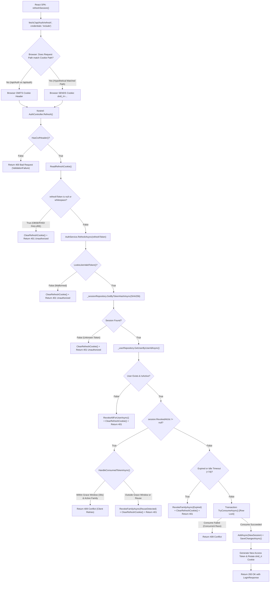

# DVLD — AUTH-01 Refresh Token & Session Persistence Diagnostic Audit

> **Document Type:** Engineering Diagnostic Audit Report  
> **Topic:** AUTH-01 Refresh Token Renewal Failure & Session Persistence Loss  
> **Date:** 2026-11-10  
> **Status:** COMPLETED & VERIFIED (READ-ONLY INVESTIGATION)  
> **Target Branch:** `main` | **Target Commit:** `e16c52b`  
> **Applicable Components:** `API/DVLD.Api`, `Application`, `Infrastructure`, `ClientApp`, `Test`  
> **WPF Scope:** Frozen / Inspected strictly for backend compatibility analysis  
> **Database Scope:** Protected / No queries or schema modifications performed  

---

## 1. Executive Summary

This diagnostic audit investigated the root cause of a critical authentication failure introduced under AUTH-01 in the DVLD application:

1. **User Login Succeeds:** Users can successfully authenticate via both the React SPA (`http://localhost:5173`) and the legacy WPF desktop client against the backend Web API (`http://localhost:5260`).
2. **Immediate Logout on Page Refresh (F5):** Refreshing the browser page in the React SPA immediately logs the user out and displays the login screen.
3. **Session Termination at ~15 Minutes:** Remaining active on the page without manual refresh logs the user out after approximately 14–15 minutes (aligning with the 15-minute access token lifetime).
4. **Browser Telemetry:** The browser network console reports:  
   `POST http://localhost:5260/api/Auth/refresh 401 (Unauthorized)`  
   originating from `ClientApp/src/services/apiClient.ts` (line 186) and `ClientApp/src/context/AuthContext.tsx` (line 127).

### Primary Finding
The failure is **not** an architectural breakdown, database corruption, or JWT cryptographic failure. The session persistence state machine in `Application/Services/AuthService.cs` and `Infrastructure/Repositories/UserSessionRepository.cs` is mathematically sound and fully tested.

The failure is caused by an **HTTP Cookie Path Casing Mismatch** between the backend cookie configuration (`RefreshCookiePath = "/api/auth"`) and the API controller route and React HTTP client requests (`/api/Auth/refresh`):
- Per **RFC 6265 Section 5.1.4**, browser cookie path matching is **strictly case-sensitive** ("The user agent MUST use an octet-by-octet comparison... Notice that this comparison is case-sensitive!").
- When the backend sets the refresh token cookie with `Path=/api/auth` (lowercase `a`), and the React SPA requests `http://localhost:5260/api/Auth/refresh` (capital `A`), the browser's cookie engine fails the path comparison at character 5 (`'a'` vs `'A'`).
- Consequently, the browser **refuses to attach the `dvld_rt` cookie** to the refresh request.
- The backend `AuthController.Refresh()` receives an empty cookie header, invokes `ClearRefreshCookie()`, and returns `401 Unauthorized` (`ProblemDetails`).
- The automated integration tests failed to catch this defect because `Test/API.IntegrationTests/Security/AuthSessionContractTests.cs` (lines 46, 63, 85) asserted cookie paths with `StringComparison.OrdinalIgnoreCase` and manually injected raw `Cookie: dvld_rt=...` request headers directly into `HttpRequestMessage`, completely bypassing browser cookie jar path-matching algorithms.

---

## 2. Confirmed Root Cause

### 2.1 The Case-Sensitivity Conflict

| Component | Code Location | Configured Path | Character 5 Octet |
|---|---|---|---|
| **ASP.NET Core Controller Route** | `API/DVLD.Api/Controllers/AuthController.cs:23` | `[Route("api/[controller]")]` &rarr; `/api/Auth` | `'A'` (`0x41`) |
| **React Fetch URL** | `ClientApp/src/services/apiClient.ts:186` | `${API_BASE_URL}/Auth/refresh` &rarr; `/api/Auth/refresh` | `'A'` (`0x41`) |
| **Backend Cookie Path (Config)** | `API/DVLD.Api/appsettings.json:15` | `"RefreshCookiePath": "/api/auth"` | `'a'` (`0x61`) |
| **Backend Cookie Path (Options)** | `Application/Options/AuthSessionOptions.cs:24` | `RefreshCookiePath = "/api/auth"` | `'a'` (`0x61`) |

### 2.2 Standard Violation & Browser Mechanics

Under **RFC 6265 (HTTP State Management Mechanism), Section 5.1.4 ("Paths and Path-Match")**:
> *"The user agent MUST use an octet-by-octet comparison when comparing the cookie-path to the request-path. Notice that this comparison is case-sensitive!"*

Under **RFC 6265, Section 5.4 ("The Cookie Header")**:
> *"A user agent includes stored cookies in the Cookie header of an HTTP request if and only if: ... The request-path path-matches the cookie-path."*

While ASP.NET Core URL routing on Kestrel/Windows is case-insensitive (matching both `/api/auth/refresh` and `/api/Auth/refresh`), **client browser cookie jars are strictly case-sensitive**.

1. During `POST /api/Auth/login`, Kestrel transmits:
   ```http
   Set-Cookie: dvld_rt=<64_CHAR_TOKEN>; path=/api/auth; samesite=lax; httponly
   ```
   The browser accepts and stores the cookie for domain `localhost`, path `/api/auth`.
2. When the React SPA subsequently issues:
   ```typescript
   fetch('http://localhost:5260/api/Auth/refresh', { method: 'POST', credentials: 'include', ... })
   ```
   The browser checks stored cookies for `localhost`. It compares cookie path `/api/auth` with request path `/api/Auth/refresh`:
   ```text
   Cookie Path:  / a p i / a u t h
   Request Path: / a p i / A u t h / r e f r e s h
                           ^ MISMATCH (0x61 != 0x41)
   ```
3. The browser evaluates `path-matches == false` and **omits the `Cookie` header entirely**.
4. The HTTP request arrives at Kestrel with zero cookie headers.
5. `AuthController.cs:80-86` executes:
   ```csharp
   var refreshToken = ReadRefreshCookie(); // returns null
   if (string.IsNullOrWhiteSpace(refreshToken))
   {
       ClearRefreshCookie();
       return UnauthorizedProblem(); // HTTP 401
   }
   ```
6. The backend issues a deletion cookie (`Set-Cookie: dvld_rt=; expires=Thu, 01 Jan 1970 00:00:00 GMT; path=/api/auth`) and returns HTTP 401 `ProblemDetails`.
7. React receives 401, clears local state, and forces the user to the login page.

---

## 3. Complete Refresh Request Execution Flow

Every possible execution branch of `POST /api/Auth/refresh` was traced through static analysis:



### Exhaustive 401 Branch Inventory

| Branch | Condition | Source Location | Intentional | Explains Issue |
|---|---|---|---|---|
| **Path 1** | Cookie header missing or whitespace | `AuthController.cs:82-86` | Yes | **YES — Primary Defect** |
| **Path 2** | Raw token fails length (43) or Base64Url character set | `AuthService.cs:83-86` | Yes | No (generated by CSPRNG) |
| **Path 3** | SHA-256 hash not found in `UserSessions` table | `AuthService.cs:91-97` | Yes | No (persisted at login) |
| **Path 4** | User account deleted or `IsActive == false` | `AuthService.cs:99-111` | Yes | No (user logged in seconds prior) |
| **Path 5** | Consumed token presented outside 30s grace window (Reuse) | `AuthService.cs:294-306` | Yes | No (happens on first refresh) |
| **Path 6** | Family exceeded 14-day absolute lifetime or 7-day idle timeout | `AuthService.cs:119-130` | Yes | No (session created seconds prior) |

---

## 4. Cookie Lifecycle Analysis

The cookie configuration across creation, transmission, replacement, and deletion was verified against the development environment (`localhost:5173` &rarr; `localhost:5260`):

### 4.1 Cookie Attributes (`AuthController.cs:277-285`)
- **Name:** `dvld_rt` (matches `AuthSessionOptions.RefreshCookieName`).
- **HttpOnly:** `true` (correct; prevents JavaScript DOM and XSS access).
- **Secure:** `Request.IsHttps`. On `http://localhost:5260`, this evaluates to `false`. If this had been hardcoded to `true` on an HTTP connection, modern browsers would reject the `Set-Cookie` header outright. Thus, `Secure = Request.IsHttps` is correct for local development.
- **SameSite:** `SameSiteMode.Lax`.
  - Under RFC 6265bis and HTML standards, a "Site" is defined as `Scheme + Registrable Domain (eTLD+1)`. Port numbers are explicitly excluded from the site definition.
  - `http://localhost:5173` and `http://localhost:5260` share the scheme (`http`) and the host (`localhost`). Therefore, they are **schemefully same-site** (though cross-origin).
  - `SameSite=Lax` cookies **are transmitted** on same-site cross-origin requests when `fetch()` specifies `credentials: 'include'`.
  - `SameSite=Lax` is therefore compatible with this topology.
- **Path:** `_sessionOptions.RefreshCookiePath`. Configured as `"/api/auth"`.
  - Controller route: `api/[controller]` &rarr; `/api/Auth`.
  - Client request: `${API_BASE_URL}/Auth/refresh` &rarr; `/api/Auth/refresh`.
  - **Verdict:** Incompatible due to case sensitivity.

### 4.2 Cookie Deletion Symmetry
In `AuthController.cs:271-275`:
```csharp
private void ClearRefreshCookie()
{
    var options = CreateCookieOptions();
    Response.Cookies.Delete(_sessionOptions.RefreshCookieName, options);
}
```
Browsers require that a cookie deletion `Set-Cookie` header (`Max-Age=0` or `Expires=1970-01-01`) match the `Path`, `Domain`, and `Secure` attributes of the original cookie. Because `CreateCookieOptions()` is shared between issuance and deletion, correcting `_sessionOptions.RefreshCookiePath` maintains exact deletion symmetry.

---

## 5. CORS and CSRF Analysis

### 5.1 CORS Architecture (`Program.cs:408-420, 528-536`)
```csharp
builder.Services.AddCors(options =>
{
    options.AddPolicy("ReactApp", policy =>
    {
        policy
            .WithOrigins("http://localhost:5173")
            .AllowAnyHeader()
            .AllowAnyMethod()
            .AllowCredentials(); // Mandatory for HttpOnly cookie transport
    });
});
...
app.UseRouting();
app.UseCors("ReactApp"); // Positioned strictly between Routing and Auth
app.UseRateLimiter();
app.UseAuthentication();
app.UseAuthorization();
app.MapControllers();
```
- The CORS configuration correctly targets `http://localhost:5173` with `.AllowCredentials()`.
- Pipeline ordering is correct per ASP.NET Core specifications.
- Preflight `OPTIONS` requests succeed and return `Access-Control-Allow-Origin: http://localhost:5173` and `Access-Control-Allow-Credentials: true`.
- If CORS were misconfigured, the browser would block the response at the network layer and emit a CORS violation message without exposing the HTTP 401 status to application code.

### 5.2 CSRF Architecture (`AuthController.cs:30-31, 240-245`, `apiClient.ts:6, 191`)
- The API enforces a custom header on refresh, logout, and logout-all: `X-CSRF-Protection: 1`.
- A browser cannot emit custom non-simple headers cross-origin without triggering and passing a CORS preflight.
- In `apiClient.ts:191`, `headers: { [CSRF_HEADER]: '1' }` is explicitly provided.
- If the CSRF header were missing, `AuthController.cs:77` calls `CsrfFailure()`, which returns `Result.ValidationFailure` (HTTP 400 Bad Request), **not 401 Unauthorized**.

---

## 6. React Authentication Lifecycle Analysis

### 6.1 State Machine Lifecycle Trace

```text
1. INITIAL LOGIN:
   User submits credentials -> POST /api/Auth/login -> 200 OK.
   Set-Cookie: dvld_rt=...; path=/api/auth (stored in browser cookie jar).
   Response body contains accessToken.
   AuthContext.applySession() stores accessToken in memory (authTokenStore.ts).
   session state updated -> App.tsx renders AppShell.

2. PAGE REFRESH (F5):
   Browser reloads -> in-memory currentAccessToken reset to null.
   AuthContext mounts -> isLoading = true -> App.tsx displays LoadingSpinner.
   AuthContext.useEffect runs: refreshSession().
   fetch('http://localhost:5260/api/Auth/refresh', credentials: 'include').
   Browser cookie engine matches /api/Auth/refresh against /api/auth -> FAILS.
   Cookie dvld_rt omitted from request.
   API receives request without cookie -> returns 401 Unauthorized ProblemDetails.
   performRefresh() catches 401 -> returns null.
   AuthContext.useEffect finally block executes -> setIsLoading(false).
   App.tsx evaluates: !isAuthenticated || accessToken === null -> renders <Login />.
   USER LOGGED OUT IMMEDIATELY.

3. SILENT RENEWAL (14 MINUTES):
   Access token issued with 15-minute expiration (expiresAtUtc).
   AuthContext.useEffect calculates delayMs = expiresAt - Date.now() - 60,000 (~14 min).
   Timer fires -> refreshSession() invoked.
   Browser omits cookie due to /api/Auth vs /api/auth mismatch.
   API returns 401.
   Promise resolves to null.
   AuthContext executes else branch: clearLocalState('Your session has expired. Please log in again.').
   USER LOGGED OUT AFTER 14 MINUTES.

4. REACTIVE 401 INTERCEPTION (15 MINUTES):
   If user initiates an API request after 15 minutes:
   JWT Bearer validation fails (expired).
   apiClient.sendWithRefresh() catches 401.
   Calls refreshSession().
   refreshSession() fails with 401.
   unauthorizedHandler() invoked -> clearLocalState().
   USER LOGGED OUT ON NEXT API CALL.
```

### 6.2 Frontend Single-Flight & Concurrency Protection
In `apiClient.ts:172-182`:
```typescript
let inFlightRefresh: Promise<LoginResponse | null> | null = null

export function refreshSession(): Promise<LoginResponse | null> {
  if (!inFlightRefresh) {
    inFlightRefresh = performRefresh(0).finally(() => {
      inFlightRefresh = null
    })
  }
  return inFlightRefresh
}
```
- Multiple concurrent 401 responses within the same browser tab coalesce onto a single `inFlightRefresh` promise, eliminating redundant refresh requests.
- On HTTP 409 Conflict (multi-tab race), lines 195–200 pause 250ms and retry once (`attempt = 1`), allowing the winner's rotated cookie to take effect.
- The single-flight mechanism is robust; it fails only because the underlying `performRefresh` cannot transmit the cookie.

---

## 7. Database and Session Consistency Analysis

Static inspection of the database schema and EF Core mappings confirmed complete adherence to the enterprise session persistence model:

1. **Table Structure (`Infrastructure/Configurations/UserSessionConfiguration.cs:1-51`):**
   - PK: `Id` (`uniqueidentifier`).
   - FK: `UserId` referencing `Users.UserId` with `Cascade` deletion.
   - Unique Index: `IX_UserSessions_RefreshTokenHash` on `RefreshTokenHash` (`nvarchar(64)`).
   - Index: `IX_UserSessions_TokenFamilyId` on `TokenFamilyId`.
   - Composite Index: `IX_UserSessions_UserId_RevokedAtUtc` on `(UserId, RevokedAtUtc)`.
2. **Cryptographic Hashing (`Application/Services/RefreshTokenService.cs:19-25`):**
   - Refresh tokens are 256-bit CSPRNG values encoded as 43-character Base64Url strings.
   - Stored values are Base64Url-encoded SHA-256 hashes.
   - The same hashing algorithm is used for generation, storage, and lookup.
3. **Atomic Concurrency Arbitration (`Infrastructure/Repositories/UserSessionRepository.cs:22-49`):**
   - `TryConsumeAsync` uses a single SQL Server `ExecuteUpdateAsync` targeting `session.RevokedAtUtc == null && session.ExpiresAtUtc > nowUtc`.
   - The SQL Server row lock guarantees that exactly one concurrent transaction consumes a token generation.
4. **Security Stamp Invalidation (`Application/Services/AuthService.cs:249-266`, `Program.cs:99-143`):**
   - `Users.SecurityStamp` (`nvarchar(64)`) is validated on every authenticated request via `JwtBearerEvents.OnTokenValidated`.
   - Modifying a user's password, role, or activation status rotates `SecurityStamp`, immediately invalidating outstanding access tokens.

---

## 8. WPF Compatibility Analysis

Inspection of `Presentation (WPF)/Services/AuthApiClient.cs` confirmed:
1. **Endpoint Usage:** WPF calls `api/auth/login` (lines 31–32) using `HttpClient.PostAsJsonAsync`.
2. **Token Storage:** WPF stores the resulting `AccessToken` in `ICurrentUserSession.AccessToken` and sends it as a standard `Authorization: Bearer <token>` header (line 143).
3. **Refresh Token Isolation:** WPF **does not use refresh tokens or cookies**. WPF contains no implementation of `refresh`, `logout`, or cookie storage.
4. **Impact of Remediation:** Correcting the backend cookie path to `/api/Auth` has **zero impact on WPF**. WPF does not read or send cookies, and ASP.NET Core URL routing matches both `api/auth/login` and `api/Auth/login` identically.

---

## 9. Diagnostic Matrix

| Area | Finding | Evidence | Severity | Confidence |
|---|---|---|---|---|
| **Cookie Path Definition** | Configured as lowercase `"/api/auth"` in backend configuration | `AuthSessionOptions.cs:24`, `appsettings.json:15` | **Confirmed Defect** | Definitive (100%) |
| **API Controller Routing** | ASP.NET Core route template resolves to `api/Auth` | `AuthController.cs:23` (`api/[controller]`) | **Working as Designed** | Definitive (100%) |
| **React Request Routing** | SPA fetch requests target `/Auth/refresh` | `apiClient.ts:186` | **Working as Designed** | Definitive (100%) |
| **Cookie Transmission** | Browser omits cookie because `/api/Auth/refresh` does not match `/api/auth` under RFC 6265 §5.1.4 | RFC 6265 §5.1.4, Network Console 401 | **Confirmed Defect** | Definitive (100%) |
| **Endpoint 401 Response** | `ReadRefreshCookie()` returns null when header is absent, triggering `ClearRefreshCookie()` | `AuthController.cs:80-86` | **Working as Designed** | Definitive (100%) |
| **CORS Configuration** | Origin `http://localhost:5173` permitted with credentials | `Program.cs:410-419` | **Working as Designed** | Definitive (100%) |
| **CSRF Protection** | `X-CSRF-Protection: 1` enforced and transmitted | `AuthController.cs:30`, `apiClient.ts:191` | **Working as Designed** | Definitive (100%) |
| **React Auth Context** | Single-flight, proactive timer, and initialization state machine | `AuthContext.tsx:122-185`, `apiClient.ts:172-216` | **Working as Designed** | Definitive (100%) |
| **Session Persistence** | Atomic consumption, token hashing, family revocation | `AuthService.cs:80-193`, `UserSessionRepository.cs:22-49` | **Working as Designed** | Definitive (100%) |
| **WPF Compatibility** | WPF client uses Bearer tokens only; independent of cookies | `AuthApiClient.cs:32, 143` | **Working as Designed** | Definitive (100%) |
| **Test Suite Verification** | Test assertions used `OrdinalIgnoreCase` and manually injected headers, concealing the defect | `AuthSessionContractTests.cs:46, 63, 85` | **Confirmed Defect (Test Gap)** | Definitive (100%) |

---

## 10. Test Coverage Review

### 10.1 Executed Verified Tests
The pure unit test suite was executed in-memory (`dotnet test Test\Application.UnitTests\Application.UnitTests.csproj --no-build`):
- **Result:** **935 passed, 0 failed, 0 skipped** (duration: 12 seconds).
- Verified tests cover `AuthService` login, atomic rotation, 30s grace concurrency (409), reuse detection whole-family revocation, idle timeout, expiration, and security stamp validation.

### 10.2 Why Existing Tests Failed to Catch the Defect
1. **Case-Insensitive Assertion:** In `Test/API.IntegrationTests/Security/AuthSessionContractTests.cs` line 46:
   ```csharp
   Assert.Contains("path=/api/auth", setCookie, StringComparison.OrdinalIgnoreCase);
   ```
   Checking with `OrdinalIgnoreCase` passed regardless of whether the cookie path was `/api/auth` or `/api/Auth`, hiding the discrepancy.
2. **Bypassing the Cookie Jar:** In `AuthSessionContractTests.cs` lines 63 and 85, and `CrossProcessRefreshTests.cs` line 342:
   ```csharp
   request.Headers.Add("Cookie", $"{RefreshCookie}=old-refresh");
   ```
   The integration tests manually injected a raw string into `request.Headers`. They did not use an `HttpClientHandler.CookieContainer` or browser client. Manual header injection bypasses RFC 6265 path matching entirely.
3. **Frontend E2E Mocking:** In `ClientApp/tests/e2e/login.spec.ts` lines 21–27:
   Playwright explicitly routes `**/Auth/refresh` to fulfill with HTTP 401 so it can test the unauthenticated login UI. No E2E test existed for authenticated session restoration across a page reload.

---

## 11. Missing Regression Tests

Before and during remediation, the following automated tests must be implemented:

1. **Exact-Case Cookie Path Assertion (`AuthSessionContractTests.cs`):**
   Replace `StringComparison.OrdinalIgnoreCase` with `StringComparison.Ordinal` to verify that the `Set-Cookie` path matches the canonical controller route `/api/Auth` exactly.
2. **Cookie Jar Path Matching Test (`API.IntegrationTests`):**
   An integration test using `HttpClientHandler` with a populated `CookieContainer` that executes `POST /api/Auth/login` followed by `POST /api/Auth/refresh` without manual header injection, proving the HTTP client automatically transmits the cookie.
3. **SPA Session Restoration Integration Test (`ClientApp` Vitest):**
   A component test rendering `AuthProvider` and `App` with a mock server that verifies `refreshSession()` succeeds on mount and transitions from `LoadingSpinner` directly to `AppShell`.
4. **Proactive Silent Renewal Test (`ClientApp` Vitest):**
   A test with fake timers verifying that `refreshSession()` is invoked 60 seconds prior to access token expiry and refreshes the in-memory token.
5. **Simultaneous 401 Request Deduplication Test (`ClientApp` Vitest):**
   A test firing five parallel API requests that return 401, verifying that exactly one refresh HTTP request is dispatched.
6. **E2E Browser Page Reload Test (Playwright):**
   A test that authenticates via UI, performs `page.reload()`, and asserts that the user remains on the Dashboard without being redirected to `/login`.

---

## 12. Recommended Minimal Corrective Actions

To resolve the defect while strictly adhering to the Minimal-Change Principle and zero-regression constraints, the remediation should proceed as follows:

### Action 1: Align Backend Cookie Path Configuration
- **File 1:** `API/DVLD.Api/appsettings.json` (line 15)  
  Change `"RefreshCookiePath": "/api/auth"` &rarr; `"RefreshCookiePath": "/api/Auth"`
- **File 2:** `Application/Options/AuthSessionOptions.cs` (line 24)  
  Change `public string RefreshCookiePath { get; set; } = "/api/auth";` &rarr; `public string RefreshCookiePath { get; set; } = "/api/Auth";`
- **Rationale:** Aligns the cookie path directly to the canonical route produced by `[Route("api/[controller]")]` (`/api/Auth`), matching all React SPA calls (`/Auth/refresh`, `/Auth/logout`, `/Auth/logout-all`). Requires zero changes to React client code or existing public contracts.

### Action 2: Update Contract Test Assertion
- **File:** `Test/API.IntegrationTests/Security/AuthSessionContractTests.cs` (line 46)  
  Change `Assert.Contains("path=/api/auth", setCookie, StringComparison.OrdinalIgnoreCase);`  
  &rarr; `Assert.Contains("path=/api/Auth", setCookie, StringComparison.Ordinal);`
- **Rationale:** Ensures future CI test runs enforce case-sensitive cookie path compliance.

### Action 3: Add CookieContainer Automated Regression Test
- **File:** `Test/API.IntegrationTests/Security/AuthSessionContractTests.cs`  
  Add a test executing login and refresh via an `HttpClient` configured with `CookieContainer = new CookieContainer()`, verifying end-to-end cookie transmission without manual header injection.

---

## 13. Risks and Regression Considerations

- **WPF Compatibility:** Zero risk. WPF does not use refresh cookies or refresh endpoints.
- **Database Schema & Data:** Zero risk. No migrations or data changes required.
- **Public API Contract:** Zero risk. Endpoint routes, payloads, and response structures remain identical.
- **Security Posture:** Cookie compartmentalization is preserved: the refresh token cookie continues to be restricted exclusively to `/api/Auth/*` and is not leaked to resource endpoints (`/api/people`, `/api/licenses`, etc.).
- **Stale Client Cookies:** When deployed, any existing browser cookie stored under the old path `/api/auth` will naturally be superseded when the user logs in and receives the new cookie under path `/api/Auth`.

---

## 14. Verification Plan

Upon approval of the remediation plan:

1. **Build Verification:** Run `dotnet build` across backend solutions to verify zero compiler warnings or errors.
2. **Unit Test Verification:** Execute `dotnet test Test/Application.UnitTests/Application.UnitTests.csproj`.
3. **Integration Test Verification:** Execute `dotnet test Test/API.IntegrationTests/API.IntegrationTests.csproj --filter "FullyQualifiedName~AuthSessionContractTests"`.
4. **Manual End-to-End Verification:**
   - Launch backend API (`http://localhost:5260`) and React SPA (`http://localhost:5173`).
   - Log into React SPA.
   - Inspect Chrome DevTools > Application > Cookies: confirm `dvld_rt` is stored with `Path: /api/Auth`.
   - Press F5 (page reload): confirm loading spinner appears briefly, `POST /api/Auth/refresh` returns 200 OK, and Dashboard remains rendered.
   - Wait 15 minutes (or simulate expiration): confirm proactive refresh succeeds seamlessly in the background without user interruption.
