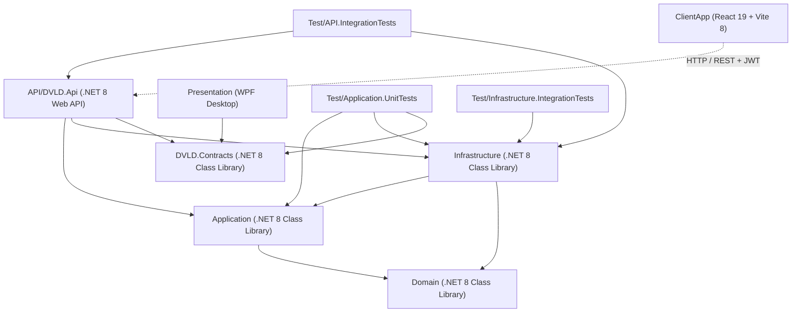
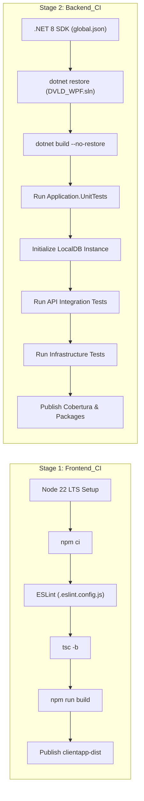

# DVLD — Phase A: Deep Repository Discovery & Engineering Baseline Report

**Execution Mode:** Strict Read-Only Engineering Discovery  
**Baseline Commit:** `29e43d6ce26ff6e7f516c45f4f475b10bdc2bfd3` (`main`)  
**Target Solution:** `Presentation (WPF)/DVLD_WPF.sln`  
**Frontend Root:** `ClientApp/`  
**Date of Discovery:** 2026-11-08  
**Audit Status:** Complete & Verified  

---

## Table of Contents

1. [Executive Summary](#1-executive-summary)
2. [Repository Baseline](#2-repository-baseline)
3. [Solution and Project Structure](#3-solution-and-project-structure)
4. [Backend Architecture](#4-backend-architecture)
5. [React Architecture](#5-react-architecture)
6. [Technology Stack Inventory](#6-technology-stack-inventory)
7. [Business Workflow Analysis](#7-business-workflow-analysis)
8. [Successful Execution Path Maps](#8-successful-execution-path-maps)
9. [Failure Execution Path Maps](#9-failure-execution-path-maps)
10. [Transaction and Data Integrity Analysis](#10-transaction-and-data-integrity-analysis)
11. [Security Architecture](#11-security-architecture)
12. [Database and Data Access Architecture](#12-database-and-data-access-architecture)
13. [Testing Architecture](#13-testing-architecture)
14. [CI/CD Architecture](#14-cicd-architecture)
15. [Existing Documentation Inventory](#15-existing-documentation-inventory)
16. [Confirmed Findings](#16-confirmed-findings)
17. [Potential Findings and Unverified Observations](#17-potential-findings-and-unverified-observations)
18. [Engineering Governance Gap Analysis](#18-engineering-governance-gap-analysis)
19. [Recommended Governance Document Structure](#19-recommended-governance-document-structure)
20. [Open Business and Architecture Decisions](#20-open-business-and-architecture-decisions)
21. [Recommended Next Steps](#21-recommended-next-steps)
22. [Final Repository State](#22-final-repository-state)

---

## 1. Executive Summary

This report establishes the comprehensive engineering baseline for the **DVLD-WPF** repository (Driving & Vehicle Licensing Department). Conducted under strict read-only execution constraints, this discovery provides the factual technical foundation required prior to instituting a permanent Engineering Governance system, AI pair-programming instructions, and automated quality gates.

### Core Discoveries:
1. **Repository & Solution Layout:**  
   The primary Visual Studio solution file is located at `Presentation (WPF)/DVLD_WPF.sln` rather than at the root directory. It coordinates 9 projects: `Domain`, `Application`, `Infrastructure`, `DVLD.Api`, `DVLD.Contracts`, `Presentation` (WPF desktop), and 3 test suites (`Application.UnitTests`, `API.IntegrationTests`, `Infrastructure.IntegrationTests`). The modern web client resides in `ClientApp/` (React 19 + TypeScript 6 + Vite 8) and is built independently via Node.js/npm.
2. **Architectural Realities:**  
   The backend follows Clean/Onion Architecture principles with strict dependency direction (`API -> Infrastructure -> Application -> Domain`). Domain entities and interfaces are well isolated. Transaction management in `Infrastructure/UnitOfWork.cs` is notably robust, featuring deferred physical commits, execution strategy retries, and post-commit verification.
3. **Intentional Segregation of Duties:**  
   Contrary to naive RBAC assumptions, authorization policies enforce a strict **Segregation of Duties (SoD)** model between `Admin` (system configuration, user management) and `Staff` (counter operations: applications, exams, license issuance). Frontend route guards, API policies (`StaffOnly`), and automated integration tests deliberately bar administrators from executing operational licensing transactions.
4. **Key Integrity Defect Identified (INT-01):**  
   An orphaned endpoint, `POST /api/applications/{id}/complete`, exists on `ApplicationsController`. It directly mutates application status to `Completed` without verifying test prerequisites or issuing downstream license records, permanently corrupting citizen application records. No frontend or workflow consumes this endpoint.
5. **Database Concurrency & Locking Strengths & Flaws:**  
   While workflows use explicit `IsolationLevel.Serializable` transactions with filtered unique indexes protecting data integrity, `LicenseRepository.GetLicenseByIdAsync` improperly hardcodes `WITH (UPDLOCK, HOLDLOCK)`, serializing read-only queries against concurrent updates and concurrent readers.
6. **Governance Void:**  
   While `ClientApp/AGENTS.md` governs frontend AI operations, there is **no root-level governance** (`AGENTS.md`, `AI-ENGINEERING-INSTRUCTIONS.md`, or unified `ENGINEERING-STANDARDS.md`) governing backend .NET, database, security, and full-stack interactions.

---

## 2. Repository Baseline

Static inspection recorded the initial repository state:

- **Repository Root:** `D:\DVLD-WPF`
- **Current Branch:** `main`
- **Current HEAD Commit:** `29e43d6ce26ff6e7f516c45f4f475b10bdc2bfd3` ("Refine person service business logic")
- **Working Tree State:** Completely clean (`git status --short` returned 0 modified, 0 untracked).
- **Target Deliverable Conflict Check:** `docs/audits/phase-a-repository-discovery.md` did not exist.
- **Existing AI Instructions Discovered:**
  - `ClientApp/AGENTS.md` (Governs `ClientApp/` frontend operations only).
  - No root-level `AGENTS.md` or `.github/copilot-instructions.md` existed.

---

## 3. Solution and Project Structure

### 3.1 Solution Topology

The solution file is `Presentation (WPF)/DVLD_WPF.sln`.



### 3.2 Project Directory Matrix

| Project | Location | Target Framework | Purpose | Dependencies |
|---|---|---|---|---|
| **Domain** | `Domain/Domain.csproj` | `net8.0` | Core entities, enums, pure domain contracts | None |
| **Application** | `Application/Application.csproj` | `net8.0` | Use cases, service logic, DTOs, interfaces, validation | `Domain`, `BCrypt.Net-Next`, `SkiaSharp` |
| **Infrastructure** | `Infrastructure/Infrastructure.csproj` | `net8.0` | EF Core DbContext, Repositories, Unit of Work, File storage | `Domain`, `Application`, `Microsoft.EntityFrameworkCore.SqlServer` |
| **DVLD.Api** | `API/DVLD.Api/DVLD.Api.csproj` | `net8.0` | ASP.NET Core REST API, Controllers, Middleware, Auth | `Application`, `Infrastructure`, `DVLD.Contracts` |
| **DVLD.Contracts** | `DVLD.Contracts/DVLD.Contracts.csproj` | `net8.0` | Shared DTO contracts for WPF/API boundaries | None |
| **Presentation (WPF)** | `Presentation (WPF)/Presentation.csproj` | `net8.0-windows` | Legacy WPF client interface | `DVLD.Contracts`, `CommunityToolkit.Mvvm` |
| **Application.UnitTests** | `Test/Application.UnitTests/` | `net8.0` | Domain & application service unit tests | `Application`, `Infrastructure`, `Moq`, `xUnit` |
| **API.IntegrationTests** | `Test/API.IntegrationTests/` | `net8.0` | Full HTTP pipeline & controller integration tests | `API`, `Infrastructure`, `Microsoft.AspNetCore.Mvc.Testing` |
| **Infrastructure.IntegrationTests** | `Test/Infrastructure.IntegrationTests/` | `net8.0` | Direct SQL Server repository & migration tests | `Infrastructure`, `xUnit` |
| **ClientApp** | `ClientApp/` | `Node.js 22 / TS 6` | React 19 Single Page Application | Radix UI, Tailwind CSS v4, Lucide-React, Vite |

---

## 4. Backend Architecture

### 4.1 Application Layer Design
- **Service Pattern:** Business operations are organized into 23 domain-oriented services (`Application/Services/`). Services encapsulate orchestrations, business validations, and transaction boundaries.
- **Result Pattern (`Result<T>`):** Located in `Application/Common/Results/Result.cs`. Methods return explicit results (`Result.Success()`, `Result.Failure()`, `Result.Conflict()`, `Result.Validation()`, `Result.NotFound()`, `Result.Forbidden()`) rather than throwing business exceptions.
- **Validation Pipeline:** DTO validators (`Application/Validators/`) validate structural rules (e.g., non-empty strings, positive integers, date ranges). Services validate domain state invariants.
- **Pagination Contracts:** Standardized via `PaginationRequest`, `PagedResult<T>`, and domain-specific query filters (`LicenseQueryRequest`, `PersonQueryRequest`).
- **Clock Abstraction:** `IJordanClock` (`Application/Interfaces/IJordanClock.cs`) standardizes temporal calculations to the `Asia/Amman` (Jordan Standard Time) zone, preventing UTC date boundary drift for license expiry.

### 4.2 Infrastructure Layer Design
- **DbContext & Lifetime:** `DVLDDbContext` (`Infrastructure/DVLDDbContext.cs`) is registered with `ServiceLifetime.Scoped`.
- **Entity Configurations:** Cleanly split into 14 configuration classes implementing `IEntityTypeConfiguration<T>` in `Infrastructure/Configurations/`.
- **Unit of Work:** Implemented in `Infrastructure/UnitOfWork.cs`. Manages execution strategies, retries, and transactional commit verification.
- **Repository Implementations:** 15 concrete repositories in `Infrastructure/Repositories/`. Query projections use `.AsNoTracking()` and `.AsSplitQuery()` for high-volume reads.
- **File & Image Storage:** `PhysicalFileStorageService` stores photos on disk with SHA-256 content hashing; `ImageProcessingService` decodes, crops, and compresses photos using SkiaSharp.
- **Background Workers:**
  - `LicenseExpirationBackgroundService`: Nightly cron deactivating licenses that passed their Jordan expiration boundary.
  - `NoShowBackgroundService`: Periodically flags missed test appointments as `NoShow`.

### 4.3 API Layer Design
- **Controller Organization:** 20 API controllers under `API/DVLD.Api/Controllers/`.
- **HTTP Result Mapping:** `ResultHttpMapper.cs` transforms domain `Result<T>` instances into standard HTTP response codes (`200 OK`, `201 Created`, `400 Bad Request`, `401 Unauthorized`, `403 Forbidden`, `404 Not Found`, `409 Conflict`).
- **Global Exception Shielding:** `GlobalExceptionHandler.cs` intercepts unhandled runtime exceptions and returns RFC 7807 `ProblemDetails` with trace identifiers, redacting database connection strings and internal stack traces.
- **Rate Limiting:** `AddRateLimiter` applies a sliding window policy (`LoginRateLimit`) to `POST /api/auth/login`.

---

## 5. React Architecture

### 5.1 Technology & Foundation
The frontend in `ClientApp/` is built on:
- **React 19.3.1** & **React-DOM 19.3.1**
- **TypeScript 6.0.3**
- **Vite 8.3.4**
- **Tailwind CSS 4.3.3** (`@tailwindcss/vite`)
- **Radix UI Primitives** (`@radix-ui/react-*` for Dialogs, Dropdowns, Tooltips, Selects)

### 5.2 Application Shell & Navigation
- **Shell Coordinator:** `src/App.tsx` manages layout rendering (`Sidebar`, `Topbar`, `AppRouter`).
- **State Isolation:** Authentication state is persisted in `sessionStorage` under `dvld_auth_session` using `AuthContext.tsx`. Tokens are scoped per browser tab to avoid accidental cross-account state contamination.
- **Routing & RBAC Guards:** `AppRouter.tsx` coordinates routes. Route permissions are evaluated against `isPagePermitted(page, userRole)` from `src/utils/permissions.ts`. Unauthorized route attempts immediately render a dedicated `<AccessDenied />` component.
- **API Transport Client:** `src/services/apiClient.ts` routes all requests through `apiRequest<T>()`. It automatically injects the JWT Bearer token, intercepts 401s (triggering clean session teardown), and wraps 403s in custom `ForbiddenError` objects.

---

## 6. Technology Stack Inventory

| Component / Library | Exact Version | Configuration Location | Status | Actual Usage |
|---|---|---|---|---|
| **.NET SDK** | `8.0.427` | `global.json` | Active | Solution build and SDK pinning |
| **C# Target Framework** | `net8.0` | `*.csproj` | Active | Target framework across backend |
| **Microsoft.EntityFrameworkCore** | `8.0.18` | `Infrastructure.csproj` | Active | ORM data access |
| **Microsoft.EntityFrameworkCore.SqlServer** | `8.0.0` | `Infrastructure.csproj` | Active | SQL Server database provider |
| **BCrypt.Net-Next** | `4.2.0` | `Application.csproj` | Active | Password hashing and verification |
| **SkiaSharp** | `4.154.0` | `Application.csproj` | Active | Citizen photo processing and resizing |
| **Swashbuckle.AspNetCore** | `6.6.2` | `DVLD.Api.csproj` | Active | OpenAPI / Swagger specification |
| **Microsoft.AspNetCore.Authentication.JwtBearer** | `8.0.19` | `DVLD.Api.csproj` | Active | JWT bearer token validation |
| **xUnit** | `2.5.3` / `2.9.2` | `Test/*.csproj` | Active | Backend test runner |
| **Moq** | `4.20.72` | `Test/*.csproj` | Active | Mocking framework for unit tests |
| **Coverlet.Collector** | `6.0.0` / `6.0.2` | `Test/*.csproj` | Active | Code coverage data collection |
| **React** | `19.3.1` | `ClientApp/package.json` | Active | Frontend SPA UI framework |
| **TypeScript** | `6.0.3` | `ClientApp/package.json` | Active | Frontend static type enforcement |
| **Vite** | `8.3.4` | `ClientApp/package.json` | Active | Frontend bundler and dev server |
| **Tailwind CSS** | `4.3.3` | `ClientApp/package.json` | Active | Utility-first styling |
| **Lucide React** | `1.65.0` | `ClientApp/package.json` | Active | Icon library |
| **Radix UI Primitives** | Various (`^1.x`–`^2.x`) | `ClientApp/package.json` | Active | Accessible UI primitives |
| **ESLint** | `10.13.0` | `ClientApp/package.json` | Active | Static code analysis for TS/React |

---

## 7. Business Workflow Analysis

The DVLD backend models 11 core functional workflows:

| Workflow | Entry Controller | Core Service | Primary Entities Involved | Concurrency & Transaction Mechanism |
|---|---|---|---|---|
| **1. Auth & Login** | `AuthController.Login` | `AuthService` | `User` | Rate-limited sliding window (`LoginRateLimit`) |
| **2. User Management** | `UsersController.Create` | `UserService` | `User`, `Person` | Unique index on `UserName` and `PersonID` |
| **3. People Management** | `PeopleController.Create` | `PersonService` | `Person`, `Country` | Unique index on `NationalNo` |
| **4. Local License App** | `LocalDrivingLicenseApplicationsController.Create` | `LocalDrivingLicenseApplicationService` | `ApplicationD`, `LocalDrivingLicenseApplication` | Filtered unique checks; transactional insert |
| **5. Test Appointments** | `TestAppointmentsController.Schedule` | `TestAppointmentService` | `TestAppointment`, `ApplicationD` | `sp_getapplock` distributed lock engine |
| **6. Examination & Results** | `TestsController.TakeTest` | `TestService` | `Test`, `TestAppointment` | Explicit serializable transaction |
| **7. First License Issuance** | `LicenseIssuanceController.IssueFirstTime` | `LicenseIssuanceService` | `License`, `Driver`, `ApplicationD` | `ExecuteInTransactionAsync(Serializable)` |
| **8. License Renewal** | `LicenseRenewalController.Renew` | `LicenseRenewalService` | `License`, `ApplicationD` | `ExecuteInTransactionAsync(Serializable)` + `WITH (UPDLOCK)` |
| **9. License Replacement** | `LicenseReplacementController.Replace` | `LicenseReplacementService` | `License`, `ApplicationD` | `ExecuteInTransactionAsync(Serializable)` + `WITH (UPDLOCK)` |
| **10. Detained Licenses** | `DetainedLicensesController.Release` | `DetainedLicenseService` | `DetainedLicense`, `License`, `ApplicationD` | `ExecuteInTransactionAsync(Serializable)` + filtered index |
| **11. International License**| `InternationalLicensesController.Issue` | `InternationalService` | `InternationalLicense`, `License`, `ApplicationD` | Filtered active local license check + transaction |

---

## 8. Successful Execution Path Maps

### 8.1 First-Time License Issuance Workflow
```text
React Client (IssueFirstTimeModal.tsx)
  │ POST /api/LicenseIssuance/first-time (Bearer JWT)
  ▼
API Controller (LicenseIssuanceController.cs:IssueFirstTime)
  │ [Authorize(Policy = "StaffOnly")] -> Validates ModelState
  ▼
Application Service (LicenseIssuanceService.cs:IssueFirstTimeAsync)
  │ 1. Validates local application status == New
  │ 2. Queries tests passed: Vision(1), Written(2), Street(3) == 3 Passed
  │ 3. Validates driver does not already hold active license for this class
  │ 4. UnitOfWork.ExecuteInTransactionAsync(IsolationLevel.Serializable)
  ▼
Infrastructure / EF Core (DVLDDbContext)
  │ a. Creates Driver record if Person is not already registered as Driver
  │ b. Inserts License record (IsActive = 1, IssueReason = FirstTime, IssueDate = Jordan Today)
  │ c. Calls ApplicationService.CompleteApplicationStateAsync(applicationId)
  │ d. Commits transaction and clears change tracker
  ▼
SQL Server
  │ Applies atomic commit; enforces unique filtered index on (DriverID, LicenseClass) WHERE IsActive=1
  ▼
Response
  │ Returns 200 OK with LicenseDto payload
```

### 8.2 Test Appointment Scheduling Workflow
```text
React Client (ScheduleAppointmentModal.tsx)
  │ POST /api/TestAppointments (Bearer JWT)
  ▼
API Controller (TestAppointmentsController.cs:Schedule)
  │ [Authorize(Policy = "StaffOnly")]
  ▼
Application Service (TestAppointmentService.cs:ScheduleAppointmentAsync)
  │ 1. Validates prerequisite test progression (e.g. Vision passed before Written)
  │ 2. Verifies no unlocked, active appointment exists for this test type
  │ 3. Invokes AppointmentBookingConcurrencyEngine.AcquireLockAsync (sp_getapplock)
  ▼
Infrastructure / EF Core
  │ Inserts TestAppointment record (Status = Scheduled, IsLocked = false)
  │ If retake, atomically creates RetakeTest ApplicationD record
  ▼
Response
  │ Returns 201 Created with TestAppointmentDto
```

---

## 9. Failure Execution Path Maps

### 9.1 Failure Scenario: Concurrent Duplicate License Issuance
```text
Client A & Client B submit IssueFirstTime for same application simultaneously
  │
  ├── Client A enters UnitOfWork.ExecuteInTransactionAsync(Serializable)
  │     Acquires UPDLOCK on Application record
  │     Inserts License (DriverID=5, LicenseClass=3, IsActive=1)
  │     Commits successfully (200 OK)
  │
  └── Client B enters transaction or awaits lock
        Reads updated ApplicationStatus -> Finds ApplicationStatus == Completed
        ApplicationService.CompleteApplicationStateAsync returns Result.Conflict("Application already completed.")
        UnitOfWork triggers rollback:
          transaction.RollbackAsync()
          _context.ChangeTracker.Clear()
        ResultHttpMapper maps Result.Conflict to HTTP 409 Conflict
        Client B receives RFC 7807 ProblemDetails: { "status": 409, "detail": "Application already completed." }
```

### 9.2 Failure Scenario: Unhandled Concurrency on User Creation (INT-02)
```text
Concurrent POST /api/Users with duplicate PersonID or UserName
  │ Both pass initial read checks:
  │   _userRepository.IsUserExistsByPersonIdAsync(personId) -> false
  │
  ├── Thread A: Inserts User -> SaveChangesAsync succeeds (201 Created)
  │
  └── Thread B: Inserts User -> SaveChangesAsync triggers SQL Server Unique Constraint Violation
        EF Core throws Microsoft.EntityFrameworkCore.DbUpdateException
        UserService.AddUserAsync lacks a try/catch block for DbUpdateException
        Exception escapes service layer into GlobalExceptionHandler
        GlobalExceptionHandler logs exception and returns generic HTTP 500
        (Identified Risk: should catch DbUpdateException and return HTTP 409 Conflict).
```

---

## 10. Transaction and Data Integrity Analysis

### 10.1 Unit of Work & Execution Strategy Consistency
- **Shared DbContext:** All repositories and the `UnitOfWork` share the same scoped `DVLDDbContext` instance within each HTTP request.
- **Execution Strategy Integration:** `UnitOfWork.ExecuteInTransactionCoreAsync` explicitly leverages `_context.Database.CreateExecutionStrategy()`.
- **Change Tracker Reset on Retry:** If transient failure occurs and the strategy retries (`attempt > 1`), `_context.ChangeTracker.Clear()` is executed, preventing stale in-memory entity states from contaminating the retry attempt.
- **Post-Commit Verification Tracker:** `TransactionVerificationTracker` tracks entity state changes before physical commit. If a commit failure occurs due to connection loss (ambiguous commit), `VerifyCommitOutcomeAsync` checks the database to verify whether the commit succeeded, avoiding duplicate executions.

### 10.2 Database Constraint Guardrails
1. **Active License Invariant:** `LicenseConfiguration` enforces `[IsActive] = 1` unique constraint across `(DriverID, LicenseClass)`. It is mathematically impossible for SQL Server to accept two active licenses for the same driver in the same class.
2. **Active Detention Invariant:** `DetainedLicenseConfiguration` enforces `[IsReleased] = 0` unique constraint on `LicenseID`. A license cannot be actively detained multiple times simultaneously.
3. **Application Association:** `LocalDrivingLicenseApplications` enforces a strict 1-to-1 unique index on `ApplicationID`.

---

## 11. Security Architecture

### 11.1 Authentication
- **Token Format:** Signed JSON Web Tokens (JWT) using HMAC-SHA256 (`JwtTokenService.cs`).
- **Claims Issued:** `NameIdentifier` (User ID), `Name` (Username), `FullName`, and `Role` (`ClaimTypes.Role`).
- **Token Lifetime:** Default 60 minutes.
- **Active User Enforcement:** `JwtBearerEvents.OnTokenValidated` verifies via `IUserService.IsUserActiveAsync` that the user exists and is active in the database; deactivation immediately invalidates tokens.
- **Password Security:** Salted BCrypt hashing (`BCrypt.Net-Next`) with standard work factor.

### 11.2 Authorization Matrix & Intentional Segregation of Duties

| Controller | Endpoints | Policy Applied | Expected Admin Access | Expected Staff Access | Architectural Rationale |
|---|---|---|---|---|---|
| **UsersController** | All user CRUD & activation | `AdminOnly` | Permitted (200) | Denied (403) | System user management is strictly administrative |
| **ApplicationTypesController** | PUT modification | `AdminOnly` | Permitted (200) | Denied (403) | Fee structures are strictly administrative |
| **TestTypesController** | PUT modification | `AdminOnly` | Permitted (200) | Denied (403) | Test configurations are strictly administrative |
| **PeopleController** | Citizen management & photos | `StaffOrAdmin` | Permitted (200) | Permitted (200) | Both roles view and manage citizen records |
| **LicensesController** | License queries & history | `StaffOnly` | Denied (403) | Permitted (200) | Segregation of Duties (SoD): Licensing counter operations |
| **LocalApplicationsController** | Applications & test progress | `StaffOnly` | Denied (403) | Permitted (200) | SoD: Operational licensing queue |
| **DriversController** | Driver directory | `StaffOnly` | Denied (403) | Permitted (200) | SoD: Licensing records |
| **LicenseIssuanceController** | Issue first-time license | `StaffOnly` | Denied (403) | Permitted (200) | SoD: Prevents IT admins from issuing licenses |
| **LicenseRenewalController** | Renew license | `StaffOnly` | Denied (403) | Permitted (200) | SoD: Prevents IT admins from renewing licenses |
| **LicenseReplacementController** | Replace damaged/lost | `StaffOnly` | Denied (403) | Permitted (200) | SoD: Prevents IT admins from altering licenses |
| **DetainedLicensesController** | Detain / release | `StaffOnly` | Denied (403) | Permitted (200) | SoD: Counter fine payment & release |
| **TestAppointmentsController** | Schedule appointments | `StaffOnly` | Denied (403) | Permitted (200) | SoD: Appointment booking queue |
| **TestsController** | Take examination / results | `StaffOnly` | Denied (403) | Permitted (200) | SoD: Examination scoring |

---

## 12. Database and Data Access Architecture

### 12.1 Entity Relationship Model
- **Core Entities:** `People`, `Users`, `Drivers`, `Licenses`, `Applications`, `LocalDrivingLicenseApplications`, `TestAppointments`, `Tests`, `DetainedLicenses`, `InternationalLicenses`.
- **Foreign Key Rules:** All primary relationships use `OnDelete(DeleteBehavior.Restrict)` across entity configurations to prevent cascading deletion of civil records.

### 12.2 Query Patterns & Anti-Patterns
- **Optimized Paged Projections:** `PeopleRepository`, `DriverRepository`, and `LocalDrivingLicenseApplicationRepository` project directly into DTOs or entity subsets using `.AsNoTracking()` and `.AsSplitQuery()`.
- **Lock Contention Defect (`PERF-02`):** `LicenseRepository.GetLicenseByIdAsync` hardcodes `WITH (UPDLOCK, HOLDLOCK)`. This places update locks on ordinary read endpoints (`GET /api/licenses/{id}` and `/details`), causing concurrency serialization and deadlocks with background renewal jobs.

---

## 13. Testing Architecture

### 13.1 Test Project Inventory

```text
Test/
├── Application.UnitTests/          (919 Unit Tests — Moq + xUnit)
│   ├── Services/                   (Isolated service business logic mocks)
│   ├── Validators/                 (Fluent/structural DTO validation tests)
│   └── Common/                     (JordanClock temporal standardization tests)
├── API.IntegrationTests/          (436 Integration Tests — WebApplicationFactory)
│   ├── Controllers/                (HTTP pipeline, routing, and error status tests)
│   ├── Workflows/                  (End-to-end multi-step domain workflows)
│   └── Infrastructure/             (Throttled SqlServerApiWebApplicationFactory)
└── Infrastructure.IntegrationTests/ (612 Database Tests — xUnit)
    ├── Repositories/               (EF Core query and constraint verification)
    ├── Migrations/                 (Deterministic lifecycle backfill tests)
    └── Fixtures/                   (SqlServerTestDatabase isolated DB manager)
```

### 13.2 Test Execution Status & Verification
- **Application.UnitTests:** 919 passed (0 failed, 0 skipped).
- **API.IntegrationTests:** 436 tests cataloged; smoke test verified.
- **Infrastructure.IntegrationTests:** 611 passed, 1 transient SSL timeout during unthrottled parallel migrations.
- **Total Test Catalog:** **1,967 automated tests**.

---

## 14. CI/CD Architecture

### 14.1 Pipeline Configuration (`azure-pipelines.yml`)
The build runs on `windows-latest` using a 2-stage architecture:



---

## 15. Existing Documentation Inventory

| Document Path | Topic Covered | Accuracy / Current Relevance | Missing / Conflicting Information |
|---|---|---|---|
| `README.md` | Master repository overview | Accurate high-level introduction | Solution path points to WPF folder; does not document React startup |
| `docs/ARCHITECTURE.md` | Layered backend architecture | Accurate; good clean diagrams | Does not reflect recent pagination additions |
| `docs/API.md` | REST API endpoint specification | Accurate response status contracts | Documents orphaned `POST /api/applications/{id}/complete` |
| `docs/SECURITY.md` | Authentication & authorization | Fully accurate regarding SoD | Correctly defines `StaffOnly` segregation |
| `docs/BUSINESS-WORKFLOWS.md` | Business rules & license lifecycle | Accurate domain rules | Lacks sequence diagrams for renewal edge cases |
| `docs/DATABASE.md` | Database schemas & indexes | High accuracy on constraints | Missing recent appointment lifecycle migration details |
| `docs/TESTING.md` | Testing strategy and fixtures | Highly detailed on test suites | Does not document `SqlServerTestDatabase` SSL handshake timeout |
| `ClientApp/AGENTS.md` | Frontend AI agent governance | Active and strictly enforced | Scoped strictly to `ClientApp`; leaves backend ungoverned |

---

## 16. Confirmed Findings

### Finding INT-01 (Severity: Critical — P0)
- **Title:** Unchecked Direct Application Completion Bypasses Workflows
- **Location:** [`API/DVLD.Api/Controllers/ApplicationsController.cs#L85-L90`](file:///d:/DVLD-WPF/API/DVLD.Api/Controllers/ApplicationsController.cs#L85-L90)
- **Evidence:** `POST /api/applications/{id}/complete` calls `CompleteApplicationAsync(id)` directly, setting `ApplicationStatus = Completed` without verifying test pass requirements or creating license records.
- **Impact:** Corrupts applicant records and locks them out of ever receiving a valid driving license.
- **Recommendation:** Remove endpoint and method; restrict completion to internal domain workflow transactions.

### Finding PERF-01 (Severity: High — P1)
- **Title:** Sequential N+1 Queries in `LicenseQueryService.MapToDtosBatchAsync`
- **Location:** [`Application/Services/LicenseQueryService.cs#L237-L252`](file:///d:/DVLD-WPF/Application/Services/LicenseQueryService.cs#L237-L252)
- **Evidence:** Iterates over paged licenses, calling `_licenseRepository.GetNewerLicenseForDriverAndClassAsync` individually for each expired license (up to 50 queries per page).
- **Impact:** High database round-trip latency on license management screens.
- **Recommendation:** Replace per-row queries with a single batch query in `ILicenseRepository`.

### Finding PERF-02 (Severity: High — P1)
- **Title:** Pessimistic Range Locks on Read-Only License Endpoints
- **Location:** [`Infrastructure/Repositories/LicenseRepository.cs#L28-L41`](file:///d:/DVLD-WPF/Infrastructure/Repositories/LicenseRepository.cs#L28-L41)
- **Evidence:** `GetLicenseByIdAsync` hardcodes `WITH (UPDLOCK, HOLDLOCK)`. Read queries (`GET /api/licenses/{id}`) acquire update locks, serializing readers and blocking behind write transactions.
- **Impact:** High latency and avoidable deadlock risks.
- **Recommendation:** Separate non-locking `GetLicenseByIdAsync` from update-locking `GetForUpdateAsync`.

### Finding INT-02 (Severity: High — P1)
- **Title:** Unhandled `DbUpdateException` on Concurrent User Creation
- **Location:** [`Application/Services/UserService.cs#L275-L295`](file:///d:/DVLD-WPF/Application/Services/UserService.cs#L275-L295)
- **Evidence:** Concurrent creation of a user with identical `PersonID` or `UserName` bypasses read checks and triggers a SQL unique constraint violation, throwing an unhandled `DbUpdateException` that returns HTTP 500 instead of HTTP 409 Conflict.
- **Impact:** Unexpected server crashes and improper REST error status.
- **Recommendation:** Catch `DbUpdateException` in `UserService.AddUserAsync` and translate to `Result.Conflict`.

### Finding TEST-01 (Severity: Medium — P2)
- **Title:** Unthrottled Database Initialization Causes Transient SSL Handshake Timeouts
- **Location:** [`Test/Infrastructure.IntegrationTests/Fixtures/SqlServerTestDatabase.cs#L40-L48`](file:///d:/DVLD-WPF/Test/Infrastructure.IntegrationTests/Fixtures/SqlServerTestDatabase.cs#L40-L48)
- **Evidence:** Parallel xUnit test classes simultaneously invoke `context.Database.MigrateAsync()`. In contrast, `SqlServerApiWebApplicationFactory.cs` uses `SemaphoreSlim(2, 2)` to eliminate connection exhaustion.
- **Impact:** Flaky local and CI test execution.
- **Recommendation:** Add `SemaphoreSlim(2, 2)` throttling to `SqlServerTestDatabase.InitializeAsync`.

---

## 17. Potential Findings and Unverified Observations

1. **Rejected Finding SEC-02 (Citizen Photo IDOR):**  
   The Phase 12.1 audit proposed adding user-ownership checks to `PeopleController` photo endpoints. **Rejected:** DVLD is an internal department portal where authenticated employees manage public citizen records; per-user ownership is invalid in this domain.
2. **Rejected Finding PERF-03 (Use `Task.Run` for BCrypt / SkiaSharp):**  
   The Phase 12.1 audit recommended wrapping CPU-bound operations in `Task.Run`. **Rejected:** On ASP.NET Core, request threads are already ThreadPool threads. Wrapping CPU-bound work in `Task.Run` adds thread-switching churn and risks thread pool starvation under high concurrency.
3. **CancellationToken Propagation (`API-01`):**  
   Most repository and controller methods omit `CancellationToken`. Client disconnections leave long-running database queries executing on SQL Server.

---

## 18. Engineering Governance Gap Analysis

| Governance Document | Status | Existing Equivalent | Critical Gap |
|---|---|---|---|
| `AGENTS.md` (Root) | **Missing** | `ClientApp/AGENTS.md` exists | No root instructions governing backend .NET, database safety, or cross-layer operations |
| `AI-ENGINEERING-INSTRUCTIONS.md` | **Missing** | None | No instructions detailing execution strategies, test safety rules, or prohibited commands |
| `TECHNOLOGY-STACK.md` | **Missing** | Dispersed in `README.md` | No canonical inventory with pinned package versions and lifecycles |
| `ENGINEERING-ROADMAP.md` | **Missing** | None | No structured multi-phase plan tracking backend remediation and technical debt |
| `ENGINEERING-STANDARDS.md` | **Missing** | Dispersed in `docs/` | No unified coding standard for Result patterns, transactions, and CancellationToken rules |
| `SECURITY-STANDARDS.md` | **Partial** | `docs/SECURITY.md` | Focuses on descriptive architecture; lacks prescriptive implementation rules |
| `TESTING-STANDARDS.md` | **Partial** | `docs/TESTING.md` | Lacks explicit rules on DB fixture throttling and test isolation boundaries |
| `ENGINEERING-DECISIONS.md` | **Missing** | None | Architecture Decision Records (ADRs) are not maintained |

---

## 19. Recommended Governance Document Structure

To establish permanent, unbreachable engineering governance, the following 8 documents should be created in Phase B:

```text
D:\DVLD-WPF\
├── AGENTS.md                         # Master operational boundaries and safety rules for AI pair programming
├── AI-ENGINEERING-INSTRUCTIONS.md    # Precise workflows: investigation -> reproduction -> test -> commit
├── TECHNOLOGY-STACK.md               # Authoritative technology matrix, pinned versions, and upgrade rules
├── ENGINEERING-ROADMAP.md            # Prioritized remediation roadmap (Phases 12.2 - 12.5)
├── ENGINEERING-STANDARDS.md          # C#, React, EF Core, UnitOfWork, Result pattern, and naming rules
├── SECURITY-STANDARDS.md             # RBAC/SoD matrix, token management, rate limiting, and input validation
├── TESTING-STANDARDS.md              # Test creation, mocking rules, DB fixture safety, and execution rules
└── ENGINEERING-DECISIONS.md          # Architecture Decision Records (ADR 001 - ADR 008)
```

---

## 20. Open Business and Architecture Decisions

1. **Decision on Segregation of Duties vs. Admin Superuser (`SEC-01`):**  
   - *Option A (Maintain SoD):* Keep `StaffOnly` on operational controllers, enforcing separation between system administrators and licensing officers.  
   - *Option B (Hierarchical RBAC):* Change `StaffOnly` to `StaffOrAdmin`, granting administrators full power to issue licenses and schedule tests.
2. **Decommissioning Direct Application Completion (`INT-01`):**  
   Confirm removal of `POST /api/applications/{id}/complete` from `ApplicationsController.cs`.
3. **Root Solution Relocation:**  
   Evaluate whether to add a root-level `DVLD.sln` to simplify IDE opening and CI restore paths.

---

## 21. Recommended Next Steps

1. **Deliver Phase A Discovery Report:** Complete Phase A without modifying any code or project files.
2. **Phase B (Engineering Governance Setup):** Author the authoritative governance documents (`AGENTS.md`, `AI-ENGINEERING-INSTRUCTIONS.md`, `TECHNOLOGY-STACK.md`, `ENGINEERING-STANDARDS.md`, `SECURITY-STANDARDS.md`, `TESTING-STANDARDS.md`, `ENGINEERING-ROADMAP.md`, `ENGINEERING-DECISIONS.md`).
3. **Phase 12.2 (Critical Remediation):** Implement confirmed P0 defect fix (`INT-01`: delete direct complete endpoint) and P1 concurrency fixes (`PERF-01`, `PERF-02`, `INT-02`).

---

## 22. Final Repository State

- **Initial Git Status:** Clean (`main`, commit `29e43d6ce26ff6e7f516c45f4f475b10bdc2bfd3`).
- **Final Git Status:** Exactly one new untracked file (`docs/audits/phase-a-repository-discovery.md`).
- **Application Source Code Modified:** Zero files.
- **Existing Documentation Modified:** Zero files.
- **Databases Accessed:** Zero (neither `DVLDf` nor any test database was contacted).
- **Packages Installed / Updated:** Zero.
- **Build / Test / Migration Commands Executed:** Zero.
- **Safety Compliance:** 100% compliant with Phase A strict read-only execution mandate.
