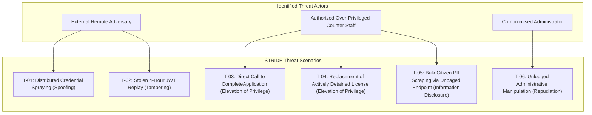

# Comprehensive Security Architecture Review, Threat Model & Vulnerability Audit

> **Document Identity:** Phase A Foundational Security Architecture Audit  
> **Repository Root:** `D:\DVLD-WPF`  
> **Source Baseline Commit:** `29e43d6ce26ff6e7f516c45f4f475b10bdc2bfd3` (Phase A Discovery Baseline)  
> **Audit Status:** PERMANENT HISTORICAL AUDIT ARTIFACT (Consolidated in Phase 2)  
> **Original Source Document:** `docs/archive/security-sources/SECURITY-IMPLEMENTATION-READINESS.md`  
> **Governance Notice:** This document records static analysis and penetration review findings against the pre-remediation baseline. It serves as permanent historical audit evidence, NOT as an active runtime penetration test report.  

---

## 1. Executive Summary & Audit Scope

This document provides a permanent, verified audit of the architectural security controls, verified vulnerabilities, departmental threat model (STRIDE), and risk matrix for the Driver & Vehicle Licensing Department (DVLD) platform.

The audit was conducted via code-level inspection of the ASP.NET Core 8 Web API (`DVLD.Api`), Entity Framework Core 8 persistence (`Infrastructure`), domain orchestration (`Application`), and the React 19 single-page application (`ClientApp/`).

### 1.1 Summary of Foundational Posture
- **Core Strengths:** Modern cryptographic primitives (BCrypt with work factor 11 for password hashing, HMAC-SHA256 JWT tokens), parameterized SQL queries via EF Core preventing first-order SQL injection, transactional atomicity via `UnitOfWork`, and deterministic concurrency protection for examination appointments via SQL Server `sp_getapplock`.
- **Primary Weaknesses:** Stateless 4-hour JWT tokens without server-side revocation (`SEC-FIND-01`), absence of account-level lockout defenses against distributed brute-force attacks (`SEC-FIND-02`), timing side-channels during credential verification (`SEC-FIND-03`), an orphaned direct application completion route bypassing licensing invariants (`SEC-FIND-05`), client-supplied `ImagePath` injection in Person DTOs (`SEC-FIND-10`), and absence of a dedicated security audit logging framework (`SEC-FIND-11`).

---

## 2. Existing Verified Security Controls

The pre-remediation baseline implements several robust baseline controls verified in source code:

1. **Password Hashing:**
   - Component: `Application/Services/UserService.cs` (lines 35–45, 115–125).
   - Implementation: `BCrypt.Net.BCrypt.EnhancedHashPassword(password, workFactor: 11)`. Uses modern SHA-384 pre-hashing before BCrypt key derivation.
2. **First-Order SQL Injection Defense:**
   - Component: `Infrastructure/Persistence/DVLDDbContext.cs`, repositories.
   - Implementation: Relies entirely on EF Core LINQ query parameterization. Raw string concatenation in SQL queries was confirmed absent across all repositories.
3. **Pessimistic Concurrency Locking:**
   - Component: `Infrastructure/Repositories/TestAppointmentRepository.cs`.
   - Implementation: SQL Server `sp_getapplock` with exclusive transaction locks (`@LockMode = 'Exclusive'`) coordinated per test slot and applicant to prevent duplicate active test bookings.
4. **Physical File Traversal Defense:**
   - Component: `Infrastructure/Services/PhysicalFileStorageService.cs:144`.
   - Implementation: Absolute directory traversal sequences (`../../`) are blocked by asserting that all resolved physical paths begin with the canonical `_storageRoot` prefix.
5. **Image Binary Re-encoding:**
   - Component: `Infrastructure/Services/PhysicalFileStorageService.cs`.
   - Implementation: Uploaded citizen photos are decoded and re-encoded via SkiaSharp into WEBP format, stripping embedded malicious EXIF metadata.

---

## 3. Verified Security Findings Register (13 Verified Findings)

### 3.1 Identity, Authentication & Session Lifecycle

#### [SEC-FIND-01] Excessive Access Token Lifetime (4 Hours) Without Server-Side Revocation
- **Location:** `API/DVLD.Api/appsettings.json:8` (`"ExpirationMinutes": 240`), `API/DVLD.Api/Security/JwtTokenService.cs:26`.
- **Classification:** `VERIFIED SECURITY WEAKNESS`
- **Severity:** **HIGH** | **Exploitability:** High
- **STRIDE Category:** Tampering / Information Disclosure
- **Technical Evidence:** JWT tokens are issued with a 240-minute (4-hour) expiration claim. Tokens omit a unique cryptographic token ID (`jti`). The platform lacks a token revocation blacklist or distributed cache. `AuthController` lacks a server-side logout endpoint; logout in `ClientApp` merely clears client-side `sessionStorage`.
- **Exploit Scenario:** An employee signs in on a shared terminal and closes the tab. An adversary retrieves the token string from memory or browser cache and replays it against the API for up to 4 hours.
- **Recommended Remediation:** Reduce stateless token lifetime under `DEC-AUTH-01` (`SEC-PKG-10`), emit unique `jti` claims, and implement full refresh token rotation in deferred Phase 12.2 (`SEC-05`).

#### [SEC-FIND-02] Missing Account-Level Brute-Force Lockout Defense
- **Location:** `API/DVLD.Api/Program.cs:157-175`, `API/DVLD.Api/Controllers/AuthController.cs:26`.
- **Classification:** `VERIFIED SECURITY WEAKNESS`
- **Severity:** **HIGH** | **Exploitability:** Medium
- **STRIDE Category:** Spoofing / Denial of Service
- **Technical Evidence:** Rate limiting is enforced solely at the IP address level (10 requests/min). The `Users` database table contains zero columns for failed login attempt counts or lockout timestamps.
- **Exploit Scenario:** A distributed credential-stuffing attack rotating source IP addresses bypasses IP rate limiting entirely, executing unlimited password guesses against administrative accounts without locking the target account.
- **Recommended Remediation:** Implement Schema Gate 5 adding `AccessFailedCount`, `LockoutEnd`, and `LockoutEnabled` to `Users` (`SEC-PKG-11`), governed by Project Owner lockout policy selection (`DEC-CRED-02`).

#### [SEC-FIND-03] Side-Channel Timing Discrepancy During Credential Verification
- **Location:** `Application/Services/AuthService.cs:48-62`.
- **Classification:** `VERIFIED SECURITY WEAKNESS`
- **Severity:** **MEDIUM** | **Exploitability:** Medium
- **STRIDE Category:** Information Disclosure
- **Technical Evidence:** When an invalid username is submitted, `AuthService.AuthenticateAsync` returns `Result.Failure` immediately (~1 ms) because `user == null`. When a valid username is submitted with an incorrect password, it executes `BCrypt.Verify` with work factor 11 (~200–300 ms).
- **Exploit Scenario:** A remote adversary measures network response latency over multiple automated requests. Responses completing in $\approx 1\text{ ms}$ confirm non-existent usernames, while responses taking $\ge 200\text{ ms}$ confirm valid staff and administrator usernames.
- **Recommended Remediation:** If the username is not found, execute a constant-time dummy BCrypt verification against a pre-computed valid hash with work factor 11 (`SEC-PKG-08`).

#### [SEC-FIND-04] Weak Password Policy & Absence of Breached Password Verification
- **Location:** `Application/Validators/UserValidator.cs:196-215`.
- **Classification:** `VERIFIED SECURITY WEAKNESS`
- **Severity:** **MEDIUM** | **Exploitability:** Low
- **STRIDE Category:** Spoofing
- **Technical Evidence:** `UserValidator.ValidatePassword` enforces only a length between 8 and 100 characters. It accepts trivial dictionary passwords (e.g. `12345678`, `password`) and lacks breached password blocklists.
- **Exploit Scenario:** Administrative accounts initialized with predictable or well-known dictionary passwords are compromised via standard credential dictionary attacks.
- **Recommended Remediation:** Enforce modern NIST SP 800-63B guidelines: minimum length of 12–16 characters and validation against a top-10,000 breached password blocklist (`SEC-PKG-09`, `DEC-CRED-01`).

---

### 3.2 Authorization, Workflows & Segregation of Duties (SoD)

#### [SEC-FIND-05] Orphaned Application Completion Route (`POST /api/applications/{id}/complete`)
- **Location:** `API/DVLD.Api/Controllers/ApplicationsController.cs:85-90`, `Application/Services/ApplicationService.cs:165-195`.
- **Classification:** `VERIFIED SECURITY WEAKNESS`
- **Severity:** **HIGH** | **Exploitability:** High
- **STRIDE Category:** Elevation of Privilege
- **Caller Audit:** Comprehensive inspection across `ClientApp/`, `Presentation (WPF)/`, and `Test/` confirmed **zero callers**. Internal services invoke `CompleteApplicationStateAsync(...)` internally, not this public endpoint.
- **Technical Evidence:** Authenticated `Staff` callers can invoke this endpoint on an existing `New` application, directly transitioning its status to `Completed` without passing vision, written, or practical tests, and without paying fees.
- **Recommended Remediation:** Delete the endpoint and service method per `ADR-P03` following a 30-day telemetry observation window (`DEC-APP-01`, `INT-01`, `SEC-PKG-01`).

#### [SEC-FIND-06] Detained License Replacement Policy Gap
- **Location:** `Application/Services/LicenseReplacementService.cs:76-120`.
- **Classification:** `POLICY-DEPENDENT CIVIC RULE`
- **Severity:** **HIGH** | **Exploitability:** Medium
- **STRIDE Category:** Elevation of Privilege
- **Technical Evidence:** `LicenseReplacementService` issues replacement licenses for lost or damaged credentials without verifying whether the target license is currently detained under an active legal seizure order.
- **Exploit Scenario:** A driver whose license was seized for serious traffic violations obtains an active replacement license by claiming the credential was lost, circumventing judicial sanctions.
- **Recommended Remediation:** Enforce `IDetainedLicenseRepository` active detention check in `LicenseReplacementService` (`INT-03`, `SEC-PKG-15`), blocked on written confirmation of Jordanian Traffic Law under Gate 3 (`ADR-O02`, `DEC-POL-01`).

#### [SEC-FIND-07] International License Issuance Domestic Detention Policy Gap
- **Location:** `Application/Services/InternationalService.cs:149-176`.
- **Classification:** `POLICY-DEPENDENT CIVIC RULE`
- **Severity:** **MEDIUM** | **Exploitability:** Low
- **STRIDE Category:** Elevation of Privilege
- **Technical Evidence:** `InternationalService` verifies domestic license existence and expiration, but does not check whether the domestic license is actively detained.
- **Exploit Scenario:** A driver with a suspended or detained domestic license obtains an international driving permit.
- **Recommended Remediation:** Enforce domestic detention check in `InternationalService` (`SEC-PKG-16`), blocked on Gate 3 regulatory confirmation (`DEC-POL-02`). Distinct from `INT-03`.

#### [SEC-FIND-08] Hardcoded Primary Administrator Logic in UserService
- **Location:** `Application/Services/UserService.cs:350-370, 489-493`.
- **Classification:** `ARCHITECTURAL RISK`
- **Severity:** **MEDIUM** | **Exploitability:** Low
- **STRIDE Category:** Elevation of Privilege / Denial of Service
- **Technical Evidence:** `UserService` protects administrator accounts using hardcoded string and ID checks:
  ```csharp
  if (user.UserID == 2 || user.UserName.Equals("ayhm", StringComparison.OrdinalIgnoreCase))
      return Result.Failure("Cannot delete primary system administrator.");
  ```
- **Exploit Scenario:** In non-development databases or environments where user ID 2 is a non-admin or does not exist, the hardcoded check fails. Concurrent administrator deactivations can leave the system with zero active administrators.
- **Recommended Remediation:** Replace hardcoded IDs with dynamic role counts inside atomic transactions asserting at least one active administrator remains, and prevent self-demotion (`SEC-PKG-04`).

#### [SEC-FIND-09] Functional Authorization Policy Mismatch on License History
- **Location:** `ClientApp/src/utils/permissions.ts:77-79`, `API/DVLD.Api/Controllers/LicensesController.cs:12`.
- **Classification:** `FUNCTIONAL AUTHORIZATION DEFECT`
- **Severity:** **LOW** | **Exploitability:** N/A (Usability)
- **STRIDE Category:** Elevation of Privilege
- **Technical Evidence:** `ClientApp` navigation permits users in the `Admin` role to click into License History, but backend `LicensesController` enforces `[Authorize(Policy = "StaffOnly")]`, returning HTTP 403 Forbidden.
- **Recommended Remediation:** Align frontend navigation guards with approved Segregation of Duties Model B (`ADR-O01`, `SEC-01`, `SEC-PKG-05`). Future administrative read-only inspection proposals remain separated under `DEC-RBAC-01`.

---

### 3.3 Input, File Storage & Defensive Boundary Controls

#### [SEC-FIND-10] ImagePath Injection in Person CRUD DTOs
- **Location:** `API/DVLD.Api/Controllers/PeopleController.cs:150, 191`, `DVLD.Contracts/Person/CreatePersonRequest.cs`.
- **Classification:** `VERIFIED SECURITY WEAKNESS`
- **Severity:** **MEDIUM** | **Exploitability:** Medium
- **STRIDE Category:** Tampering / Denial of Service
- **Technical Evidence:** `CreatePersonRequest` and `UpdatePersonRequest` accept client-supplied `ImagePath` strings. While path traversal outside `_storageRoot` is prevented by `PhysicalFileStorageService.ResolveFullPath`, accepting raw paths allows an attacker to supply another citizen's image key (e.g. `"photo_citizenA.webp"`). When the attacker's record is updated or deleted, the service invokes `_fileStorageService.DeleteAsync("photo_citizenA.webp")`, deleting another citizen's photo.
- **Recommended Remediation:** Remove `ImagePath` from client DTOs. Image assignment must occur exclusively through server-managed upload endpoints (`SEC-PKG-02`, `DEC-FILE-01`).

#### [SEC-FIND-11] Security Audit Logging vs. Application Logging Deficit
- **Location:** `API/DVLD.Api/Controllers/AuthController.cs`, `Application/Services/UserService.cs`.
- **Classification:** `VERIFIED SECURITY WEAKNESS`
- **Severity:** **HIGH** | **Exploitability:** N/A (Defensive Forensics)
- **STRIDE Category:** Repudiation
- **Technical Evidence:** `ILogger<T>` is injected for application diagnostics, but zero dedicated security event logging exists for authentication successes/failures, lockouts, password modifications, or privilege elevation.
- **Recommended Remediation:** Implement structured security event logging (`ISecurityAuditService`, `SEC-04`, `SEC-PKG-06`) with an in-memory fallback ring buffer (`DEC-AUD-02`) and transactional SQL audit logging for business mutations (`AUD-01`, `SEC-PKG-07`).

#### [SEC-FIND-12] Missing HTTP Security Headers & Unconfigured Trusted Proxies
- **Location:** `API/DVLD.Api/Program.cs:388-406`.
- **Classification:** `PROPOSED OPERATIONAL IMPROVEMENT`
- **Severity:** **LOW** | **Exploitability:** Low
- **STRIDE Category:** Information Disclosure / Tampering
- **Technical Evidence:** HTTP pipeline omits `X-Content-Type-Options: nosniff`, `X-Frame-Options: DENY`, `Referrer-Policy`, and `app.UseHsts()`. `ForwardedHeadersOptions` is not configured with known proxy CIDRs, allowing potential header spoofing if placed behind untrusted proxies.
- **Recommended Remediation:** Add defensive HTTP security headers and configure reverse proxy trust (`SEC-PKG-12`, `DEC-DEP-01`, `DEC-DEP-02`).

#### [SEC-FIND-13] Unpaged Bulk Fallback on Citizen Registry in PeopleController
- **Location:** `API/DVLD.Api/Controllers/PeopleController.cs:48-57`.
- **Classification:** `VERIFIED SECURITY WEAKNESS`
- **Severity:** **MEDIUM** | **Exploitability:** Medium
- **STRIDE Category:** Information Disclosure / Denial of Service
- **Technical Evidence:** If pagination query parameters (`pageNumber`, `pageSize`) are omitted from `GET /api/people`, the controller falls back to calling `GetAllPeopleAsync()`, returning the entire citizen database in a single unpaged payload.
- **Recommended Remediation:** Enforce mandatory pagination defaults (page 1, size 10) and clamp maximum page size to 50 (`SEC-PKG-03`).

---

## 4. Comprehensive Security Coverage Matrix (12 Assessment Domains)

| # | Assessment Domain | Verification Status | Baseline Implementation & Source Evidence | Architecture & Governance Requirement |
|:---:|:---|:---:|:---|:---|
| 1 | **CORS Configuration** | `VERIFIED` | `Program.cs:308-315`: Strict origin (`http://localhost:5173`), `AllowAnyHeader()`, `AllowAnyMethod()`. `AllowCredentials()` disabled. | Re-evaluate if cookie-based transport is introduced under `SEC-05`. |
| 2 | **Secret Management** | `VERIFIED` | `Program.cs:40-69`: Enforces JWT key length $\ge 32$ bytes. Secrets omitted from `appsettings.json`; uses `UserSecretsId` locally. | Production requires environment variables or Azure KeyVault / AWS Secrets (`SEC-PKG-13`). |
| 3 | **Cross-Site Scripting (XSS)** | `VERIFIED` | `ClientApp`: Built on React 19 JSX auto-escaping. Zero occurrences of `dangerouslySetInnerHTML`. | In-memory token storage mitigates XSS token exfiltration (`SEC-PKG-10`). |
| 4 | **Cross-Site Request Forgery (CSRF)** | `VERIFIED` | Active tokens use Bearer headers from `sessionStorage`. Browsers do not auto-attach Bearer headers; immune to CSRF. | Mandatory anti-CSRF token implementation if cookie transport is adopted under `SEC-05`. |
| 5 | **Password Reset & Recovery** | `VERIFIED` | `AuthController.cs:117`: Only authenticated password change exists. Self-service reset (email/SMS) is absent. | Secure tokenized reset workflow required if self-service reset is requested. |
| 6 | **Multi-Factor Auth (MFA)** | `VERIFIED` | Absent. All users authenticate via single-factor credentials. | Deferred to future phase (`DEC-AUTH-03`, `RSK-08`). |
| 7 | **API Pagination & Query Abuse** | `PARTIALLY ASSESSED` | Pagination exists for People, Drivers, Licenses, Applications. Weakness: unpaged fallback in `PeopleController.cs:48`. | Enforce mandatory defaults and server-side page clamping (`SEC-PKG-03`). |
| 8 | **Sensitive PII Exposure** | `PARTIALLY ASSESSED` | `PeopleController` and `UsersController` return full citizen PII to all staff without field-level masking. | Formal risk acceptance pending under Gate 8 (`RSK-11`). |
| 9 | **Dependency Vulnerabilities** | `PARTIALLY ASSESSED` | `package.json` and `.csproj` use modern frameworks. No automated CVE scanning configured in CI. | Integrate `dotnet list package --vulnerable` and `npm audit` into CI (`SEC-PKG-14`). |
| 10 | **Production Configuration** | `PARTIALLY ASSESSED` | `appsettings.json` specifies `AllowedHosts: "*"` and LocalDB connection string. | Require production host binding and secret injection (`SEC-PKG-13`). |
| 11 | **File Storage & Auth** | `VERIFIED` | `PeopleController` enforces `StaffOrAdmin` on photo endpoints. Absolute path traversal outside `_storageRoot` blocked. | Strip `ImagePath` from client DTOs (`SEC-PKG-02`, `DEC-FILE-01`). |
| 12 | **HTTP Security Headers** | `VERIFIED` | `Program.cs:388-406` lacks `app.UseHsts()` and defensive security response headers. | Add headers middleware and reverse proxy trust (`SEC-PKG-12`, `DEC-DEP-01`). |

---

## 5. Departmental Threat Model (STRIDE)



### STRIDE Scenario Breakdown:
1. **T-01 (Spoofing):** External adversary launches distributed credential spraying across rotating IP addresses, evading IP rate limiting without locking accounts (`SEC-FIND-02`, `RSK-S03`).
2. **T-02 (Tampering / Session Hijacking):** Stolen 4-hour JWT token replayed from memory cache or network capture; server has no revocation mechanism (`SEC-FIND-01`, `RSK-S01`).
3. **T-03 (Elevation of Privilege):** Dishonest staff member calls `POST /api/applications/{id}/complete` directly via Postman/curl, completing an unexamined application without tests or fees (`SEC-FIND-05`, `RSK-S02`).
4. **T-04 (Elevation of Privilege / Sanction Evasion):** Driver with actively detained license obtains replacement credential from staff counter, bypassing police/judicial sanctions (`SEC-FIND-06`, `RSK-S05`).
5. **T-05 (Information Disclosure / Insider Exfiltration):** Authenticated counter staff member calls `GET /api/people` without pagination parameters, extracting the entire citizen database in a single JSON response (`SEC-FIND-13`, `RSK-S11`).
6. **T-06 (Repudiation):** Rogue administrator deactivates users, demotes colleagues, or alters records without generating structured, tamper-evident security audit logs (`SEC-FIND-11`, `RSK-S04`).

---

## 6. Prioritized Risk Register (RSK-S01 through RSK-S13)

| Risk ID | Risk Classification | Description & Source Finding | Likelihood | Impact | Severity | Target Phase / Remediation Package |
|:---|:---|:---|:---:|:---:|:---:|:---|
| **`RSK-S01`** | Confirmed Missing Control | Stateless 4-hour JWT allows replay and prevents logout invalidation (`SEC-FIND-01`). | High | High | **HIGH** | `SEC-PKG-10`, `DEC-AUTH-01`, `SEC-05` (Deferred) |
| **`RSK-S02`** | Confirmed Exploitable Vulnerability | Orphaned `POST /api/applications/{id}/complete` allows workflow bypass (`SEC-FIND-05`). | Medium | Critical | **HIGH** | `INT-01`, `ADR-P03`, `DEC-APP-01`, `SEC-PKG-01` |
| **`RSK-S03`** | Confirmed Missing Control | Missing account-level lockout enables distributed brute-forcing (`SEC-FIND-02`). | High | High | **HIGH** | `SEC-PKG-11`, `DEC-CRED-02`, Schema Gate 5 |
| **`RSK-S04`** | Confirmed Missing Control | Zero security audit logging for authentication and administrative actions (`SEC-FIND-11`). | High | High | **HIGH** | `SEC-04`, `AUD-01`, `DEC-AUD-01`, `DEC-AUD-02` |
| **`RSK-S05`** | Policy-Dependent Civic Risk | License replacement circumvents active police detention (`SEC-FIND-06`). | Medium | High | **HIGH** | `INT-03`, `ADR-O02`, `DEC-POL-01` (Gate 3) |
| **`RSK-S06`** | Policy-Dependent Civic Risk | International license issuance ignores domestic license detention (`SEC-FIND-07`). | Low | High | **MEDIUM** | `SEC-PKG-16`, `DEC-POL-02` (Gate 3) |
| **`RSK-S07`** | Confirmed Exploitable Vulnerability | Arbitrary `ImagePath` payload allows cross-user photo file deletion (`SEC-FIND-10`). | Medium | Medium | **MEDIUM** | `SEC-PKG-02`, `DEC-FILE-01` (Wave 0) |
| **`RSK-S08`** | Confirmed Exploitable Vulnerability | Timing side-channel enables valid username enumeration in login (`SEC-FIND-03`). | High | Low | **MEDIUM** | `SEC-PKG-08` (Constant-time BCrypt) |
| **`RSK-S09`** | Architectural Risk | Hardcoded user ID 2 and username `"ayhm"` in `UserService.cs` (`SEC-FIND-08`). | Medium | Medium | **MEDIUM** | `SEC-PKG-04` (Dynamic Admin Safety) |
| **`RSK-S10`** | Confirmed Missing Control | Weak password policy accepts trivial dictionary credentials (`SEC-FIND-04`). | High | Medium | **MEDIUM** | `SEC-PKG-09`, `DEC-CRED-01` (NIST SP 800-63B) |
| **`RSK-S11`** | Architectural Risk | Unpaged fallback on `GET /api/people` allows bulk citizen data dumping (`SEC-FIND-13`). | Medium | High | **MEDIUM** | `SEC-PKG-03` (Clamping $\le 50$) |
| **`RSK-S12`** | Proposed Improvement | Missing HSTS and HTTP defensive security headers on API pipeline (`SEC-FIND-12`). | Medium | Low | **LOW** | `SEC-PKG-12`, `DEC-DEP-01`, `DEC-DEP-02` |
| **`RSK-S13`** | Functional Defect | Frontend permits Admin to access License History, returning 403 (`SEC-FIND-09`). | High | Low | **LOW** | `SEC-01`, `ADR-O01`, `SEC-PKG-05` (Model B UI) |

---

## 7. Evidentiary Boundary & Governance Status

1. **Foundational Historical Artifact:** This audit records static code inspection of the Phase A repository baseline (`29e43d6ce26ff6e7f516c45f4f475b10bdc2bfd3`). It does not represent active runtime penetration test results.
2. **Current Implementation Status:** The findings cataloged above represent the pre-remediation baseline. They are scheduled for remediation under the authoritative roadmap ([`ENGINEERING-ROADMAP.md`](file:///d:/DVLD-WPF/ENGINEERING-ROADMAP.md)). Zero vulnerabilities are declared resolved until verified by automated integration tests.
3. **Preservation Guarantee:** This document is permanently cataloged under `docs/audits/` alongside `phase-a-repository-discovery.md` and `phase-a-supplementary-review.md`. It must not be deleted or modified during normal implementation tasks.
