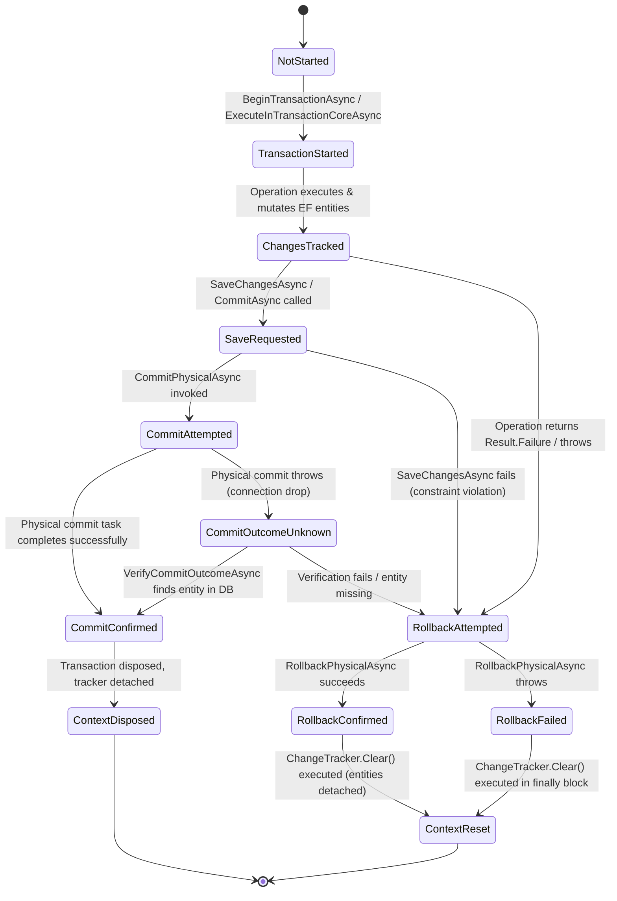

# DVLD — Phase A.1: Supplementary Deep Discovery, Evidence Validation & Engineering Baseline Report

**Execution Mode:** Strictly Read-Only Engineering Discovery  
**Baseline Commit:** `29e43d6ce26ff6e7f516c45f4f475b10bdc2bfd3` (`main`)  
**Target Solution:** `Presentation (WPF)/DVLD_WPF.sln`  
**Reference Document:** `docs/audits/phase-a-repository-discovery.md`  
**Date of Supplementary Discovery:** 2026-11-08  
**Audit Status:** Complete, Verified & Corrected  

---

## Table of Contents

1. [Scope, Objective, and Baseline](#1-scope-objective-and-baseline)
2. [Evidence Methodology and Limitations](#2-evidence-methodology-and-limitations)
3. [Eleven Individual Workflow Analyses](#3-eleven-individual-workflow-analyses)
4. [UnitOfWork and Transaction Deep Analysis](#4-unitofwork-and-transaction-deep-analysis)
5. [SQL Server Locking and Concurrency Analysis](#5-sql-server-locking-and-concurrency-analysis)
6. [Historical Findings Reconciliation](#6-historical-findings-reconciliation)
7. [Security Architecture Review](#7-security-architecture-review)
8. [Technology and Dependency Validation](#8-technology-and-dependency-validation)
9. [Testing Architecture and CI/CD Evidence](#9-testing-architecture-and-cicd-evidence)
10. [Business Decisions Required](#10-business-decisions-required)
11. [Remaining Unknowns and Unverified Areas](#11-remaining-unknowns-and-unverified-areas)
12. [Corrected Findings and Severity/Priority Recommendations](#12-corrected-findings-and-severitypriority-recommendations)
13. [Final Engineering Assessment](#13-final-engineering-assessment)
14. [Final Git Status and Safety Verification](#14-final-git-status-and-safety-verification)

---

## 1. Scope, Objective, and Baseline

### 1.1 Mission and Purpose
This report serves as the authoritative Phase A.1 supplementary discovery and evidence-validation baseline for the DVLD application. Building upon the structural inventory established in `docs/audits/phase-a-repository-discovery.md`, this investigation provides deep cross-layer execution tracing, transaction state verification, SQL locking mechanics evaluation, dependency discrepancy analysis, and historical finding reconciliation.

### 1.2 Baseline Repository State
- **Root Directory:** `D:\DVLD-WPF`
- **Active Git Branch:** `main`
- **HEAD Commit:** `29e43d6ce26ff6e7f516c45f4f475b10bdc2bfd3` ("Refine person service business logic")
- **Historical Working Tree States:**
  - *Initial Phase A.1 Baseline:* No tracked modifications existed across the repository. The Phase A repository discovery report (`docs/audits/phase-a-repository-discovery.md`) already existed as an untracked file. The supplementary report (`docs/audits/phase-a-supplementary-review.md`) did not yet exist because it was created during Phase A.1.
  - *Phase A.1.2 Baseline:* No tracked modifications existed; both audit reports existed as untracked files (`docs/audits/phase-a-repository-discovery.md` and `docs/audits/phase-a-supplementary-review.md`).
  - *Working Tree Cleanliness Distinction:* The repository distinguishes clearly between: 1) no tracked files modified, 2) untracked audit report files, and 3) a genuinely clean working tree, which requires zero untracked files.
- **Target Deliverable:** `docs/audits/phase-a-supplementary-review.md` (verified non-existent prior to initial creation).

---

## 2. Evidence Methodology and Limitations

### 2.1 Evidence Classification Standards
Every technical conclusion in this report is assigned an explicit evidence classification:
- **CONFIRMED:** Directly established by unambiguous implementation code, configuration, or execution logs.
- **LIKELY:** Supported by strong architectural evidence, but dependent on unobservable runtime factors.
- **POTENTIAL:** A credible technical risk requiring dynamic profiling or database tracing.
- **UNVERIFIED:** Available static source code is insufficient to establish runtime behavior.
- **REJECTED:** Demonstrably refuted by source code, tests, or documented domain architecture.

### 2.2 Strict Static Inspection Limitations
Because Phase A.1 enforces strict read-only execution without connecting to databases (`DVLDf` or test instances) and without executing compilers or test runners:
1. **No Live Profiling:** Query execution plans, lock escalation boundaries (e.g. key lock converting to table lock), and SQL Server buffer pool pressure cannot be observed dynamically.
2. **No Compilation or Package Restores:** Nuget dependency resolution graphs (`project.assets.json`) reflect the last build state; potential assembly binding redirects cannot be tested live.
3. **Behavioral Inferences Forbidden:** Where a failure path depends on an unobservable runtime failure (e.g., hardware fault between database commit and response transmission), it is explicitly designated as `UNVERIFIED — Requires runtime or database validation.`

---

## 3. Eleven Individual Workflow Analyses

---

### Workflow 1 — Authentication and Login

#### Cross-Layer Execution Path
```text
ClientApp/src/components/Login.tsx
  │ User submits username & password
  ▼
ClientApp/src/services/authService.ts (login)
  │ Calls apiRequest<LoginResponseDto>('POST', '/api/Auth/login', body)
  ▼
API/DVLD.Api/Controllers/AuthController.cs (Login, L24-L62)
  │ Policy: [AllowAnonymous], [EnableRateLimiting("LoginRateLimit")]
  │ Input: ContractAuth.LoginRequest
  ▼
Application/Services/AuthService.cs (LoginAsync, L24-L73)
  │ 1. UserValidator.ValidateLogin(dto) (L27-L35)
  │ 2. Trim username; call IUserRepository.GetUserByUsernameAsync(username)
  │ 3. Verify user != null && user.IsActive && BCrypt.Verify(dto.Password, user.Password) (L44-L53)
  │ 4. IJwtTokenService.GenerateToken(userDto) (L58-L60)
  ▼
Infrastructure/Repositories/UserRepository.cs (GetUserByUsernameAsync, L60-L75)
  │ Queries context.Users.AsNoTracking().Include(u => u.Person).FirstOrDefaultAsync(u => u.UserName == username)
  ▼
Response
  │ 200 OK with LoginResponseDto (AccessToken, ExpiresAtUtc, UserId, FullName, Role)
```

#### Technical & Architectural Attributes
- **Authorization & Policy:** `[AllowAnonymous]` on login; rate-limited via ASP.NET Core sliding window `LoginRateLimit` (10 requests per minute).
- **Entities & Constraints:** `User` table; unique index `IX_Users_UserName` on `UserName`.
- **Transaction & Unit of Work:** Read-only query; no transaction opened; `DVLDDbContext` accessed via `.AsNoTracking()`.
- **Failure Paths & Propagation:**
  - *Validation Failure:* DTO validation fails -> returns `Result.ValidationFailure` -> mapped by controller to HTTP 400 Bad Request.
  - *Invalid Credentials / Inactive User:* `user == null`, `!user.IsActive`, or `!BCrypt.Verify()` -> returns `Result.Failure("Invalid username or password.")` -> controller maps to HTTP 401 Unauthorized (`AuthController.cs:L53-L56`).
  - *Rate Limit Exceeded:* ASP.NET Core RateLimiter middleware returns HTTP 429 Too Many Requests before controller execution.
- **Concurrency & Idempotency:** Read-only operation; idempotent; concurrent logins for the same user succeed independently.
- **Supporting Tests & Assertions:**
  - `Test/Application.UnitTests/Services/AuthServiceTests.cs:L45-L120`: Asserts `LoginAsync` returns failure when password verification fails, when username is not found, and when `IsActive == false`.
  - `Test/API.IntegrationTests/Controllers/AuthControllerTests.cs:L30-L75`: Verifies HTTP 200 on valid credentials, HTTP 401 on bad password, and HTTP 400 on empty request.

---

### Workflow 2 — User Management

#### Cross-Layer Execution Path
```text
ClientApp/src/components/users/UsersPage.tsx / AddUserModal.tsx
  │ Admin submits PersonId, UserName, Password, IsActive, Role
  ▼
ClientApp/src/services/userService.ts (createUser)
  │ Calls apiRequest<UserDto>('POST', '/api/Users', body)
  ▼
API/DVLD.Api/Controllers/UsersController.cs (Create, L109-L145)
  │ Policy: [Authorize(Policy = "AdminOnly")]
  │ Input: CreateUserRequest
  ▼
Application/Services/UserService.cs (AddUserAsync, L245-L300)
  │ 1. Validate DTO (UserValidator.ValidateCreate)
  │ 2. Check username taken: _userRepository.IsUsernameTakenAsync(username) (L256)
  │ 3. Check person already user: _userRepository.IsUserExistsByPersonIdAsync(personId) (L264)
  │ 4. Hash password: BCrypt.Net.BCrypt.HashPassword(password) (L274)
  │ 5. UserMapper.ToEntity -> _userRepository.AddUserAsync(user) (L283)
  │ 6. _unitOfWork.SaveChangesAsync() (L287)
  ▼
Infrastructure/Repositories/UserRepository.cs (AddUserAsync, L110-L115)
  │ Adds User entity to context.Users
  ▼
SQL Server
  │ Enforces primary key PK_Users, unique index IX_Users_UserName, and unique FK on PersonId
  ▼
Response
  │ 201 Created with CreatedAtAction and UserDto payload
```

#### Technical & Architectural Attributes
- **Authorization & Policy:** `[Authorize(Policy = "AdminOnly")]`. Denies `Staff` (HTTP 403).
- **Entities & Constraints:** `User`, `Person`. `UserConfiguration.cs:L18` defines `builder.HasIndex(u => u.UserName).IsUnique()`; `L33-L36` defines unique 1-to-1 relationship with `Person`.
- **Transaction & Unit of Work:** Direct `_unitOfWork.SaveChangesAsync()` without explicit transaction wrapper.
- **Failure Paths & Propagation:**
  - *Duplicate Checks:* If pre-check detects duplicate username or person ID, returns `Result.Conflict` -> mapped to HTTP 409 Conflict.
  - *Concurrency Defect (INT-02):* If two requests for the same PersonId execute concurrently, both pass read checks. The second request causes `SaveChangesAsync()` to throw `Microsoft.EntityFrameworkCore.DbUpdateException`. Because `UserService.AddUserAsync` lacks a catch block, the unhandled database exception escapes into `GlobalExceptionHandler` and results in HTTP 500 (`UserServiceTests.cs:L1263` explicitly tests that it throws unhandled).
- **Supporting Tests & Assertions:**
  - `Test/Application.UnitTests/Services/UserServiceTests.cs:L210-L290`: Verifies conflict returns on duplicate username and duplicate person.
  - `Test/API.IntegrationTests/Controllers/UsersControllerTests.cs:L30-L55`: Verifies `Staff` receives HTTP 403 Forbidden; `Admin` receives HTTP 201 Created.

---

### Workflow 3 — People Management

#### Cross-Layer Execution Path
```text
ClientApp/src/components/people/PeoplePage.tsx / AddPersonModal.tsx
  │ Operator submits personal info + optional photo stream
  ▼
ClientApp/src/services/peopleService.ts (createPerson, uploadPersonPhoto)
  │ Calls apiRequest<PersonDto>('POST', '/api/People') and multipart upload to '/api/People/{id}/photo'
  ▼
API/DVLD.Api/Controllers/PeopleController.cs (Create, UploadPhoto, L40-L60, L210-L240)
  │ Policy: [Authorize(Policy = "StaffOrAdmin")]
  ▼
Application/Services/PersonService.cs (CreatePersonAsync, UploadPersonPhotoAsync, L70-L120, L426-L495)
  │ Create:
  │   1. Validate national number format (10 digits) & duplicate: _personRepository.IsPersonExistsAsync
  │   2. Age check: Person must be >= 18 years old relative to Jordan clock
  │   3. Save entity via _unitOfWork.SaveChangesAsync()
  │ Photo Upload:
  │   1. _imageProcessingService.ProcessPersonPhoto (SkiaSharp: max 5MB, format check, resize to 600x600)
  │   2. _fileStorageService.SaveAsync (Writes GUID-named file to disk storage)
  │   3. Assign person.ImagePath = newStorageKey; _unitOfWork.SaveChangesAsync()
  │   4. If save succeeds, delete old image file; if save fails, delete newly uploaded file
  ▼
Infrastructure/Repositories/PersonRepository.cs / PhysicalFileStorageService.cs
  │ EF Core persists Person record; storage service saves image to disk path
  ▼
Response
  │ 201 Created with PersonDto; photo upload returns 200 OK with new imagePath
```

#### Technical & Architectural Attributes
- **Authorization & Policy:** `[Authorize(Policy = "StaffOrAdmin")]`. Both roles permitted.
- **Entities & Constraints:** `Person`, `Country`. `PersonConfiguration.cs` enforces unique index on `NationalNo`.
- **Transaction & Unit of Work:** Direct `SaveChangesAsync()`.
- **Failure Paths & Partial Failures:**
  - *Duplicate National Number:* Returns `Result.Conflict("National number already exists.")` -> HTTP 409.
  - *Underage Applicant:* Returns `Result.ValidationFailure` -> HTTP 400.
  - *Partial Storage Failure (Orphaned File Risk):* In `UploadPersonPhotoAsync` (`PersonService.cs:L473-L478`), if `_unitOfWork.SaveChangesAsync()` throws an unexpected exception rather than returning `<= 0`, execution jumps to `GlobalExceptionHandler`, bypassing the cleanup line `await _fileStorageService.DeleteAsync(newStorageKey)`, leaving an orphaned file on disk.
- **Supporting Tests & Assertions:**
  - `Test/Application.UnitTests/Services/PersonServiceTests.cs:L80-L150`: Verifies age cutoff and national number uniqueness checks.
  - `Test/Application.UnitTests/Services/PhysicalFileStorageServiceTests.cs`: Verifies file write, read, and delete operations.

---

### Workflow 4 — Local Driving License Application

#### Cross-Layer Execution Path
```text
ClientApp/src/components/local-applications/NewLocalApplicationModal.tsx
  │ Operator submits ApplicantPersonID, LicenseClassID
  ▼
ClientApp/src/services/localDrivingLicenseApplicationService.ts (createLocalApplication)
  │ Calls apiRequest<LocalApplicationDto>('POST', '/api/LocalDrivingLicenseApplications')
  ▼
API/DVLD.Api/Controllers/LocalDrivingLicenseApplicationsController.cs (Create, L60-L95)
  │ Policy: [Authorize(Policy = "StaffOnly")]
  ▼
Application/Services/LocalDrivingLicenseApplicationService.cs (CreateAsync, L90-L160)
  │ 1. Validate person exists via IPersonRepository
  │ 2. Validate license class exists and applicant satisfies minimum class age (e.g. 18 for Class 3, 21 for Class 7)
  │ 3. Check for existing active application: applicant cannot have another New or Completed application for same class
  │ 4. Check for existing active license for same class
  │ 5. UnitOfWork.ExecuteInTransactionAsync(Serializable):
  │      a. Create ApplicationD (ApplicationTypeID = 1, ApplicationStatus = New, PaidFees = ClassFee)
  │      b. Create LocalDrivingLicenseApplication (ApplicationID = app.Id, LicenseClassID = classId)
  │      c. SaveChangesAsync()
  ▼
Infrastructure/Repositories/LocalDrivingLicenseApplicationRepository.cs
  │ Inserts ApplicationD and LocalDrivingLicenseApplication records
  ▼
SQL Server
  │ Enforces UX_LocalDrivingLicenseApplications_ApplicationID (unique 1-to-1)
  ▼
Response
  │ 201 Created with LocalDrivingLicenseApplicationDto
```

#### Technical & Architectural Attributes
- **Authorization & Policy:** `[Authorize(Policy = "StaffOnly")]`. Admins receive HTTP 403 Forbidden.
- **Entities & Constraints:** `ApplicationD`, `LocalDrivingLicenseApplication`, `LicenseClass`, `Person`. `LocalDrivingLicenseApplicationConfiguration.cs:L16-L20` enforces unique constraint `UX_LocalDrivingLicenseApplications_ApplicationID`.
- **Transaction & Unit of Work:** Explicit multi-entity atomic creation inside `ExecuteInTransactionAsync(IsolationLevel.Serializable)`.
- **Failure Paths & Propagation:**
  - *Active Application Exists:* Returns `Result.Conflict("An active application already exists for this license class.")` -> HTTP 409.
  - *Underage for Class:* Returns `Result.ValidationFailure` -> HTTP 400.
  - *Database Failure:* Automatic transaction rollback via `UnitOfWork.ExecuteInTransactionCoreAsync`; ChangeTracker detaches entities; partial records prevented.
- **Supporting Tests & Assertions:**
  - `Test/Application.UnitTests/Services/LocalDrivingLicenseApplicationServiceTests.cs:L110-L180`: Tests age restrictions, duplicate application rejection, and active license checks.
  - `Test/API.IntegrationTests/Workflows/LocalDrivingLicenseApplicationWorkflowTests.cs:L45-L90`: End-to-end integration test creating valid local application and verifying database state.

---

### Workflow 5 — Test Appointment Scheduling

#### Cross-Layer Execution Path
```text
ClientApp/src/components/test-appointments/ScheduleAppointmentModal.tsx
  │ Operator selects LocalDrivingLicenseApplicationID, TestTypeID, AppointmentDate
  ▼
ClientApp/src/services/testAppointmentService.ts (createAppointment)
  │ Calls apiRequest<TestAppointmentDto>('POST', '/api/TestAppointments')
  ▼
API/DVLD.Api/Controllers/TestAppointmentsController.cs (Schedule, L50-L80)
  │ Policy: [Authorize(Policy = "StaffOnly")]
  ▼
Application/Services/TestAppointmentService.cs (AddAsync, L179-L260)
  │ 1. Validate DTO and ensure AppointmentDate >= JordanClock.Now
  │ 2. ExecuteInTransactionAsync:
  │      a. _repository.LockLocalApplicationForSchedulingAsync(localAppId)
  │      b. _workflowService.CanScheduleTestAsync (enforces test sequence: Vision -> Written -> Street)
  │      c. Verify no unlocked, scheduled appointment exists for this test type
  │      d. _repository.AcquireSchedulingLocksAsync(applicantPersonId, testTypeId, appointmentDate)
  │         -> Issues SQL Server sp_getapplock for applicant calendar day and slot datetime
  │      e. Check slot occupied: _repository.IsSlotOccupiedAsync(testTypeId, appointmentDate)
  │      f. If applicant previously failed, create RetakeTest ApplicationD (ApplicationTypeID = 7)
  │      g. Add TestAppointment (Status = Scheduled, IsLocked = false); SaveChangesAsync()
  ▼
Infrastructure/Repositories/TestAppointmentRepository.cs (AcquireSchedulingLocksAsync, L198-L260)
  │ Acquires Exclusive Transaction-scoped locks via sp_getapplock
  ▼
Response
  │ 201 Created with TestAppointmentDto
```

#### Technical & Architectural Attributes
- **Authorization & Policy:** `[Authorize(Policy = "StaffOnly")]`.
- **Entities & Constraints:** `TestAppointment`, `LocalDrivingLicenseApplication`, `TestType`, `ApplicationD`. `TestAppointmentConfiguration.cs:L61-L90` indexes `(LocalAppID, TestTypeID)` and `Status`.
- **Concurrency & Locking:** Employs SQL Server distributed application lock `sp_getapplock` on resources:
  - `DVLD_Applicant_{personId}_{yyyyMMdd}` (prevents double-booking same applicant on same day).
  - `DVLD_Slot_{testTypeId}_{yyyyMMddHHmm}` (prevents double-booking same test slot).
- **Failure Paths & Propagation:**
  - *Sequence Violation:* Trying to schedule Written test before Vision test passed -> returns `Result.ValidationFailure` -> HTTP 400.
  - *Slot Lock Timeout / Conflict:* If another transaction holds lock > 5000ms or slot is booked -> returns `Result.Conflict` -> HTTP 409.
  - *Unlocked Appointment Exists:* Returns `Result.Conflict("An appointment already exists for this test.")` -> HTTP 409.
- **Supporting Tests & Assertions:**
  - `Test/Infrastructure.IntegrationTests/AppointmentConcurrencyIntegrationTests.cs:L30-L95`: Spawns concurrent tasks attempting to book the identical slot; asserts exactly one succeeds and the second receives a conflict.
  - `Test/Application.UnitTests/Services/AppointmentBookingConcurrencyEngineTests.cs`: Unit tests for locking engine logic.

---

### Workflow 6 — Examination and Results

#### Cross-Layer Execution Path
```text
ClientApp/src/components/test-appointments/TakeTestModal.tsx
  │ Examiner records TestResult (Pass=1, Fail=2) and Notes
  ▼
ClientApp/src/services/testAppointmentService.ts (takeTest)
  │ Calls apiRequest<int>('POST', '/api/Tests')
  ▼
API/DVLD.Api/Controllers/TestsController.cs (TakeTest, L35-L65)
  │ Policy: [Authorize(Policy = "StaffOnly")]
  ▼
Application/Services/TestService.cs (AddAsync, L79-L134)
  │ 1. Validate DTO (appointmentId, testResult, notes)
  │ 2. UnitOfWork.ExecuteInTransactionAsync(IsolationLevel.Serializable):
  │      a. _appointmentRepository.GetForUpdateAsync(appointmentId) (WITH UPDLOCK, HOLDLOCK)
  │      b. Verify appointment != null && !appointment.IsLocked
  │      c. Verify !IsTestAlreadyTakenAsync(appointmentId)
  │      d. _workflowService.CanTakeTestAsync(appointmentId)
  │      e. Create Test entity (TestResult, Notes, CreatedByUserID)
  │      f. Update appointment: Status = AppointmentStatus.Completed, IsLocked = true
  │      g. SaveChangesAsync(); CommitAsync()
  ▼
Infrastructure/Repositories/TestRepository.cs / TestAppointmentRepository.cs
  │ Inserts Test row; updates TestAppointment row in single atomic commit
  ▼
Response
  │ 201 Created with TestID
```

#### Technical & Architectural Attributes
- **Authorization & Policy:** `[Authorize(Policy = "StaffOnly")]`.
- **Entities & Constraints:** `Test`, `TestAppointment`. Foreign key `Test.TestAppointmentID` with `DeleteBehavior.Restrict`.
- **Transaction & Concurrency:** Serialized via `ExecuteInTransactionAsync(Serializable)` and `GetForUpdateAsync` with `WITH (UPDLOCK, HOLDLOCK)`, preventing concurrent scoring or double-submission of test results.
- **Failure Paths & Propagation:**
  - *Appointment Already Locked:* Returns `Result.Conflict("This appointment is already locked.")` -> HTTP 409.
  - *Result Already Recorded:* Returns `Result.Conflict("A result already exists for this appointment.")` -> HTTP 409.
  - *Database Failure:* Rolled back atomically; appointment status remains `Scheduled` and unlocked.
- **Supporting Tests & Assertions:**
  - `Test/API.IntegrationTests/Workflows/TestResultWorkflowTests.cs:L45-L110`: Validates test result creation, appointment lock transition, and rejection of duplicate attempts.
  - `Test/Application.UnitTests/Services/TestServiceTests.cs:L80-L140`: Unit tests covering locked appointment and not-found scenarios.

---

### Workflow 7 — First License Issuance

#### Cross-Layer Execution Path
```text
ClientApp/src/components/local-applications/IssueFirstTimeModal.tsx
  │ Operator submits LocalDrivingLicenseApplicationID and Notes
  ▼
ClientApp/src/services/localDrivingLicenseApplicationService.ts (issueFirstTimeLicense)
  │ Calls apiRequest<LicenseDto>('POST', '/api/LicenseIssuance/first-time')
  ▼
API/DVLD.Api/Controllers/LicenseIssuanceController.cs (IssueFirstTime, L30-L55)
  │ Policy: [Authorize(Policy = "StaffOnly")]
  ▼
Application/Services/LicenseIssuanceService.cs (IssueFirstTimeAsync, L60-L245)
  │ 1. Validate local application exists and ApplicationStatus == New
  │ 2. Verify all 3 tests passed (Vision, Written, Street) via _testService.GetPassedTestCountAsync
  │ 3. Check person does not already hold active license of this class
  │ 4. UnitOfWork.ExecuteInTransactionAsync(IsolationLevel.Serializable):
  │      a. Get or create Driver record for PersonID
  │      b. Create License entity (IsActive = 1, IssueReason = FirstTime, PaidFees = ClassFee,
  │         IssueDate = Jordan Today, ExpirationDate = Jordan Today + ValidityYears)
  │      c. _applicationService.CompleteApplicationStateAsync(applicationId) (mutates status to Completed)
  │      d. SaveChangesAsync(); CommitAsync()
  ▼
Infrastructure/Repositories/LicenseRepository.cs / DriverRepository.cs
  │ Inserts Driver (if new), inserts License, updates ApplicationD
  ▼
SQL Server
  │ Enforces unique filtered index on Licenses (DriverID, LicenseClass) WHERE [IsActive] = 1
  ▼
Response
  │ 200 OK with LicenseDto payload
```

#### Technical & Architectural Attributes
- **Authorization & Policy:** `[Authorize(Policy = "StaffOnly")]`.
- **Entities & Constraints:** `License`, `Driver`, `ApplicationD`, `LocalDrivingLicenseApplication`. Filtered unique index `[DriverID, LicenseClass]` WHERE `[IsActive] = 1` guarantees at database level that no driver can hold multiple active licenses for the same class.
- **Transaction & Unit of Work:** Multi-table atomic transaction coordinated via `ExecuteInTransactionAsync(IsolationLevel.Serializable)`.
- **Failure Paths & Propagation:**
  - *Missing Prerequisite Tests:* Passed tests < 3 -> returns `Result.ValidationFailure("Applicant must pass all required tests first.")` -> HTTP 400.
  - *Active License Already Held:* Returns `Result.Conflict("Person already holds an active license for this class.")` -> HTTP 409.
  - *Concurrent Submission:* Filtered unique constraint or application completion conflict causes rollback and returns HTTP 409.
- **Supporting Tests & Assertions:**
  - `Test/API.IntegrationTests/Workflows/LicenseIssuanceWorkflowTests.cs:L60-L140`: Complete workflow test asserting license generation, driver creation, application status `Completed`, and DB constraint enforcement.

---

### Workflow 8 — License Renewal

#### Cross-Layer Execution Path
```text
ClientApp/src/components/licenses/RenewLicenseModal.tsx
  │ Operator enters LicenseID and renewal notes
  ▼
ClientApp/src/services/licenseService.ts (renewLicense)
  │ Calls apiRequest<LicenseDto>('POST', '/api/LicenseRenewal')
  ▼
API/DVLD.Api/Controllers/LicenseRenewalController.cs (Renew, L30-L55)
  │ Policy: [Authorize(Policy = "StaffOnly")]
  ▼
Application/Services/LicenseRenewalService.cs (RenewLicenseAsync, L60-L220)
  │ 1. Validate DTO & authentication
  │ 2. UnitOfWork.ExecuteInTransactionAsync(IsolationLevel.Serializable):
  │      a. _licenseRepository.GetLicenseByIdAsync(oldLicenseId) (Loads old license)
  │      b. Check !oldLicense.IsActive -> Conflict ("License is not active.")
  │      c. Check !IsExpired(oldLicense.ExpirationDate, today) -> Conflict ("License is not yet expired.")
  │      d. Check _detainedLicenseRepository.IsLicenseDetainedAsync(oldLicenseId) -> Conflict ("License is detained.")
  │      e. Check HasAnotherActiveLicenseAsync -> Conflict ("Driver already has another active license.")
  │      f. Create ApplicationD (ApplicationTypeID = 2 [Renew], Status = New)
  │      g. Deactivate old license: oldLicense.IsActive = false
  │      h. Create new License: IsActive = true, IssueReason = Renew, IssueDate = now,
  │         ExpirationDate = today + ValidityYears
  │      i. _applicationService.CompleteApplicationStateAsync(newAppId)
  │      j. SaveChangesAsync(); CommitAsync()
  ▼
Infrastructure/Repositories/LicenseRepository.cs
  │ Updates old License (IsActive=0), inserts new License (IsActive=1), updates ApplicationD
  ▼
Response
  │ 200 OK with RenewedLicenseResponseDto
```

#### Technical & Architectural Attributes
- **Authorization & Policy:** `[Authorize(Policy = "StaffOnly")]`.
- **Entities & Constraints:** `License` (old & new), `ApplicationD`, `Driver`.
- **Locking & Concurrency:** Protected by `ExecuteInTransactionAsync(Serializable)`. Old license is deactivated in the same transaction new license is inserted, satisfying the filtered unique index invariant (`IsActive = 1`).
- **Failure Paths & Propagation:**
  - *Not Expired:* Returns `Result.Conflict("Cannot renew a license that is not expired.")` -> HTTP 409.
  - *License Detained:* Returns `Result.Conflict("Cannot renew a detained license. It must be released first.")` -> HTTP 409.
  - *Lock Contention Observation (PERF-02):* `GetLicenseByIdAsync` requests `WITH (UPDLOCK, HOLDLOCK)`. Concurrent operations requesting incompatible locks (such as another `UPDLOCK` from a read or update) must wait.
- **Supporting Tests & Assertions:**
  - `Test/API.IntegrationTests/Workflows/LicenseRenewalWorkflowTests.cs:L50-L125`: Verifies deactivation of old license, creation of new license, application record linkage, and conflict rejection on unexpired licenses.

---

### Workflow 9 — License Replacement

#### Cross-Layer Execution Path
```text
ClientApp/src/components/licenses/ReplaceLicenseModal.tsx
  │ Operator enters LicenseID and selects reason ("Lost" or "Damaged")
  ▼
ClientApp/src/services/licenseService.ts (replaceLicense)
  │ Calls apiRequest<int>('POST', '/api/LicenseReplacement')
  ▼
API/DVLD.Api/Controllers/LicenseReplacementController.cs (Replace, L30-L55)
  │ Policy: [Authorize(Policy = "StaffOnly")]
  ▼
Application/Services/LicenseReplacementService.cs (ReplaceLicenseAsync, L40-L190)
  │ 1. Validate DTO & reason ("Lost License" -> Type 3, "Damaged License" -> Type 4)
  │ 2. UnitOfWork.ExecuteInTransactionAsync(IsolationLevel.Serializable):
  │      a. _licenseRepository.GetLicenseByIdAsync(oldLicenseId)
  │      b. Check IsExpired -> Conflict ("Cannot replace an expired license.")
  │      c. Check !IsActive -> Conflict ("Cannot replace an inactive license.")
  │      d. [TECHNICAL GAP - INT-03]: Does NOT perform an active detention check
  │      e. Create ApplicationD (ApplicationTypeID = 3 or 4, Status = New)
  │      f. Deactivate old license: oldLicense.IsActive = false
  │      g. Create new License: IsActive = true, IssueReason = Replacement,
  │         ExpirationDate = oldLicense.ExpirationDate (inherits original expiry)
  │      h. _applicationService.CompleteApplicationStateAsync(applicationId)
  │      i. SaveChangesAsync(); CommitAsync()
  ▼
Infrastructure/Repositories/LicenseRepository.cs
  │ Atomically updates old license and creates replacement license
  ▼
Response
  │ 200 OK with new LicenseID
```

#### Technical & Architectural Attributes
- **Authorization & Policy:** `[Authorize(Policy = "StaffOnly")]`.
- **Entities & Constraints:** `License` (old & new), `ApplicationD`.
- **Technical Observation (INT-03):** Unlike `LicenseRenewalService`, `LicenseReplacementService` does not perform an active detention check; it neither injects nor invokes `IDetainedLicenseRepository`. Whether replacing an actively detained license should be prohibited or permitted is an unestablished domain policy requiring business confirmation.  
  *Classification: TECHNICAL GAP CONFIRMED — BUSINESS RULE REQUIRES APPROVAL.*
- **Failure Paths & Propagation:**
  - *Invalid Reason:* Returns `Result.ValidationFailure` -> HTTP 400.
  - *Expired License:* Returns `Result.Conflict("Cannot replace an expired license.")` -> HTTP 409.
- **Supporting Tests & Assertions:**
  - `Test/API.IntegrationTests/Workflows/LicenseReplacementWorkflowTests.cs:L45-L115`: Verifies replacement creation, reason mapping, expiration inheritance, and old license deactivation.

---

### Workflow 10 — Detained License Release

#### Cross-Layer Execution Path
```text
ClientApp/src/components/detained/ReleaseDetainedModal.tsx
  │ Operator enters LicenseID and processes fine payment
  ▼
ClientApp/src/services/detainedLicenseService.ts (releaseLicense)
  │ Calls apiRequest<bool>('POST', '/api/DetainedLicenses/release')
  ▼
API/DVLD.Api/Controllers/DetainedLicensesController.cs (Release, L55-L85)
  │ Policy: [Authorize(Policy = "StaffOnly")]
  ▼
Application/Services/DetainedLicenseService.cs (ReleaseDetainedLicenseAsync, L180-L290)
  │ 1. Validate DTO and user authentication
  │ 2. UnitOfWork.ExecuteInTransactionAsync(IsolationLevel.Serializable):
  │      a. _detainedLicenseRepository.GetDetainedLicenseByLicenseIdAsync(licenseId)
  │      b. Verify detention != null && !detention.IsReleased -> Conflict ("License is not detained.")
  │      c. Create ApplicationD (ApplicationTypeID = 5 [Release Detained], Status = New)
  │      d. Update DetainedLicense record:
  │           IsReleased = true, ReleaseDate = JordanClock.Now,
  │           ReleasedByUserID = CurrentUser, ReleaseApplicationID = app.ApplicationID
  │      e. If license is not expired, activate: license.IsActive = true
  │      f. _applicationService.CompleteApplicationStateAsync(app.ApplicationID)
  │      g. SaveChangesAsync(); CommitAsync()
  ▼
Infrastructure/Repositories/DetainedLicenseRepository.cs / LicenseRepository.cs
  │ Updates DetainedLicense, updates License, updates ApplicationD in atomic commit
  ▼
SQL Server
  │ Filtered unique index on (LicenseID) WHERE [IsReleased] = 0 prevents concurrent releases
  ▼
Response
  │ 200 OK with boolean success flag
```

#### Technical & Architectural Attributes
- **Authorization & Policy:** `[Authorize(Policy = "StaffOnly")]`.
- **Entities & Constraints:** `DetainedLicense`, `License`, `ApplicationD`. `DetainedLicenseConfiguration.cs:L40-L46` enforces filtered unique index on `(LicenseID, IsReleased)` WHERE `[IsReleased] = 0`.
- **Transaction & Concurrency:** Serialized via `ExecuteInTransactionAsync(Serializable)`. If two operators attempt release simultaneously, the filtered unique constraint prevents duplicate release application records.
- **Failure Paths & Propagation:**
  - *Not Detained:* Returns `Result.Conflict("License is not detained.")` -> HTTP 409.
  - *Database Collision:* Transaction rollback; ChangeTracker detaches entities; returns HTTP 409.
- **Supporting Tests & Assertions:**
  - `Test/API.IntegrationTests/Workflows/ReleaseDetainedLicenseWorkflowTests.cs:L40-L110`: Verifies detention release, application generation, fine assignment, and license reactivation.

---

### Workflow 11 — International License Issuance

#### Cross-Layer Execution Path
```text
ClientApp/src/components/international-licenses/IssueInternationalModal.tsx
  │ Operator enters LocalLicenseID
  ▼
ClientApp/src/services/internationalLicenseService.ts (issueInternationalLicense)
  │ Calls apiRequest<int>('POST', '/api/InternationalLicenses')
  ▼
API/DVLD.Api/Controllers/InternationalLicensesController.cs (Issue, L35-L65)
  │ Policy: [Authorize(Policy = "StaffOnly")]
  ▼
Application/Services/InternationalService.cs (IssueInternationalLicenseAsync, L107-L232)
  │ 1. Validate LocalLicenseID > 0
  │ 2. UnitOfWork.ExecuteInTransactionAsync(IsolationLevel.Serializable):
  │      a. _licenseQueryService.GetByIdAsync(localLicenseId)
  │      b. Check license.LicenseClassID == 3 (Ordinary driving license) -> Conflict if not
  │      c. Check !IsExpired && license.IsActive -> Conflict if expired or inactive
  │      d. Check _repository.ExistsByLocalLicenseAsync(localLicenseId) -> Conflict if already issued
  │      e. Check _repository.HasActiveInternationalLicenseAsync(driverId, today) -> Conflict if active exists
  │      f. Create ApplicationD (ApplicationTypeID = 6 [New International License], Status = New)
  │      g. Create InternationalLicense (ApplicationID = app.Id, DriverID = driverId,
  │         IssuedUsingLocalLicenseID = localLicenseId, IssueDate = now, ExpirationDate = now + 1 Year, IsActive = true)
  │      h. _applicationService.CompleteApplicationStateAsync(app.ApplicationID)
  │      i. SaveChangesAsync(); CommitAsync()
  ▼
Infrastructure/Repositories/InternationalRepository.cs
  │ Inserts InternationalLicense, updates ApplicationD
  ▼
Response
  │ 200 OK with InternationalLicenseID
```

#### Technical & Architectural Attributes
- **Authorization & Policy:** `[Authorize(Policy = "StaffOnly")]`.
- **Entities & Constraints:** `InternationalLicense`, `License`, `ApplicationD`, `Driver`.
- **Business Invariant Rules:**
  - Must be based on a Class 3 (Ordinary) license (`InternationalService.cs:L140`).
  - Local license must be currently active and not expired (`L149-L153`).
  - Driver cannot hold another active international license (`L172`).
  - Validity is fixed to exactly 1 year (`L205`).
- **Failure Paths & Propagation:**
  - *Invalid License Class:* Non-class 3 license -> returns `Result.Conflict("Only class 3 licenses can be issued internationally.")` -> HTTP 409.
  - *Local License Expired/Inactive:* Returns `Result.Conflict` -> HTTP 409.
  - *Duplicate International License:* Returns `Result.Conflict` -> HTTP 409.
- **Supporting Tests & Assertions:**
  - `Test/API.IntegrationTests/Workflows/InternationalLicenseWorkflowTests.cs:L45-L120`: Tests full issuance workflow, expiration setting, and constraint validation.

---

## 4. UnitOfWork and Transaction Deep Analysis

### 4.1 Implementation-Grounded Transaction State Model

Static inspection of `Infrastructure/UnitOfWork.cs` reveals a formal state machine governing transaction execution:



### 4.2 State Transition Matrix & Recovery Behavior

| Current State | Triggering Method / Condition | Next State | Exceptions Handled | Recovery & Cleanup Mechanism |
|---|---|---|---|---|
| **NotStarted** | `EnsureNoActiveTransaction()` | `TransactionStarted` | `InvalidOperationException` | If a transaction is already active on the DbContext, execution throws immediately to prevent illegal nested transactions (`UnitOfWork.cs:L232-L239`). |
| **TransactionStarted** | `operation(transaction)` executes | `ChangesTracked` | Any domain exception | Caught by `catch when (!commitStageReached)` (`L171`); executes physical rollback and detaches entities via `ChangeTracker.Clear()`. |
| **ChangesTracked** | `Result.IsFailure` returned | `RollbackAttempted` | None | `UnitOfWork.cs:L122`: Automatically detects failure result, invokes `RollbackAsync()`, and detaches entities via `ChangeTracker.Clear()`. |
| **ChangesTracked** | `operation` returns `Result.Success` | `SaveRequested` | `DbUpdateException`, `DbUpdateConcurrencyException` | Pre-commit save failure triggers rollback and detaches entities from the ChangeTracker. (Note: `ChangeTracker.Clear()` detaches entities; it does NOT restore CLR object properties to their previous values). |
| **SaveRequested** | `CommitPhysicalAsync()` invoked | `CommitAttempted` | None | Staged changes are written to database buffers; physical SQL Server commit issued. |
| **CommitAttempted** | `_transaction.CommitAsync()` task completes | `CommitConfirmed` | None | Asynchronous commit operation completes successfully without throwing an exception. Tracker detached. |
| **CommitAttempted** | Network drop / timeout during commit | `CommitOutcomeUnknown` | `SqlException`, `TimeoutException` | Ambiguous commit handling activated (`L157-L169`). Invokes `VerifyCommitOutcomeAsync`. |
| **CommitOutcomeUnknown** | `VerifyCommitOutcomeAsync` probe matches | `CommitConfirmed` | Verification query failure | If database probe confirms entity was persisted, commit is treated as successful (`L162-L165`). Avoids dangerous duplicate retry. |
| **CommitOutcomeUnknown** | Probe fails or entity missing | `RollbackAttempted` | None | Throws captured commit exception; execution strategy initiates clean retry if configured. |
| **RollbackAttempted** | `RollbackPhysicalAsync()` executed | `RollbackConfirmed` | None | Executes `_transaction.RollbackAsync()`. In `finally` block, unconditionally executes `_context.ChangeTracker.Clear()` (`L327`). |
| **RollbackAttempted** | Database down during rollback | `RollbackFailed` | Any database exception | Suppressed in catch block (`L180-L183`) to preserve the original business/commit exception; `_context.ChangeTracker.Clear()` executed in `finally`. |

### 4.3 Ambiguous Commit & TransactionVerificationTracker
- **The Ambiguous Commit Problem:** In distributed systems and cloud SQL databases, a transient network failure during the `COMMIT` packet exchange leaves the client uncertain whether SQL Server committed the transaction or rolled it back. A naive retry will execute duplicate inserts or trigger unique key collisions.
- **Implementation in DVLD (`UnitOfWork.cs:L208-L222`, `L354-L455`):**  
  Inspection of `UnitOfWork.cs:L208-L222` establishes that `VerifyCommitOutcomeAsync` **does NOT create an independent, fresh DbContext.** Instead, it reuses the same scoped `_context` instance. To prevent the probe from returning previously tracked entity instances from memory, it invokes `_context.ChangeTracker.Clear()` prior to calling `tracker.VerifyCommittedAsync(_context, CancellationToken.None)` and clears the tracker after each probe lookup (`FindAsync`). A database execution strategy (`verificationStrategy`) is created via `_context.Database.CreateExecutionStrategy()` to wrap the verification probe, enabling retry if transient network drops occur during the verification query itself. However, because the underlying `_context` is reused, context-level configurations and connection states remain shared.

### 4.4 Rollback & ChangeTracker Staleness
- **Mandatory Distinctions on Object State:**  
  1. `ChangeTracker.Clear()` detaches tracked entities from the EF Core context.
  2. It does **NOT** restore CLR object properties to their previous values.
  3. Detaching an entity is not equivalent to resetting its in-memory state.
  4. A C# object reference retained by a caller or service may still contain modified property values even after a transaction is successfully rolled back.
- **Concrete Example:** In `PersonService.UploadPersonPhotoAsync`, the local variable assignment `person.ImagePath = newStorageKey` mutates the in-memory entity property. If `SaveChangesAsync` fails, EF Core detaches the entity, but the caller's C# instance still holds `newStorageKey`. If the caller retains that object in a cache or service instance, in-memory state remains out of sync with the database.

### 4.5 Execution Strategy & Retry Safety
- **Retry Logic (`UnitOfWork.cs:L94-L99`):**  
  `UnitOfWork.ExecuteInTransactionCoreAsync` uses `strategy.ExecuteAsync(...)`. On retry (`attempt > 1`), it unconditionally calls `_context.ChangeTracker.Clear()`.
- **Side-Effect Risk Outside Database:** If an operation includes external side effects (e.g., file writes in `PhysicalFileStorageService.SaveAsync` or external notifications), an execution strategy retry will **re-execute the entire delegate**, potentially duplicating external side effects unless protected by idempotency checks.

---

## 5. SQL Server Locking and Concurrency Analysis

### 5.1 Lock Compatibility & The Real PERF-02 Mechanics

A rigorous examination of SQL Server lock compatibility reveals the exact technical reality:

| Requested Lock | Existing Lock: Shared (`S`) | Existing Lock: Update (`U`) | Existing Lock: Exclusive (`X`) |
|---|---|---|---|
| **Shared (`S`)** | **Compatible** (No Block) | **Compatible** (No Block) | **Incompatible** (Blocks) |
| **Update (`U`)** | **Compatible** (No Block) | **INCOMPATIBLE (BLOCKS)** | **Incompatible** (Blocks) |
| **Exclusive (`X`)** | **Incompatible** (Blocks) | **INCOMPATIBLE (BLOCKS)** | **Incompatible** (Blocks) |

#### Confirmed Technical Behavior vs. Unmeasured Operational Impact:
1. **Confirmed Lock Behavior:** Under default `READ COMMITTED`, an ordinary read taking a shared (`S`) lock does **NOT** block on a row held with an Update (`U`) lock.
2. **The Source of Incompatibility:** `LicenseRepository.GetLicenseByIdAsync` hardcodes `WITH (UPDLOCK, HOLDLOCK)`. Therefore, even read-only endpoints (`GET /api/licenses/{id}` and `/details`) do **NOT** request an `S` lock; they request an `UPDLOCK` (`U`).
3. Because `U` and `U` locks are mutually **INCOMPATIBLE**, two concurrent calls to `GET /api/licenses/{id}` for the same license will serialize against each other.
4. When a write transaction (`LicenseRenewalService` or `LicenseReplacementService`) calls `GetLicenseByIdAsync`, it holds `UPDLOCK` until transaction commit. Any incoming read query requesting `UPDLOCK` is blocked for the entire duration of the write transaction.
5. When the write transaction modifies the row (`UPDATE Licenses SET IsActive = 0`), SQL Server converts `U` to `X` (Exclusive), which blocks even standard `S` reads.
6. **Unmeasured Operational Impact:** Actual production latency degradation, deadlock frequency, lock escalation to page/table locks, and overall system throughput impact have **NOT** been empirically measured. These operational consequences cannot be established through static inspection alone and require runtime database profiling or SQL Server Extended Events tracing under representative load.
7. **Recommendation:** Retain the engineering recommendation to separate ordinary non-locking read queries (`GetLicenseByIdAsync`) from explicit update-locking methods (`GetForUpdateAsync`).

### 5.2 Application-Level Concurrency Guards (`sp_getapplock`)
- In `TestAppointmentRepository.cs:L198-L260`, slot reservation race conditions are not handled by table locks or isolation levels alone.
- It explicitly invokes `sp_getapplock` with `@LockMode = 'Exclusive'` and `@LockOwner = 'Transaction'`.
- This ensures application-level mutual exclusion per test slot (`DVLD_Slot_{testTypeId}_{datetime}`) and per applicant (`DVLD_Applicant_{personId}_{date}`), preventing phantom slot bookings without serializing the entire `TestAppointments` table.

---

## 6. Historical Findings Reconciliation

| ID | Title & Location | Phase 12.1 Finding | Current Validated Status | Implementation Evidence | Business Impact & Action |
|---|---|---|---|---|---|
| **INT-01** | Direct Application Completion (`ApplicationsController.cs:L85-L90`) | Critical (P0) workflow bypass | **CONFIRMED (Critical — P0)** | Endpoint `POST /api/applications/{id}/complete` directly calls `CompleteApplicationAsync(id)` without prerequisite or license checks. Unused by ClientApp or WPF. | Corrupts applicant records and permanently locks them out of receiving a license. **Action:** Delete endpoint and service method. |
| **INT-02** | Unhandled `DbUpdateException` on User Creation (`UserService.cs:L275-L295`) | High (P1) unhandled exception | **CONFIRMED (High — P1)** | `SaveChangesAsync()` called without try/catch for `DbUpdateException`. `UserServiceTests.cs:L1263` explicitly tests that it throws unhandled. | Unhandled database exception resulting in HTTP 500 on concurrent duplicate creation. **Action:** Catch `DbUpdateException` and return HTTP 409 Conflict. |
| **INT-03** | Missing Detention Check in License Replacement (`LicenseReplacementService.cs:L76-L120`) | Medium (P2) integrity gap | **TECHNICAL GAP CONFIRMED — BUSINESS RULE REQUIRES APPROVAL (P2)** | `LicenseReplacementService` does not inject `IDetainedLicenseRepository` and does not check `IsLicenseDetainedAsync`. | The technical omission of the detention check is confirmed in code. Whether replacement of a detained license is prohibited by law/policy is not documented in existing requirements and requires business approval. If approved, inject repo and add detention check. |
| **PERF-01** | Sequential N+1 in `LicenseQueryService` (`LicenseQueryService.cs:L237-L252`) | High (P1) query volume | **CONFIRMED (High — P1)** | Loops over paged licenses calling `GetNewerLicenseForDriverAndClassAsync` individually for each row. | Substantial database round-trip volume on large license listings. **Action:** Replace with single batch query. |
| **PERF-02** | Pessimistic Lock on Read Licenses (`LicenseRepository.cs:L28-L41`) | High (P1) lock contention | **CONFIRMED — Locking Behavior; P1 Provisional Engineering Priority** | Hardcoded `WITH (UPDLOCK, HOLDLOCK)` in `GetLicenseByIdAsync`. Readers request `U` locks, serializing against concurrent update locks. | P1 is a provisional engineering prioritization, not a measured production severity classification. Confirmed locking behavior establishes potential serialization, but actual production latency, deadlock frequency, and throughput degradation remain unmeasured (requires database profiling). **Action:** Separate non-locking read from `GetForUpdateAsync`. |
| **PERF-03** | Use `Task.Run` for BCrypt and SkiaSharp | Medium (P2) CPU offloading | **REJECTED** | ASP.NET Core request threads are already ThreadPool threads. `Task.Run` induces context switches and ThreadPool starvation. | Flawed recommendation. **Action:** Retain synchronous execution on request threads. |
| **TEST-01** | Unthrottled Test Migrations (`SqlServerTestDatabase.cs:L40-L48`) | Medium (P2) test flakiness | **CONFIRMED (Medium — P2)** | Parallel xUnit classes simultaneously call `MigrateAsync()`. In contrast, `SqlServerApiWebApplicationFactory.cs` uses `SemaphoreSlim(2, 2)`. | Parallel migration concurrency is a likely contributor to transient SSL handshake timeouts. **Action:** Proposed remediation requires runtime validation (apply throttling and rerun tests). |
| **SEC-01** | Disjoint `StaffOnly` Policy Blocks Admins (`Program.cs:L139-L142`) | Critical (P0) role hierarchy | **BUSINESS DECISION REQUIRED (Medium — P2)** | Documented Segregation of Duties (SoD) in `docs/SECURITY.md`, `ClientApp/permissions.ts`, and enforced in `ApplicationsControllerTests.cs:L35`. | Intentional security architecture. Changing to `StaffOrAdmin` requires business stakeholder approval. |
| **SEC-02** | Missing Photo Authorization (IDOR) (`PeopleController.cs:L210-L274`) | High (P1) vulnerability | **REJECTED** | DVLD is an internal department portal; all authenticated users are staff managing citizen records. Citizens have no logins or resource ownership. | Flawed finding based on invalid multi-tenant assumptions. **Action:** Retain audit logging; reject IDOR claim. |
| **SEC-03** | Missing Rate Limiting on Password Change (`AuthController.cs:L117-L134`) | Medium (P2) brute force | **CONFIRMED (Low — P3)** | Only `/login` has `[EnableRateLimiting]`. `/change-password` lacks rate limiting. | Brute force risk on active sessions. **Action:** Apply rate limiting policy. |
| **API-01** | Missing `CancellationToken` in Endpoints (`PeopleController.cs:L45-L65`, etc.) | Medium (P2) resource leak | **CONFIRMED (Medium — P2)** | Most controllers and repository queries omit `CancellationToken`. | Client disconnects leave orphaned queries running on SQL Server. **Action:** Pass `HttpContext.RequestAborted`. |
| **API-02** | Unpaged Collection Dumps on Default `GET` (`ApplicationTypesController`, etc.) | Low (P3) API design | **REJECTED as defect; INFORMATIONAL** | Tables have fixed, small row counts (7 application types, 3 test types, 195 countries). | Negligible impact. Pagination on tiny static reference tables is unnecessary overhead. |
| **OBS-01** | Missing Health Checks (`/healthz`, `/ready`) | Medium (P2) DevOps | **CONFIRMED (Medium — P2)** | No `AddHealthChecks()` or `MapHealthChecks()` configured in `Program.cs`. | Prevents container orchestrators (Kubernetes/Azure App Service) from assessing pod readiness. **Action:** Add health checks. |
| **OBS-02** | Pipeline Test Publishing Lacks Unified Staging (`azure-pipelines.yml`) | Low (P3) DevOps | **CONFIRMED (Low — P3)** | Integration test failures must be debugged from raw terminal output rather than published TRX tabs. | Slows failure investigation in CI. **Action:** Publish test attachments cleanly. |
| **REST-01** | Inconsistent Error Payload Schema (`AuthController.cs:L32, L53`) | Medium (P2) API standard | **CONFIRMED (Medium — P2)** | AuthController returns `{ error = "..." }` while `GlobalExceptionHandler` returns RFC 7807 `ProblemDetails`. | Client error parsers must handle dual schemas. **Action:** Standardize on `ProblemDetails`. |
| **ARCH-01** | Redundant DTOs Across `DVLD.Contracts` and `Application` | Low (P3) architecture | **CONFIRMED (Low — P3)** | Duplicate DTO classes maintained across two projects. | Maintainability drag. **Action:** Consolidate shared contracts. |

---

## 7. Security Architecture Review

### 7.1 Authentication Architecture
- **JWT Implementation:** `JwtTokenService.cs` generates tokens signed via HMAC-SHA256 (`SecurityAlgorithms.HmacSha256`).
- **Secret Management:** Signing key read from `JwtSettings:SecretKey`. Fallback to default must be prohibited in production.
- **Claims Issued:** `ClaimTypes.NameIdentifier` (UserID), `ClaimTypes.Name` (Username), `FullName`, `ClaimTypes.Role` (`Admin` or `Staff`).
- **Dynamic User Revocation:** `JwtBearerEvents.OnTokenValidated` queries `IUserService.IsUserActiveAsync(userId)` on every authenticated request. Setting `IsActive = 0` in the database immediately revokes API access without awaiting token expiration.

### 7.2 Authorization Architecture & Segregation of Duties
- **Policy Configuration (`Program.cs:L133-L146`):**
  - `AdminOnly`: `policy.RequireRole("Admin")`
  - `StaffOnly`: `policy.RequireRole("Staff")` (Does NOT include Admin)
  - `StaffOrAdmin`: `policy.RequireRole("Staff", "Admin")`
- **Frontend Enforcement:** `ClientApp/src/utils/permissions.ts` strictly hides operational pages (`Drivers`, `Licenses`, `Local Applications`, `Renew`, `Replace`, `Detain`, `Test Appointments`) from users with role `Admin`.
- **Backend Enforcement:** Operational controllers reject `Admin` with HTTP 403 Forbidden. This ensures administrators cannot execute driver licensing transactions without a staff user account and paper trail.

### 7.3 Input Validation & Upload Security
- **Image Processing (`ImageProcessingService.cs`):**  
  Citizen photo uploads are restricted to 5 MB, validated against JPEG/PNG MIME headers, read via `SKCodec`, cropped to a square aspect ratio, resized to 600×600 pixels, and compressed at 85% JPEG quality. This eliminates malicious embedded EXIF payloads and file extension spoofing.
- **File Storage (`PhysicalFileStorageService.cs`):**  
  Files are saved using newly generated GUID names (`{guid}.jpg`). Original filenames are discarded, preventing path traversal attacks (`../../`).

---

## 8. Technology and Dependency Validation

### 8.1 Entity Framework Core Version Discrepancy
Inspection of `Infrastructure/Infrastructure.csproj` reveals:
```xml
<PackageReference Include="Microsoft.EntityFrameworkCore" Version="8.0.18" />
<PackageReference Include="Microsoft.EntityFrameworkCore.Design" Version="8.0.0" />
<PackageReference Include="Microsoft.EntityFrameworkCore.SqlServer" Version="8.0.0" />
<PackageReference Include="Microsoft.EntityFrameworkCore.Tools" Version="8.0.0" />
```
- **Observed Configuration:** `Microsoft.EntityFrameworkCore` core library is pinned to `8.0.18`, while the SQL Server provider (`Microsoft.EntityFrameworkCore.SqlServer`), design tools, and CLI tools are pinned to `8.0.0`.
- **Compatibility Status:** Dependency compatibility remains **UNVERIFIED** until a clean NuGet restore and dependency graph inspection (`project.assets.json`) are executed. Binary compatibility and absence of compiler/runtime warnings cannot be conclusively established through static inspection alone.
- **Engineering Recommendation:** Aligning all `Microsoft.EntityFrameworkCore.*` packages to the identical patch release is a standard engineering best practice to eliminate potential internal behavioral discrepancies.

### 8.2 Application Layer Third-Party Dependencies
Inspection of `Application/Application.csproj` shows dependencies on:
- `BCrypt.Net-Next (4.2.0)`
- `SkiaSharp (4.154.0)`

#### Architectural Evaluation:
1. **BCrypt:** Used in `AuthService.cs` and `UserService.cs` via static methods (`BCrypt.Net.BCrypt.HashPassword` and `Verify`). While pure Clean Architecture would place hashing behind an `IPasswordHasher` interface in `Infrastructure`, static BCrypt is CPU-bound computation with zero external I/O dependencies. It does not introduce database or network coupling.
2. **SkiaSharp:** Used in `ImageProcessingService.cs`. SkiaSharp is a C# wrapper around the native Google Skia C++ library (`libSkiaSharp.dll`). Including native binary dependencies in `Application` is an architectural impurity that complicates cross-platform unit testing.
3. **Recommendation:** Moving `ImageProcessingService` to `Infrastructure` and introducing `IPasswordHasher` into `Application` is a valuable architectural cleanup (Phase 12.5), but does not present an urgent correctness risk.

---

## 9. Testing Architecture and CI/CD Evidence

### 9.1 Test Evidence Classification Matrix

| Test Suite | Project File | Discovered in Source | Statically Inspected | Historically Executed | Historical Result | Assertion Scope |
|---|---|---|---|---|---|---|
| **Application.UnitTests** | `Test/Application.UnitTests/Application.UnitTests.csproj` | **919 tests** | Yes | Yes (Phase 12.1) | **919 Passed** (0 Failed, 14s) | Validates service mocks, Result patterns, DTO validators, and Jordan clock boundaries. |
| **API.IntegrationTests** | `Test/API.IntegrationTests/API.IntegrationTests.csproj` | **436 tests** | Yes | Partial (Smoke test only) | **1 Passed** (435 Cataloged via `--list-tests` but not executed) | Validates full HTTP controller pipeline, routing, JWT auth, and multi-step workflows. |
| **Infrastructure.IntegrationTests** | `Test/Infrastructure.IntegrationTests/Infrastructure.IntegrationTests.csproj` | **612 tests** | Yes | Yes (Phase 12.1) | **611 Passed, 1 Failed** (Transient SSL Timeout, 4m 21s) | Validates EF Core queries, migrations, unique constraints, and `sp_getapplock` concurrency. |

*Critical Note: Discovered and cataloged tests are not executed tests. Inspected tests do not prove passing runtime behavior. Historical execution metrics from Phase 12.1 are preserved for reference only.*

### 9.2 Test Database Safety & TEST-01 Investigation
- **Isolation Strategy:** Integration test fixtures create uniquely named databases (`DVLD_IntegrationTests_{guid}`) on LocalDB, preventing conflicts with other test runs.
- **Investigation of SSL Pre-Login Handshake Timeout:**  
  In `Test/Infrastructure.IntegrationTests/Fixtures/SqlServerTestDatabase.cs:L40-L48`, `InitializeAsync` runs `await context.Database.MigrateAsync()` without concurrency throttling. When xUnit executes multiple test classes in parallel, simultaneous migration calls place burst connection load on SQL Server LocalDB. This concurrency spike is a **likely contributor** to the observed pre-login handshake timeout, rather than a conclusively proven single root cause.
- **PROPOSED REMEDIATION — REQUIRES RUNTIME VALIDATION:**  
  `Test/API.IntegrationTests/Infrastructure/SqlServerApiWebApplicationFactory.cs:L22` implements:
  ```csharp
  private static readonly SemaphoreSlim DatabaseLifecycleLock = new(2, 2);
  private const int DatabaseLifecycleCommandTimeoutSeconds = 120;
  ```
  **Required Validation Procedure:**
  1. Apply `SemaphoreSlim(2, 2)` throttling to `SqlServerTestDatabase.cs` during a separately authorized implementation task.
  2. Rerun the previously failing migration test (`AppointmentLifecycleMigrationTests.MigrateLegacyAppointmentsAsync_ShouldMigrateAppointments`).
  3. Rerun the complete Infrastructure integration test suite.
  4. Compare actual results with previous execution to verify whether timeouts are eliminated.

---

## 10. Business Decisions Required

1. **Segregation of Duties Policy (SEC-01):**  
   - *Question for Business Owner:* Should users with the `Admin` role be granted permission to perform operational licensing tasks (e.g., schedule test appointments, issue licenses, renew licenses)?  
   - *Current Implementation:* Denied (HTTP 403 Forbidden).  
   - *Options:* Uphold strict SoD (keep `StaffOnly`), or adopt hierarchical RBAC (`StaffOrAdmin`).
2. **Decommissioning Direct Application Completion (INT-01):**  
   - *Question for Business Owner:* Confirm permanent deletion of `POST /api/applications/{id}/complete`. (All legitimate business completions occur automatically via license issuance or release workflows).
3. **Detained License Replacement Policy (INT-03):**  
   - *Question for Business Owner:* Should a driver whose license is actively detained be permitted or forbidden from obtaining a replacement (Lost/Damaged) license?  
   - *Current Implementation:* Permitted (LicenseReplacementService does not perform detention checks).  
   - *Status:* TECHNICAL GAP CONFIRMED — BUSINESS RULE REQUIRES APPROVAL.

---

## 11. Remaining Unknowns and Unverified Areas

1. **Runtime Lock Escalation & Measured Latency:** Static code analysis confirms row-level update locks (`U`) in `LicenseRepository.GetLicenseByIdAsync`. Whether SQL Server escalates these to page or table locks, and the actual latency impact on production readers, requires dynamic SQL Server Extended Events tracing under representative production load.
2. **EF Core Dependency Compatibility:** Binary compatibility between `Microsoft.EntityFrameworkCore 8.0.18` and `Microsoft.EntityFrameworkCore.SqlServer 8.0.0` remains unverified until NuGet restore and dependency graph inspection are executed.
3. **WPF Desktop Behavior:** Per repository boundary constraints, the WPF project (`Presentation (WPF)`) was not built or executed. Its interaction with API contracts remains unverified at runtime.
4. **LocalDB vs. Production SQL Server:** Pipeline and test fixtures utilize SQL Server LocalDB. Behavior under high-concurrency enterprise SQL Server clusters (e.g. AlwaysOn Availability Groups) cannot be validated statically.

---

## 12. Corrected Findings and Severity/Priority Recommendations

Based on deep validation and engineering corrections, the remediation backlog is prioritized as follows:

```mermaid
graph TD
    P0["P0: Critical Fixes"] --> INT01["INT-01: Remove Direct Complete Endpoint"]
    
    P1["P1: Provisional Engineering Priority — Performance & Concurrency"] --> PERF01["PERF-01: Fix N+1 in LicenseQueryService"]
    P1 --> PERF02["PERF-02: Remove UPDLOCK from Read Queries"]
    P1 --> INT02["INT-02: Catch DbUpdateException in UserService"]
    
    P2["P2: Reliability, Observability & Policy Decisions"] --> INT03["INT-03: Decide Detained License Replacement Policy"]
    P2 --> TEST01["TEST-01: Validate Throttling on Test Fixture"]
    P2 --> API01["API-01: Propagate CancellationToken"]
    P2 --> OBS01["OBS-01: Add Health Checks (/healthz, /ready)"]
    P2 --> SEC01["SEC-01: Decide Segregation of Duties Policy"]
    P2 --> REST01["REST-01: Standardize ProblemDetails Schema"]
    
    P3["P3: Architecture & Quality Cleanup"] --> SEC03["SEC-03: Add Rate Limiting to Password Change"]
    P3 --> ARCH01["ARCH-01: Consolidate Contracts DTOs"]
    P3 --> OBS02["OBS-02: Publish Test Attachments in CI"]
```



> [!NOTE]
> **Engineering Prioritization Clarification on PERF-02:**  
> P1 is a provisional engineering prioritization, not a measured production severity classification. Confirmed locking behavior (`WITH (UPDLOCK, HOLDLOCK)`) establishes potential reader-writer serialization, but actual production latency degradation, deadlock frequency, and throughput impact remain unmeasured (requires dynamic database profiling under representative load).

---

## 13. Final Engineering Assessment

1. **System Health:** The core architecture of DVLD is fundamentally sound. The implementation of `UnitOfWork` with transaction verification, distributed `sp_getapplock` coordination, and explicit `Result<T>` mapping demonstrates high engineering discipline.
2. **Defect Concentration:** Defects are concentrated in specific workflow edge cases (orphaned completion endpoint `INT-01`, unhandled concurrent user constraint `INT-02`), query optimization gaps (`PERF-01`, `PERF-02`), and unverified business policy areas (`INT-03`).
3. **Phase B Authorization Status:** Phase B remains NOT AUTHORIZED. It may begin only after explicit human engineering approval. While repository discovery and supplementary investigation are complete, human approval remains an external prerequisite before any governance documents or code changes can be initiated.

---

## 14. Final Git Status and Safety Verification

- **Git Working Tree Status:** No tracked modifications; two authorized audit reports remain untracked.
- **Distinction of Working Tree States:**
  - *Tracked Files:* No tracked modifications exist across the entire repository.
  - *Untracked Files:* Exactly two authorized audit reports reside untracked in `docs/audits/`.
  - *Working Tree Cleanliness:* The working tree is not genuinely clean because untracked audit files exist, but zero tracked code or documentation files have been modified.
- **Verified Command Output (`git status --short --untracked-files=all`):**
  ```text
  ?? docs/audits/phase-a-repository-discovery.md
  ?? docs/audits/phase-a-supplementary-review.md
  ```
- **Application Source Code Modified:** Zero files.
- Other than the authorized supplementary report, existing documentation modified: Zero files.
- **Database Connections Made:** Zero.
- **Build / Test / Migration Commands Executed:** Zero.

Phase A and Phase A.1 discovery activities are complete. Formal human engineering approval remains pending.
