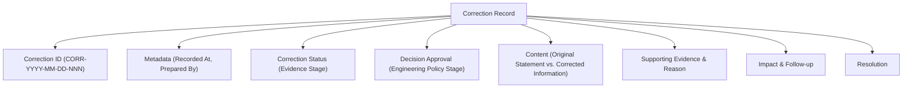

# DVLD Historical Correction Log & Resolution Register

> **Document Role:** Official Record of Historical Corrections and Factual Rectifications  
> **Repository Root:** `D:\DVLD-WPF`  
> **Parent Continuity Suite:** [`PROJECT-CHARTER-AND-CONTINUITY.md`](./PROJECT-CHARTER-AND-CONTINUITY.md)  
> **Governance Rule:** Historical records are governed by a no-silent-rewrite rule; corrections must be appended here. This is not a claim of technical immutability.  

---

## 1. Purpose and Historical Integrity Rule

The **Correction Log** is the authoritative register for recording corrections to past documentation errors, superseded technical claims, inaccurate test reports, or unverified statements identified in historical session logs and governance records.

### The No-Silent-Rewrite Invariant:
1. **No Silent Rewriting:** Session logs (`docs/continuity/SESSION-LOGS/`), baseline audits (`docs/audits/`), and archived phase reports represent point-in-time evidence. They must not be silently rewritten or deleted. This is a governance convention; Git does not make them technically immutable.
2. **Corrections Must Be Formally Appended:** When a previous record is discovered to contain factual errors (e.g., claiming a test ran when it did not, misstating an ADR status, or overstating database guarantees), the error and its verified correction must be logged in this document.
3. **Cross-Referencing Required:** When a correction is recorded, the affected document should reference this log by `Correction ID` (e.g., `CORR-YYYY-MM-DD-NNN`) rather than erasing its historical text.

---

## 2. Structure and Field Definitions

Every correction entry in this log must strictly capture the following standardized fields:



### 2.1 Distinct Field Vocabularies
To prevent conflation between evidence verification and engineering policy approval, two separate status fields are maintained:

#### A. Correction Status (Evidence & Recording Stage)
- `PROPOSED`: A discrepancy or inaccuracy has been reported but supporting evidence has not yet been verified.
- `EVIDENCE VERIFIED`: Concrete repository or runtime evidence has confirmed the error and verified the accurate factual state.
- `RECORDED`: The correction has been formally documented in this register and referenced in continuity tracking.
- `CLOSED`: All required documentation updates and follow-ups resulting from the correction are complete.

#### B. Decision Approval (Engineering Policy Stage)
- `NOT REQUIRED`: The correction rectifies a factual or typographical error and does not introduce or alter an engineering decision.
- `REQUIRED`: The correction reveals an architectural gap or policy ambiguity that requires formal human Project Owner approval (e.g., in `ENGINEERING-DECISIONS.md`).
- `PENDING`: A decision approval has been submitted to the Project Owner and is awaiting formal ratification.

> [!IMPORTANT]
> **Separation of Evidence from Policy Approval:**  
> Verifying that a historical statement was inaccurate (`Correction Status: EVIDENCE VERIFIED`) does **NOT** independently approve a new engineering decision or policy. If an engineering policy change is required, it must remain `Decision Approval: PENDING` until explicitly approved by the Project Owner.

---

## 3. Standard Correction Record Template

```markdown
### [CORR-YYYY-MM-DD-NNN] <Descriptive Title of Correction>
- **Correction ID:** `CORR-YYYY-MM-DD-NNN`
- **Recorded At:** `YYYY-MM-DDTHH:MM:SS+OFFSET`
- **Prepared By:** `<Human Engineer or AI Agent Role>`
- **Correction Status:** `PROPOSED` | `EVIDENCE VERIFIED` | `RECORDED` | `CLOSED`
- **Decision Approval:** `NOT REQUIRED` | `REQUIRED` | `PENDING`
- **Original Record:** `<File path, session log ID, or document reference>`
- **Original Statement:**
  > "<Exact quote or description of the inaccurate historical claim>"
- **Corrected Information:**
  "<Accurate factual statement backed by evidence>"
- **Supporting Evidence:** `<File reference, commit hash, or static code evidence>`
- **Reason for Correction:** `<Explanation of why the previous statement was inaccurate>`
- **Impact Assessment:** `<Evaluation of whether this affects architecture, safety, or roadmap>`
- **Required Follow-up:** `<Documentation updates, ADR creation, or user review needed>`
- **Resolution:** `<Summary of how the discrepancy was resolved or what remains pending>`
```

---

## 4. Correction History Register

| Correction ID | Recorded At | Affected Document | Summary of Correction | Correction Status | Decision Approval | Resolution |
|---|---|---|---|---|---|---|
| *(No historical corrections logged yet — initial clean register)* | — | — | — | — | — | — |

