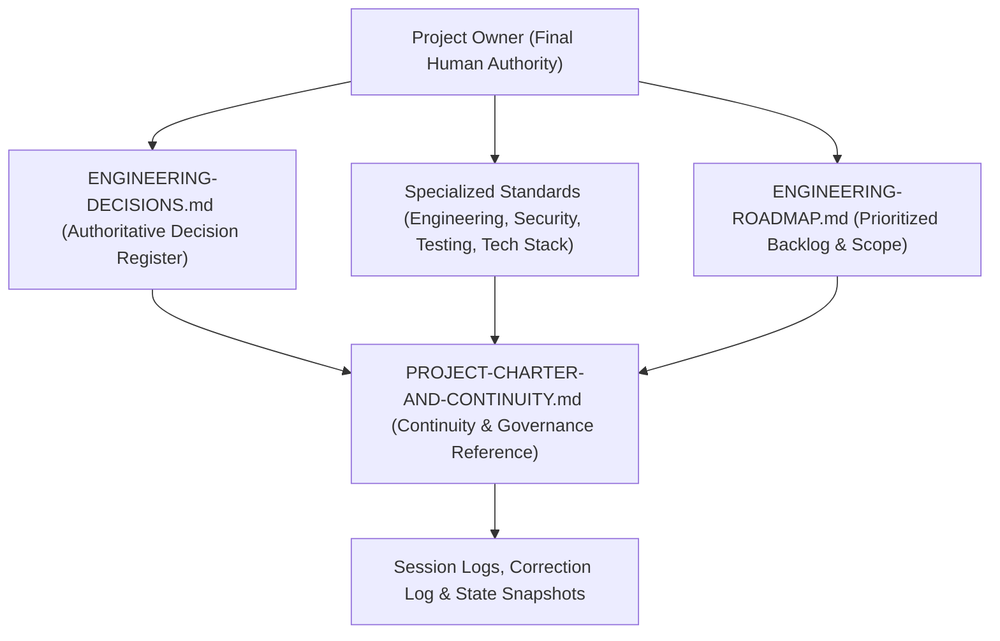
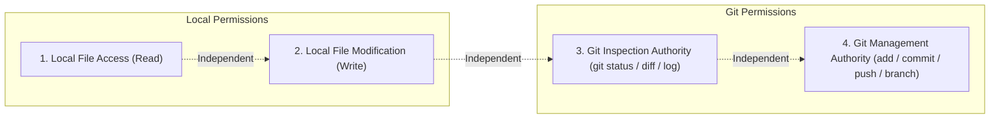

# DVLD Project Charter & Continuity Governance

> **Project Name:** Driver & Vehicle Licensing Department (DVLD) Management System  
> **Repository Root:** `D:\DVLD-WPF`  
> **Document Role:** Authoritative Continuity Framework & Operating Charter  
> **Parent Governance Suite:** [`AGENTS.md`](../../AGENTS.md), [`AI-ENGINEERING-INSTRUCTIONS.md`](../../AI-ENGINEERING-INSTRUCTIONS.md), [`ENGINEERING-DECISIONS.md`](../../ENGINEERING-DECISIONS.md), [`ENGINEERING-ROADMAP.md`](../../ENGINEERING-ROADMAP.md)  
> **Governance Status:** ACTIVE & ENFORCED  
> **Version:** 1.0.0  
> **Effective Date:** 2026-11-08  

---

## 1. Mission and Continuity Framework

This Project Charter and Continuity Governance document establishes the operating authority, decision vocabulary, evidence standards, session logging obligations, and safety boundaries for all human engineers and AI coding assistants collaborating within the DVLD repository.

The objective of this continuity framework is to ensure seamless, evidence-driven engineering across multiple development sessions and AI invocations, preventing:
1. Hallucinated verification and false completion claims.
2. Silent drift or unauthorized alteration of approved architecture and security policies.
3. Conflation of local project file access with Git state management or commit/push authority.
4. Conflation of documentation preparation duties with repository write authorization.
5. Inadvertent damage to protected operational databases (`DVLDf`) or frozen client codebases (`Presentation (WPF)/`).

---

## 2. Authority Model

The DVLD engineering repository operates under a strict, hierarchical authority model:

### 2.1 Final Decision Authority
- The **Project Owner** is the supreme authority for all project approvals, phase authorizations, policy changes, scope adjustments, and conflict resolutions.
- No AI assistant or pair-programming agent may self-authorize implementation phases, database modifications, dependency upgrades, or policy relaxations.

### 2.2 Domain Authority Boundaries
- [`ENGINEERING-DECISIONS.md`](../../ENGINEERING-DECISIONS.md) is the **exclusive authoritative register** for architectural, security, and domain policy decisions.
- Specialized standards documents remain authoritative within their specific technical domains:
  - [`ENGINEERING-STANDARDS.md`](../../ENGINEERING-STANDARDS.md): Layering, persistence patterns, UnitOfWork, API design.
  - [`SECURITY-STANDARDS.md`](../../SECURITY-STANDARDS.md): Authentication, RBAC, Segregation of Duties (SoD), file upload security.
  - [`TESTING-STANDARDS.md`](../../TESTING-STANDARDS.md): Test isolation, LocalDB/SQL Server lifecycle, test data isolation.
  - [`TECHNOLOGY-STACK.md`](../../TECHNOLOGY-STACK.md): Verified technology inventory, versions, dependency gaps.
- This Charter serves as an operational governance and continuity reference. It does **not** override, replace, or establish independent engineering decisions.
- **Document recency alone does not establish authority:** A newer working document or session report cannot supersede an accepted decision in `ENGINEERING-DECISIONS.md` unless formally recorded and approved by the Project Owner.

---

## 3. Decision Status Vocabulary

All technical topics, work items, and proposals across the repository must strictly use the standardized decision vocabulary:

| Status Vocabulary | Operational Definition & Invariant Rules |
|---|---|
| `IMPLEMENTED` | Code, tests, and configurations are fully committed in the repository and verified passing. |
| `APPROVED` | Formally selected and ratified by the Project Owner in `ENGINEERING-DECISIONS.md`. |
| `APPROVED DESIGN` | Conceptual architecture or design parameters are accepted, but implementation is **NOT** authorized without a distinct phase authorization. |
| `PLANNED` | Scoped and prioritized on the roadmap backlog for a future phase; execution is **NOT** authorized. |
| `PROPOSED` | Under review or consideration; no formal acceptance or authorization granted. |
| `PROVISIONAL` | Provisionally selected direction pending external policy verification, empirical validation, or business sign-off. |
| `NEEDS VALIDATION` | Theoretical or plausible approach requiring empirical runtime proof or profiling before approval. |
| `NOT AUTHORIZED` | Explicitly prohibited from execution during the active phase. |
| `PROHIBITED` | Strictly forbidden by safety gates or governance (e.g., modifying `DVLDf`, editing WPF). |
| `SUPERSEDED` | Replaced by a subsequent formally approved decision or corrected architecture. |
| `CLOSED` | Formally concluded or rejected; not open for implementation. |

> [!IMPORTANT]
> **Approved Design vs. Implementation Authorization:**  
> An `APPROVED DESIGN` (such as the SEC-05 token lifetime model) confirms architectural consensus on design parameters, but does **NOT** grant authorization to modify source code, alter schemas, or execute database migrations.

---

## 4. AI Operating Authority and Boundaries

AI coding assistants operate strictly within defined authorization boundaries:

### 4.1 Autonomous Analysis vs. Explicit Authorization
- **Autonomous Analysis Permitted:** Reading repository files, tracing code execution, performing static analysis, identifying root causes, and drafting proposed plans.
- **Explicit Human Authorization Required:**
  1. Modifying any repository file (source code, tests, documentation, configurations).
  2. Executing shell commands that mutate files or launch background processes.
  3. Running builds, unit tests, integration tests, or linters.
  4. Executing Git commands (inspection, state modification, commit, push).
  5. Any interaction with relational database instances.

### 4.2 Bounded Authorization Framework
When the Project Owner grants authorization, it is strictly bounded by:
- **Objective:** The precise problem to be solved.
- **Paths:** Explicit list of authorized files or directories.
- **Operation Types:** Read, Create, Edit, or Verify.
- **Permitted Tools:** Explicit set of allowed IDE or CLI capabilities.
- **Exclusions:** Explicitly prohibited areas (e.g., WPF, `DVLDf`).

### 4.3 Stop-on-Risk Protocol
An AI assistant must immediately halt execution and request user guidance if:
- An unanticipated conflict arises with existing user modifications.
- An action would cause data loss, file overwrite, or schema corruption.
- An unauthorized file modification would be required to proceed.
- An undocumented security or architectural side effect is discovered.
- **Technical capability does not imply permission:** The ability to execute a tool or edit a file never substitutes for explicit authorization.

---

## 5.8 Local Repository Access vs. Git Authority

To prevent accidental repository mutation or unintended Git history modifications, permissions are strictly partitioned into independent categories:

### 5.8.1 Local Project File Access (Read & Write)
- Refers to reading, creating, or editing files on the local filesystem (`D:\DVLD-WPF`).
- Local file modification authority applies strictly to the specified target paths and never authorizes Git operations.

### 5.8.2 Git Inspection Authority
- Refers to non-destructive inspection of repository state (`git status`, `git diff`, `git log`, `git branch`).
- Requires separate authorization. When Git inspection is prohibited, AI assistants must rely solely on filesystem tools.

### 5.8.3 Git Management Authority
- Refers to altering Git index, staging, branching, or remote references (`git add`, `git commit`, `git push`, `git reset`, `git checkout`).
- **Strictly Prohibited without explicit, separate human authorization.**

### 5.8.4 Separation of Permissions
- Authorizing local file creation or editing does **NOT** grant Git inspection authority.
- Authorizing Git inspection does **NOT** grant commit, push, or branch authority.
- Commit and push operations always require independent, explicit authorization.

---

## 6. Documentation Obligation vs. Repository Write Authorization

A fundamental governance rule governs all session logging and continuity documentation:

> **The obligation to prepare a session record does not grant permission to create or modify repository files.**

1. **In-Conversation Session Preparation:** If an AI assistant completes a significant engineering turn but lacks repository write authorization, it **must** prepare the complete session log within the conversation response.
2. **Persistence Status Tracking:** The assistant must mark the record with `Record Status: PREPARED IN CONVERSATION` and clearly indicate that repository persistence is pending user approval.
3. **No Silent Omission:** Failure to obtain repository write authorization must never result in omitting documentation.
4. **Application to Charter & Templates:** Creating or updating governance documents, templates, or logs requires explicit authorization for the exact target paths.

---

## 7. Continuity and Evidence Integrity

Project continuity relies on accurate, evidence-backed historical records governed by traceability and no-silent-rewrite controls:

### 7.1 Current Project State as a Snapshot
- [`snapshots/CURRENT-PROJECT-STATE-2026-11-08.md`](./snapshots/CURRENT-PROJECT-STATE-2026-11-08.md) represents a **point-in-time dated snapshot**, not a real-time reflection of the repository.
- Changes to the repository do not automatically mutate the snapshot until an authorized state update is performed.

### 7.2 Session Log Governance
- **Significant Engineering Sessions:** Every session involving file modifications, architectural evaluations, root-cause analyses, security reviews, or decision formulating requires an independent session log in `docs/continuity/SESSION-LOGS/`.
- **Zero-Change Significant Sessions:** Sessions that evaluate architecture or perform deep research require a log even if no code was changed, no tests were run, or no final decision was reached.
- **Minor Learning Sessions:** Lightweight conversational queries or routine clarifications that do not materially impact project continuity do not require independent log files.
- **No Silent Rewriting:** Persisted historical session logs must not be silently rewritten or deleted. This is a governance rule, not a claim of technical immutability; corrections are appended to the Correction Log.
- **Correction Log Mandatory:** Factual errors or superseded historical claims must be formally documented in [`CORRECTION-LOG.md`](./CORRECTION-LOG.md).

### 7.3 Evidence Confidence Levels
All technical assertions in continuity records must carry explicit confidence labels:
- `VERIFIED`: Confirmed within the explicitly stated verification scope by direct evidence, such as captured runtime execution, test output, or static code inspection. A documentation-only review verifies only the documented content, not runtime behavior.
- `REPORTED`: Sourced from previous documentation or external review, but not independently re-verified in the current session.
- `INFERRED`: Derived logically from architecture patterns or indirect evidence; requires empirical confirmation.
- `PENDING`: Unverified assumption or open investigation item awaiting test/runtime proof.
- `SUPERSEDED`: Previously documented claim confirmed to be inaccurate or replaced.

---

## 8. Current Project Decisions and Invariants

All continuity records must maintain strict consistency with the following accepted and provisional decisions:

### 8.1 Segregation of Duties (`ADR-O01`)
- **Status:** `APPROVED — Model B (Explicit Permission Separation)` (Decision Date: 2026-11-08).
- Admin users do not automatically inherit Staff operational counter permissions.
- Staff counter users do not receive administrative system management rights.
- Authorization policy `StaffOnly` remains enforced on licensing counter endpoints.

### 8.2 Detained License Replacement Policy (`ADR-O02`)
- **Status:** `PROVISIONALLY SELECTED — OFFICIAL POLICY VERIFICATION REQUIRED` (Provisional Date: 2026-11-08).
- Internal project simulation rule: A driving license with an active detention must not be replaced until released.
- **Crucial Boundaries:**
  - This is an internal simulation rule, **not** a confirmed legal requirement or verified official Jordanian government procedure. Official policy verification remains required.
  - Lost-license and damaged-license replacement workflows must **not** be assumed to have identical requirements.
  - Technical questions regarding `LicenseId` vs `DriverId` binding and historical relationship preservation remain unresolved.
  - Implementation remains strictly **NOT AUTHORIZED**.

### 8.3 Refresh Token & Multi-Session Architecture (`SEC-05`)
SEC-05 remains a **design-only workstream**. The following records distinguish selected design direction from proposals; none grants implementation authorization:

| Parameter | Current Design Status | Governance Boundary |
|---|---|---|
| Independent sessions per user | `SELECTED DESIGN DIRECTION` | Multiple independent sessions are intended; implementation remains unauthorized. |
| Refresh token idle lifetime | `SELECTED DESIGN DIRECTION — 7 DAYS` | Design direction only; implementation remains unauthorized. |
| Access token lifetime | `PROPOSED — 15 MINUTES` | Not separately approved. |
| Absolute session lifetime | `PROPOSED — 30 DAYS` | Not approved. |
| Refresh token transport | `PROPOSED — HttpOnly Cookie` | Cookie details remain subject to final design review. |
| Cookie attributes | `PROPOSED` | Secure, SameSite, Path and deployment details are not treated as finalized implementation settings. |
| CSRF protection and Origin validation | `REQUIRED SECURITY CONCERNS — MECHANISM UNSELECTED` | Custom headers, anti-CSRF tokens, Origin/Referer rules and rejection behavior remain candidate mechanisms, not approved implementation details. |
| Business audit persistence | `ARCHITECTURAL REQUIREMENT` | Sensitive successful business mutations requiring audit must be committed atomically with the business transaction. Specific table names and code paths are not approved here. |

**Explicitly Unresolved SEC-05 Decisions:**
- *Successor Token Recovery:* Option A (Durable SQL recovery record) vs. Option C (No successor recovery; re-authentication on dropped response) remains **UNSELECTED**.
- *Reuse Handling Policy:* Policy 1 (Session revocation after recovery boundary) vs. Policy 2 (Ordinary 401 rejection without automatic revocation) remains **UNDECIDED**.
- *Operational Recovery Duration ($T_{\text{recovery}}$):* Neither 15 seconds nor 30 seconds is approved. Final duration is **UNDECIDED — REQUIRES EXPLICIT USER APPROVAL**.
- *Physical Retention & Cleanup:* Recovery record ineligibility is distinct from physical record deletion. Cleanup timing, retention duration, scheduling, and pruning strategies remain **UNRESOLVED**.
- *Detailed Concurrency & Transport Schemes:* Detailed CSRF and Origin validation mechanisms remain proposed.

### 8.4 Logging Architecture Boundaries
The system strictly partitions logging into three distinct operational domains:

1. **Transactional Business Audit Logs (`AUD-01`):**
   - Captures successful sensitive business mutations requiring an audit record.
   - The audit record must be committed atomically within the same database transaction as the corresponding business operation.
   - The final table/schema and application implementation path remain to be designed and approved; this charter does not select `AuditLogs` or a specific Unit of Work method.
2. **Security Event Telemetry (`SEC-04`):**
   - Emits structured security events (login failures, reuse detections, session terminations).
   - Operates outside the business SQL transaction to guarantee failed auth attempts are logged even when no business transaction exists.
3. **Diagnostic & Application Logs (`OBS-03`):**
   - High-throughput operational logs via Serilog file sinks (`logs/dvld-.json`).
   - Diagnostic files do not replace committed SQL Server audit records. They are not guaranteed durable upon catastrophic process crashes or disk failures.

### 8.5 Phase Authorization Invariants
- **Phase 12.2:** `PROPOSED / NOT AUTHORIZED`
- **Phase 12.3:** `PLANNED / NOT AUTHORIZED`
- **Phase 12.4:** `PLANNED / NOT AUTHORIZED`
- *Governance Rule:* Inclusion in the engineering roadmap or backlog does not constitute authorization. Each phase requires separate explicit human authorization.

---

## 9. Protected Repository Boundaries

### 9.1 Local/Production Database Protection (`DVLDf`)
- Under **NO CIRCUMSTANCES** may any script, command, migration, or test connect to, query, modify, truncate, or drop the development/production database `DVLDf`.
- Integration tests must strictly run against dynamic ephemeral test databases named `DVLD_IntegrationTests_<GUID>` under `DVLD_TEST_CONNECTION`.

### 9.2 Frozen Codebases (`Presentation (WPF)/`)
- The legacy WPF desktop client located in `Presentation (WPF)/` is **frozen** and explicitly out of scope.
- No AI assistant may audit, refactor, or modify WPF code unless explicitly instructed in writing by the Project Owner.

---

## 10. Foundational Engineering Discovery References

The DVLD repository permanently maintains two foundational engineering discovery reports authored during the initial architectural baseline discovery on 2026-11-08:

1. [`docs/audits/phase-a-repository-discovery.md`](../audits/phase-a-repository-discovery.md): Initial deep repository discovery covering solution architecture, technology inventory, business workflow maps, execution paths, and security posture.
2. [`docs/audits/phase-a-supplementary-review.md`](../audits/phase-a-supplementary-review.md): Supplementary deep discovery providing 11 detailed workflow analyses, UnitOfWork and transaction analysis, SQL Server locking and concurrency analysis, and reconciled findings.

### 10.1 Classification and Invariants
- **Classification:** `KEEP — FOUNDATIONAL HISTORICAL ENGINEERING EVIDENCE`.
- **Baseline Commit:** `29e43d6ce26ff6e7f516c45f4f475b10bdc2bfd3` (`main`).
- **Date of Discovery:** `2026-11-08`.
- **Evidentiary Limitations:** Both reports reflect a static code analysis conducted at the baseline commit. They do not reflect subsequent phase remediations and must **never** be cited as real-time guarantees of current codebase state.
- **Evidentiary Weight:** Observations in these reports constitute historical evidence. They must not be converted into approved business rules or architectural decisions without separate policy sign-off and current source verification.

### 10.2 Mandatory Scoped Consultation Rule
All future AI coding assistants, system architects, and pair-programming agents **must consult these foundational reports** if and only if their assigned task materially involves:
- System architecture or cross-layer dependency boundaries.
- Database transactions, UnitOfWork mechanics, or SQL Server concurrency/locking behavior.
- Core domain licensing workflows (e.g., LDL application submission, 3-tier test sequencing, first-time license issuance, renewals, replacements, or detentions).
- Cross-cutting security, JWT authentication lifecycles, or file upload storage mechanics.
- Test suite architecture or ephemeral test database provisioning.

*Note:* Consultation is not required for isolated styling, typographical, or documentation metadata adjustments. Consultation does not grant authority to modify repository files, run tests, or access databases.

---

## 11. Modernization Development & Domain Documentation Structure

Active domain specifications and preserved historical planning reside across specialized documentation directories:

- [`LICENSING-DOMAIN-SPECIFICATION.md`](../domain/LICENSING-DOMAIN-SPECIFICATION.md) — Authoritative domain business constraints, Local Driving License lifecycle, 3-tier sequential exam prerequisites, and post-issuance workflows.
- [`docs/archive/historical-planning/`](../archive/historical-planning/) — Preserved original development plan, modernization vision, target architecture draft, and scoped blocker register.
- [`docs/archive/security-sources/`](../archive/security-sources/) — Preserved historical Security Master Plan and Security Implementation Readiness Assessment.
