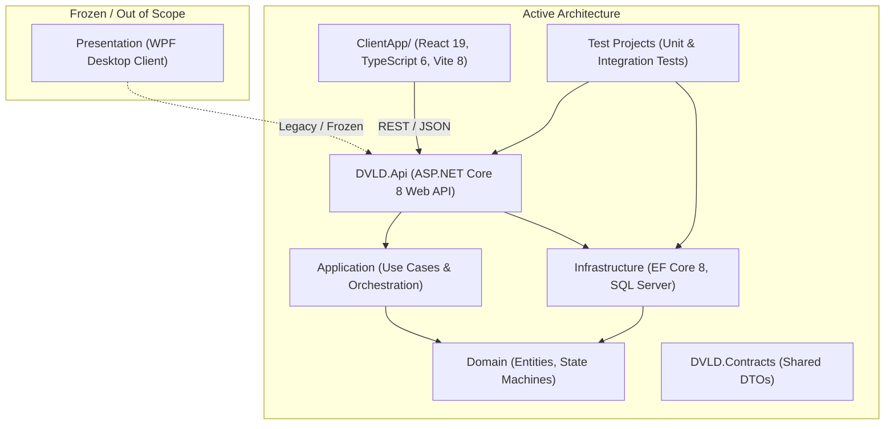

# DVLD Current Project State Snapshot

> **Snapshot ID:** `SNAPSHOT-2026-11-08-001`  
> **Supersedes Snapshot:** `None — Initial Baseline Snapshot`  
> **Last Updated:** `2026-11-08T15:15:00+03:00`  
> **Project Identity:** Driver & Vehicle Licensing Department (DVLD) Management System  
> **Repository Root:** `D:\DVLD-WPF`  
> **Document Status:** `DRAFT — PENDING PROJECT OWNER REVIEW`  
> **Repository Persistence Status:** `PERSISTED IN REPOSITORY`  

---

## 1. Verification Overview & Baseline Constraints

This document provides a point-in-time snapshot of the DVLD project state, governance agreements, active priorities, and safety constraints.

> [!WARNING]
> **Snapshot Verification Boundaries (Read Carefully):**
> - **Git State Uninspected:** In strict compliance with the Project Owner's instructions, **zero Git commands** were executed during the creation of this snapshot. The current Git branch, HEAD commit, and working-tree status were not inspected in this turn.
> - **No Runtime or Build Verification:** No backend or frontend builds, unit tests, integration tests, or linters were executed.
> - **No Database Inspection:** No database connections to LocalDB or SQL Server were opened; `DVLDf` remains strictly uninspected and protected.
> - **Evidence Origin:** Information regarding existing code structure and previous audit results is labeled `REPORTED` based on existing repository governance documents (`docs/audits/`, `ENGINEERING-ROADMAP.md`, `ENGINEERING-DECISIONS.md`). Current empirical verification of all items remains `PENDING` until authorized.

### 1.3 Foundational Engineering Discovery References
This repository maintains two permanent, code-verified discovery reports in `docs/audits/`:
- [`docs/audits/phase-a-repository-discovery.md`](../../audits/phase-a-repository-discovery.md) (Baseline commit `29e43d6ce26ff6e7f516c45f4f475b10bdc2bfd3`, dated 2026-11-08).
- [`docs/audits/phase-a-supplementary-review.md`](../../audits/phase-a-supplementary-review.md) (Baseline commit `29e43d6ce26ff6e7f516c45f4f475b10bdc2bfd3`, dated 2026-11-08).

*Evidentiary Boundary:* Both reports reflect static code analysis of the pre-remediation baseline. They serve as foundational historical evidence, not current source-of-truth guarantees of active runtime state.

---

## 2. Architecture and Technology Context

The active codebase comprises an ASP.NET Core 8 Web API backend and a modern React 19 frontend:

- **Backend (.NET 8):** Clean / Onion architecture with strict boundary enforcement. `Domain` and `Application` maintain no dependencies on `Infrastructure`. Persistence is handled via Entity Framework Core 8 and UnitOfWork.
- **Frontend (React 19):** Single Page Application located in `ClientApp/` using TypeScript, Tailwind CSS, and Vite.
- **Frozen Legacy Client:** The desktop client in `Presentation (WPF)/` is completely frozen and out of scope.

---

## 3. Documented Completed Work & Milestones

The following milestones are recorded from the cited documentation. Confidence labels describe the evidence available for this snapshot; they do not imply live runtime or repository verification:

| Milestone / Deliverable | Status | Confidence | Evidence Reference |
|---|---|---|---|
| **Phase A Discovery Audit** | Completed | `REPORTED` | `docs/audits/phase-a-repository-discovery.md` |
| **Phase A.1 Supplementary Review** | Completed | `REPORTED` | `docs/audits/phase-a-supplementary-review.md` |
| **Phase B Governance Suite** | Completed | `REPORTED` | Root governance markdown suite (`AGENTS.md`, etc.) |
| **ADR-O01 Policy Ratification** | `APPROVED` | `VERIFIED` | `ENGINEERING-DECISIONS.md#ADR-O01` (Model B) |
| **ADR-O02 Provisional Direction** | `PROVISIONAL` | `VERIFIED` | `ENGINEERING-DECISIONS.md#ADR-O02` (Pending verification) |
| **SEC-05 Design Workstream** | `DESIGN ONLY — DECISIONS PARTLY UNRESOLVED` | `REPORTED` | `ENGINEERING-ROADMAP.md#SEC-05` |

---

## 4. Active Workstreams & Backlog Priorities

Current engineering activity is focused on governance finalization and preparation for future implementation phases:

- **Recent Governance Deliverable:** Initial DVLD Project Continuity documentation suite created under `docs/continuity/`; content is pending Project Owner review and acceptance.
- **Roadmap Priorities (from [`ENGINEERING-ROADMAP.md`](../../../ENGINEERING-ROADMAP.md)):**
  - **P0 Critical Integrity:** `INT-01` (Direct Application Complete Endpoint remediation).
  - **P1 Provisional Performance:** `PERF-01` (Sequential N+1 query in `LicenseQueryService`), `INT-02` (Persistence violation handling in `UserService`).
  - **P2 Reliability & Observability:** `OBS-01` (Health checks), `OBS-03` (Structured Serilog logging), `SEC-04` (Security telemetry), `AUD-01` (Transactional SQL audit logging), `SEC-05` (Refresh token rotation), `FE-01` (React silent refresh coordination), `TEST-02` (Integration test suite), `INT-03` (Detained license check).
  - **P3 Architecture & CI:** `ARCH-01` (DTO consolidation), `SEC-03` (Password rate limiting), `OBS-02` (CI test publishing).

---

## 5. Architectural Decisions and Policy Invariants

### 5.1 Segregation of Duties (`ADR-O01`)
- **Status:** `APPROVED — Model B (Explicit Permission Separation)`.
- Administrators maintain system configuration rights but cannot execute counter actions (`StaffOnly` remains enforced).
- Staff counter operators cannot perform administrative user management.

### 5.2 Detained License Replacement Policy (`ADR-O02`)
- **Status:** `PROVISIONALLY SELECTED — OFFICIAL POLICY VERIFICATION REQUIRED`.
- Proposed Business Rule: A driving license with an active detention must not be replaced until released.
- Critical Clarification: This is an internal project simulation rule, not a verified legal mandate of Jordanian law or official procedure. Lost-license and damaged-license workflows must not be assumed identical. Implementation remains unauthorized.

### 5.3 Refresh Token & Multi-Session Architecture (`SEC-05`)
- **Design-only direction:** Multiple independent sessions per user and a 7-day refresh-token idle lifetime are selected design directions; implementation is not authorized.
- **Unapproved proposals:** 15-minute access-token lifetime and 30-day absolute session lifetime remain proposals, not approved parameters.
- **Transport/security proposals:** HttpOnly refresh cookie, cookie attributes, deployment transport, CSRF and Origin-validation mechanisms remain subject to final design approval.
- **Business audit requirement:** Where required for sensitive successful business mutations, audit persistence must be atomic with the business transaction; schema and implementation details remain to be designed.
- **Unresolved SEC-05 Decisions:**
  - Option A (Durable SQL recovery) vs. Option C (No successor recovery; re-authentication on dropped response) remains **UNSELECTED**.
  - Policy 1 (Revocation after recovery boundary) vs. Policy 2 (Ordinary 401 rejection without automatic revocation) remains **UNDECIDED**.
  - Final operational recovery duration ($T_{\text{recovery}}$): Neither 15s nor 30s is approved. Duration is **UNDECIDED — REQUIRES EXPLICIT USER APPROVAL**.
  - Recovery eligibility expiration is distinct from physical record retention. Cleanup timing, retention duration, and deletion strategy remain **UNRESOLVED**.

### 5.4 Logging Separation
- **Business Audit Logs (`AUD-01`):** Committed in SQL Server within the business transaction; rolls back if the business operation aborts.
- **Security Event Telemetry (`SEC-04`):** Captures auth failures and reuse events independently out-of-band.
- **Diagnostic Logs (`OBS-03`):** High-throughput Serilog file sinks; not a substitute for committed SQL audit records.

---

## 6. Authorization Boundaries & Phase Statuses

| Phase | Scope Summary | Documented Status | Authorization Prerequisite |
|---|---|---|---|
| **Phase 12.2** | P0 & P1 Remediation (`INT-01`, `INT-02`, `PERF-01`) | **PROPOSED / NOT AUTHORIZED** | Explicit Project Owner review and authorization of Phase 12.2 scope. |
| **Phase 12.3** | P2 Observability & Audit (`OBS-01`, `OBS-03`, `AUD-01`, `INT-03`) | **PLANNED / NOT AUTHORIZED** | Phase 12.2 completion; NuGet & DB migration approvals; ADR-O02 policy verification. |
| **Phase 12.4** | Session Management & Frontend (`SEC-05`, `FE-01`, `TEST-02`) | **PLANNED / NOT AUTHORIZED** | Phase 12.3 completion; DB migration approval for session/token tables. |

> [!CAUTION]
> **Governance Rule:** Inclusion on the roadmap does not grant authorization to implement work items. Every phase requires separate explicit human authorization before execution.

---

## 7. Risks, Blockers, and Constraints

1. **Production Database Safety (`DVLDf`):** Direct connections, queries, schema changes, or test executions against `DVLDf` are strictly forbidden.
2. **ADR-O02 Policy Verification Blocker:** Phase 12.3 cannot implement `INT-03` without human confirmation of official licensing department policy regarding active detentions during license replacements.
3. **Cryptographic Suite Selection (SEC-05):** ASP.NET Core Data Protection is a proposed direction only. No cipher (such as AES-256-GCM) has been approved or benchmarked.
4. **Frozen WPF Scope:** The WPF client remains completely frozen and out of scope.

---

## 8. Recommended Next Steps

1. **Project Owner Review of Continuity Suite:** Review and accept or request corrections to the draft continuity documentation in `docs/continuity/`.
2. **Phase 12.2 Review and Authorization Decision:** Review the scoped remediation plan for P0/P1 items (`INT-01`, `INT-02`, `PERF-01`) to determine whether to authorize Phase 12.2 implementation.

---

## 9. Snapshot Limitations and Integrity

- **Snapshot Author:** AI Assistant under explicit Project Owner authorization.
- **Verification Confidence:** Static review of the supplied governance documentation only. Repository/Git state, source implementation, builds, tests, runtime and database state remain unverified or pending as stated above.
- **Integrity Notice:** This snapshot is a dated, point-in-time record. It must not be silently overwritten. Subsequent changes must be recorded in an updated snapshot (e.g., `SNAPSHOT-2026-11-08-002`) with an explicit change log.
